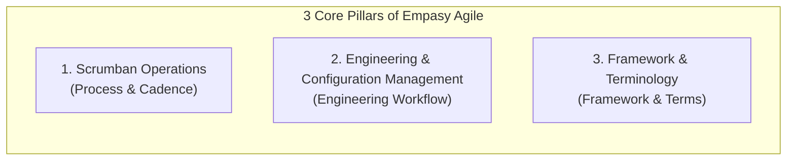
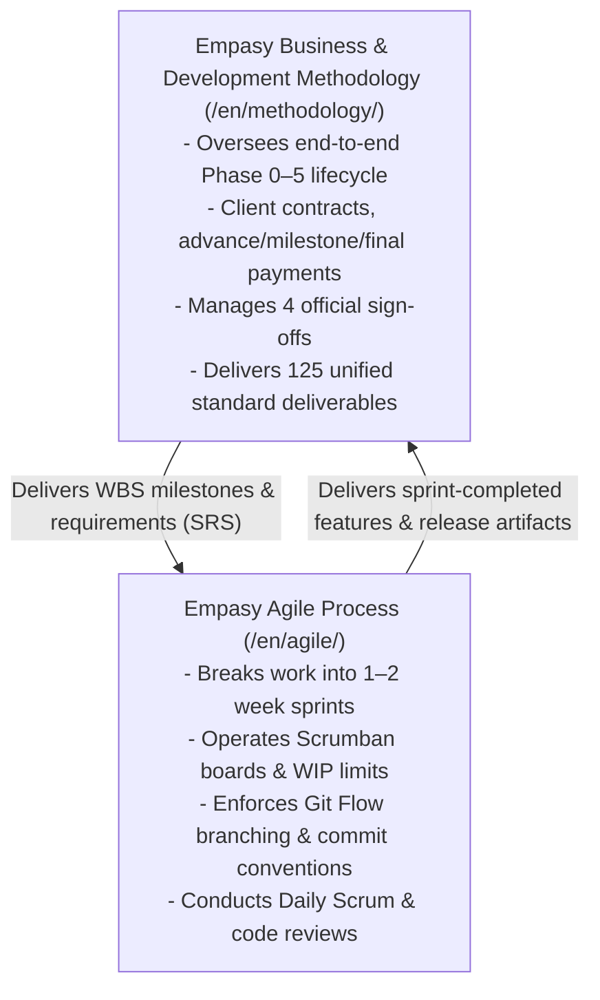

# Empasy Agile Process and Engineering Portal

The **Empasy Agile & Engineering Process** is the **day-to-day software engineering standard and collaboration culture guide** that governs how engineering teams communicate daily, write code, manage configuration, and track issues in project delivery.

This portal breaks down the WBS milestones established in the macro-level business management and delivery framework ([Empasy Business and Development Methodology](/en/methodology/)) into 1–2 week sprints for delivery teams, enabling them to achieve **bottleneck-free workflow (Flow)** and **strict code quality (Quality Gate)**.

---

## 1. Three Core Pillars of Empasy Agile Engineering

### 1) Scrumban Operations Framework
Combines Scrum's planning structure (roles, backlog, retrospectives) with Kanban's flexibility (WIP limits, pull system) to minimize bottlenecks in enterprise environments where urgent operational tasks and new feature development coexist.
* **[Scrumban Hybrid Operations Overview](./scrumban.md)**: Differences between Scrum and Kanban, pull-based execution, board layout
* **[Scrumban Practical Guide](./guide.md)**: Board column setup, criteria for setting WIP (Work in Progress) limits
* **[Regular Activities and Ceremonies](./activity.md)**: Sprint planning, backlog replenishment, sprint review, and retrospective
* **[Daily Scrum Guide](./dailyScrum.md)**: Running a 15-minute stand-up meeting, the three standard questions
* **[Story Point Estimation Guide](./storyPointGuide.md)**: Fibonacci-based effort estimation and planning poker
* **[Sprint Operations Checklist](./checklistAndProcedure.md)**: Essential pre-sprint and post-sprint verification checklists

---

### 2) Engineering & Configuration Management Workflow
All engineers follow consistent branching strategies, commit conventions, and issue lifecycles to maximize code traceability and maintainability.
* **[Git Flow Branching Strategy](./gitFlow.md)**: Standard operating rules for `main`, `develop`, `feature/*`, `release/*`, and `hotfix/*`
* **[Git Commit Log Convention](./gitCommitLog.md)**: Standards for `feat:`, `fix:`, `docs:`, `refactor:`, `test:`, and `chore:` prefixes and commit message bodies
* **[Issue Creation Rules and Templates](./createIssue.md)**: Templates and labeling rules for bug reports, new features, and work tasks
* **[Issue Lifecycle Management Principles](./PrinciplesForIssueUsage.md)**: State transition rules for Todo -> In Progress -> Review -> Done

---

### 3) Framework Comparison and Standard Glossary
* **[Methodology Comparison Analysis (XP vs Scrum vs Kanban)](./xp_scrum_kanban.md)**: Detailed comparison of Extreme Programming, Scrum, Kanban, and Scrumban, along with best-fit project types
* **[Agile and Engineering Glossary](./glossaryOfTerms.md)**: Essential terms including Burndown Chart, WIP, Velocity, Definition of Ready (DoR), and Definition of Done (DoD)

---

## 2. Integration with Macro-Level Business Methodology

Empasy's software ecosystem operates through tight synchronization between **macro-level business management** and **micro-level Agile execution**.

* **Contracting & awards, 4 official sign-offs, 125 official deliverables, and AI-SDLC**: See the **[Empasy Business and Development Methodology Portal](/en/methodology/)**.
* **Daily engineering collaboration, source control, and sprint operations**: Follow this **Agile Process** guide.
