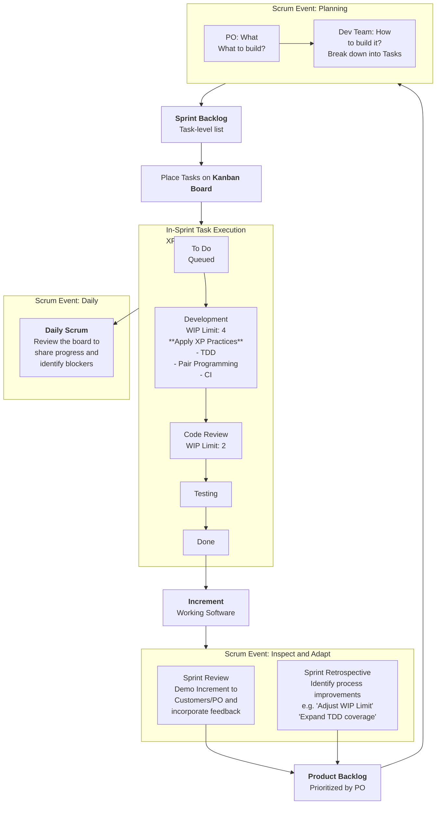

## XP, Scrum, and Kanban Integration Guide: Comparing Agile Development Methodologies and Practical Adoption Strategies

### Introduction: The Essence and Evolution of Agile

True to the meaning of "agile," Agile is a collection of software development philosophies and frameworks designed to respond rapidly to changing requirements and continuously deliver value. Published in 2001, the Manifesto for Agile Software Development values **individuals and interactions** over processes and tools, **working software** over comprehensive documentation, **customer collaboration** over contract negotiation, and **responding to change** over following a plan.

This guide compares and analyzes three representative methodologies that put Agile into practice—eXtreme Programming (XP), Scrum, and Kanban—explains how they relate to one another, and presents a practical approach to combining them into an integrated workflow.

---

### 1. Comparing XP, Scrum, and Kanban

#### **1.1 eXtreme Programming (XP) — Engineering Practices**

XP is a **development framework** focused on improving software quality and maximizing a development team's productivity and responsiveness. Its core objective is to respond effectively to rapidly changing customer requirements.

- **Philosophy:** "If something is good, doing it to the extreme is even better."
- **Scope:** Primarily deeply involved in the software **code development phase**.
- **Cadence:** Development proceeds in short cycles called **Iterations** (typically 1–2 weeks).
- **Core Practices:**
- **Pair Programming:** Two developers work together at a single workstation, reviewing code in real time and sharing knowledge.
- **Test-Driven Development (TDD):** Write a **failing test first** for the code to be implemented, then write the minimum amount of code required to pass that test. Repeating this cycle increases code reliability.
- **Continuous Integration (CI):** Integrate code into the main repository multiple times a day and run automated tests to catch issues early.
- **Refactoring:** Improve the internal structure of code without altering its external behavior, increasing readability and maintainability.
- **Simple Design:** Design the simplest system that satisfies the current requirements.
- **Collective Code Ownership:** Any team member can modify any part of the system.
- **On-Site Customer:** A customer representative is co-located with the development team or readily accessible at all times.

- **Pros:** High code quality, fewer defects, minimized technical debt, reduced fear of change.
- **Cons:** Steep learning curve and high focus required to adopt practices, potential resistance to pair programming, difficulty securing an on-site customer.

#### **1.2 Scrum — Project Management Framework**

Scrum is a **project management framework** for developing and managing complex products. It clearly defines roles, decision-making structures, and events—establishing who does what and when.

- **Philosophy:** Grounded in empiricism, solving complex problems through a cycle of **transparency, inspection, and adaptation**.
- **Scope:** Applied across the overall project **management and collaboration process**.
- **Cadence:** Work proceeds in fixed-length time-boxes called **Sprints** (typically 2–4 weeks).
- **Core Roles:**
  - **Product Owner (PO):** Accountable for maximizing product value; manages and prioritizes requirements in the **Product Backlog**.
  - **Scrum Master (SM):** Coaches the team to follow Scrum effectively and removes impediments. Acts as a **servant leader** rather than a traditional manager.
  - **Development Team:** A cross-functional, self-organizing team that actually builds the product.
- **Core Artifacts:**
  - **Product Backlog:** A prioritized list of all features, enhancements, and fixes needed for the product.
  - **Sprint Backlog:** The Product Backlog items selected for the current sprint along with a plan for delivering them.
  - **Increment:** The "working product" outcome produced at the end of a sprint.
- **Core Events:** (All Time-boxed)

  - **Sprint Planning:** Plan what will be delivered and how the work will be accomplished.
  - **Daily Scrum:** A 15-minute sync to share progress and surface blockers.
  - **Sprint Review:** Demonstrate the Increment to customers/stakeholders and gather feedback.
  - **Sprint Retrospective:** Inspect the team's process and identify actionable improvements.

- **Pros:** Clear roles and responsibilities, regular feedback and adaptation, transparent progress, encourages team self-organization.
- **Cons:** Provides no direct guidance on engineering practices (quality depends on the team); rigidity from prohibiting mid-sprint scope changes (changes must wait until the next sprint).

#### **1.3 Kanban — Continuous Flow Improvement System**

Kanban is a **continuous flow system** that visualizes **workflow** and limits Work In Progress (WIP) to maximize efficiency. It focuses on evolutionary, incremental process improvement.

- **Philosophy:** "Start with what you do now, and pursue continuous improvement through incremental, evolutionary change."
- **Scope:** **Applicable to any process** (development, maintenance, marketing, HR, etc.).
- **Cadence:** **Continuous.** There is no time-box; as soon as one work item is completed, the next item is pulled in.
- **Core Practices:**

  - **Visualize:** Use a **Kanban Board** to make workflow stages and item states (e.g., To Do, In Progress, Done) visible at a glance.
  - **Limit Work In Progress (WIP Limit):** Cap the maximum number of items allowed in each stage (especially "In Progress") simultaneously. This exposes bottlenecks and improves team focus.
  - **Manage Flow:** Observe how items move across the board, measure queues, delays, and bottlenecks, and continuously smooth the flow.
  - **Make Policies Explicit:** Clearly define each workflow stage and the Definition of Done (DoD).
  - **Feedback Loops:** Hold regular operations and delivery review meetings to inspect flow and quality.

- **Pros:** Highly flexible with immediate responsiveness to change, low barrier to adoption, excels at identifying bottlenecks and shortening Cycle Time.
- **Cons:** Without clear roles and deadlines, teams lacking discipline may struggle; harder to establish long-term plans; pace of change can be gradual.

#### **1.4 Comparison Summary Table**

| Attribute         | **eXtreme Programming (XP)**                          | **Scrum**                                       | **Kanban**                                                |
| :---------------- | :---------------------------------------------------- | :---------------------------------------------- | :-------------------------------------------------------- |
| **Essence**       | **Set of engineering practices**                      | **Project management framework**                | **Continuous flow improvement system**                    |
| **Focus**         | Code quality, technical excellence                    | Team collaboration, value delivery, adaptation  | Workflow efficiency, reducing wait time                   |
| **Cadence**       | Iteration (1–2 weeks)                                 | Sprint (2–4 weeks, fixed)                       | Continuous (no time-box)                                  |
| **Change Handling** | Permitted even within an Iteration                  | No changes during a Sprint                      | Anytime (highly flexible)                                 |
| **Roles**         | Coach, Customer, Developers                           | PO, SM, Development Team                        | No specific roles prescribed                              |
| **Core Tools**    | TDD, Pair Programming, CI                             | Sprint Backlog, Burndown Chart                  | **Kanban Board, WIP Limit**                               |
| **Key Metrics**   | Unit test coverage, etc.                              | Sprint Velocity                                 | **Cycle Time, Throughput**                                |
| **Best Fit**      | Rapidly changing requirements, high quality demands   | Clear goals and rapid value delivery needed     | Maintenance, irregular workloads, incremental improvement |

---

### 2. Relationships Among the Three Methodologies: Complementary and Evolutionary

XP, Scrum, and Kanban are not competing methodologies. They solve different problems and stand in a **complementary** and **evolutionary** relationship.

1. **Scrum + XP: The Most Common and Powerful Combination**

- Scrum provides the management framework for **"What"** to build and **"When"** to deliver it.
- XP provides the engineering practices for **"How"** to build it well.
- Adopting XP practices (TDD, CI, Refactoring) so that a Scrum team can produce the Increment committed in each sprint with **high quality** and at a **sustainable** pace is completely natural. Think of Scrum as the skeleton and XP as the muscle.

2. **Kanban -> Scrum: A Gradual Path to Agile Adoption**

- Kanban improves processes incrementally without disrupting existing workflows, starting with visualization and WIP limits.
- Organizations adopting Agile/Scrum for the first time can take an **evolutionary approach**: start with Kanban to visualize their current state and smooth flow, then gradually introduce Scrum's Roles, Events, and Artifacts.

3. **Scrum -> Kanban: Extending Scrum's Flexibility (Scrumban)**

- When a Scrum team needs a more flexible workflow without rigid sprint boundaries (for example, a maintenance team), it can blend in Kanban's flow-centric approach.
- Known as **Scrumban**, this hybrid retains Scrum disciplines such as Sprint Planning, Reviews, and Retrospectives while managing daily stand-ups and task execution as a continuous flow using a Kanban board and WIP limits.

---

### 3. Integrating Scrum, XP, and Kanban in Practice

An ideal team blends the strengths of all three methodologies in harmony. Below is a systematic way to put this into practice.

#### **3.1 Integration Principles**

1. **Use Scrum as the Backbone:** Follow Scrum's roles, events, and artifacts as the structural foundation for project management and collaboration.
2. **Guarantee Quality with XP Practices:** Actively adopt XP practices during development to maintain high code quality and a sustainable pace.
3. **Improve Execution with Kanban Flow:** Leverage a Kanban board and WIP limits to manage work flow inside each sprint and surface bottlenecks.

#### **3.2 Step-by-Step Checklist (Integrated Adoption Roadmap)**

**Phase 1: Preparation and Initial Setup (Months 1–2)**

- [ ] **Stakeholder Training:** Ensure all members (developers, managers, and customers) understand the core concepts of Scrum, XP, and Kanban and the goal of integrating them.
- [ ] **Establish the Scrum Structure:**
- [ ] Designate a **Product Owner** and create the initial **Product Backlog**.
- [ ] Designate a **Scrum Master**.
- [ ] Form the **Development Team** (cross-functional whenever possible).
- [ ] Decide on the **Sprint cadence** (e.g., 2 weeks).
- [ ] **Tooling Setup:** Configure a collaboration tool with **Kanban Board** capabilities such as Jira, Trello, or Azure Boards (a physical board also works).

**Phase 2: First Sprint Execution and XP Practice Adoption (Months 3–6)**

- [ ] **Run Scrum Events:**
- [ ] **Sprint Planning:** Build the Sprint Backlog together with the PO.
- [ ] **Daily Scrum:** Review progress while looking at the Kanban Board ("Talk to the board").
- [ ] **Sprint Review & Retrospective:** Review the first sprint outcome and discuss areas for improvement.
- [ ] **Leverage the Kanban Board:**
- [ ] Place Sprint Backlog items in the "To Do" column of the Kanban Board.
- [ ] Configure board columns to fit the team's workflow (e.g., `To Do` -> `Development` -> `Code Review` -> `Testing` -> `Done`).
- [ ] **Start applying a WIP Limit from the "Development" stage** (e.g., number of developers \* 1.5).
- [ ] **Adopt XP Practices (incrementally, one at a time):**
- [ ] **Adopt CI (Continuous Integration):** Set up an automated build/test pipeline (**highest priority**).
- [ ] **Adopt TDD:** Train the habit of writing test cases first, starting with core modules.
- [ ] **Allocate refactoring time:** Explicitly include refactoring work as tasks during sprint planning.

**Phase 3: Maturation and Optimization (6+ Months)**

- [ ] **Quantify and Improve the Process:**
- [ ] **Measure Cycle Time / Throughput:** Track the team's average delivery speed using Kanban metrics.
- [ ] **Measure Velocity:** Track Scrum Velocity to improve forecasting accuracy.
- [ ] **Tune WIP Limits:** Optimize WIP limits based on empirical data and team feedback.
- [ ] **Deepen XP Practices:**
- [ ] **Try Pair Programming:** Use it for complex bug fixes or onboarding new team members.
- [ ] **Simple Design:** Regularly review and discuss design complexity during retrospectives.
- [ ] **Embed the Culture:**
- [ ] **Remove Fear of Failure:** Use TDD and retrospectives to foster a culture that treats mistakes as learning opportunities.
- [ ] **Encourage Team Self-Organization:** Rather than issuing directives, the Scrum Master coaches the team to solve problems on their own.

#### **3.3 Integrated Workflow Diagram: "Flow of a Single Sprint"**

---

### Conclusion: Find the Optimal Combination for Your Context

There is no "silver bullet" methodology. XP, Scrum, and Kanban are each tools with distinct strengths and areas of focus.

- **Teams building new products at high speed** benefit greatly from an "integrated approach" that uses **Scrum** as the structural backbone, **XP** practices to guarantee quality, and a **Kanban** board to keep in-sprint workflow smooth.
- **Teams focused primarily on maintenance** can rely on **Kanban** as their primary system, hold regular **Retrospectives (Scrum)** to drive continuous improvement, and apply **TDD (XP)** to critical bug fixes.

What matters most is that a team recognizes its own context and pain points, understands the principles and values behind these methodologies, and **continuously experiments and improves**. We hope this guide serves as a solid starting point for that journey.

---

## Software Engineering Velocity and the Limits of Development Paradigms After AI Adoption

- Source: [Should We Revisit Extreme Programming (XP) in the Age of AI?](https://news.hada.io/topic?id=23013)

* Although AI tools and platform innovations have dramatically accelerated code generation, project success rates remain low and failure rates remain high.
* The bottleneck is not speed—it is the lack of verification and alignment, and XP uses deliberate constraints to drive learning, alignment, and quality improvement.

---

## The Role of XP: A Counterweight to Speed

- Unconstrained acceleration creates problems by stripping away opportunities for learning, catching mistakes, and course-correcting.
- XP is designed to introduce intentional friction and constraints so teams keep moving in the right direction.
- Representative practice: Pair programming deliberately cuts individual raw output in half.
- While pair programming may halve raw output volume, it doubles positive outcomes such as shared understanding, trust, quality, and team-wide capability growth.

---

## XP's Core Concerns Deepen in the Age of AI

- As AI makes code generation effortless, the risk of mass-producing poorly verified software increases.
- Unconstrained automated systems layer unverified logic on top of itself, worsening complexity and fragility.
- Recent research demonstrates that LLM accuracy degrades as context windows grow longer.
- This results in brittle code with high maintenance costs—the very kind of disorderly entropy XP was created to prevent.

---

## Software Remains a Human Endeavor

- No matter how much AI advances, software fundamentally remains something built by humans for humans, shaped by organizational communication and culture.
- The primary obstacles to delivery are not levels of automation, but human-centered factors such as alignment, shared context, clear outcomes, and user validation.
- Core values of XP: Simplicity, Communication, Feedback, Respect, and Courage.

---

## From Feature Factory to Delivering Real Value

- Successful teams prioritize flow and feedback over raw velocity itself.
- XP practices—small batches, continuous integration, automated testing, and collective ownership—drive adaptability and user centricity.
- As code production accelerates even further, these practices become indispensable for managing quality, risk, and intent.

---

## Lessons from History

- CHAOS Report statistics:

  - 1994: 16% of projects succeeded on time and within budget.
  - 2012: Improved to 37%.
  - 2020: Fell back to 31%.

- Even after more than 20 years of innovation and transformation (Agile, DevOps, cloud native, AI, etc.), overall reliability improved by only 14 percentage points.
- Toolchains alone cannot solve the problem.
- This reaffirms the importance of choosing and applying the right methodology.

---

## What Is Needed Going Forward

1. Output is no longer the constraint: Code generation capacity now outpaces verification and alignment speed.
2. Strengthen outcome-oriented capabilities: Feedback, clear product direction, strong collaboration, and sound design are essential.
3. More human-centric processes are needed: Even as AI advances, continuous delivery still depends on collaboration.

- An effective Product Operating Model emerges from human-centered operations built around collaboration, clarity, and flow.
- When team strategy, operating rhythm, and engineering practices are tightly aligned—rather than relying on technical innovation (platforms) alone—a sustainable software delivery environment for the AI era becomes possible.

---

## Conclusion: Is XP Still Necessary in the AI Era?

- Yes.
- Amid ever-more-powerful tools, teams need a framework that anchors human-centric practices.
- XP simultaneously provides team focus, empathy, shared understanding, and clear alignment toward the right goals.
- Rather than chasing raw output speed, it focuses on meaningful direction and alignment within the team.
- In an era of AI acceleration and unconstrained production, XP is one of the rare methodologies that reminds us software is still human work.