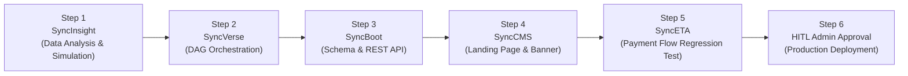

# End-to-End Autonomous Integration Scenario

## 1. Scenario Overview

This document explains the end-to-end operational workflow in which the seven core agents of the SyncSeries ecosystem autonomously collaborate to complete a production deployment when an enterprise business requirement—**"Launching a New VIP Membership Program and Online Payment Integration"**—is submitted.

---

## 2. Step-by-Step Execution Pipeline

### Step 1: Data Analysis and What-If Simulation (SyncInsight)
- **Activities**:
  - Comprehensively analyzes existing customer purchase history (internal DB) and competitor membership benefits (data collected by SyncCrawl).
  - Through a roundtable agent discussion, derives the projection: "Offering an additional 5% discount to customers with annual spending of KRW 10M or more yields an estimated +18.5% revenue increase while defending a 94% margin rate."
- **Artifact**: `ActionPlan_VIP_Membership.json`

### Step 2: Task Decomposition and DAG Construction (SyncVerse)
- **Activities**:
  - Generates an execution DAG (Directed Acyclic Graph) based on the action plan derived by SyncInsight.
  - Maps dependencies across domain agents:
    1. SyncBoot: Add DB migration and membership discount calculation API
    2. SyncCMS: Register VIP membership guide page and benefit introduction banner
    3. SyncETA: Generate and execute E2E scenarios for payment page discount rate application
- **Artifact**: `ExecutionGraph_Task_88291.json`

### Step 3: Automated Backend Schema and API Generation (SyncBoot)
- **Activities**:
  - Automatically generates DDL for `tb_vip_membership` and `tb_vip_benefit_log` tables.
  - Compiles Entity, Repository, Service, and Controller code following DDD principles and runs unit tests.
  - Executes agent self-verification static checks (`verify-zero-mock.ps1`).
- **Artifact**: Spring Boot microservice JAR build artifact

### Step 4: Content and Marketing Asset Registration (SyncCMS)
- **Activities**:
  - AI-generates drafts for the VIP benefit introduction landing page and announcement notice.
  - Passes PII filtering and brand guideline compliance checks.
  - Performs real-time headless publishing to the staging environment.
- **Artifact**: CMS content artifact `content-vip-membership-kr`

### Step 5: Unattended E2E Regression Test Verification (SyncETA)
- **Activities**:
  - Automatically generates a new payment scenario targeting the staging environment:
    1. Log in with a VIP account
    2. Add a KRW 100,000 product to the cart
    3. Navigate to the checkout order form screen
    4. Verify that the additional 5% VIP discount (KRW 5,000) is properly deducted
    5. Confirm a `200 OK` response from the payment approval API
  - Cross-inspects UI components for anomalies using Vision AI.
- **Artifact**: `TestRunReport_Run9941.json` (Pass Rate: 100%, 0 regression failures)

### Step 6: Human-in-the-Loop Administrator Final Approval
- **Activities**:
  - Issues a production deployment ticket on the SyncVerse control dashboard.
  - Provides the system administrator with a unified bundle containing Before/After Git Diffs, DDL scripts, and test pass reports.
  - Executes zero-downtime blue-green production rollout upon one-click administrator approval.
- **Artifact**: WORM audit ledger signed record `audit-tx-prod-9941`
