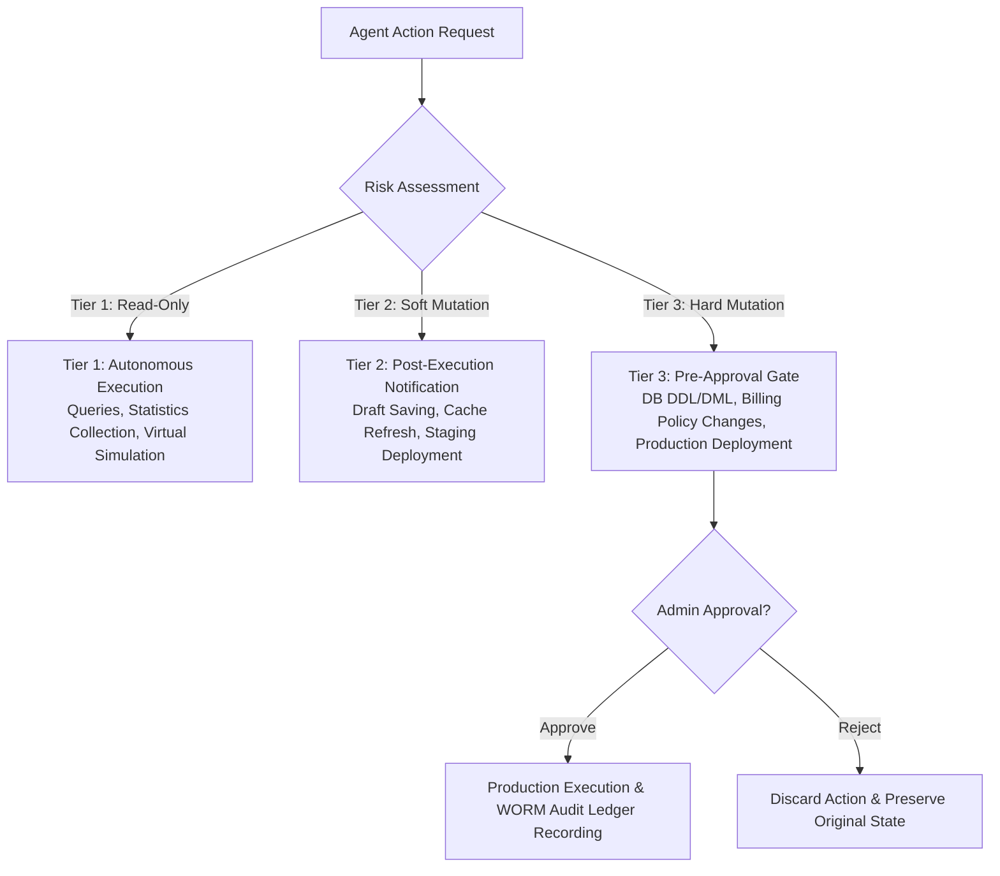
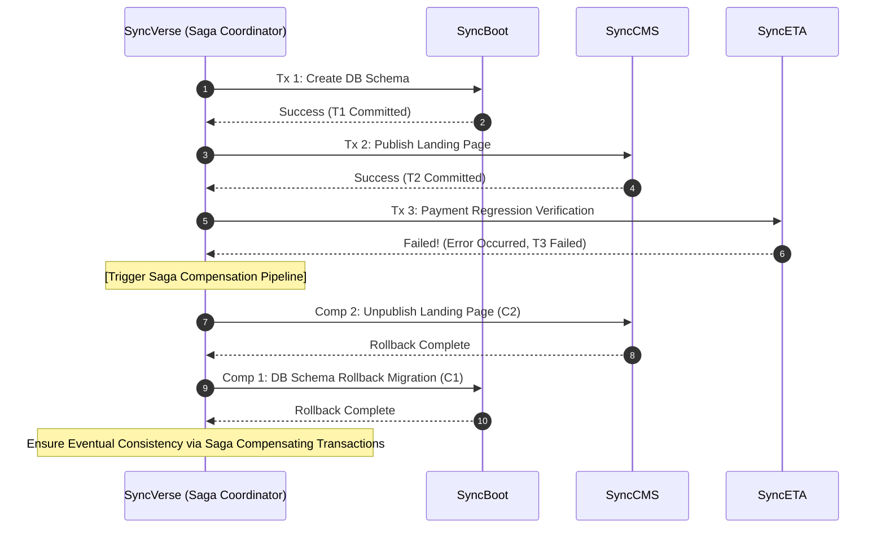

# HITL Governance & Saga Distributed Transactions

## 1. Enterprise Safety Principles

The greatest risks to guard against in an autonomous AI operating ecosystem are **unforeseen side effects and data corruption**.  
To maximize autonomy while systematically controlling risk, SyncSeries operates **3-Tier HITL Safety Tiers** and the **Saga Compensating Transaction Pattern** as enterprise-wide standards.

---

## 2. 3-Tier HITL Safety Approval Tiers

Every MCP tool invocation is automatically classified into one of three tiers based on its risk level:

| Tier | Risk Level | Example Operations | Approval Policy |
|:---|:---|:---|:---|
| **Tier 1 (Safe)** | Harmless (Read-Only) | Statistics queries, log search, What-If simulations, RAG document lookup | **Zero-Wait Immediate Autonomous Execution** |
| **Tier 2 (Low Risk)** | Minor (Soft Mutation) | Staging content registration, dev server branch creation, temp file cleanup | **Post-Execution Notification** (Slack / Notification Center) |
| **Tier 3 (High Risk)** | Destructive (Hard Mutation) | DB DDL migrations, user privilege escalation, billing/discount policy changes | **Mandatory Pre-Approval by Administrator** (HITL Gate) |

---

## 3. Saga Pattern Distributed Transactions and Compensating Recovery

In a microservices environment, when a partial step fails during a composite workflow spanning multiple domain agents, the **Orchestrated Saga Pattern** is applied to safely revert the system to a consistent state.

### 3.1 Idempotency Guarantee
- Every compensating action includes an **Idempotency Key** so that system state remains consistent even under network retries or duplicate invocations.
- Failure causes and compensating transaction execution results are transparently recorded in the control tower logs in the `RFC 7807 Problem Details` standard format.
