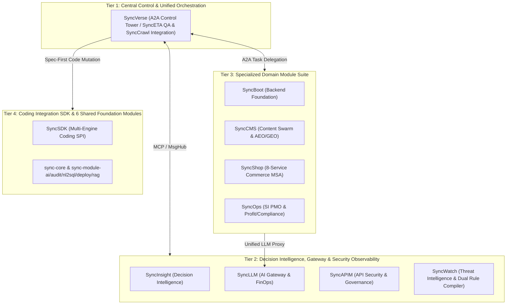
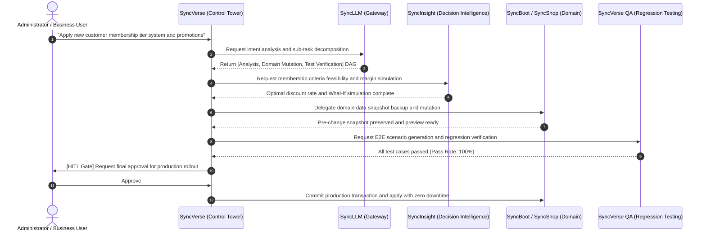

# SyncSeries Unified Architecture and Module Integration

> **Reader's Guide**: This document is a technical overview for developers and system architects. For a non-technical service introduction, visit the [Empasy Official Website (empasy.io)](https://empasy.io/en/pages/index.html). For installation-free hands-on demos, visit the [Unified Demo Portal (sync.empasy.io)](https://sync.empasy.io/en/). For adoption proposal PDFs, see the [Proposal Repository (/en/proposals/)](/en/proposals/), and for core technical term definitions, refer to the [Enterprise Technical Glossary (/en/glossary/)](/en/glossary/).

## 1. Architecture Overview and Design Principles

**SyncSeries** reorganizes traditional IT landscapes—where individual software applications operated as isolated silos—into a **modular A2A (Agent-to-Agent) operating architecture** in which domain modules communicate and collaborate through standard protocols on top of a shared back-office, authentication, and auditing foundation.

Core enterprise services and shared modules run on a single standardized technology stack comprising **Java 25**, **Spring Boot 4.0**, **AgentScope Java (`io.agentscope:agentscope-harness:2.0.2`)**, and **PostgreSQL 18.6 (`pgvector`)**, following three foundational design principles:

1. **Centralized Orchestration**: **SyncVerse**, the central control tower module, analyzes business requests, decomposes them into sub-tasks, and delegates execution to the appropriate domain modules.
2. **Standardized Interface Interoperability**: Every module exposes and invokes tools and APIs conforming to the **[Model Context Protocol (MCP)](/en/glossary/#mcp)** and the enterprise-wide single **[Canonical URL](/en/glossary/#canonical-url)** (`/api/v1/{product}/...`) specification.
3. **Pre-Execution Approval and Recovery Safety**: High-risk operations such as data mutations, schema changes, and code deployments pass through **[Multi-Party HITL (Human-in-the-Loop)](/en/glossary/#hitl)** approval gates and **snapshot-based compensating transactions** to guarantee data consistency and rollback availability.

---

## 2. 4-Tier Enterprise Architecture and Core Module Composition

SyncSeries consists of 11 enterprise modules organized across four tiers by role and responsibility (`SyncVerse`, `SyncInsight`, `SyncLLM`, `SyncAPIM`, `SyncWatch`, `SyncBoot`, `SyncCMS`, `SyncShop`, `SyncOps`, `SyncETA`, `SyncCrawl`), a coding engine integration SDK (`SyncSDK`), and 6 shared foundation modules (`sync-core`, `sync-module-ai`, `sync-module-nl2sql`, `sync-module-audit`, `sync-module-deploy`, `sync-module-rag`).

### Tier 1: Central Control & Unified Orchestration Layer
- **SyncVerse (`sync-verse`)**: The central orchestration layer of the ecosystem. It provides unified governance over 5-Step Spec Studio-based specification and task tracking, multi-coding-engine SPI routing (`CodingAgentRoutingProxy`), multi-party HITL approvals, web/mobile QA (`SyncETA`), and web data collection (`SyncCrawl`).

### Tier 2: Decision Intelligence, AI Gateway & Security Observability Layer
- **SyncInsight (`sync-insight`)**: Collects and analyzes heterogeneous internal and external data, generating evidence-based reports and actionable proposals via 2-Phase Deep Research and Apache Calcite-powered read-only Safe [NL2SQL](/en/glossary/#nl2sql).
- **SyncLLM (`sync-llm`)**: Dedicated to multi-LLM tier routing, real-time PII masking, Redis [Semantic Cache](/en/glossary/#semantic-cache), and department-level [FinOps](/en/glossary/#finops) budget guardrails.
- **SyncAPIM (`sync-apim`)**: Built on a 4-independent-JVM architecture (`admin`, `receiver`, `detector`, `gateway`), it identifies unregistered shadow APIs, diagnoses OpenAPI 3.0.1 specification drift, detects six major categories of web/API attacks ([WAF](/en/glossary/#waf) / [eBPF](/en/glossary/#ebpf)), and performs dynamic masking across eight sensitive data categories.
- **SyncWatch (`sync-watch`)**: Collects and normalizes eight global security threat feeds (OSV.dev, GitHub GHSA, NVD CVE, CISA KEV, Nuclei, OWASP CRS, MITRE ATT&CK, KISA) and diagnostic advisories ([CVSS/CVE/STIX](/en/glossary/#cvss-cve-stix)), distributing security inspection and defense rules to `SyncVerse` (`VerseAuditPack`) and `SyncAPIM` (`ApimDefensePack`).

### Tier 3: Specialized Domain Execution Layer
- **SyncBoot (`sync-boot`)**: The enterprise back-office standard foundation providing DB single-source-of-truth dynamic routing (`sys_permission`, [RBAC](/en/glossary/#rbac)), zero-downtime configuration hot-swap (`sys_config`), and remote socket diagnostics.
- **SyncCMS (`sync-cms`)**: A hybrid headless CMS featuring Nuxt 3 SSR, a 3-stage Copywriter-SEO-Publisher content workflow, and SEO/AEO/GEO web quality inspection tools.
- **SyncShop (`sync-shop`)**: An e-commerce platform composed of eight independent microservices ([MSA](/en/glossary/#msa))—Gateway, Auth, Admin, Portal, Search, Monitor, MBG, and MCP Server—along with the storefront (`SYNC SELECT`).
- **SyncOps (`sync-ops`)**: Manages SI project profit and loss (contract rate vs. actual input cost), KOSA-grade personnel matrices, four types of performance guarantee bond expirations, subcontractor payment due-date monitoring, and Tax Special Treatment Act SHA-256 electronic research notes.

### Tier 4: Coding Integration SDK & 6 Shared Foundation Modules
- **SyncSDK (`sync-sdk`)**: A development SDK that swaps CLI/coding agent adapters in a pluggable manner to match corporate policies via the `ICodingAgentClient` standard SPI and integrates a 4-Cycle build verification and recovery pipeline.
- **6 Shared Modules**: `sync-core`, `sync-module-ai`, `sync-module-nl2sql`, `sync-module-audit`, `sync-module-deploy`, and `sync-module-rag`.

---

## 3. Agent Collaboration Lifecycle

---

## 4. Architectural Comparison (Siloed Build vs. SyncSeries Unified Architecture)

| Area | Siloed / Distributed System Operation | SyncSeries Shared-Foundation Unified Architecture |
|:---|:---|:---|
| **New Features & API Expansion** | Authentication, authorization, logging, and auditing re-implemented per project | Reuses `SyncBoot` foundation, Canonical URLs (`/api/v1/{product}/*`), and 6 shared modules |
| **Change Deployment & Recovery** | Manual DB backups and manual log tracing/rollback upon incidents | Pre-change snapshot preservation, multi-party HITL approval gates, compensating-transaction rollback |
| **LLM Cost & Model Governance** | Separate API keys per team causing duplicate calls and untracked spend | Routed through single `SyncLLM` gateway with semantic caching and departmental FinOps quota policies |
| **Regression Verification Automation** | Missed pre-deployment manual checks and broken scripts on UI changes | `SyncETA` scenario-driven automated execution with semantic DOM and vision-based self-healing |
| **Security & Audit Evidence** | Manual code reviews; delayed visibility into API inventory and data leaks | Threat rule distribution via `SyncAPIM` and `SyncWatch`, PII masking, and complete audit ledger logging |

---

## 5. Next Steps

- **[Enterprise Technical Glossary](/en/glossary/)**: Official Single Source of Truth (SSOT) definitions for core SyncSeries technical terminology
- **[Standard MCP Protocol Specification](/en/ecosystem/mcp-protocol)**: Inter-agent tool invocation and messaging standards
- **[AgentScope Java Standard Guide](/en/ecosystem/agentscope-guide)**: Spring Boot 4.0 & Java 25 backend agent development standards
- **[Shared Modules & SDK Architecture](/en/ecosystem/shared-modules-and-sdk)**: Structure of the 6 shared modules (`sync-core`, `sync-module-*`) and `SyncSDK`
- **[End-to-End Workflow in Practice](/en/ecosystem/e2e-workflow)**: Cross-module integration procedures based on real-world scenarios
- **[HITL Governance & Saga](/en/ecosystem/hitl-governance)**: Administrator safety approvals and distributed rollback mechanisms
- **[Security Whitepaper & Compliance](/en/ecosystem/security-and-compliance)**: Zero Data Retention and air-gapped security architecture
- **[Product Brochures & Proposal PDFs](/en/proposals/)**: Document repository for evaluation and enterprise proposals
