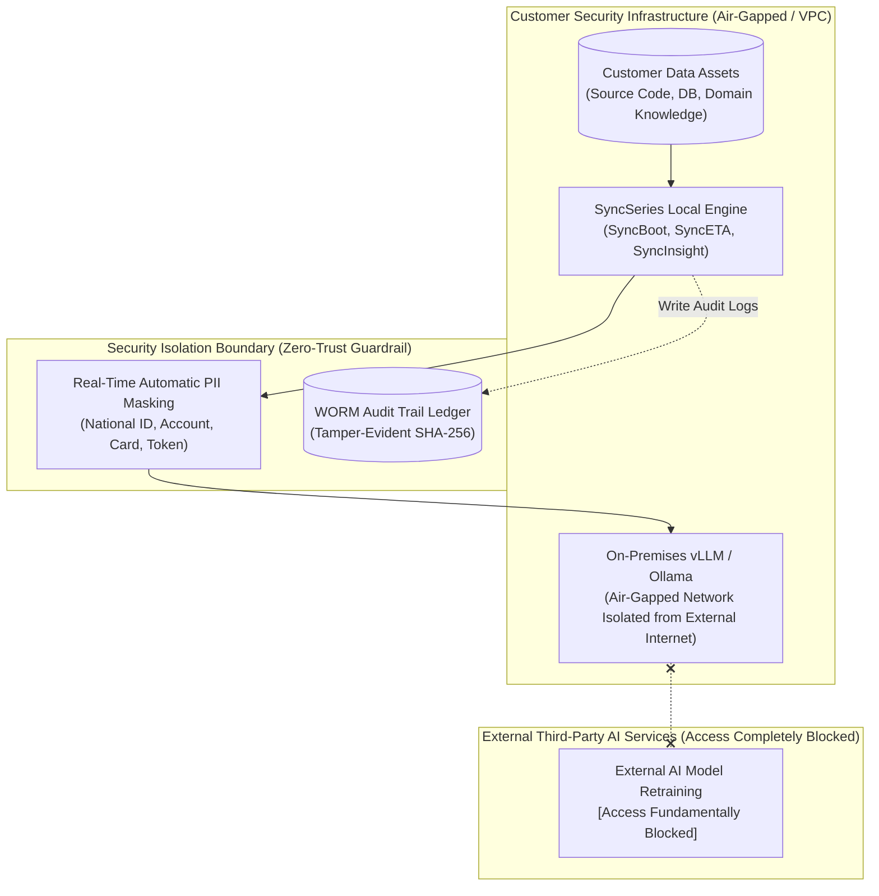

# Enterprise Security Whitepaper and Compliance Guide

Empasy Inc. implements enterprise-grade data protection and security governance across the entire **SyncSeries AI Autonomous Operating Ecosystem** for regulated industries—including finance, public sector, manufacturing, and large-scale digital platforms—that demand strict information security and regulatory compliance.

---

## 1. Core Data Protection Principles (Data Privacy Pillars)



### 1.1 Zero Data Retention (No-Training Guarantee)
* **Principle**: Customer source code, prompts, API transaction payloads, business rules, and database schemas are **never used for fine-tuning Empasy's shared AI models or training any external third-party models.**
* **Inline Volatile Processing**: All LLM inference requests and tool call payloads are processed strictly in ephemeral in-memory (RAM) sessions and are securely overwritten and purged from memory buffers immediately upon response delivery.
* **Data Isolation Guarantee**: Even in multi-tenant deployments, logical and physical isolation based on encrypted customer tenant identifiers (`tenant_id`) prevents any cross-organization data mixing.

### 1.2 On-Premises Air-Gapped Deployment Support
* **Fully Isolated Network Execution**: Runs safely and independently in environments physically disconnected from the public internet, such as financial core networks and government networks.
* **Local LLM Runtime Compatibility**: Executes 100% local offline inference on on-premises servers (NVIDIA H100/A100, RTX 6000, etc.) using open-weight foundation models (Llama 3, Llama 3.3, OpenAI o3-mini, etc.) via vLLM, Ollama, or TensorRT-LLM.
* **Self-Hosted Embeddings & Vector Stores**: Supports building a completely on-premises RAG knowledge base on internal Milvus, Qdrant, or OpenSearch clusters to prevent outbound data leakage.

---

## 2. Encryption and Network Transport Specifications (Cryptographic Standards)

| Area | Applied Technical Standard | Operational Policy Details |
|:---|:---|:---|
| **Data in Transit** | TLS 1.3 (RFC 8446) | Legacy/weak ciphers (DES, 3DES, RC4) completely disabled; Perfect Forward Secrecy (PFS) enforced |
| **Data at Rest** | AES-256-GCM | Full encryption of database volumes and file storage; customer-managed keys (BYOK / KMS) supported |
| **Token & Secret Storage** | HashiCorp Vault / AWS KMS | Plaintext hardcoding in configuration files prohibited; dynamic one-time tokens and 90-day automatic rotation |
| **Audit Log Integrity** | HMAC-SHA256 & WORM | Immutable Write-Once-Read-Many storage with cryptographic log-chaining verification |

---

## 3. Multi-Layered Access Control (Identity & Access Governance)

### 3.1 Granular RBAC & ABAC
* **RBAC (Role-Based Access Control)**: Separates privileges across System Administrator (`ROLE_ADMIN`), Security Auditor (`ROLE_AUDITOR`), Solution Operator (`ROLE_OPERATOR`), and API Service Account (`ROLE_SERVICE`).
* **ABAC (Attribute-Based Access Control)**: Blocks unauthorized access in real time through dynamic policy evaluation based on IP ranges, department codes, operating hours, and request risk scores.

### 3.2 Real-Time Automatic PII Masking Engine
SyncSeries inline proxies and the SyncLLM gateway detect sensitive data patterns in request and response payloads in real time using regular expressions and Named Entity Recognition (NER), automatically obfuscating them:
* **Resident / Foreigner Registration Number (National ID)**: `700101-1******`
* **Credit Card Number**: `5424-****-****-1234`
* **Bank Account Number**: All segments masked except the last 4 digits
* **Secret Keys & Token Patterns**: `eyJhbGci... [REDACTED_JWT]`, `sk-proj-... [REDACTED_API_KEY]`

---

## 4. Compliance & Security Certification Framework

```
┌───────────────────────────────────────────────────────────────────────────────────┐
│                      SyncSeries Security Governance Framework                     │
├─────────────────────────┬─────────────────────────┬───────────────────────────────┤
│  ISMS-P (KISA)          │  ISO/IEC 27001          │  Financial Security AI Guide  │
├─────────────────────────┼─────────────────────────┼───────────────────────────────┤
│ • 102 Security Controls │ • ISMS Framework        │ • AI Bias & Error Controls    │
│ • Personal Data Life-   │ • Risk Assessment &     │ • Model Explainability (XAI)  │
│   cycle Management      │   Treatment             │ • Distributed Saga            │
│ • 2-Year Access Logs    │ • Business Continuity   │   Compensating Transactions   │
└─────────────────────────┴─────────────────────────┴───────────────────────────────┘
```

1. **Audit Trail Retention**: All A2A (Agent-to-Agent) invocations, MCP tool executions, and administrator approval histories are permanently retained for a minimum of 2 years as RFC 5424-compliant structured logs (JSON).
2. **Software Supply Chain Security (SBOM) & Tri-Partite Autonomous DevSecOps (`SyncWatch` → `SyncVerse` → `SyncAPIM`)**: Every deployment image and artifact includes a CycloneDX / SPDX SBOM. Through `VerseAuditPack` (SCA/SAST/DAST code auditing) and `ApimDefensePack` (`SqlXssLexicalTokenizer` lexical syntax fingerprinting + `SandboxedDefenseEvaluator` pinpoint virtual patching + kernel eBPF blocking) collected and compiled by [`SyncWatch`](/en/syncwatch/), zero-day threats are mitigated in real time across both source code and runtime.
3. **Pre-Engagement NDA Procedure**: Prior to customer technical review and PoC initiation, a standard enterprise mutual Non-Disclosure Agreement (NDA) is executed upfront to protect technical assets and business information.
