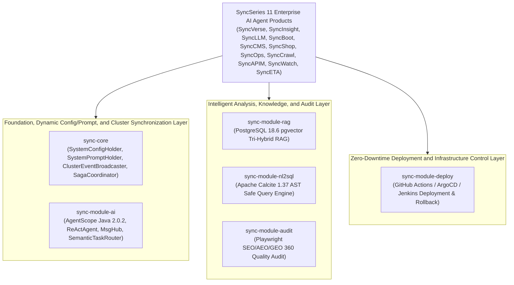
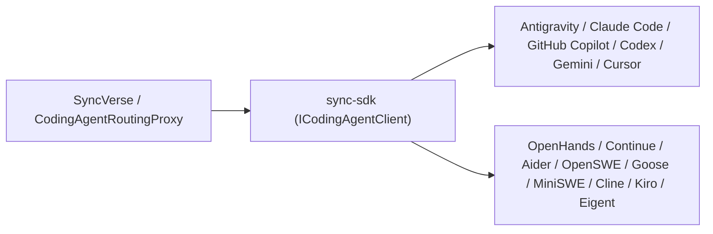

# Enterprise Shared Modules and AI Coding SDK Architecture

Under the root `pom.xml` multi-module structure, SyncSeries standardizes and operates **6 core foundation modules (`sync-core`, `sync-module-*`)** and the **15-agent AI coding engineering SDK (`sync-sdk`)** to eliminate duplicate code across domain services and agents and enforce consistent enterprise-wide architectural standards (Java 25, Spring Boot 4.0, AgentScope Java 2.0.2, PostgreSQL 18.6).

---

## 1. Enterprise 6 Shared Module Architecture

### 1.1 Foundation and AI Agent Runtime Modules
* **`sync-core` (`com.empasy.sync:sync-core`)**:
  * Provides common enterprise domain entity specifications (`BaseEntity`), a standard API response wrapper (`Result<T>`), global exception handling, and AES-256 encryption utilities.
  * **DB-driven zero-downtime dynamic configuration (`SystemConfigHolder`, `sys_config`) and dynamic prompts (`SystemPromptHolder`, `sys_prompt_template`, `sys_prompt_history`)**: Eliminates hardcoded constants and prompts in source code, supporting real-time database lookup and version rollback.
  * **Multi-instance cluster synchronization (`com.empasy.sync.core.cluster.*`)**: Synchronizes configurations, prompts, and circuit breaker states in real time across multiple instances via `ClusterEventBroadcaster`, `RedisClusterStateBackingStore`, `SharedMemoryClusterStateBackingStore`, `DistributedLockExecutor`, and `DistributedStateCoalescer`.
  * Provides high-performance concurrency control based on `ReentrantLock` to prevent OS thread pinning (Carrier Pinning) in **Java 25** Virtual Threads environments.
* **`sync-module-ai` (`com.empasy.sync:sync-module-ai`)**:
  * Integrates **`AgentScope Java` (`io.agentscope:agentscope-harness:2.0.2`)**, the sole enterprise-standard AI framework (`ReActAgent`, `MsgHub`, automatic `@Tool` discovery).
  * `AgentSelfRegistrationClient`: Asynchronously handles agent self-registration to the SyncVerse central control plane (`/api/v1/verse/agent/register-manifest`) on backend startup.

### 1.2 Intelligent Analysis, Knowledge, and Audit Modules
* **`sync-module-rag` (`com.empasy.sync:sync-module-rag`)**:
  * **Tri-Hybrid RAG Engine**: Maximizes domain knowledge retrieval accuracy by combining PostgreSQL 18.6 `pgvector` HNSW dense vector search, `pg_trgm` keyword search, and a knowledge graph.
  * `ContextAwareMarkdownSplitter`: Intelligent chunking engine that preserves Markdown header hierarchies and code block context intact.
  * `IncidentRunbookService`: Automatically maps historical incident resolution procedures in real time when system failures occur.
* **`sync-module-nl2sql` (`com.empasy.sync:sync-module-nl2sql`)**:
  * Provides relational algebra AST optimization and multi-layer SQL security guardrails (enforcing `SELECT`-only queries, automatic tenant isolation condition injection, and `LIMIT` enforcement) powered by **Apache Calcite 1.37.0** and **JSqlParser 4.9**.
* **`sync-module-audit` (`com.empasy.sync:sync-module-audit`)**:
  * `AuditOrchestratorService`: Combines Playwright headless rendering with static AST analysis to quantitatively score SEO, AEO, and GEO web quality out of 100 points and propose AI-generated patches.

### 1.3 Zero-Downtime Deployment and Infrastructure Control Module
* **`sync-module-deploy` (`com.empasy.sync:sync-module-deploy`)**:
  * Multi-CI/CD pipeline adapters (`JenkinsPipelineAdapter`, `GitHubActionsAdapter`, `ArgoCdPipelineAdapter`).
  * Real-time container and Kubernetes Pod health checks with automated rollback orchestration.

---

## 2. SyncSDK (`com.empasy.sync.sdk:sync-sdk-parent`)

`sync-sdk` is the enterprise standard SDK module for 5-Step Spec Studio and programmatic integration with **15 enterprise coding agents (`CodingAgentType`)**.

* **15-Engine Multi-Coding Hot-Swap SPI (`ICodingAgentClient` & `CodingAgentType`)**: Switches seamlessly at runtime across 15 engines—`ANTIGRAVITY`, `CLAUDE_CODE`, `GITHUB_COPILOT`, `CODEX_CLI`, `GEMINI_CLI`, `CURSOR_CLI`, `OPENHANDS`, `CONTINUE`, `AIDER`, `OPENSWE`, `GOOSE`, `MINI_SWE`, `CLINE`, `KIRO`, and `EIGENT`—and dynamically retrieves each engine's default model from the `sys_config` table via `SystemConfigHolder.getValue("sync.sdk.agent.default-model.<code_lower>", defaultModel)`.
* **4-Cycle Build Self-Healing**: Runs `mvn test-compile` and `vue-tsc` verification after applying code patches, and feeds compilation error logs back into the agent for autonomous remediation when errors occur.
* **Zero-Mock Production Guarantee**: Completely eliminates hardcoded dummy responses from production runtime classes and binds directly to the real Git workspace (`GitWorkspaceManager`) and atomic patch engine (`AtomicDiffPatchEngine`).
