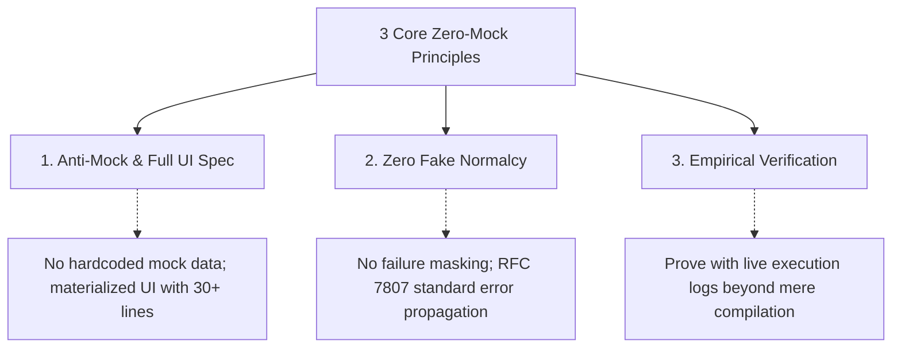
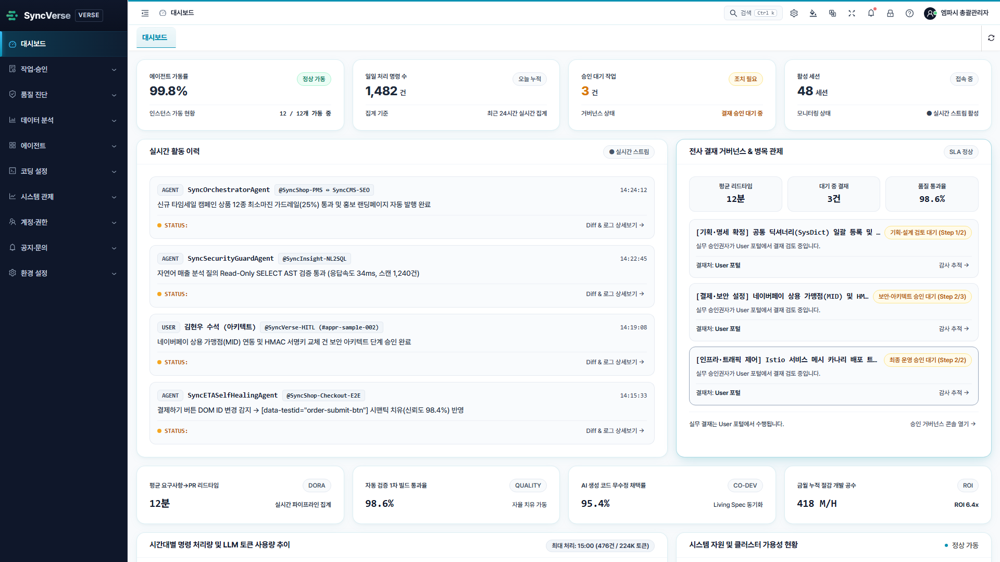
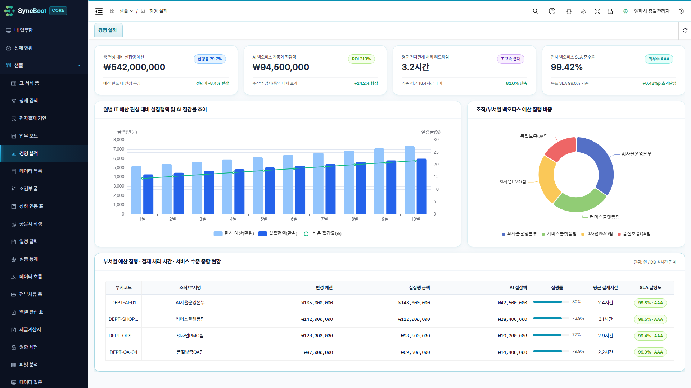
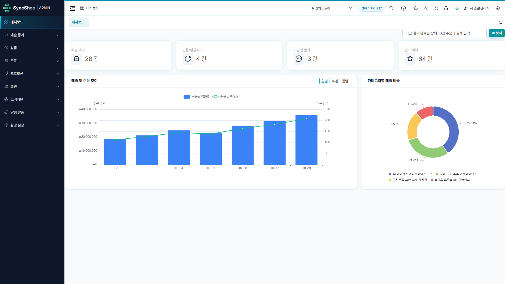
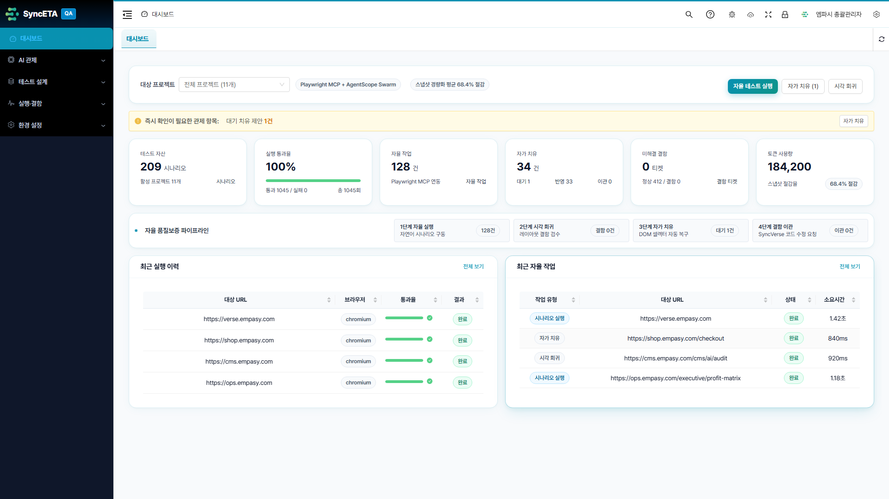

# Zero-Mock Enterprise Quality Harness and Verification Protocol

::: tip Practical Implementation Example
For guidance on writing real Spring Boot and PostgreSQL tests using Testcontainers, see the [Real-Environment Testing Guide](/en/sdk/zero-mock-testing).
:::

To ensure commercial-grade reliability, SyncSeries strictly enforces the **Zero-Mock Principle** and the **4-Cycle Quality Verification Protocol**, rejecting hardcoded fake responses in favor of verification against live databases and real network integrations.

---

## 1. Three Core Principles of Zero-Mock and Commercial Quality

### 1.1 Anti-Mock & Full UI Spec Mandate
* Outside of explicit unit test isolation, writing hardcoded mock objects, dummy wrappers, or empty-return methods in production backend or frontend logic is strictly prohibited.
* All REST APIs and frontend components must integrate 100% with real database queries and service interfaces.
* Every UI view component must implement at least 30 lines of materialized UI elements (tables, forms, filters, etc.); empty shells or placeholder text are forbidden.

### 1.2 Zero Fake Normalcy
* Suppressing exceptions in `catch` blocks or returning fabricated success statuses (`status: SUCCESS`) to mask network failures, HTTP call errors, or database query faults as normal behavior is strictly blocked.
* All exceptions must be propagated to clients and upstream control systems with accurate HTTP status codes and structured diagnostic fields following the RFC 7807 Problem Details standard.

### 1.3 Empirical Verification
* Rather than stopping at source code edits or clean compilation, engineers and agents must empirically verify changes by printing live database execution logs, REST API response payloads, and frontend build outputs to the console.

---

## 2. 4-Cycle Quality Verification Protocol

After any code change, build integrity is confirmed by iterating through the following four-stage regression verification process.

| Verification Stage | Key Verification Items | Tools & Commands | Acceptance Criteria |
|:---|:---|:---|:---|
| **[Cycle 1] Full Build & Initial Check** | Enterprise-wide module compilation and type checks | `mvn compile`, `pnpm build` | Full build succeeds (`BUILD SUCCESS`) |
| **[Cycle 2] Fixes & Secondary Cross-Check** | Interface and type consistency verification | `mvn test-compile` | Zero inter-module dependency or type errors |
| **[Cycle 3] Regression Tests & Tertiary Audit** | Unit/integration tests and static quality audit | `mvn test`, `verify-zero-mock.ps1` | Unit tests pass, zero Mock violations |
| **[Cycle 4] Final Regression Build & Audit** | Clean build and independent QA cross-audit | Subagent Audit (`QA_Auditor`) | Final approval verdict (`APPROVED`) |

---

## 3. Enterprise Automated Audit Script Suite

To verify the integrity of development deliverables, SyncSeries operates three dedicated automated audit scripts across all core agents and shared modules.

* **`verify-zero-mock.ps1`**:
  * Performs static pattern analysis across Java, Vue, and TypeScript source files to detect hardcoded mock variables, arbitrary dummy collection returns, and fake branching logic.
* **`verify-security-leaks.ps1`**:
  * Scans all source code and configuration files (10,000+ files) for plaintext hardcoded API keys, passwords, and private authentication tokens.
* **`verify-api-contracts.ps1`**:
  * Audits 1:1 consistency of URLs, HTTP methods, and parameters between backend controller endpoints and frontend API client definitions.

---

## 4. Enterprise 1,045 Test Cases (TC) and Playwright E2E UI Verification Status (100% PASSED)

SyncSeries continuously executes a total of **1,045 test cases (`L1`–`L5`)** across the entire product suite (13 parts, 209 usage scenarios × 5 dimensions: `HAPPY_PATH`, `VALIDATION`, `BOUNDARY`, `STATE`, `PERMISSION`), alongside Playwright headless-browser high-resolution (`1920×1080`) screen rendering and callout annotation checks.

| Verification Item | Target Scope | Pass Rate / Result |
|:---|:---|:---|
| **Full Functional Test Cases (`L1`–`L5`)** | 13 parts · 209 scenarios · 1,045 TCs | **`1,045 / 1,045 PASSED (100.0%)`** |
| **DB 6-Stage Standard Scripts (`00`–`05_*.sql`)** | 9 core agent DBs (54 SQL files total) | **`0` violations (0 `ON CONFLICT`, 0 `migrations/`)** |
| **Zero-Mock Static Quality Audit** | 18 projects and microservice modules | **`18 / 18 PASSED (0 Violations)`** |
| **API Contract & Secret Leak Audit** | Enterprise Canonical URLs (`/api/v1/{product}/...`) & secret scan | **`11 / 11 PASSED (0 Leaks)`** |
| **Playwright E2E UI & High-Res Capture** | 42 raw `1920×1080` screens + 40 callout-annotated screens across all products | **`ConsoleErrors=0`, `PageErrors=0` (82 total)** |

### Representative Verified Product Screenshots

