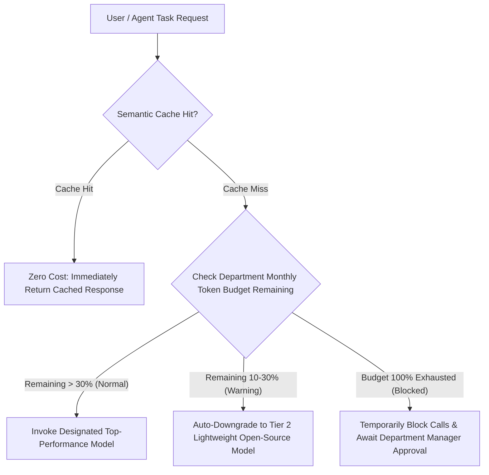

# Departmental Token Budget Management and Cost Optimization Guide

## 1. Overview and FinOps Management Objectives

As the adoption of generative AI models and autonomous agents expands, organizations must control the risk of unexpected cloud API billing charges caused by excessive prompt invocations or infinite loops in specific departments.

The SyncSeries FinOps module enables organizations to predict AI operating costs in advance and keep spending within planned budget limits through **granular token expenditure quota management at the organization (department/project) level** and **intelligent multi-tier model routing**.

---

## 2. Three-Stage Budget Threshold Alerts and Control Policies

Depending on the consumption rate of the monthly budget configured per department (e.g., KRW 2M/month or 50M tokens/month), the following automated governance rules take effect:

| Consumption Stage | System Action & Control Policy | User / Administrator Notification |
| :---: | :--- | :--- |
| **Stage 1: Normal (0 - 70%)** | Serve all requests normally using the configured default upper-tier models (Tier 3-4) | No notification (real-time aggregation on dashboard) |
| **Stage 2: Caution (70 - 90%)** | Prioritize routing simple classification or extraction tasks to internal lightweight models (Tier 1) | Send informational alert via email/Slack to department coordinator |
| **Stage 3: Warning (90 - 100%)** | Pause large-scale batch jobs and restrict calls to high-cost frontier models | Send urgent warning to department head and finance officer |
| **Stage 4: Exceeded (100% Reached)** | Block general queries and force fallback to internal air-gapped on-premises models | Automatically issue a budget increase approval request |

---

## 3. Two Core Engines for Cost Optimization

### 1) Capability-Based 4-Tier Model Tiering
Instead of processing every task with expensive commercial models, requests are automatically routed to the most cost-effective model based on task complexity:

- **Tier 1 (Ultra-Lightweight / On-Premises)**: Simple intent classification, regex validation, named entity recognition -> *Zero invocation cost (uses internal GPUs)*.
- **Tier 2 (Medium / Open Source)**: General Q&A, document summarization, simple SQL queries -> *Llama-3.1-8B, Llama-3.1-8B*.
- **Tier 3 (Large / High Performance)**: Complex business planning, architecture specification generation -> *Llama-3.3-70B, Claude 3.5 Haiku*.
- **Tier 4 (Frontier Reasoning)**: Complex algorithm design, multi-agent deliberation and consensus -> *Claude 3.5 Sonnet, OpenAI-o3*.

### 2) Semantic Cache Utilization
- Returns verified responses cached in the database immediately not only for exact text matches, but also for semantically similar queries with high similarity (Cosine Similarity >= 0.95).
- For internal customer inquiries or frequently asked questions (FAQs), redundant API calls are eliminated, substantially reducing token consumption.

---

## 4. Monthly Cost Settlement and Reporting

- In the Admin Console under **[FinOps > Departmental Statistics]**, you can view daily and monthly token consumption trend charts broken down by department, project, and agent.
- Supports CSV and PDF report downloads for immediate use in internal IT cost chargebacks and accounting voucher processing.
