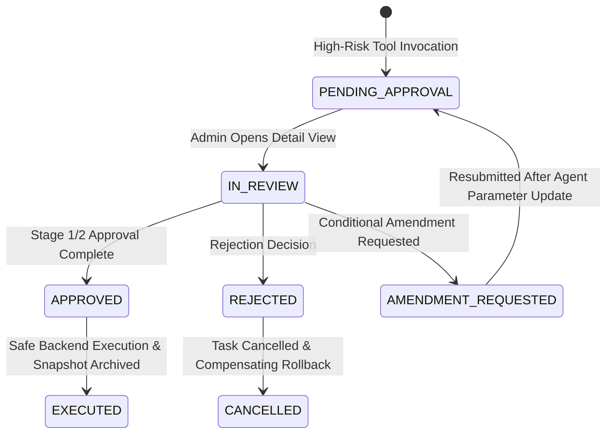

# High-Risk Task Multi-Stage Approval and Audit Trail Guide

## 1. Task Risk Classification Criteria (Risk Levels)

Every tool and business action invoked by an agent is pre-classified and managed across four risk tiers according to its potential impact on the system.

| Level | Task Type | Example Tasks | Approval Policy |
| :---: | :--- | :--- | :--- |
| **Level 1 (Safe)** | Read-only queries and reporting | Order status lookup, log search, RAG document retrieval | **Autonomous execution without approval** (execution history auto-recorded) |
| **Level 2 (Caution)** | Reversible configuration changes | Crawling schedule adjustment, cache expiration, notification channel setup | **Single-approver sign-off** (1-person approval) |
| **Level 3 (Warning)** | Data modification and deletion | Member profile updates, bulk product price changes, DB record deletion | **2-stage sequential approval** (Coordinator -> Department Head) |
| **Level 4 (Critical)** | System-wide impact | New production version deployment, DDL schema changes, bulk refunds | **3-stage multi-party approval** (Coordinator -> CISO -> Executive Owner) |

---

## 2. Web Console Approval Workflow Procedures

When a Level 2 or higher task is detected, agent execution is immediately paused (`PAUSED`), and an approval card is registered in the pending approval queue of the Admin Portal.

### Stage-by-Stage Review Checklist
1. **Verify Blast Radius**:
   - Check the target table name and expected row count to be modified.
   - For bulk updates affecting 1,000 or more rows rather than a single record, verify that the justification is valid.
2. **Compare Before-and-After Diff**:
   - Confirm that the JSON/SQL data diff between the `Current State` and `Proposed State` is accurate.
3. **Verify Rollback Snapshot Availability**:
   - Check the status indicator to confirm that a snapshot ID has been successfully created to restore the prior state in the event of a system failure.

---

## 3. Administrator Decision Action Guide

- **Approve**:
  - Click the **Approve** button once review confirms there are no issues with the proposed operation.
  - For multi-party approvals, the approval chain advances sequentially to the next approver, and the actual transaction is committed only upon final approval.
- **Reject**:
  - If the task violates business policy or poses a risk of data corruption, enter a specific rejection reason and deny the request.
  - The agent immediately halts execution and releases associated resources.
- **Amend**:
  - If the overall direction is valid but parameters (such as discount rate or target user scope) require fine-tuning, provide revision feedback to instruct the agent to rework and resubmit the task.

---

## 4. Audit Log Tracking and Tamper Prevention

All approval and rejection decisions are permanently persisted in the internal Audit Ledger:

- **Recorded Fields**: Request timestamp, executing agent ID, approver employee ID and IP address, original request prompt, tool parameter hash, and final execution outcome.
- **Integrity Guarantee**: Audit logs are cryptographically linked in a timestamped SHA-256 hash chain, ensuring that even database administrators cannot arbitrarily alter or delete historical records.
