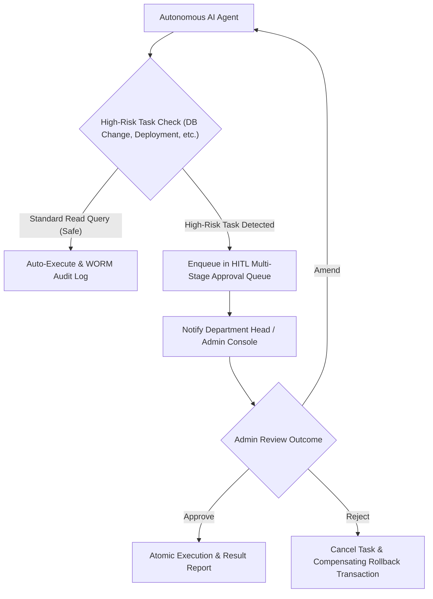

# Business Administrator Operational Governance Guide

## 1. Overview and Target Audience

SyncSeries provides a web-based management console and governance tooling so that not only software engineers, but also **business department managers, product planners, and security reviewers** can safely control and operate AI agents.

This guide is written for practitioners performing the following roles:
- **Department Heads & Approvers**: Making approve/reject decisions for high-risk tasks requested by agents (such as bulk data modifications and production deployments).
- **FinOps & Finance Officers**: Tracking monthly AI model invocation costs by department/project and managing budget caps.
- **Compliance & Audit Officers**: Conducting tamper-proof audits of historical agent actions, decision rationale, and prompt logs.

---

## 2. Core Governance Principles

1. **Principle of Least Privilege**:
   - Each agent and user can execute only the tools and UI permissions mapped to their assigned role (`sys_role`).
2. **Multi-Party Human-in-the-Loop (HITL)**:
   - Destructive actions or payment/pricing modifications exceeding defined thresholds require sequential approval from two or more parties rather than a single administrator before final execution.
3. **Tamper-Proof Audit Trail**:
   - All approval decisions and agent execution logs are sealed in a timestamped cryptographic hash chain, making post-hoc alteration or deletion impossible.

---

## 3. Daily & Weekly Operational Checklist by Role

| Role | Frequency | Key Inspection Items | Admin Console Menu & Reference Manual |
| :--- | :---: | :--- | :--- |
| **Department Head / Approver** | Continuous | • Check the approval queue for Level 3-4 high-risk tasks (bulk price changes, schema modifications, deployments) • Verify before/after data diffs and rollback snapshot ID generation | `SyncVerse > Task Approvals (/governance)` [HITL Approval Manual](./hitl-approval-operations) |
| **FinOps / IT Planning Team** | Weekly | • Monitor monthly token budget consumption rates by department and agent (70% / 90% thresholds) • Check semantic cache hit rate (`>= 35%`) and lightweight model (Tier 1-2) auto-routing ratio | `SyncLLM > FinOps Ledger` [FinOps Budget Manual](./finops-budget-operations) |
| **Information Security / Audit Team** | Monthly | • Audit PII (national ID numbers, bank accounts, card numbers, contact details) masking incidents in external LLM calls • Verify SHA-256 hash chain audit log integrity and unauthorized API (`SyncAPIM`) block records | `SyncAPIM > Threat Detection Logs` `SyncWatch > Security Pack Deployment Ledger` |

---

## 4. Emergency Response & 1-Click Rollback Standard Operating Procedure (SOP)

If unexpected metric anomalies or business complaints arise immediately after an autonomous agent task is applied, administrators can restore the previous state immediately without waiting for engineering code fixes by following this three-step procedure:

1. **Step 1 — Identify Execution History and Snapshot**:
   - In `SyncVerse` or the relevant domain agent (`SyncShop`, `SyncCMS`, `SyncBoot`) under **[Task Approvals > Execution Audit History]**, locate the most recently executed task ID and its auto-issued snapshot identifier (`SNP-YYYYMM-NNN`).
2. **Step 2 — Trigger 1-Click Compensating Rollback**:
   - Click **[Restore Immediately to Previous Snapshot (Rollback)]** on the corresponding history card to execute the backend compensating transaction (`revert_data_state` or `ROLLBACK_PRICE`) and restore the pre-change data state within `1 second`.
3. **Step 3 — Root Cause Analysis (RCA) and Guardrail Calibration**:
   - Review the `SyncInsight` RCA report to identify the root cause, and if necessary, elevate the tool's risk level or recalibrate constraint parameters (e.g., minimum guaranteed margin rate, maximum affected record count).

---

## 5. Detailed Operational Manuals

- **[4-Stage HITL Approval and Snapshot Rollback Manual](./hitl-approval-operations)**: Receiving approval requests in the web console, reviewing detailed diffs and impact scope, executing approve/reject/amend actions, and performing snapshot rollbacks.
- **[FinOps Budget Guardrails and Model Routing Manual](./finops-budget-operations)**: Allocating organization-level monthly budgets, threshold alert policies, automatic model tiering, and overspend prevention procedures.
