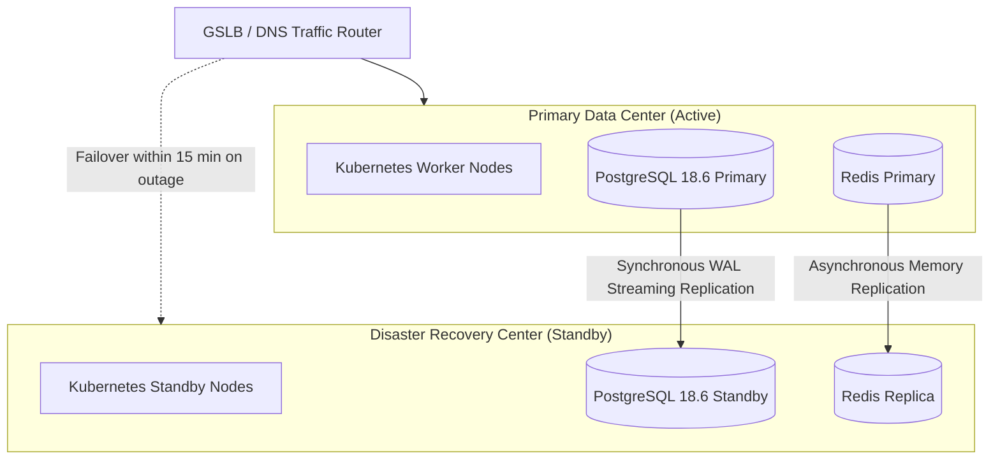

# Disaster Recovery (DR) and High Availability Design

## 1. Overview and Recovery Target Objectives

To reliably support financial, manufacturing, and public-sector services where data loss is critical, SyncSeries defines clear recovery target metrics (RPO, RTO) and operates multi-region, redundant infrastructure.

- **RPO (Recovery Point Objective)**: **0 minutes** (under synchronous replication) / **within 1 minute** (under asynchronous cross-region replication).
- **RTO (Recovery Time Objective)**: **Within 15 minutes** (based on completing traffic cutover to the secondary center when the primary center fails).



---

## 2. Data Layer High Availability and Replication Architecture

### 1) PostgreSQL 18.6 (pgvector) WAL Streaming Replication
- Physical Streaming Replication in PostgreSQL 18.6 is applied to maintain consistency across business tables and AI embedding vector data.
- By setting `synchronous_commit = on`, the final client response is returned only after the transaction commit signal has been written to the standby node's WAL (Write-Ahead Log), preventing commit loss during failures.

```ini
# postgresql.conf (Primary)
wal_level = replica
max_wal_senders = 10
wal_keep_size = 4096MB
synchronous_commit = on
synchronous_standby_names = 'FIRST 1 (dr_standby_node)'
```

### 2) Point-In-Time Recovery (PITR) Pipeline
- Every day at 02:00, a full Base Backup is compressed, encrypted, and stored in MinIO object storage.
- Continuously generated WAL archive files are synchronized to secondary storage every 60 seconds, providing a PITR environment capable of precisely restoring the database to a specific minute or second in the event of data corruption caused by operator error.

---

## 3. Redis Distributed Lock and Session Replication

- Distributed locks (`Redlock`) that prevent concurrent task collisions between agents and active user sessions are configured on a 3-node automatic failover cluster powered by Redis Sentinel.
- If a critical hardware failure occurs on the master node, Sentinel quorum consensus automatically promotes a standby node to the new master within 3 seconds.

---

## 4. Step-by-Step Failover Procedure During a Disaster

In the event of physical flooding, power outage, or network disconnection at the primary data center, traffic is failed over to the standby center in accordance with the following Standard Operating Procedure (SOP):

1. **Detection and Outage Declaration (0–3 minutes)**:
   - An infrastructure critical alert is triggered if three external health-check probes observe sustained 5xx errors or unresponsiveness from the primary center for more than 180 seconds.
2. **Secondary Database Promotion (3–7 minutes)**:
   - Execute the promotion command on the PostgreSQL Standby node in the DR center to switch it to read/write mode:
     ```bash
     pg_ctl promote -D /var/lib/postgresql/data
     ```
3. **Kubernetes Pod Scale-Out and Startup (7–10 minutes)**:
   - Immediately scale out the domain agent Deployment replicas in the secondary cluster from their standby baseline (1 instance) to production capacity (minimum 3 or more instances).
4. **GSLB Traffic Cutover (10–15 minutes)**:
   - Shift Global Server Load Balancer (GSLB) weights to 0% for the primary center and 100% for the secondary center, and wait for the DNS TTL (60 seconds) to expire.
   - Perform final verification of healthy inbound service traffic and proper validation of authorized token sessions.

---

## 5. Scheduled Drills and Recovery Verification

- **Drill Frequency**: Conduct scheduled DR simulation drills once per quarter.
- **Verification Items**:
  - Forcefully sever the primary center network interface and measure total time to complete traffic cutover.
  - Perform a full reconciliation after cutover to verify zero data loss (0 missing records) across agent execution history and RAG vector indexes.
  - Compile a drill execution report and retain it as enterprise compliance audit evidence.
