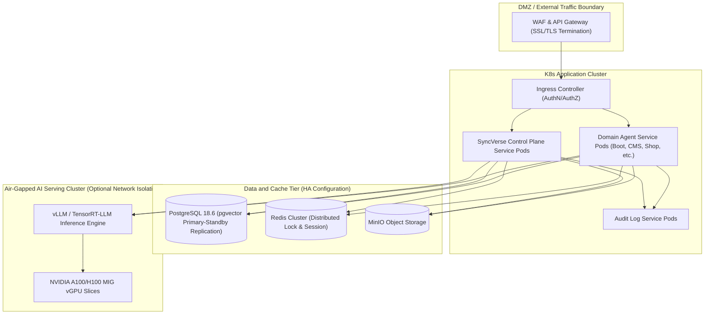

# Enterprise Infrastructure and Security Architecture

## 1. Infrastructure Design Principles

SyncSeries is engineered to support enterprise environments that mandate strict network segmentation regulations and security compliance, including finance, public sector, and manufacturing.

The platform infrastructure is built around three core engineering principles:
1. **Isolation and Defense-in-Depth**: A containerized architecture capable of operating completely and independently not only in public clouds, but also in physically air-gapped on-premise environments where external internet connectivity is blocked.
2. **Declarative GitOps Deployment**: All Kubernetes manifests and environment configurations are managed with a Git repository as the Single Source of Truth, tracked and automatically synchronized through ArgoCD.
3. **Strict Data Sovereignty and Privacy Protection**: Real-time automated PII (Personally Identifiable Information) masking during external LLM API communication and tamper-evident retention of enterprise-wide Audit Trails.

---

## 2. Physical Layer Architecture by Module

The enterprise platform operates dedicated, functionally isolated Node Pools to ensure service stability and prevent performance bottlenecks.

| Tier | Key Components | Recommended Hardware Specs | Network Policy |
| :--- | :--- | :--- | :--- |
| **API & Orchestration** | `SyncVerse`, API Gateway, Nacos | General-purpose compute nodes (8 vCPU, 32GB RAM) | External inbound allowed, mTLS communication |
| **Domain Business Services** | `SyncBoot`, `SyncCMS`, `SyncShop` | Memory-optimized nodes (16 vCPU, 64GB RAM) | Internal private network only, intra-cluster communication |
| **Data & RAG Vector Store** | PostgreSQL 18.6, Redis, MinIO | NVMe SSD-equipped storage nodes | Internal isolated network, data encryption (LUKS/TLS) |
| **Local AI Serving (On-Premise)** | vLLM, TensorRT-LLM, embedding models | GPU-accelerated nodes (NVIDIA L40S, A100, H100) | Dedicated inference isolation VLAN, external network blocked |

---

## 3. Enterprise Operations Documentation Roadmap

Detailed operational guides are provided so infrastructure and security administrators can immediately reference procedures for environment setup and incident response:

- **Air-Gapped Local LLM Serving and vGPU Resource Partitioning**: Configuring internal GPU servers without external connectivity and optimizing vLLM serving.
- **AI Security Guardrails and PII Masking**: Prompt injection defense, harmful output blocking, and real-time personal data anonymization.
- **Kubernetes Deployment and GitOps Operations Pipeline**: Helm chart structure, ArgoCD continuous deployment, and HPA autoscaling.
- **Disaster Recovery (DR) and High Availability Design**: Active-standby redundancy, Point-In-Time Recovery (PITR), and procedures to achieve an RTO of 15 minutes.
