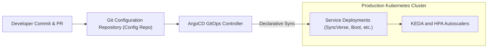

# Kubernetes Deployment and GitOps Operations Pipeline

## 1. GitOps Operations Framework Overview

SyncSeries production environments adopt the **GitOps** methodology to guarantee consistency and traceability across infrastructure configurations.

Development and operations teams are restricted from running `kubectl` commands directly against production Kubernetes clusters to apply changes; all service deployments, environment variable updates, and scaling configurations are performed declaratively through commits and Pull Requests in the Git repository.



---

## 2. Standard Helm Chart Directory Structure

Enterprise services are managed under a unified Umbrella Helm chart pattern, with each domain service structured as an independent sub-chart.

```
deploy/helm/
├── Chart.yaml                  # Umbrella Chart metadata
├── values.yaml                 # Enterprise-wide common defaults (domain, image tags, etc.)
├── values-production.yaml      # Production cluster-specific overrides
└── charts/
    ├── sync-verse/             # Control plane service chart
    ├── sync-boot/              # Engineering backend chart
    ├── sync-cms/               # Content service chart
    ├── sync-shop/              # E-commerce microservice chart
    └── sync-llm/               # AI gateway chart
```

### Example Common `values.yaml`
```yaml
global:
  environment: production
  domain: empasy.internal
  imageRegistry: harbor.empasy.internal/syncseries
  imagePullPolicy: IfNotPresent
  storageClass: fast-nvme-sc

sync-verse:
  replicaCount: 3
  resources:
    limits:
      cpu: "4"
      memory: 8Gi
    requests:
      cpu: "1"
      memory: 2Gi
  autoscaling:
    enabled: true
    minReplicas: 3
    maxReplicas: 10
    targetCPUUtilizationPercentage: 75
```

---

## 3. ArgoCD Application Manifest Configuration

ArgoCD detects changes in the Git repository every 3 minutes (or upon receiving a webhook) and reconciles them with the actual cluster state. If manual drift occurs, its Self-Heal policy automatically restores the cluster to the authoritative Git state.

```yaml
apiVersion: argoproj.io/v1alpha1
kind: Application
metadata:
  name: sync-series-production
  namespace: argocd
  finalizers:
    - resources-finalizer.argocd.argoproj.io
spec:
  project: default
  source:
    repoURL: 'https://github.com/DramaticCollaboration/SyncSeries.git'
    targetRevision: main
    path: deploy/helm
    helm:
      valueFiles:
        - values.yaml
        - values-production.yaml
  destination:
    server: 'https://kubernetes.default.svc'
    namespace: sync-prod
  syncPolicy:
    automated:
      prune: true
      selfHeal: true
    syncOptions:
      - CreateNamespace=true
      - ApplyOutOfSyncOnly=true
```

---

## 4. KEDA-Based Event-Driven Autoscaling

When large-scale task requests or batch crawling workloads arrive, relying solely on CPU metrics makes it difficult to respond promptly to sudden load spikes. SyncSeries leverages **KEDA (Kubernetes Event-driven Autoscaling)** to perform proactive scale-out based on message queue length (`Queue Length`).

```yaml
apiVersion: keda.sh/v1alpha1
kind: ScaledObject
metadata:
  name: sync-crawl-autoscaler
  namespace: sync-prod
spec:
  scaleTargetRef:
    name: sync-crawl-worker
  minReplicaCount: 2
  maxReplicaCount: 20
  triggers:
  - type: redis
    metadata:
      address: redis-ha.sync-prod.svc:6379
      listName: queue:crawl:tasks
      listLength: "15" # Add 1 Pod for every 15 queued tasks exceeded
```

---

## 5. Zero-Downtime Rolling Updates and Rollback Guide

All deployments adopt the `RollingUpdate` strategy by default, ensuring zero traffic interruption by terminating old containers sequentially only after new-version containers have fully passed readiness checks (`readinessProbe: healthy`).

- **Update Strategy Configuration**:
  ```yaml
  strategy:
    type: RollingUpdate
    rollingUpdate:
      maxSurge: 25%
      maxUnavailable: 0
  ```
- **Immediate Rollback Procedure**: If a critical defect is detected immediately after deployment, pushing a `Revert` commit in Git back to the previous stable commit triggers ArgoCD to detect the change and restore the cluster to the prior version within 1 minute.
