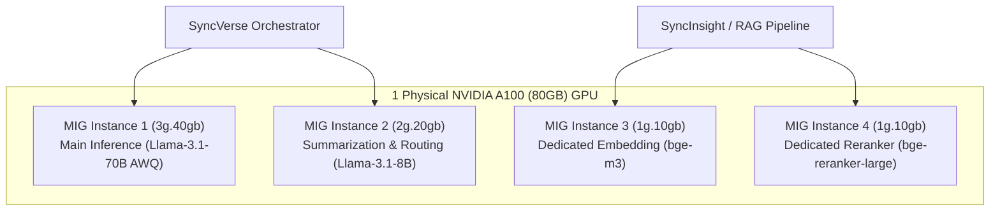

# Air-Gapped Local LLM Serving and vGPU Resource Partitioning

## 1. Overview and Background

To prevent core enterprise business logic, financial transaction records, personal information, or source code from being transmitted to external commercial APIs (e.g., OpenAI, Anthropic), SyncSeries supports an architecture that serves proprietary open-source models (e.g., Llama-3.3, OpenAI-o3) within physically isolated internal private clouds and on-premise GPU server environments.

This guide covers procedures for partitioning available GPU resources and ensuring serving stability in an internal data center environment using the high-performance inference engine **vLLM** and NVIDIA hardware virtualization technology **MIG (Multi-Instance GPU)**.



---

## 2. Hardware Virtualization Setup Using NVIDIA MIG

Loading only a single model onto a high-performance GPU (such as an A100 80GB or H100 80GB) wastes both memory and compute units. Applying MIG technology enables a physical GPU to be partitioned into independent instances that are completely isolated at the hardware level.

### Enabling MIG and Creating Instances
```bash
# 1. Enable MIG mode on the GPU (no reboot required)
sudo nvidia-smi -i 0 -mig 1

# 2. Check supported profiles
nvidia-smi mig -lgip

# 3. Create partitioned instances (e.g., one 40GB, one 20GB, two 10GB)
# Based on profile IDs 9 (3g.40gb), 14 (2g.20gb), and 19 (1g.10gb)
sudo nvidia-smi mig -cgi 9,14,19,19 -C

# 4. Verify UUIDs of created MIG devices
nvidia-smi -L
```

---

## 3. Kubernetes Deployment Manifest for the vLLM Inference Engine

Each partitioned MIG instance is deployed with a 1:1 mapping to a Kubernetes Pod. PagedAttention and quantization (AWQ) options are applied to prevent memory fragmentation and maximize throughput.

```yaml
apiVersion: apps/v1
kind: Deployment
metadata:
  name: vllm-llama-70b
  namespace: sync-ai
spec:
  replicas: 1
  selector:
    matchLabels:
      app: vllm-llama-70b
  template:
    metadata:
      labels:
        app: vllm-llama-70b
    spec:
      containers:
      - name: vllm-server
        image: vllm/vllm-openai:v0.6.3
        args:
        - "--model=/models/Llama-3.1-70B-Instruct-AWQ"
        - "--quantization=awq"
        - "--max-model-len=16384"
        - "--gpu-memory-utilization=0.92"
        - "--enforce-eager"
        - "--port=8000"
        env:
        - name: NVIDIA_VISIBLE_DEVICES
          value: "MIG-GPU-xxxx-xxxx" # Target MIG instance UUID
        ports:
        - containerPort: 8000
        resources:
          limits:
            nvidia.com/mig-3g.40gb: 1
            memory: 48Gi
            cpu: "8"
          requests:
            nvidia.com/mig-3g.40gb: 1
            memory: 32Gi
            cpu: "4"
        volumeMounts:
        - name: model-storage
          mountPath: /models
          readOnly: true
      volumes:
      - name: model-storage
        persistentVolumeClaim:
          claimName: nfs-ai-models-pvc
```

---

## 4. Model Serving Tuning and Performance Optimization Guide

### 1) Applying AWQ 4-Bit Quantization
- Models with 32B parameters or more require roughly 65GB or more of VRAM when loaded with 16-bit (FP16) weights, which exceeds the capacity of a 40GB MIG slice.
- Adopting an AWQ (Activation-aware Weight Quantization) 4-bit model compresses model weight size to approximately 20GB while keeping causal reasoning performance degradation below 1%, allowing the model to reside comfortably within a `3g.40gb` slice.

### 2) PagedAttention Memory Optimization
- Set `gpu-memory-utilization` between `0.90` and `0.92` to reserve maximum memory for the KV cache.
- Even under heavy concurrent request loads, requests are processed reliably in the waiting queue (Continuous Batching) without Out of Memory (OOM) crashes.

### 3) Health Checks and Failover Configuration
- Bind vLLM's `/health` endpoint to Kubernetes `livenessProbe` and `readinessProbe`.
- If temporary overload occurs on an inference engine, incoming traffic is immediately halted and automatically distributed to standby secondary instances.
