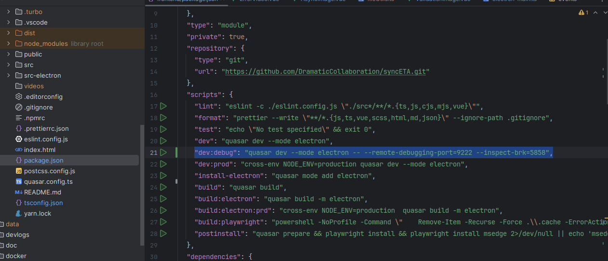
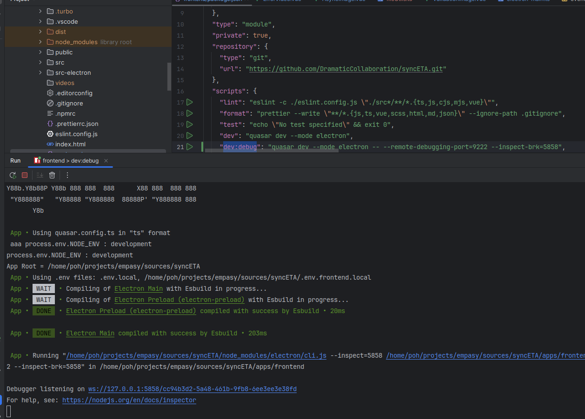
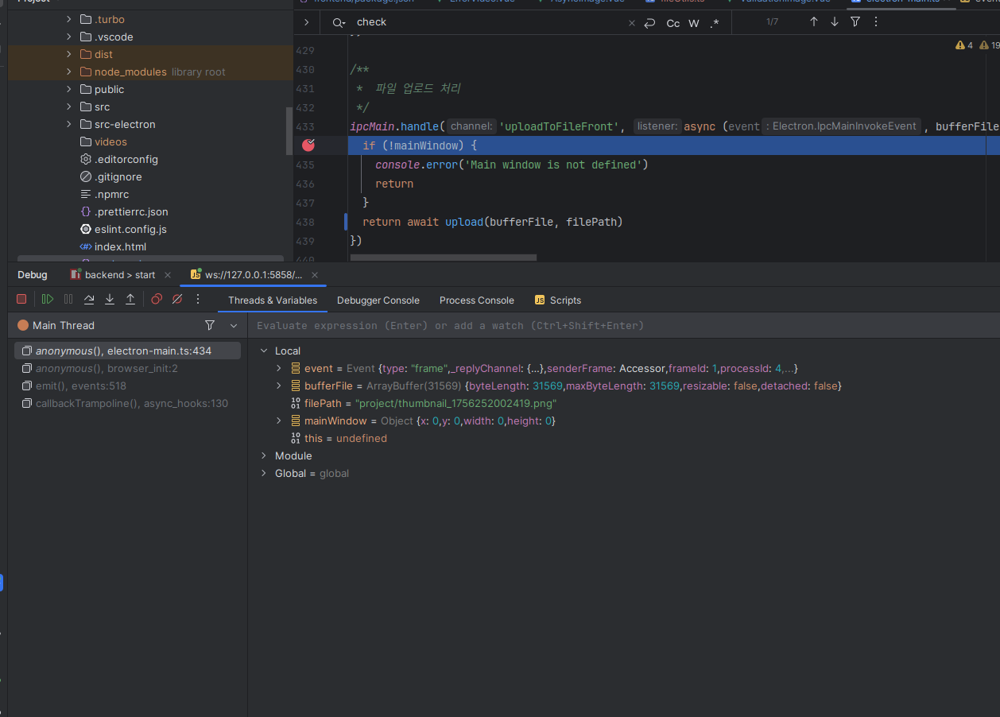

# Guide to Attaching an IntelliJ IDEA Remote Debugger to the Electron Main Process

The SyncETA desktop application operates on a multi-process architecture consisting of the **Electron Main Process (Node.js / Playwright control)** and the **Renderer Process (Vue 3 UI)**. This document describes the standard procedure for attaching a remote debugger from IntelliJ IDEA to the Electron main process via the V8 Inspector WebSocket (`ws://127.0.0.1:5858`) and tracing breakpoints.

---

## 1. Launch in Debug Mode (`dev:debug`)

Run the `dev:debug` script defined in `package.json` to start the Electron main process with the `--inspect=5858` flag.

| Script | Internal Flag | Default Debug Port |
| :--- | :--- | :--- |
| `yarn dev:debug` | `electron --inspect=5858 .` | `127.0.0.1:5858` (V8 Inspector WebSocket) |

---

## 2. Connect to the V8 Inspector Remote Debugger Socket

`Ctrl + Click` (or `Cmd + Click`) the `Debugger listening on ws://127.0.0.1:5858/...` link printed in the terminal console to immediately attach IntelliJ's built-in JavaScript/Node.js debugger.

---

## 3. Set Breakpoints and Inspect Runtime State

When you set breakpoints in the main process TypeScript source code (such as IPC handlers or Playwright browser context controllers), execution pauses when an event is invoked, allowing you to inspect the Call Stack and local variable states in real time.

---

## 4. Debugging Targets and Precautions by Process

| Process | Execution Runtime | Debugger Attachment Method | Primary Debugging Targets |
| :--- | :--- | :--- | :--- |
| **Main Process** | Node.js / Electron Main | `ws://127.0.0.1:5858` V8 Inspector socket connection | `ipcMain.handle`, Playwright browser pool control, local file I/O |
| **Preload Script** | Isolated Context Bridge | Chromium DevTools (`Ctrl+Shift+I`) Sources tab | `contextBridge.exposeInMainWorld` API binding verification |
| **Renderer Process** | Chromium / Vue 3 | Chromium DevTools or Vite HMR console | Vue 3 component state (Pinia), scenario canvas UI rendering |

> [!TIP]
> Pausing for an extended period at a main process breakpoint may cause IPC response timeouts in the renderer process. When debugging asynchronous IPC calls, it is recommended to temporarily relax timeout thresholds or use conditional breakpoints.
