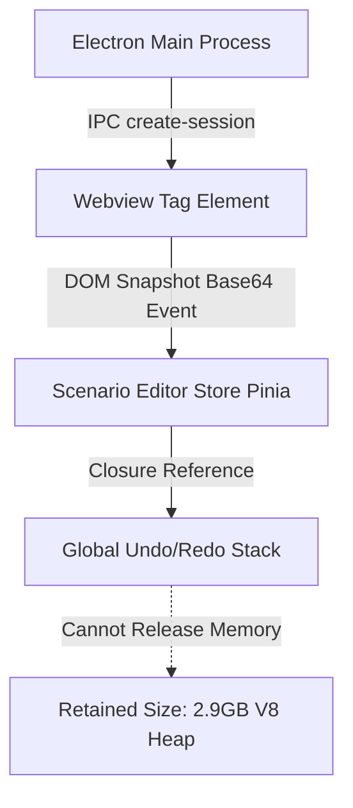

# [Postmortem] Analysis and Resolution of Electron Multi-Webview DOM Snapshot Memory Leak

## 1. Overview and Incident Symptoms

- **Incident Time**: 2026-02-10 14:20 KST
- **Affected Scope**: SyncETA Desktop Application (v0.0.31 build)
- **Symptoms**: When a user sequentially executed 30 or more E2E scenarios or maintained a long recording session, the Electron renderer process memory footprint steadily climbed from 800 MB to **3.8 GB**, eventually crashing with a white-out screen and `STATUS_BREAKPOINT (0x80000003)`.

---

## 2. Root Cause Analysis

We performed heap profiling using the **Heap Snapshot** and **Allocation Instrumentation on Timeline** tools in the Chrome DevTools Memory tab.



### Three Core Leak Causes

1. **CDP Listener Leak on Webview Destruction**:
   When switching to a new scenario tab, the previous `<webview>` element was removed from the DOM, but the `Page.screencastFrame` event listener on the background CDP session was never detached, causing frame buffers to continuously accumulate in memory.
2. **Heap Fragmentation from Base64 Image Strings**:
   Viewport screenshots for step verification were stored in the Vue reactive store (Pinia) as Base64-encoded strings (~1.8 MB per screenshot), rapidly inflating the V8 Old Space heap.
3. **Unbounded Undo/Redo History Stack**:
   The history stack had no maximum depth limit (Max Depth), preventing all historical DOM tree snapshot objects from ever being reclaimed by the Garbage Collector (GC).

---

## 3. Remediation and Code Patches

### (1) Explicit Webview Lifecycle Termination and WeakRef Transition

```typescript
// Before patch: Simple DOM node removal
webviewContainer.removeChild(webviewElement);

// After patch: Detach CDP session and explicitly destroy resources
export async function destroyWebviewSession(webview: Electron.WebviewTag): Promise<void> {
  try {
    const wc = webview.getWebContents();
    if (wc && !wc.isDestroyed()) {
      wc.debugger.detach();
      wc.stop();
    }
  } catch (err) {
    console.warn('[Cleanup] WebContents already detached:', err);
  } finally {
    webview.src = 'about:blank';
    webview.remove();
  }
}
```

### (2) Screenshot Binary Disk Offloading (Off-Heap Caching)

Instead of retaining Base64 strings in memory, we redesigned the pipeline to write WebP-compressed binaries directly to the app's temporary cache directory and reference only local file URIs (`file://...`).

```typescript
// Snapshot persistence pipeline
export async function persistStepSnapshot(stepId: string, imageBuffer: Buffer): Promise<string> {
  const cachePath = path.join(app.getPath('userData'), 'snapshots', `${stepId}.webp`);
  await fs.promises.writeFile(cachePath, imageBuffer);
  return `sync-file://${cachePath}`;
}
```

### (3) History Queue Size Limit and Circular Buffer Adoption

We capped the Undo/Redo history at a maximum of 20 entries and immediately unlinked (deleted) expired snapshot files asynchronously.

---

## 4. Verification Results and Metrics

After applying the patches, we ran a load test in the identical environment (Windows 11, unattended batch execution of 100 consecutive regression scenarios).

| Metric | Before Patch (v0.0.31) | After Patch (v0.0.33) | Improvement |
|:---|:---|:---|:---|
| **Peak Renderer Memory Usage** | 3,850 MB (Crash) | **410 MB (Stabilized)** | **89.3% reduction** |
| **Residual Memory After Long Run** | 3.2 GB leaked | **180 MB (Reclaimed by GC)** | **Proper reclamation verified** |
| **100-Scenario Completion Rate** | 24% (Frequent crashes) | **100% (0 crashes)** | **Stability achieved** |

---

## 5. Preventive Measures

1. **Added Automated Memory Regression CI Test**: Added a 50-iteration consecutive smoke test measuring `process.memoryUsage()` to the Playwright-based E2E pipeline, failing the build if usage exceeds 600 MB.
2. **Established Internal Electron Development Guidelines**: Mandated lifecycle teardown hooks whenever using `Webview` or `BrowserView`.
