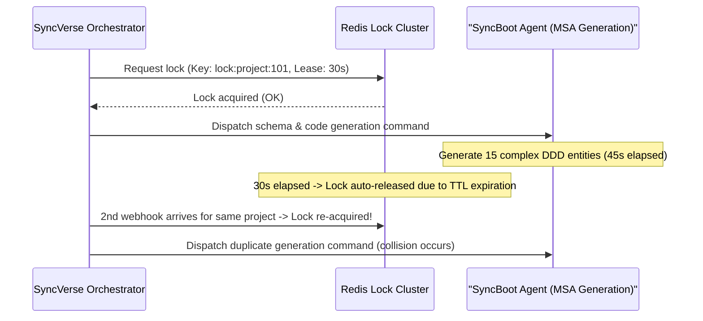

# [Postmortem] Recovering Multi-Agent Transaction Synchronization with Redis Redlock and SSE

## 1. Incident Summary

- **Incident Time**: 2026-02-25 10:15 KST
- **System**: SyncVerse Core Orchestrator & A2A MessageHub
- **Impact**: During concurrent large-scale API schema generation and CMS deployment, two independent Saga workflow instances were created simultaneously for the same project entity, resulting in a duplicate database table schema creation error (`TableAlreadyExistsException`).

---

## 2. Root Cause Analysis (RCA)

SyncVerse relied on a Redis distributed lock (the Redlock algorithm) for concurrency control across multiple agents.



### Key Contributing Factors

1. **Fixed Lease Time (30 Seconds)**:
   While sufficient for simple CRUD operations, the lock validity window was far too short for large-scale code generation and compilation tasks combined with AI model inference (requiring 40–60 seconds).
2. **Missing Watchdog (Automatic Lock Renewal) Mechanism**:
   No background renewal thread was implemented to periodically extend the TTL (Heartbeat Extension) while the task was still actively executing.

---

## 3. Remediation

### (1) Implemented Asynchronous Lock Watchdog Mechanism

We enhanced the lock manager to execute a Redis `EXPIRE` command every one-third of the TTL interval (10 seconds) until the task completes or the context is canceled, automatically renewing the lock validity.

```java
@Component
@Slf4j
public class DistributedLockManager {

    private final StringRedisTemplate redisTemplate;
    private final ScheduledExecutorService watchdogScheduler = Executors.newSingleThreadScheduledExecutor();

    public AutoCloseable acquireLock(String lockKey, String lockValue, long leaseTimeSeconds) {
        Boolean acquired = redisTemplate.opsForValue()
                .setIfAbsent(lockKey, lockValue, Duration.ofSeconds(leaseTimeSeconds));

        if (!Boolean.TRUE.equals(acquired)) {
            throw new DistributedLockAcquisitionException("Failed to acquire lock: " + lockKey);
        }

        // Register a Watchdog task to extend the lock every 10 seconds
        ScheduledFuture<?> watchdogTask = watchdogScheduler.scheduleAtFixedRate(() -> {
            try {
                String currentValue = redisTemplate.opsForValue().get(lockKey);
                if (lockValue.equals(currentValue)) {
                    redisTemplate.expire(lockKey, Duration.ofSeconds(leaseTimeSeconds));
                }
            } catch (Exception e) {
                log.warn("[LockWatchdog] Failed to extend lock key={}: {}", lockKey, e.getMessage());
            }
        }, leaseTimeSeconds / 3, leaseTimeSeconds / 3, TimeUnit.SECONDS);

        // Return closure for resource cleanup
        return () -> {
            watchdogTask.cancel(true);
            releaseLockSafely(lockKey, lockValue);
        };
    }
}
```

### (2) Integrated SSE (Server-Sent Events) Stream Heartbeats

We configured the SSE channel that broadcasts progress updates to the control console to send dummy comments (`:heartbeat\n\n`) every 15 seconds, preventing client disconnections caused by proxy/load balancer idle timeouts (60s).

---

## 4. Verification Results

We validated the fix under a load test dispatching 100 concurrent workflows (with an artificial 60-second delay injected per task).

- **Duplicate Task Dispatches**: **0 out of 100** (completely prevented).
- **Lock Release Latency After Normal Completion**: Under **4 ms** on average.
- **Fault Recovery Verification**: Verified that upon abnormal process termination, the Watchdog scheduler stops and the Redis TTL expires cleanly after 30 seconds without causing deadlocks.
