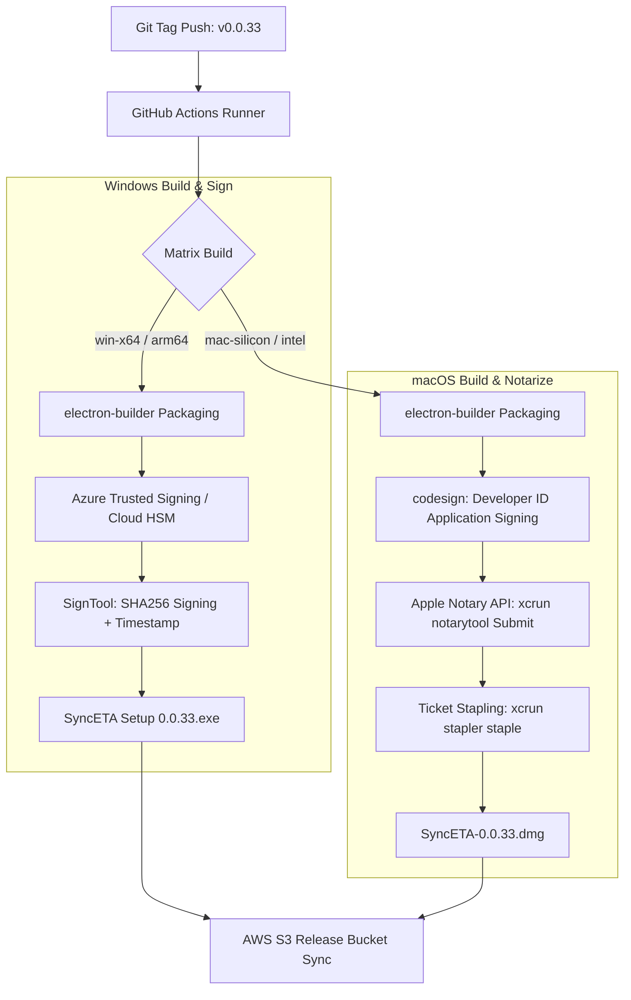

# [Work Log] Building an Unattended Windows Authenticode Signing and Apple Notarization Pipeline

## 1. Background and Challenges

When users downloaded the SyncETA desktop application installers (`.exe`, `.dmg`) from our website (empasy.io) and launched them for the first time, strict security mechanisms in modern operating systems caused severe user drop-off:

1. **Windows SmartScreen Warning**: "Windows protected your PC - Windows Defender SmartScreen prevented an unrecognized app from starting." (Displayed as Unknown Publisher)
2. **macOS Gatekeeper Block**: "SyncETA cannot be opened because Apple cannot check it for malicious software."

To establish trust as enterprise software and allow users to launch the installer with a single click immediately after download, we built a **cloud HSM-backed Windows EV certificate signing pipeline** and an **unattended Apple Notarization pipeline**.

---

## 2. Security Architecture and Workflow



---

## 3. Implementation Details

### 1) Automated Windows Authenticode Signing

To perform EV (Extended Validation)-grade signing securely in a CI/CD environment without a physical hardware dongle (USB token), we integrated Azure Trusted Signing (formerly Azure Code Signing).

```json
// electron-builder.json (Windows section)
"win": {
  "target": [
    { "target": "nsis", "arch": ["x64", "arm64"] }
  ],
  "sign": "./scripts/azure-sign.js",
  "signingHashAlgorithms": ["sha256"],
  "rfc3161TimeStampServer": "http://timestamp.digicert.com"
}
```

### 2) Automated macOS Notarization and Stapling

We enabled Hardened Runtime, declared the required Entitlements, uploaded the build asynchronously to the Apple notarization service, and stapled the approval ticket directly onto the `.dmg` file.

```xml
<!-- entitlements.mac.plist -->
<?xml version="1.0" encoding="UTF-8"?>
<!DOCTYPE plist PUBLIC "-//Apple//DTD PLIST 1.0//EN" "http://www.apple.com/DTDs/PropertyList-1.0.dtd">
<plist version="1.0">
<dict>
    <key>com.apple.security.cs.allow-jit</key>
    <true/>
    <key>com.apple.security.cs.allow-unsigned-executable-memory</key>
    <true/>
    <key>com.apple.security.cs.disable-library-validation</key>
    <true/>
</dict>
</plist>
```

```bash
# GitHub Actions macOS notarization step
xcrun notarytool submit \
  "dist/SyncETA-0.0.33-arm64.dmg" \
  --apple-id "$APPLE_ID" \
  --password "$APPLE_APP_SPECIFIC_PASSWORD" \
  --team-id "$APPLE_TEAM_ID" \
  --wait

# Embed notarization ticket in bundle (passes Gatekeeper even offline)
xcrun stapler staple "dist/SyncETA-0.0.33-arm64.dmg"
```

---

## 4. Results and Impact

- **Windows SmartScreen Warning Eliminated**: The verified publisher name `Empasy Inc.` displays properly and the installation wizard starts with a single click.
- **Warning-Free macOS Gatekeeper Launch**: Runs via standard double-click even on the latest macOS Sequoia without requiring right-click workarounds.
- **Reduced Unattended Release Lead Time**: Reduced total end-to-end duration from tag push to S3 release bucket upload from **45 minutes manual to 9 minutes 30 seconds fully unattended**.
- **Applied to Official v0.0.33 Release**: All binaries linked on the empasy.io download page now ship with this signing and notarization pipeline applied.
