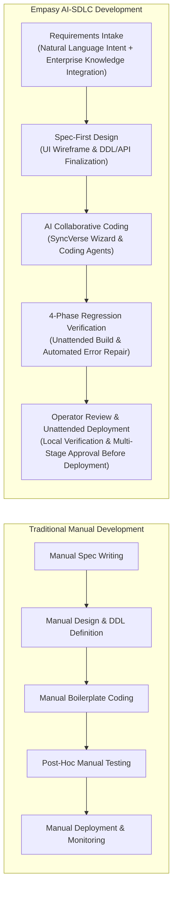
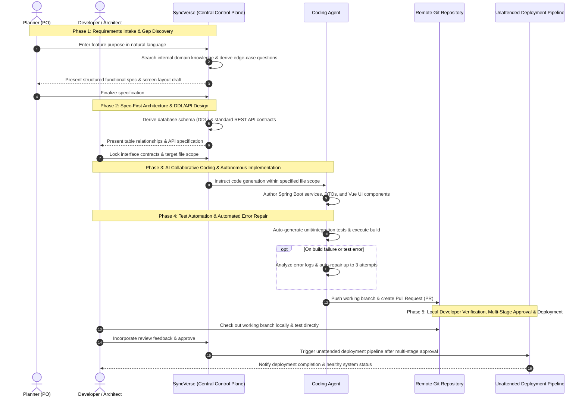

# Empasy AI Software Development Lifecycle (Empasy AI-SDLC)

> **Summary:** The Empasy AI Software Development Lifecycle (Empasy AI-SDLC) is a practical engineering methodology that systematically orchestrates and verifies the entire software development lifecycle (SDLC)—from business requirements intake to architecture design, code implementation, automated testing, human-in-the-loop approval, and unattended deployment—through **SyncVerse**, Empasy's enterprise orchestration platform, and **AI agents**.

::: tip Quick Links to Step-by-Step Practical Guides
Access hands-on guides and prompt examples for each phase of your project:
* **[Enterprise End-to-End Project Lifecycle (RFP to Go-Live)](./enterprise-project-lifecycle.md)**: End-to-end organizational operations from proposal to launch
* **[Phase-by-Phase Action Items & SOP Guide](./enterprise-action-items-guide.md)**: Concrete action items and standard operating procedures by phase
* **[Pre-Sales & Proposal Playbook](./presales-ai-playbook.md)**: RFP analysis, PoC demo creation, and effort estimation
* **[Phase 01: Planning & Requirements Specification Guide](./ai-sdlc-01-requirements.md)** (For Planners / POs)
* **[Phase 02: Spec-First Architecture & DDL/API Design Guide](./ai-sdlc-02-architecture.md)** (For Architects / Lead Developers)
* **[Phase 03: AI Collaborative Coding & Autonomous Implementation Guide](./ai-sdlc-03-implementation.md)** (For Developers)
* **[Phase 04: Test Automation & 4-Phase Automated Error Repair Guide](./ai-sdlc-04-testing.md)** (For QA / Developers)
* **[Phase 05: Code Review & Unattended Deployment Guide](./ai-sdlc-05-review-deploy.md)** (For Reviewers / Operators)
* **[Appendix: Practical Prompt Recipes by Scenario](./ai-sdlc-prompt-recipes.md)** (For All Roles)
:::

---

## 1. Overview & Definition

### 1.1. Background & Rationale for AI-Driven Development

#### Limitations of Traditional Software Development
Traditional Waterfall and Agile workflows relied heavily on manual data entry and human memory:
* **Repetitive Work Fatigue**: Significant engineering time was consumed by standardized tasks such as data model conversions, basic CRUD implementation, configuration files, and foundational unit tests.
* **Semantic Drift in Communication**: As a planner's intent passed through documents and tickets to developers, differences in interpretation frequently caused rework.
* **Late Defect Discovery**: Interface mismatches and regression bugs were often discovered only late in development or right before deployment, driving up remediation costs.
* **Drift Between Documentation and Code**: Under release deadline pressure, code changed while documentation went unupdated, making it difficult to trace system history.

#### Benefits and Paradigm Shift of Empasy AI-SDLC
Empasy AI-SDLC goes beyond simple chatbot assistants by centrally orchestrating the entire engineering pipeline and cross-verifying deliverables at every phase. Using SyncVerse as the central orchestration engine, engineers move away from repetitive boilerplate coding and focus on system architecture design and core business logic verification.

| Comparison Area | Traditional Development | Empasy AI-SDLC | Expected Practical Impact |
| :--- | :--- | :--- | :--- |
| **Requirements Definition** | Writing dozens of pages of static documents | Conversational requirements refinement and automated spec structuring | Reduced misinterpretation across teams |
| **Design Approach** | Incremental interface changes mid-implementation | Upfront finalization of data models (DDL) and API contracts | Guaranteed UI-to-server consistency |
| **Code Implementation** | Developers manually authoring files from scratch | Automated generation of framework-standard code with AI collaboration | Faster delivery of core features |
| **Quality Verification** | Post-hoc manual testing after implementation | 4-phase iterative build verification and automated error repair loop | Earlier defect detection and higher stability |
| **Deployment & Operations** | Manual developer deployments and incident tracing | Unattended deployment and rollback after multi-stage operator approval | Deployment reliability and full auditability |

---

### 1.2. Goals & Scope of Application

#### Core Goals
1. **Shorter Development Lead Time**: Substantially reduce the end-to-end time from initial planning concepts to production-ready code.
2. **Built-In Software Quality**: Finalize specifications before coding and run 4-phase regression verification to minimize runtime errors.
3. **Architectural Standardization**: Consistently enforce enterprise-wide standard libraries (Lombok, AgentScope Java, etc.) and shared framework conventions.

#### Phased Adoption Scope
* **Stage 1 (Tool Assistance)**: Developers use AI inside their IDE for code autocompletion and straightforward refactoring.
* **Stage 2 (Feature-Level Autonomy)**: Use the SyncVerse 4-phase wizard to handle specification extraction, code mutation, and build verification for individual features in one integrated flow.
* **Stage 3 (Enterprise Collaborative Ecosystem)**: Planners, developers, QA, and operators run the full development pipeline under central orchestration with formal approval workflows.

---

### 1.3. Key Terminology

* **SyncVerse**: Empasy's central orchestrator and control plane that coordinates all development and operational workflows.
* **AI Agent**: An autonomous execution unit that sequentially invokes required tools—such as file exploration, code authoring, and terminal command execution—to achieve a given objective.
* **Domain Agent**: A specialized agent dedicated to a specific business domain (SyncCMS: content, SyncShop: e-commerce, SyncBoot: shared backend, SyncLLM: AI gateway).
* **Spec-First Development**: An engineering approach in which database schemas and API input/output contracts are finalized before writing application code.
* **Acceptance Criteria**: Concrete completion conditions used to judge whether a planned feature has been implemented accurately.
* **Auto Repair / Self-Healing**: A procedure in which AI analyzes build or test failure logs, repairs the code autonomously, and re-runs the build.
* **Human-in-the-Loop (HITL)**: A safety control mechanism requiring human inspection and explicit approval before high-risk actions such as database changes, permission updates, or production deployments.

---

## 2. Five-Phase Flow of the Empasy AI-SDLC

The Empasy AI-SDLC workflow progresses through **Requirements Intake -> Spec-First Design -> Implementation -> 4-Phase Verification -> Review & Deployment**.

---

### 2.1. Phase 1: Requirements Analysis & Planning
* **Objective**: Clarify planning intent and proactively uncover easily overlooked exception scenarios.
* **Key Activities**:
  * The planner enters the background and goal of the feature in natural language.
  * SyncVerse queries the internal knowledge base (RAG) and asks the planner about missing edge cases (expiration, insufficient balance, duplicate requests, etc.).
  * Finalize user-perspective behavioral acceptance criteria (Given-When-Then format) and screen wireframes.
* **Detailed Practical Guide**: [Phase 01: Planning & Requirements Specification Guide](./ai-sdlc-01-requirements.md)

---

### 2.2. Phase 2: Spec-First Architecture Design
* **Objective**: Finalize data models and API input/output contracts before coding to eliminate mismatches between server and frontend.
* **Key Activities**:
  * Author the 6-file DDL schema (`00_extensions.sql` ~ `05_sample_dev.sql`) targeting PostgreSQL 18.6.
  * Eliminate temporary conflict-avoidance clauses (`ON CONFLICT`) and declare exact constraints and indexes.
  * Pre-define standard REST API endpoints (`/api/v1/{domain}/{resource}`) following the single-mapping principle.
* **Detailed Practical Guide**: [Phase 02: Spec-First Architecture & DDL/API Design Guide](./ai-sdlc-02-architecture.md)

---

### 2.3. Phase 3: AI Collaborative Coding & Autonomous Implementation
* **Objective**: Author source code rapidly and safely while adhering to enterprise architecture standards.
* **Key Activities**:
  * Explicitly define the editable file scope (`focusFiles`) to isolate changes and prevent unintended side effects in other modules.
  * Backend: Enforce Lombok annotations, single canonical URL mapping, and AgentScope Java tool integration.
  * Frontend: Separate `BasicModal` components and follow database-driven dynamic menu routing.
  * Eliminate fake dummy responses (Mock) and ensure full live integration with the real database.
* **Detailed Practical Guide**: [Phase 03: AI Collaborative Coding & Autonomous Implementation Guide](./ai-sdlc-03-implementation.md)

---

### 2.4. Phase 4: Test Automation & 4-Phase Regression Verification
* **Objective**: Verify that authored code is free of syntax, interface, and business-logic defects, and repair errors autonomously when they occur.
* **Key Activities**:
  * Automatically generate unit tests (JUnit 5, Vitest) covering exception scenarios.
  * **4-Phase Verification Loop**:
    1. Source code compilation verification
    2. API and DTO interface consistency verification
    3. Business logic unit/integration test verification
    4. Final clean packaging build verification
  * When build errors occur, automatically repair code up to 3 attempts via `autoRepairCode`.
* **Detailed Practical Guide**: [Phase 04: Test Automation & 4-Phase Automated Error Repair Guide](./ai-sdlc-04-testing.md)

---

### 2.5. Phase 5: Code Review & Safe Deployment
* **Objective**: Enable human code verification and deploy reliably through a multi-stage approval workflow.
* **Key Activities**:
  * AI automatically drafts a Pull Request (PR) summary detailing changes (Git Diff).
  * Developers check out the working branch in their local IDE, test directly, and leave inline feedback where needed.
  * Route high-risk changes through multi-stage approval (`Developer` -> `QA` -> `Admin`).
  * Execute unattended deployment, and apply configuration updates dynamically at runtime without restarting servers.
* **Detailed Practical Guide**: [Phase 05: Code Review & Unattended Deployment Guide](./ai-sdlc-05-review-deploy.md)

---

## 3. Practical Engineering Tools & Prompt Usage

Ready-to-use prompts and rule configuration files for day-to-day engineering are provided in dedicated documents:
* **[Practical Prompt Recipes by Scenario (Cheat Sheet)](./ai-sdlc-prompt-recipes.md)**: Copy-and-paste templates for planning, DDL design, backend services, frontend modals, unit tests, and debugging.
* **Shared Agent Rule Injection**: Consistently configure enterprise standards (AgentScope Java, mandatory Lombok, single canonical URL, modal separation, Zero-Mock 4-Cycle verification) in `.agents/AGENTS.md` at the repository root and in IDE rule files (`.cursorrules`, `copilot-instructions.md`, etc.).

---

## 4. Adoption Roadmap & Performance Management

### Phased Rollout Procedure
1. **Pilot Operation (Months 1–2)**: Select a pilot engineering team to trial Spec-First design and AI pair coding.
2. **Process Standardization (Months 3–4)**: Integrate the 4-phase build verification and automated error repair loop into CI pipelines.
3. **Domain Agent Integration (Months 5–6)**: Expand usage across domain-specific agents such as SyncCMS and SyncShop.
4. **Enterprise-Wide Institutionalization (Month 7+)**: Establish an autonomous collaborative workflow where everyone from planners to operators communicates through SyncVerse.

### Key Performance Metrics
* **Development Lead Time**: Track changes in total end-to-end lead time from feature planning to deployment.
* **Early Defect Rate**: Measure the number of defects requiring urgent hotfixes within 24 hours after deployment.
* **Test Coverage**: Track the ratio of automated test coverage across core business logic.
* **Rework Rate**: Monitor how often designs must be revised due to specification mismatches.
