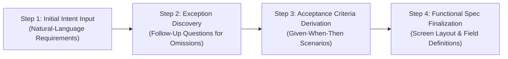

# [Phase 01] Planning & Requirements Specification Practical Guide

> **Phase Summary:** Starting from a simple idea or business request, use conversational Q&A with SyncVerse and AI to produce a **Functional Specification containing easily overlooked exception scenarios, explicit acceptance criteria, and screen layout wireframes**.

---

## 1. Phase Purpose & Target Roles

* **Primary Owners**: Service Planners, Product Owners (PO), Business Analysts
* **Collaborators**: Lead Developers, UI/UX Designers
* **Estimated Duration**: ~30 minutes to 1 hour per feature
* **Tools Used**: SyncVerse Requirements Analysis Wizard, Internal Domain Knowledge Hub, AI Chat Tools

---

## 2. Pre-Start Checklist (Entry Criteria)

Before beginning this phase, verify the following:
- Is the problem to be solved or customer pain point summarized in 1–2 sentences?
- Has the business domain for the feature been identified (e.g., orders, payments, members, content management)?
- Are existing internal screens or policy documents available for reference?

---

## 3. Four-Step Practical Execution Procedure



### Step 1: Initial Intent Input
Instead of filling out complex forms, the planner briefly enters the purpose and core flow of the desired feature in natural language.
> Example: *"I want to add a year-end discount coupon feature to our online store shopping cart. Members can select one of their owned coupons to receive a discount on the order total."*

### Step 2: Reverse-Questioning for Exception Conditions & Omissions
Prompt the AI to proactively ask about business and technical edge cases that the planner may not have considered yet.
* Example: *"If the coupon discount amount exceeds the shopping cart payment total, is the remaining balance forfeited, or can it be applied to a future order?"*
* Example: *"If a user cancels mid-checkout, should the coupon be restored immediately so it can be reused?"*

### Step 3: Deriving Scenario-Based Acceptance Criteria
Based on the Q&A, write behavioral criteria (`Given-When-Then`: Precondition – User Action – System Response) that planners, developers, and QA share as a common source of truth.

### Step 4: Finalizing the Functional Specification & Screen Layout
Document input/output data fields, validation rules, and a text-based screen layout in Markdown, and attach it to a Jira ticket or task management tool.

---

## 4. Practical Prompt Examples (Copy & Use)

### Prompt 1: Discovering Exception Scenarios & Missing Conditions
```markdown
[Role] Principal IT Service Planner and Business Analyst
[Context] Defining requirements for a new feature on an e-commerce platform.
[Feature Idea]
"{{Enter the core summary of the feature you want to plan in 2–3 lines}}"

[Request]
Based on the idea above, present 5 exception scenarios and edge cases as questions that must be decided before development begins:
- Policies for payment, cancellation, and refund
- Boundary conditions for minimum order amount and maximum discount cap
- Expiration handling and concurrent reuse attempts across multiple devices
- Stacking rules with other benefits (reward points, partner discounts, etc.)
```

---

### Prompt 2: Writing Scenario-Based Acceptance Criteria
```markdown
[Role] Requirements Analysis and Test Design Specialist
[Context] Based on the feature overview and policy decisions below, write QA-verifiable Acceptance Criteria.
[Feature Overview]
- Feature Name: {{Feature Name}}
- Confirmed Policies: {{Core policy decisions established from prior questions}}

[Output Format]
Apply the following structure to each user scenario:
- Scenario 1: Happy Path (Normal coupon application)
  - Given (Precondition):
  - When (User Action):
  - Then (System Response):
- Scenario 2: Invalid Input (Conditions not met)
- Scenario 3: Insufficient Balance or Expired Validity
- Scenario 4: Duplicate Request & Concurrency Error Handling
```

---

### Prompt 3: Structuring a Markdown Functional Spec & Screen Layout
```markdown
[Role] Technical Planner collaborating with the Engineering Team
[Input Data]
{{Previously finalized user scenarios and acceptance criteria}}

[Request]
Complete the functional specification in the Markdown format below so developers and designers can reference it immediately:
1. Feature Overview & Purpose
2. Screen Layout Wireframe (Markdown table or text layout diagram)
3. Screen Input Field Definitions (Field name, data type, required flag, helper/error text)
4. List of Data Items Required for Backend Integration
```

---

## 5. Common Mistakes & Precautions

| Mistake Type | Common Problem | Recommended Approach |
| :--- | :--- | :--- |
| **Using Vague Adjectives** | Writing unmeasurable phrases such as "loads quickly" or "shows an appropriate error message" | Specify concrete numbers (within 200ms) or exact user-facing text ("This coupon has expired."). |
| **Mandating Infrastructure During Planning** | Specifying implementation technologies in the planning doc, such as "cache in Redis and publish a Kafka topic" | Focus on user-visible screen behavior and business outcomes rather than specific infrastructure names. |
| **Omitting Security & Exception Rules** | Documenting only happy-path flows while omitting personal data exposure or concurrent request handling | Always review personal data masking rules and duplicate-click prevention criteria alongside core flows. |

---

## 6. Phase Completion Checklist (Exit Criteria)

Verify the following items before advancing to **[Phase 02: Spec-First Architecture Design](./ai-sdlc-02-architecture.md)**:
- [ ] Are core user scenarios and acceptance criteria fully documented?
- [ ] Is handling defined for key edge cases such as expiration, insufficient balance, and duplicate calls?
- [ ] Are the exact error messages shown to users finalized?
- [ ] Have the planner and lead developer completed a mutual review of the functional specification?

### Linked Official Deliverables (Phase 1)
* **[EMP-P1-13] Software Requirements Specification (SRS)** · **[EMP-P1-14] Requirements Traceability Matrix (RTM)** · **[EMP-P1-19] Internal/External Interface Specification Agreement** · **[EMP-P1-20] Scope Freeze Agreement** · **[EMP-P1-22] AI Governance & Trustworthiness Checklist** -> [Go to Standard Template Download Center](./enterprise-document-templates.md#emp-p1-13)
