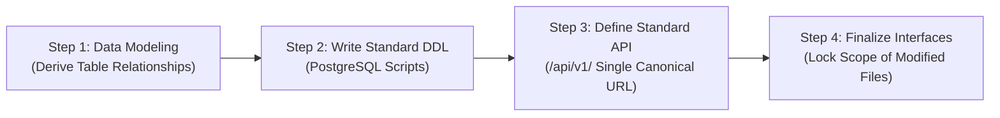

# [Phase 02] Practical Guide to Spec-First Architecture and DDL/API Design

> **Phase Summary:** Before writing any code, finalize the **database schema (PostgreSQL DDL) and standard REST API specification (OpenAPI/Swagger)** upfront (Spec-First Development) to establish interface contracts that allow backend and frontend teams to work in parallel without blocking each other.

---

## 1. Phase Objective and Audience

* **Primary Owners**: System Architect, Backend Lead Developer, Database Administrator (DBA)
* **Collaborators**: Frontend Lead, Security Administrator
* **Estimated Duration**: Approximately 30 minutes to 1 hour per module
* **Tools Used**: SyncVerse Schema Studio, PostgreSQL, OpenAPI/Swagger Editor

---

## 2. Pre-Start Checklist (Entry Criteria)

Verify the following items before starting this phase:
- Has the review of the [Phase 01] functional specification and completion criteria (acceptance criteria) been completed?
- Have the existing table structures and common entities (audit columns, common codes, etc.) of the target system been verified?
- Have the domain prefix conventions (e.g., `cms_` for CMS, `pms_`/`oms_` for Shop, `sys_` for platform common) been established?

---

## 3. Four-Step Practical Workflow



### Step 1: Data Modeling and Deriving Table Relationships
Design table structures that satisfy all requirements and identify relationships (`1:N`, `N:M`) with existing tables. When modifying existing tables, assess the impact of column additions or type changes in advance.

### Step 2: Writing Standard PostgreSQL DDL Scripts
Write scripts conforming to the enterprise standard `<subproject>/db/` directory structure:
* `00_extensions.sql`: Declare required extension modules
* `02_schema_domain.sql`: Business table creation (DDL), primary keys (PK), foreign keys (FK), and indexes (`INDEX`)
* `04_seed_domain.sql`: Business menu permissions (`sys_permission`) and role mappings
* **Authoring Principle**: Exclude workaround clauses intended to bypass key collisions (such as `ON CONFLICT DO NOTHING`), and write pure `INSERT INTO` statements with pre-verified key integrity.

### Step 3: Defining Standard REST API Specifications
* **Single-Mapping Principle**: Never map multiple URLs to a single feature; define one clear Canonical URL only.
* **Standard Prefix Compliance**: Always declare endpoints under the `/api/v1/{domain}/{resource}` pattern.
* **Upfront OpenAPI 3.0 Specification**: Define request/response JSON formats upfront so the frontend team can reference them immediately.

### Step 4: Finalizing Interfaces and Locking Work Scope
Commit the finalized DDL and API specifications to the Git repository to lock the interfaces, enabling backend and frontend developers to begin implementation in parallel.

---

## 4. Practical Prompt Templates (Copy and Use)

### Prompt 1: Generating PostgreSQL DDL Schemas
```markdown
[Role] Principal Database Modeler and DBA
[Context]
- Database: PostgreSQL 18.6
- Domain: {{domain_name, e.g., shop_coupon}}
- Functional Requirements:
{{Functional specification finalized in Phase 01}}

[Authoring Rules]
1. Name tables in lowercase snake_case ({{domain_entity_name}}).
2. Apply the BIGINT standard for the primary key (id).
3. Include standard audit columns: created_at, updated_at, created_by, updated_by, and del_flag (soft-delete flag).
4. Create appropriate indexes for frequently queried conditions (member ID, status value, date).
5. Explicitly specify foreign keys (FK) and required constraints to ensure data integrity.
6. Instead of collision-bypass clauses (`ON CONFLICT DO NOTHING`, etc.), write pure CREATE TABLE and INSERT statements with guaranteed integrity.

[Output Format]
- Mermaid entity-relationship diagram
- 02_schema_domain.sql script (table creation, index creation)
- Table and column descriptions (COMMENT)
```

---

### Prompt 2: Defining Standard REST API Specifications and OpenAPI
```markdown
[Role] RESTful API Design Engineer
[Context] Based on the data model derived above, design the REST API specification to integrate with the frontend.
[Target Resource] {{resource_path, e.g., /api/v1/shop/cart/coupon}}

[Authoring Rules]
1. Single-Mapping Principle: Assign only one canonical URL per endpoint (avoid multiple URL mappings).
2. Follow the `/api/v1/{product}/{resource}` URL path format.
3. Separate HTTP methods (GET, POST, PUT, DELETE) according to their semantics.
4. Apply the standard response envelope (CommonResult: code, message, result, timestamp).
5. Use pageNo, pageSize, and sortField as standard parameters for paginated queries.

[Output Format]
1. API endpoint summary table (method, URL, description, permission)
2. Request/response JSON examples per endpoint (success and error cases)
3. OpenAPI 3.0 YAML specification snippet
```

---

### Prompt 3: Backend DTO and Entity Modeling (With Lombok)
```markdown
[Role] Spring Boot Backend Development Lead
[Context] Write Java entities and request/response DTOs corresponding to the DDL and API specifications above.

[Authoring Rules]
1. Apply Lombok annotations instead of manual getters/setters:
   - DTO: @Getter, @Setter, @Builder, @NoArgsConstructor, @AllArgsConstructor
   - Entity: @Getter, @NoArgsConstructor(access = AccessLevel.PROTECTED), @AllArgsConstructor, @Builder
2. Add Bean Validation annotations (@NotNull, @NotBlank, @Min, etc.) to DTO fields for input validation.
3. Propose static factory methods or mappers to facilitate conversion between entities and DTOs.
```

---

## 5. Common Mistakes and Precautions

| Mistake Type | Common Issue | Recommended Mitigation |
| :--- | :--- | :--- |
| **Multiple URL Mappings** | Writing `@RequestMapping({"/coupon", "/api/v1/coupon"})` for backward compatibility | Apply the single canonical URL principle and consolidate into a single `/api/v1/{domain}/...` path. |
| **Circular Reference Errors** | Indiscriminately applying `@Data` on bidirectional associations, causing infinite loops | Avoid `@Data` and declare `@Getter`, `@NoArgsConstructor`, `@Builder`, etc. individually. |
| **Overuse of Workaround Clauses** | Masking key collisions with `ON CONFLICT DO NOTHING` | Verify ID generation rules upfront and maintain pure `INSERT` statements that execute cleanly without duplicates. |

---

## 6. Phase Completion Checklist (Exit Criteria)

Verify the following items before proceeding to **[Phase 03: AI-Collaborative Coding and Implementation](./ai-sdlc-03-implementation.md)**:
- [ ] Do the DDL scripts execute cleanly without errors on the local database?
- [ ] Do all API URLs follow the standard `/api/v1/{domain}/...` prefix?
- [ ] Have request/response JSON specifications been shared for frontend developers to reference?
- [ ] Are input validation rules completely defined on all DTOs?

### Linked Official Deliverables (Phase 2)
* **[EMP-P2-11] System Architecture Description (SAD)** · **[EMP-P2-15] Development Standards and Environment Definition** · **[EMP-P2-20] Database Specification (9 Sheets)** · **[EMP-P2-22] Interface and API Specification** · **[EMP-P2-24] AI Inference and Prompt Design Specification** -> [Go to Standard Template Download Center](./enterprise-document-templates.md#emp-p2-11)
