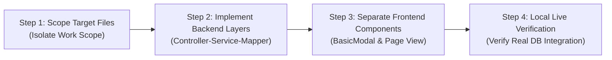

# [Phase 03] Practical Guide to AI-Collaborative Coding and Autonomous Implementation

> **Phase Summary:** Based on the finalized upfront data schemas and API specifications, **restrict the scope of modified files** to prevent unintended code changes, and implement production code while strictly adhering to enterprise architecture standards (Lombok usage, modal popup component separation, and dynamic menu integration).

---

## 1. Phase Objective and Audience

* **Primary Owners**: Backend Developer, Frontend Developer, Full-Stack Engineer
* **Collaborators**: System Architect, Code Reviewer
* **Estimated Duration**: Approximately 1 to 2 hours per unit feature
* **Tools Used**: SyncVerse Coding Agent, IDEs (Cursor, IntelliJ IDEA, VS Code), Local Infrastructure Environment

---

## 2. Pre-Start Checklist (Entry Criteria)

Verify the following items before starting this phase:
- Has the review of the [Phase 02] Spec-First Architecture (DDL and API specifications) been completed?
- Has a new working branch (`feat/xxx`) been created?
- Has the list of files to be modified (`focusFiles`) been identified?
- Is the local development infrastructure (`docker-compose-local.yml`, etc.) running properly?

---

## 3. Four-Step Practical Workflow



### Step 1: Scoping Modified Files (Work Target Isolation)
Allowing AI to modify the entire project without boundaries can lead to unintended changes in unrelated files. Explicitly specify the list of files required for the feature (`focusFiles`) to constrain the work scope.
* Example: `CouponController.java`, `CouponService.java`, `CouponRepository.java`, `CouponApplyModal.vue`

### Step 2: Layered Backend Implementation (AgentScope Java · Lombok Standard)
1. **Data Access Layer (Repository / Mapper)**: Write database query methods (connected to real PostgreSQL 18.6; dummy returns are strictly prohibited).
2. **Business Layer (Service)**: Implement validation checks (expiration, insufficient balance, duplicate prevention) and transaction management (`@Transactional`). Always isolate AI inference (`AgentScope Java`) and external MCP I/O outside `@Transactional`.
3. **Controller Layer (Controller)**: Use `@RequiredArgsConstructor` constructor injection, `@Slf4j` structured logging, and standard single Canonical URL mappings (`/api/v1/{product}/{resource}`).

### Step 3: Frontend Component Separation
1. **API Client Module**: Write communication functions that call standard backend URLs.
2. **Modal Popup Component Separation**: Avoid writing lengthy inline modal markup inside page view files; extract it into a standalone file (`components/CouponApplyModal.vue`).
3. **Dynamic Menu Registration**: Never hardcode routes in source code; manage them via the database permission table (`sys_permission`).

### Step 4: Local Live Integration Verification
Instead of using fake dummy data (hardcoded lists or empty return values), verify that the local database, backend, and frontend are actually connected and exchanging real data properly.

---

## 4. Practical Prompt Templates (Copy and Use)

### Prompt 1: Implementing Spring Boot Business Logic and Transactional Services
```markdown
[Role] Enterprise Spring Boot Developer
[Context]
- Tech Stack: Java 25, Spring Boot 4.0, PostgreSQL 18.6
- Target Implementation: {{domain_name, e.g., Coupon Application Service}}
- Finalized Upfront Specifications:
{{DDL and API specification finalized in Phase 02}}

[Authoring Rules]
1. Apply Lombok annotations:
   - Avoid @Autowired field injection; use private final fields with @RequiredArgsConstructor constructor injection.
   - Use @Slf4j for logging.
2. When writing business logic:
   - Apply @Transactional(readOnly = true) for read-only queries and @Transactional for data-mutating methods.
   - Throw an appropriate business exception (ServiceException) when conditions are not met.
   - Thoroughly validate input parameters to prevent NullPointerException.
3. Write complete code that calls the actual data access layer instead of temporary dummy returns (return null, etc.).

[Output Format]
1. CouponServiceImpl.java source code
2. Explanation of core validation logic
```

---

### Prompt 2: Implementing Vue 3 and Standalone Modal Popup Components
```markdown
[Role] Vue 3 and TypeScript Frontend Developer
[Context] Build a coupon selection popup modal that integrates with the backend API above.

[Authoring Rules]
1. Use the framework standard modal component, BasicModal.
2. Do not inline modal markup in the parent view; extract it into a standalone file (components/CouponApplyModal.vue).
3. Apply sufficient internal padding (p-4) so UI elements do not sit flush against the modal borders.
4. Include substantial interactive UI elements—such as tables, radio selection, and discount amount previews—rather than an empty placeholder screen.
5. Clearly define TypeScript interfaces (Props, Emits).

[Output Format]
- Complete source code for components/CouponApplyModal.vue
- Integration example showing how to open and close the modal from the parent view
```

---

### Prompt 3: Shared Agent Rules File Example (`.agents/AGENTS.md` / IDE Rules Integration)
```markdown
# Declare enterprise development standards in .agents/AGENTS.md at the project root (and IDE rule files):

You are an engineering agent strictly adhering to the project's development standards.
Follow these coding rules:
1. Java (JDK 25 / Spring Boot 4.0):
   - Apply Lombok to DTOs, Entities, and Services (@Getter, @Builder, @RequiredArgsConstructor, @Slf4j).
   - Controller mappings must use a single canonical URL in the `/api/v1/{product}/{resource}` format.
   - Use AgentScope Java as the standard for AI capabilities and invoke it outside @Transactional boundaries.
   - Temporary dummy returns (return null, etc.) and fake exception fallbacks are prohibited; connect real DB logic.
2. Vue 3 (Vben Admin):
   - Prioritize standard components: BasicTable, BasicModal, and BasicForm.
   - Extract modal popups into standalone files under components/<Name>Modal.vue with internal padding (p-4).
   - Do not hardcode static routes; comply with DB-driven (sys_permission) dynamic menu integration.
```

---

## 5. Common Mistakes and Precautions

| Mistake Type | Common Issue | Recommended Mitigation |
| :--- | :--- | :--- |
| **Leaving Dummy Data Behind** | Leaving `return new ArrayList<>()` in place for quick prototyping and forgetting to replace it | Verify that real database mapper and repository integration code is fully implemented. |
| **Inlining Modals** | Writing lengthy modal code at the bottom of a parent view file, degrading readability | Extract modals into separate files (`components/XxxModal.vue`) to preserve single responsibility. |
| **Modifying Out-of-Scope Files** | Failing to restrict the work scope, allowing unrelated config files to be altered arbitrarily | Limit target files upfront using `focusFiles` to strictly control the change boundary. |

---

## 6. Phase Completion Checklist (Exit Criteria)

Verify the following items before proceeding to **[Phase 04: Testing and Automated Remediation](./ai-sdlc-04-testing.md)**:
- [ ] Are Lombok and constructor injection applied across all DTOs, services, and controllers?
- [ ] Are modal popups extracted into standalone components?
- [ ] Do the frontend and backend integrate properly with the real database during local execution?
- [ ] Have no files outside the designated target list been modified? (Verify via `git status`)

### Linked Official Deliverables (Phase 3)
* **[EMP-P3-01] Weekly Work Report** · **[EMP-P3-10] Change Request Form (CR Form)** · **[EMP-P3-14] REST API Development Manual** · **[EMP-P3-15] AI Business Rules Dictionary** · **[EMP-P3-16] AI Prompt Specification** -> [Go to Standard Template Download Center](./enterprise-document-templates.md#emp-p3-01)
