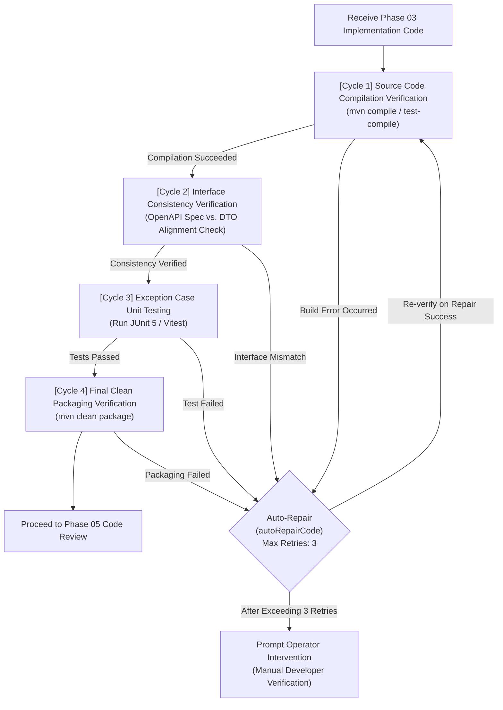

# [Phase 04] Practical Guide to Test Automation and 4-Cycle Auto-Repair

> **Phase Summary:** **Automatically generate unit and integration tests** for the implemented code, execute the enterprise-standard **4-Cycle regression verification (Compilation -> Interface -> Logic -> Clean Build)**, and run **automated error repair (`autoRepairCode`)** where AI analyzes error logs and fixes code upon failure.

---

## 1. Phase Objective and Audience

* **Primary Owners**: QA Engineer, Software Test Engineer, Backend/Frontend Developer
* **Collaborators**: System Architect, Release Manager
* **Estimated Duration**: Approximately 30 to 45 minutes per feature
* **Tools Used**: Maven / Gradle, JUnit 5, MockMvc, Vitest, SyncVerse Self-Healing Engine

---

## 2. Pre-Start Checklist (Entry Criteria)

Verify the following items before starting this phase:
- Has [Phase 03] code implementation been completed and passed initial local compilation?
- Have the per-scenario completion criteria (acceptance criteria) from the [Phase 01] functional specification been confirmed?
- Is the test database or test container environment ready?

---

## 3. Practical 4-Cycle Verification and Auto-Repair Workflow



### [Cycle 1] Static Zero-Mock Audit and Source Code Compilation Verification
* Pass static integrity checks (`verify-hardcoded-smells`, `verify-zero-mock`), then execute `mvn compile` and `mvn test-compile` (`pnpm build` and type checks for frontend) to block syntax errors, type mismatches, and dummy code violations upfront.

### [Cycle 2] Interface Contract and Security Secret Cross-Verification
* Verify 1:1 alignment (`verify-api-contracts`) between the OpenAPI specification defined upfront in Phase 02 and frontend-backend `/api/v1/` URLs, confirm zero plaintext secrets (`verify-security-leaks`), and inspect against the 49 MOIS/KISA secure software development weaknesses.

### [Cycle 3] Exception Case Unit/Integration Testing and AI Golden-Set Evaluation
* In addition to normal execution paths, run isolated unit tests (JUnit 5 / Vitest) for exception scenarios (expiration, insufficient balance, duplicate requests). When AI/LLM features are included, perform precision and recall regression evaluation against the **50-question standard golden set (EMP-P4-09)**.

### [Cycle 4] Final Clean Packaging and Independent QA Cross-Audit
* Clear previous build caches and run `mvn clean package`, then have an **independent QA subagent (or cross-reviewer)** cross-audit the modified files and Requirements Traceability Matrix (RTM) to issue the final pass verdict.

### Auto-Repair Loop (`autoRepairCode`)
* If an error occurs during verification, the system analyzes the error log to identify the root cause and automatically repairs the code.
* To prevent infinite loops, auto-repair is attempted up to 3 times; if failures exceed 3 attempts, the process safely halts and requests developer intervention.

---

## 4. Practical Prompt Examples (Copy and Use)

### Prompt 1: Automated Generation of Exception Case Unit Tests (JUnit 5)
```markdown
[Role] Senior QA Engineer & Backend Testing Specialist
[Context] Please write a JUnit 5-based unit test class for the business service code below.
[Code Under Test]
{{Service or Controller source code implemented in Phase 03}}
[Completion Criteria]
{{Situation-Action-Result scenarios derived in Phase 01}}

[Writing Rules]
1. In addition to normal execution cases, write individual @Test methods for the following exception scenarios:
   - Attempt to apply an expired coupon -> Verify the appropriate business exception is thrown
   - Attempt below minimum order amount -> Verify validation failure exception
   - Passing a non-existent ID -> Verify resource-not-found exception
   - Concurrent duplicate application by the same member -> Verify duplicate blocking
2. Use AssertJ (assertThat, assertThatThrownBy) to write clear, readable assertions.
3. Clearly state the test objective in @DisplayName.
```

---

### Prompt 2: Automated Build Error Repair (`autoRepairCode`)
```markdown
[Role] Software Debugging & Error Remediation Agent
[Context]
During build verification, the following compilation or test error occurred. Fix the error while preserving existing business policies.

[Error Log]
{{Build error stack trace content}}

[Failing Source Code]
{{Source code content of the affected file}}

[Writing Rules]
1. Root Cause Analysis: Summarize the core cause of the error in 2 lines or fewer.
2. Side-Effect Check: Confirm that the fix does not negatively impact other components.
3. Replacement Code: Provide the complete file content ready for direct replacement.
   - [Caution] Do not arbitrarily delete required validation statements (if checks) just to resolve the error.
   - [Caution] Do not leave method bodies empty (// TODO).
```

---

## 5. Common Mistakes and Precautions

| Mistake Type | Common Issue | Recommended Mitigation |
| :--- | :--- | :--- |
| **Tests Without Assertions** | Writing fake tests that only invoke a method without verifying results, causing them to always pass | Ensure every test method includes at least two result assertions (`assertThat`). |
| **Arbitrarily Deleting Validation Logic** | Removing essential service validation checks just to make tests pass | Instruct the repair process to preserve business validation checks while aligning types or parameters. |
| **Infinite Repair Retries** | Wasting time by endlessly rebuilding even when errors persist | Cap maximum retries at 3 and escalate to manual developer intervention if exceeded. |

---

## 6. Phase Completion Checklist (Exit Criteria)

Verify the following items before proceeding to **[Phase 05: Code Review and Autonomous Deployment](./ai-sdlc-05-review-deploy.md)**:
- [ ] Have all 4-Cycle Zero-Mock verifications (static/compilation, API contract & security, unit/integration/AI golden set, clean packaging & independent QA audit) passed?
- [ ] Have isolated unit tests for major exception scenarios been written and executed successfully?
- [ ] If auto-repair was triggered, does the repaired code preserve the original design intent?
- [ ] Are the build artifacts (such as JAR files) packaged properly?

### Linked Official Deliverables (Phase 4)
* **[EMP-P4-02] Unit Test Cases** · **[EMP-P4-04] Integration Test Scenarios & Results** · **[EMP-P4-06] 49 SW Secure Development Checklist (MOIS/KISA)** · **[EMP-P4-07] Open Source License Verification Report** · **[EMP-P4-09] AI Golden-Set Quality Evaluation Report** · **[EMP-P4-11] UAT Confirmation Certificate** -> [Go to Standard Template Download Center](./enterprise-document-templates.md#emp-p4-02)
