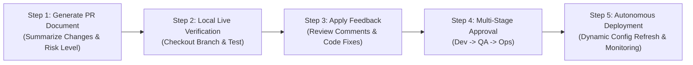

# [Phase 05] Practical Guide to Code Review and Autonomous Deployment

> **Phase Summary:** For a working branch that has passed 4-stage build verification, **AI generates a Pull Request (PR) summarizing change reasons and risk levels**, the assigned developer **runs and verifies it locally (Co-Dev)**, and the changes are safely deployed after **multi-stage approval**.

---

## 1. Phase Objective and Audience

* **Primary Owners**: Code Reviewer, Senior Developer, Tech Lead, Infrastructure/Deployment Engineer
* **Collaborators**: Business Planner, Security Officer
* **Estimated Duration**: Approximately 15 to 30 minutes per PR
* **Tools Used**: GitHub / GitLab, IntelliJ IDEA, Docker / K8s, CI/CD Deployment Pipeline

---

## 2. Pre-Start Checklist (Entry Criteria)

Verify the following items before starting this phase:
- Have all [Phase 04] 4-stage regression verifications and unit tests passed?
- Has the working branch (`feat/xxx`) been pushed to the remote repository?
- Has the latest source code from the target base branch (`main` or `dev`) been merged or rebased?

---

## 3. Five-Step Practical Workflow



### Step 1: Automated Pull Request (PR) Description Generation
Once the working branch is pushed, AI analyzes the modified code (Git Diff) and structures the following details in Markdown:
* **Background**: Planning intent and related work ticket numbers
* **Key Changes**: List of added or modified files
* **Database Changes**: Whether tables were created or columns were altered
* **Test Results Summary**: 4-stage verification status and newly added test cases

### Step 2: Developer Local Live Verification (Co-Dev Principle)
To avoid the risk of approving changes merely by skimming lines of code in a web UI, the developer checks out the working branch in a local terminal and runs it directly:
```bash
git fetch origin feat/issue-101-cart-coupon
git checkout feat/issue-101-cart-coupon
```
Set breakpoints in the local IDE and directly verify actual functional behavior and UI responsiveness.

### Step 3: Applying Feedback and Interactive Fixes
* Leave review comments wherever revisions are needed (for example, *"This loop may execute duplicate queries; please refactor it into a join query"*).
* AI or the assigned engineer applies the feedback and pushes follow-up commits.

### Step 4: Multi-Stage Approval Workflow (Human-in-the-Loop Approval Control)
Risk-sensitive tasks—such as database schema changes or core business logic updates—go through sequential approvals according to a predefined authorization matrix:
1. `Developer Approval`: Verify coding standards compliance and business logic soundness
2. `QA Approval`: Verify fulfillment of completion criteria and test scenarios
3. `Operator Approval`: Grant final authorization for deployment timing and system impact

### Step 5: Autonomous Deployment and Real-Time Monitoring
* Upon full approval, the deployment pipeline executes automatically and rolls out changes to the target servers.
* System configuration updates are applied immediately in memory via runtime events (`ConfigRefreshEvent`) without restarting the server.
* If post-deployment monitoring detects abnormal error rates, the system swiftly rolls back to the previous stable version.

---

## 4. Practical Prompt Examples (Copy and Use)

### Prompt 1: PR Description Generation from Code Changes (Git Diff)
```markdown
[Role] Release Engineering Technical Writer
[Context] Analyze the Git Diff generated from the working branch and write a Markdown PR description that is easy for reviewers to read.
[Git Diff Content]
{{Paste git diff content}}

[Sections to Include]
## 1. Overview (Why & What)
- Purpose and background of the feature addition (2-3 sentences)
## 2. Key Changes
- Summary of changes across Backend / Frontend / DB Schema
## 3. Precautions & Risk Check
- Impact on existing features (backward compatibility status)
- Query performance (usage of lookup indexes)
## 4. Verification Summary
- 4-stage verification results and list of executed unit tests
```

---

### Prompt 2: Senior Architect Code Review and Vulnerability Check
```markdown
[Role] Principal System Architect & Security Reviewer
[Context] Perform an in-depth code review on the newly authored PR code.
[Target Code]
{{Modified source code to review}}

[Review Criteria]
1. Concurrency: Is there any risk of data inconsistency under concurrent user requests?
2. Query Performance: Could N+1 problems or excessive full table scans occur on large datasets?
3. Enterprise Standards: Are Lombok usage, single canonical URLs (/api/v1/...), and modal component separation properly followed?
4. Security: Are there any SQL injection risks, sensitive data exposure in logs, or missing authorization checks?

[Output Format]
- Overall Recommendation (Approve / Request Changes)
- Specific improvement suggestions by file name and line number (including before/after code examples)
```

---

## 5. Common Mistakes and Precautions

| Mistake Type | Common Issue | Recommended Mitigation |
| :--- | :--- | :--- |
| **Visual-Only Review** | Relying solely on Markdown summaries and approving without local execution, leading to runtime bugs | Strictly uphold the Co-Dev verification principle by checking out and running the source code locally. |
| **Breaking Backward Compatibility** | Arbitrarily renaming existing API response fields, causing failures in integrated systems | Coordinate in advance with affected clients whenever modifying existing API specifications. |
| **Unilateral Single-Person Deployment** | Approving and immediately deploying critical database changes by a single individual | Enforce multi-stage approval workflows so multiple owners cross-verify changes. |

---

## 6. Phase Completion Checklist (Exit Criteria)

Verify the following items to conclude this AI-SDLC cycle and complete deployment:
- [ ] Has the developer checked out the source code locally and verified its behavior firsthand?
- [ ] Have all improvement comments raised during code review been resolved?
- [ ] Have all required approvals along the defined sign-off chain (Dev, QA, Ops) been completed?
- [ ] Do post-deployment system error rates and response times remain within normal thresholds?
- [ ] Have related functional specifications and system documentation been synchronized to the latest state?

### Linked Official Deliverables (Phase 5)
* **[EMP-P5-01] System Cutover Plan** · **[EMP-P5-02] Cutover Checklist** · **[EMP-P5-03] System Deployment and Rollback Runbook** · **[EMP-P5-04] Data Migration Reconciliation Matrix** · **[EMP-P5-12] Final Acceptance Completion Certificate** · **[EMP-P5-19] Monthly AI FinOps Settlement Report** -> [Go to Standard Template Download Center](./enterprise-document-templates.md#emp-p5-01)
