# Empasy Phase-by-Phase Action Items (45 Action Items) & Operational Execution Guide (SOP)

> **Overview:** This guide is the enterprise Standard Operating Procedure (SOP) defining **what (`Action Item`) each owner executes, in what sequence, which official template (`EMP-*`) to produce, and how to determine pass/fail acceptance** at every stage from **Phase 0 (Pre-Sales) to Phase 5 (Go-Live & Settlement)**.

::: tip Related Parent & Practitioner Guides
* **[Empasy Business & Project Management Standard Document Template Download Center (125 Templates)](./enterprise-document-templates.md)**: 90-8-2 enterprise standard format featuring 125 single master (Blank) templates + 6 scale-based preset packages
* **[Empasy Business & Development Methodology Overview (Phase 0–5)](./enterprise-project-lifecycle.md)**: Full-lifecycle governance, 4 major Sign-offs, and S/M/L Tailoring criteria
* **[Empasy Full-Lifecycle Standard Document System & Delivery/Management Guide](./enterprise-business-documents.md)**: Public sector, finance, and AI Basic Act regulations, AI FinOps, outsourcing, and crisis response standards
* **[Pre-Sales & Proposal Support Playbook (Pre-sales)](./presales-ai-playbook.md)**: RFP analysis, proposal drafting, PoC demo creation, and effort estimation
* **[Development Lifecycle Overview (AI-SDLC)](./ai-driven-development.md)**: Detailed 5-stage development process
* **[Situational Practical Prompt Collection (Cheat Sheet)](./ai-sdlc-prompt-recipes.md)**: Ready-to-copy prompt templates by execution stage
:::

---

## 1. Overview of All 45 Action Items Across Phase 0 – Phase 5

```mermaid
flowchart TD
    subgraph P0 ["Phase 0: Pre-Sales & Proposal (7 Items: A0.0–A0.6)"]
        A00["A0.0 Go/No-Go Review & NDA Execution"]
        A01["A0.1 RFP Requirement Decomposition"]
        A02["A0.2 Technical Proposal Authoring"]
        A03["A0.3 PoC Demo & Results Report"]
        A04["A0.4 Official Quote & 3-Year TCO Estimation"]
        A05["A0.5 Bid Package & PT Q&A Defense"]
        A06["A0.6 Pre-Execution Technical Approval (Sign-off)"]
    end
    subgraph P1 ["Phase 1: Contract Execution, Kickoff & Analysis (8 Items: A1.0–A1.7)"]
        A10["A1.0 Main Contract, Surety Bond, Advance Payment, Subcontract & Kickoff Filing"]
        A11["A1.1 PMP, Security Pledge & AI Governance Check"]
        A12["A1.2 SRS & RTM Baseline Confirmation"]
        A13["A1.3 Proactive Business Exception Discovery"]
        A14["A1.4 Master WBS & Milestone Confirmation"]
        A15["A1.5 Change Control (CR 3 M/D) Governance"]
        A16["A1.6 Legacy Data Migration Early Validation"]
        A17["A1.7 Scope Baseline Sign-off (Sign-off #1)"]
    end
    subgraph P2 ["Phase 2: Design & Specification (7 Items: A2.0–A2.6)"]
        A20["A2.0 UI Storyboard Specification (Sign-off #2)"]
        A21["A2.1 SAD, Cloud & Firewall Request Confirmation"]
        A22["A2.2 PostgreSQL 6-File DDL & 9-Sheet DB Spec"]
        A23["A2.3 Unified /api/v1/ API, Integration & AI Prompts"]
        A24["A2.4 Agent Coding Standards (.agents/AGENTS.md)"]
        A25["A2.5 External Integration Mock Server Pre-Build"]
        A26["A2.6 Design Phase Completion Report & Approval"]
    end
    subgraph P3 ["Phase 3: Collaborative Implementation & Progress Control (7 Items: A3.1–A3.7)"]
        A31["A3.1 Modified File Scope (focusFiles) Isolation"]
        A32["A3.2 Backend & AgentScope Zero-Mock Implementation"]
        A33["A3.3 Frontend Vben Standard & Modal Separation"]
        A34["A3.4 Weekly & Monthly Progress Reporting (S-Curve)"]
        A35["A3.5 Issue, Risk & Daily Defect Log Management"]
        A36["A3.6 Change Request (CR) & Extension of Time (EOT)"]
        A37["A3.7 Interim Report & Progress Billing Inspection (40%)"]
    end
    subgraph P4 ["Phase 4: Verification, Security & Audit (6 Items: A4.1–A4.6)"]
        A41["A4.1 4-Cycle Zero-Mock Regression Verification"]
        A42["A4.2 Build Error Self-Healing (autoRepair)"]
        A43["A4.3 MOIS/KISA 49 Security Checks & OSS Verification"]
        A44["A4.4 Performance Load Test & AI Golden Set Eval"]
        A45["A4.5 User Acceptance Testing UAT (Sign-off #3)"]
        A46["A4.6 Third-Party Audit Finding Remediation Complete"]
    end
    subgraph P5 ["Phase 5: Go-Live, Acceptance & Settlement (10 Items: A5.1–A5.10)"]
        A51["A5.1 Deployment/Rollback Runbook & Zero-Downtime Cutover"]
        A52["A5.2 Runtime Configuration & Real-Time Monitoring"]
        A53["A5.3 User/Admin Manuals & Pilot Operation"]
        A54["A5.4 Client Training & Account/Privilege Handover"]
        A55["A5.5 Operations Runbook & One-Click Onboarding"]
        A56["A5.6 Completion Report & Final Acceptance (Sign-off #4)"]
        A57["A5.7 Final Completion Balance (30%) Billing & Collection"]
        A58["A5.8 Warranty Bond & Defect Liability Plan"]
        A59["A5.9 Maintenance SLA & Monthly FinOps Settlement"]
        A510["A5.10 Project Closure Retrospective & P&L Settlement"]
    end

    P0 --> P1 --> P2 --> P3 --> P4 --> P5
```

---

## 2. Detailed Operational Guide by Phase and Action Item

---

### [Phase 0] Pre-Sales & Proposal Support (7 Items)

#### Action Item A0.0: Bid Feasibility Review (Go / No-Go) & Non-Disclosure Agreement (NDA) Execution
* **Objective**: Prevent under-qualified or loss-making bids upfront and establish legal confidentiality and prohibition of external AI training prior to receiving client source materials.
* **Owner**: Business Division Head, Account Executive, Proposal Technical PM, Legal Counsel
* **Execution Procedure**:
  1. Execute a Mutual Non-Disclosure Agreement (NDA) before receiving detailed client RFP documents or data.
  2. Quantitatively score technical fit (30 pts), profitability (25 pts), schedule feasibility (20 pts), asset reuse rate (15 pts), and contractual/security risk (10 pts).
  3. Approve bid participation (Go) when the total score is **70 points or higher**; decide against bidding (No-Go) if below threshold.
* **Standard Deliverables**: [EMP-P0-01 Mutual Non-Disclosure Agreement (NDA)](./enterprise-document-templates.md#emp-p0-01), [EMP-P0-02 Bid Feasibility Go/No-Go Review Sheet](./enterprise-document-templates.md#emp-p0-02)
* **Acceptance Criteria**: Is the NDA fully executed with official seals, and has formal bid participation been approved with a Go/No-Go total score of 70 points or above?

#### Action Item A0.1: RFP Requirement Decomposition & Pre-Bid Clarification
* **Objective**: Extract Functional (SFR), Data (DAR), Interface (SIR), and Non-Functional (NFR) requirements without omission from multi-hundred-page RFPs.
* **Owner**: Pre-Sales Engineer, Proposal Technical PM
* **Execution Procedure**:
  1. Structure RFP requirements by unique ID, category, and difficulty level (High/Medium/Low).
  2. Compile ambiguous constraints and legacy integration scopes into a Pre-Sales Client Inquiry Sheet to obtain contracting authority clarification.
* **Standard Deliverables**: [EMP-P0-03 Pre-Sales Client Inquiry Sheet](./enterprise-document-templates.md#emp-p0-03), [EMP-P0-08 Pre-Sales Technical Proposal Direction Brief](./enterprise-document-templates.md#emp-p0-08)
* **Acceptance Criteria**: Are all requirement items in the original RFP classified without omission, and have all key issues been identified?

#### Action Item A0.2: Business Technical Proposal Authoring
* **Objective**: Demonstrate differentiation in the target system's 4-tier architecture, security/quality assurance, and execution methodology.
* **Owner**: Solution Architect, Proposal PM
* **Execution Procedure**:
  1. Assign section owners and review schedules according to the Detailed Proposal Work Plan.
  2. Document the architecture diagram, Spec-First methodology, 4-Cycle Zero-Mock quality verification, and AI governance strategy.
* **Standard Deliverables**: [EMP-P0-07 Detailed Proposal Work Plan](./enterprise-document-templates.md#emp-p0-07), [EMP-P0-09 Standard Business Technical Proposal Template](./enterprise-document-templates.md#emp-p0-09)
* **Acceptance Criteria**: Does the proposal satisfy all mandatory client constraints and evaluation scoring items?

#### Action Item A0.3: Sales Demo PoC Creation & Technical Verification Results Report
* **Objective**: Secure a technical evaluation advantage by demonstrating 1–2 live, working core screens during the proposal presentation (PT).
* **Owner**: Prototype Developer, Frontend & AI Engineer
* **Execution Procedure**:
  1. Select 1–2 core screens of highest client interest and build a working prototype using internal standard components (`Vben BasicModal`, etc.).
  2. Summarize empirical metrics such as accuracy and response latency and deliver them to the Account Executive.
* **Standard Deliverables**: Live demo URL, [EMP-P0-08 Pre-Sales Technical Proposal Direction Brief](./enterprise-document-templates.md#emp-p0-08)
* **Acceptance Criteria**: Do click actions, queries, and AI analysis operate cleanly without errors in the demonstration environment?

#### Action Item A0.4: Official Quote, 3-Year TCO Cost Calculation & Execution Budget Estimation
* **Objective**: Secure target profit margins by calculating labor costs, cloud/GPU infrastructure, commercial LLM tokens, and outsourcing expenses together.
* **Owner**: Proposal PM, Account Executive, Development Lead
* **Execution Procedure**:
  1. Calculate required effort (M/M) based on feature complexity alongside a 3-year TCO for infrastructure and LLM tokens.
  2. Apply the target operating profit margin over internal cost to finalize the Official Quote and Execution Budget.
* **Standard Deliverables**: [EMP-P0-04 3-Year TCO Cost Calculation Sheet](./enterprise-document-templates.md#emp-p0-04), [EMP-P0-05 Contract Award Execution Budget](./enterprise-document-templates.md#emp-p0-05), [EMP-P0-06 Standard SW Development Quote](./enterprise-document-templates.md#emp-p0-06)
* **Acceptance Criteria**: Is the project executable within available staffing and timeline while meeting the target profit margin?

#### Action Item A0.5: Bid Participation Package Preparation & Proposal PT Q&A Defense Simulation
* **Objective**: Prevent bid disqualification and prepare logical defenses against the top 10 tough evaluator questions.
* **Owner**: Business Support Team, Pre-Sales, Proposal Presenter
* **Execution Procedure**:
  1. Prepare the corporate seal certificate, national/local tax clearance certificates, credit rating report, past performance certificates, and bid guarantee insurance policy.
  2. Rehearse a 3-step defense script (`Principle -> Technical Solution -> Verified Track Record`) for the top 10 frequent evaluator questions.
* **Standard Deliverables**: Full bid qualification document set, [EMP-P0-10 Proposal PT Evaluation Slide Deck](./enterprise-document-templates.md#emp-p0-10)
* **Acceptance Criteria**: Are all administrative documents within validity periods with official seals complete, and is the top 10 Q&A defense fully rehearsed?

#### Action Item A0.6: Pre-Execution Technical Feasibility Agreement (Technical Sign-off)
* **Objective**: Prevent reckless low-price or compressed-schedule bids without engineering validation.
* **Owner**: Development Lead (Tech Lead), Business Division Head
* **Execution Procedure**:
  1. Prior to bid submission, the Development Lead conducts a final review of effort, delivery timeline, technical specifications, and AI SLA feasibility.
  2. Upon confirming feasibility, sign the Pre-Execution Technical Approval form.
* **Standard Deliverables**: [EMP-P0-11 Pre-Execution Technical Feasibility Approval](./enterprise-document-templates.md#emp-p0-11)
* **Acceptance Criteria**: Has formal written sign-off from the Development Lead been secured?

---

### [Phase 1] Contract Execution, Kickoff & Requirements Analysis (Inception & SRS — 8 Items)

#### Action Item A1.0: Main Contract Execution, Surety Bonds, Advance Payment & Subcontract Approval, and Kickoff Filing
* **Objective**: Finalize legal rights and obligations, secure early advance payment (30–50%), and submit formal kickoff notification.
* **Owner**: Business Representative, Sales/Legal, PM, Business Support Team
* **Execution Procedure**:
  1. Execute the standard contract specifying payment milestones (30/40/30), liquidated damages (0.075%), intellectual property rights, and warranty period (1 year).
  2. Issue the contract performance bond insurance policy and file the Kickoff Report and Advance Payment Request (including advance payment bond).
  3. When deploying external subcontractors, submit the Pre-Subcontract Approval Application (within 50% cap, sub-subcontracting prohibited) pursuant to Article 51 of the Software Promotion Act.
* **Standard Deliverables**: [EMP-P1-01 Standard SW Service Contract](./enterprise-document-templates.md#emp-p1-01), [EMP-P1-02 Kickoff Notice & PMP](./enterprise-document-templates.md#emp-p1-02), [EMP-P1-06 Advance Payment Request](./enterprise-document-templates.md#emp-p1-06), [EMP-P1-07 Pre-Subcontract Approval Application](./enterprise-document-templates.md#emp-p1-07)
* **Acceptance Criteria**: Are bilateral contract seals, surety bond issuance, Kickoff Notice, and advance payment request all completed?

#### Action Item A1.1: Project Management Plan (PMP) Confirmation, Security Pledges & AI Basic Act Governance Check
* **Objective**: Obtain Kickoff Briefing approval, enforce personnel security compliance, and proactively verify 2026 AI Basic Act requirements.
* **Owner**: Lead PM, Security Officer, AI Lead
* **Execution Procedure**:
  1. Confirm the project organization, contact directory, recurring meeting cadence, and standard folder structure through the Kickoff Briefing and workshop.
  2. Collect Security Pledges and Personal Information Processing Consignment Agreements from all assigned staff; for AI-enabled projects, check all 18 items including High-Impact AI classification, exclusion from external model training, and PII masking.
* **Standard Deliverables**: [EMP-G0-01 Standard Folder Structure](./enterprise-document-templates.md#emp-g0-01), [EMP-P1-04 Kickoff Briefing Presentation](./enterprise-document-templates.md#emp-p1-04), [EMP-P1-08 Security Pledge & Consignment Agreement](./enterprise-document-templates.md#emp-p1-08), [EMP-P1-09 Contact Directory & Meeting Cadence](./enterprise-document-templates.md#emp-p1-09), [EMP-P1-22 AI Governance Checklist](./enterprise-document-templates.md#emp-p1-22)
* **Acceptance Criteria**: Has the Kickoff Briefing been approved, have all team members submitted security pledges, and is the initial AI governance check complete?

#### Action Item A1.2: Software Requirements Specification (SRS) & Traceability Matrix (RTM) Confirmation
* **Objective**: Establish a 1:1 mapping between proposal commitments and actual implementation scope using unique IDs.
* **Owner**: PM, BA/Planner, Client Business PM
* **Execution Procedure**:
  1. Conduct stakeholder interviews, environment analysis, benchmarking, and AS-IS process diagnostics.
  2. Finalize functional, data, integration, and security requirements in the SRS, and agree on the bidirectional RTM and Enterprise System Interface Specification Agreement.
* **Standard Deliverables**: [EMP-P1-13 Software Requirements Specification (SRS)](./enterprise-document-templates.md#emp-p1-13), [EMP-P1-14 Requirements Traceability Matrix (RTM)](./enterprise-document-templates.md#emp-p1-14), [EMP-P1-16 Environment Analysis Report](./enterprise-document-templates.md#emp-p1-16), [EMP-P1-18 AS-IS Process Definition](./enterprise-document-templates.md#emp-p1-18), [EMP-P1-19 Interface Specification Agreement](./enterprise-document-templates.md#emp-p1-19)
* **Acceptance Criteria**: Does every requirement have a unique ID and acceptance criterion, and has client operational review been completed?

#### Action Item A1.3: Proactive Business Exception Policy Discovery & Stakeholder Interviews
* **Objective**: Prevent frequent mid-development policy changes and rework upfront.
* **Owner**: Service Planner, BA
* **Execution Procedure**:
  1. Prepare an edge-case questionnaire covering cancellations, refunds, expirations, concurrent requests, and permission boundaries, and conduct interviews with client business owners.
  2. Finalize the delivery schedule for client-supplied text, images, and master data.
* **Standard Deliverables**: [EMP-P1-15 Requirements Questionnaire & Content Supply List](./enterprise-document-templates.md#emp-p1-15), [EMP-P2-03 Operations Policy Definition](./enterprise-document-templates.md#emp-p2-03)
* **Acceptance Criteria**: Have major exception-handling policies beyond the happy path and the content delivery schedule been agreed upon in writing?

#### Action Item A1.4: Master WBS & Milestone Baseline Confirmation
* **Objective**: Establish full-lifecycle work breakdown, weighted progress criteria, and sprint planning.
* **Owner**: Lead PM, Tech Lead
* **Execution Procedure**:
  1. Finalize the WBS based on the RTM, incorporating granular Phase 0–5 tasks, weights (summing to 100%), and public holiday calendars.
  2. Agree with the contracting authority on the scale-based Tailoring deliverables list and key milestones.
* **Standard Deliverables**: [EMP-P1-10 Master WBS](./enterprise-document-templates.md#emp-p1-10), [EMP-P1-11 Milestone Summary](./enterprise-document-templates.md#emp-p1-11), [EMP-P1-12 Scope & Deliverables List](./enterprise-document-templates.md#emp-p1-12)
* **Acceptance Criteria**: Has the 100% weight sum been verified and the overall schedule baseline agreed upon?

#### Action Item A1.5: Scope Change Management (CR 3 M/D Threshold) Governance Setup
* **Objective**: Prevent margin erosion caused by verbal requests and uncontrolled Scope Creep.
* **Owner**: Lead PM, Client PM
* **Execution Procedure**:
  1. Establish an agreement rejecting verbal requests and requiring formal written submission via the CR Form.
  2. Codify the rule that changes exceeding **3 M/D** in impact analysis (5 M/D under large-contract special terms) must trigger feature swapping, schedule extension, or an addendum contract.
* **Standard Deliverables**: [EMP-P3-10 Change Request Form (CR Form)](./enterprise-document-templates.md#emp-p3-10), [EMP-P3-11 Cumulative Change Management Register](./enterprise-document-templates.md#emp-p3-11)
* **Acceptance Criteria**: Have change control thresholds and approval procedures been formally agreed upon in writing with the client?

#### Action Item A1.6: Legacy Data Migration Early Validation
* **Objective**: Prevent go-live delays caused by missing data or format mismatches discovered right before launch.
* **Owner**: Data Engineer, DBA
* **Execution Procedure**:
  1. Extract legacy DB samples in Week 2–3 after kickoff and validate transformation into the target schema early.
  2. Formally notify the client's IT department of identified missing values and code errors to drive pre-launch data cleansing.
* **Standard Deliverables**: [EMP-P1-19 Internal/External Interface Specification Agreement](./enterprise-document-templates.md#emp-p1-19), [EMP-P5-04 Data Migration Reconciliation Table (Draft)](./enterprise-document-templates.md#emp-p5-04)
* **Acceptance Criteria**: Has sample transformation testing been completed and have erroneous records requiring cleansing been identified early?

#### Action Item A1.7: Scope Baseline Agreement Signing (Sign-off #1 — Scope Freeze)
* **Objective**: Formally close Phase 1 and legally freeze the development scope.
* **Owner**: Lead PM, Client Business & IT Executives
* **Execution Procedure**:
  1. Submit the scope freeze approval package attaching the confirmed SRS (`EMP-P1-13`), RTM (`EMP-P1-14`), and Interface Specification Agreement (`EMP-P1-19`).
  2. Obtain official seals/signatures from both parties' executives and receive authorization to enter Phase 2.
* **Standard Deliverables**: [EMP-P1-20 Scope Baseline Scope Freeze Agreement](./enterprise-document-templates.md#emp-p1-20)
* **Acceptance Criteria**: Have original signed copies from executive leads of both organizations been secured?

---

### [Phase 2] Spec-First Architecture & Detailed Design (Design & Spec — 7 Items)

#### Action Item A2.0: UI/UX Storyboard Specification & Client Approval (Sign-off #2)
* **Objective**: Freeze UI/UX specifications reviewable by business users in writing prior to coding to eliminate rework.
* **Owner**: UI/UX Planner, Designer, Client Business Team
* **Execution Procedure**:
  1. Author the Information Architecture (IA), Unit Function Definitions, TO-BE Processes, Design Strategy, and Screen Storyboards.
  2. Conduct business user walkthroughs and obtain formal sign-off on screen counts, layouts, and interactions.
* **Standard Deliverables**: [EMP-P2-01 Information Architecture (IA)](./enterprise-document-templates.md#emp-p2-01), [EMP-P2-02 Unit Function Definition](./enterprise-document-templates.md#emp-p2-02), [EMP-P2-06 Screen Design Storyboard](./enterprise-document-templates.md#emp-p2-06), [EMP-P2-07 Design Strategy](./enterprise-document-templates.md#emp-p2-07), [EMP-P2-10 Screen Design Approval Confirmation](./enterprise-document-templates.md#emp-p2-10)
* **Acceptance Criteria**: Are all menu screen designs complete and has formal client approval (Sign-off #2) been obtained?

#### Action Item A2.1: System Architecture Design (SAD) & Cloud/Firewall Request Confirmation
* **Objective**: Resolve infrastructure bottlenecks by confirming server sizing, network segregation zones, and firewall port policies early.
* **Owner**: Infrastructure Architect (AA), Client IT Infrastructure Team
* **Execution Procedure**:
  1. Design the DEV/STG/PRD 3-tier topology, container architecture (EKS/Docker), HA/backup strategy, and security architecture.
  2. Submit source/destination IP and port firewall opening requests to the client security team early.
* **Standard Deliverables**: [EMP-P2-11 System Architecture Document (SAD)](./enterprise-document-templates.md#emp-p2-11), [EMP-P2-12 Architecture Diagram](./enterprise-document-templates.md#emp-p2-12), [EMP-P2-13 Cloud & Firewall Request Form](./enterprise-document-templates.md#emp-p2-13)
* **Acceptance Criteria**: Have server, network, and firewall specifications been agreed upon with the infrastructure and security teams?

#### Action Item A2.2: Data Standardization, 6-File PostgreSQL DDL & 9-Sheet DB Specification Confirmation
* **Objective**: Complete audit-mandatory data standardization deliverables and eliminate SQL conflict errors at the source.
* **Owner**: Data Architect (DA), DBA
* **Execution Procedure**:
  1. Author standard terminology, common codes, logical/physical data models, the 9-Sheet DB Specification, and the CRUD Matrix.
  2. Write the 6-stage pure SQL scripts (`00_extensions.sql` through `05_sample_dev.sql`, strictly prohibiting `ON CONFLICT`) in `<SubProject>/db/` and verify clean single-pass execution.
* **Standard Deliverables**: [EMP-P2-17 Standard Terminology Definition](./enterprise-document-templates.md#emp-p2-17), [EMP-P2-18 Common Code Definition](./enterprise-document-templates.md#emp-p2-18), [EMP-P2-19 Logical & Physical Data Model](./enterprise-document-templates.md#emp-p2-19), [EMP-P2-20 9-Sheet DB Specification](./enterprise-document-templates.md#emp-p2-20), [EMP-P2-21 CRUD Matrix](./enterprise-document-templates.md#emp-p2-21)
* **Acceptance Criteria**: Do the 6-stage SQL scripts initialize cleanly on the first run without errors on local PostgreSQL 18.6?

#### Action Item A2.3: Unified Canonical REST API, Batch & AI Prompt Design Confirmation
* **Objective**: Freeze interface contracts for parallel backend, frontend, and AI development.
* **Owner**: Backend Lead, Frontend Lead, AI Engineer
* **Execution Procedure**:
  1. Finalize all APIs under the unified `/api/v1/{product}/{resource}` standard path and OpenAPI 3.0 specification.
  2. Design scheduled batch jobs (dependencies and retry handling) as well as AI inference pipelines and JSON output schemas.
* **Standard Deliverables**: [EMP-P2-22 Interface & API Specification](./enterprise-document-templates.md#emp-p2-22), [EMP-P2-23 Batch Program Design Specification](./enterprise-document-templates.md#emp-p2-23), [EMP-P2-24 AI Inference & Prompt Design Specification](./enterprise-document-templates.md#emp-p2-24)
* **Acceptance Criteria**: Is unified URL standard compliance verified and has contract review across frontend, backend, and AI teams completed?

#### Action Item A2.4: Enterprise Development Standards Definition & Agent Common Rules (`.agents/AGENTS.md`) Distribution
* **Objective**: Enforce uniform compliance with 2026 enterprise standards across all team members and coding agents.
* **Owner**: Architect, Tech Lead
* **Execution Procedure**:
  1. Define Java 25, Spring Boot 4.0, AgentScope Java, Lombok, Vue 3 Vben standards, and Zero-Mock rules.
  2. Commit `.agents/AGENTS.md` and IDE rule files to the repository root to distribute across all development environments.
* **Standard Deliverables**: [EMP-P2-15 Development Standards & Environment Definition](./enterprise-document-templates.md#emp-p2-15), repository `.agents/AGENTS.md`
* **Acceptance Criteria**: Do coding agents and CI verification scripts automatically enforce the enterprise standard rules?

#### Action Item A2.5: External Integration System Virtualization (Mock Server) Pre-Build
* **Objective**: Eliminate internal development idle bottlenecks caused by external agency or legacy network opening delays.
* **Owner**: Backend Integration PL
* **Execution Procedure**:
  1. Stand up a Mock Server simulating normal, timeout, and error responses based on the Interface Specification (`EMP-P2-22`).
  2. Decouple integration adapters so switching to live integration requires only updating an environment variable endpoint when the production network opens.
* **Standard Deliverables**: Mock Server configuration files, [EMP-P2-16 Software Component Design Specification](./enterprise-document-templates.md#emp-p2-16)
* **Acceptance Criteria**: Do local/dev E2E scenarios run independently even while external networks remain closed?

#### Action Item A2.6: Design Phase Completion Report & Development Entry Approval
* **Objective**: Freeze all Phase 2 design deliverables and lock module-by-module development schedules.
* **Owner**: Lead PM, Client PM
* **Execution Procedure**:
  1. Conduct a consolidated review of UI, SAD, DB, API, and AI design deliverables and finalize the Module-Level Development Schedule Plan.
  2. Obtain design completion sign-off and enter the Phase 3 implementation stage.
* **Standard Deliverables**: [EMP-P2-10 Screen Design Approval Confirmation](./enterprise-document-templates.md#emp-p2-10), [EMP-P2-25 Module-Level Development Schedule Plan](./enterprise-document-templates.md#emp-p2-25)
* **Acceptance Criteria**: Are key design deliverables approved and are development sprint backlogs assigned?

---

### [Phase 3] AI-Collaborative Implementation, Progress & Change Control (Implementation & Control — 7 Items)

#### Action Item A3.1: Scoped File Modification (`focusFiles`) Isolation
* **Objective**: Prevent unintended side effects on unrelated modules or configuration files outside the assigned unit task.
* **Owner**: All Developers
* **Execution Procedure**:
  1. Before starting a feature ticket, explicitly isolate the target file list (`Controller`, `Service`, `Modal.vue`, etc.).
  2. Upon completion, run `git status` and `git diff` to verify there are zero out-of-scope modifications.
* **Standard Deliverables**: Per-ticket `focusFiles` list and isolated PR branch
* **Acceptance Criteria**: Are there zero unnecessary modifications outside the designated working files?

#### Action Item A3.2: Backend & AgentScope Java Standard Implementation (Zero-Mock Compliance)
* **Objective**: Achieve 100% live integration with actual PostgreSQL 18.6 and AI pipelines without dummy data or fake fallbacks.
* **Owner**: Backend Developer, AI Engineer
* **Execution Procedure**:
  1. Enforce Lombok (`@RequiredArgsConstructor`, `@Slf4j`), unified `/api/v1/` URLs, and decoupling of external LLM calls outside `@Transactional`.
  2. Implement live integrations for the AI business rules dictionary, prompt specifications, and legacy DB integration adapters.
* **Standard Deliverables**: Standards-compliant backend source code, [EMP-P3-14 REST API Manual](./enterprise-document-templates.md#emp-p3-14), [EMP-P3-15 AI Rules Dictionary](./enterprise-document-templates.md#emp-p3-15), [EMP-P3-16 AI Prompt Specification](./enterprise-document-templates.md#emp-p3-16), [EMP-P3-17 Legacy DB Integration Specification](./enterprise-document-templates.md#emp-p3-17)
* **Acceptance Criteria**: Are there zero Mock/Stub patterns or fake exception fallbacks, and do live DB and AI pipelines operate normally?

#### Action Item A3.3: Frontend Vben Standards & Independent Modal Component Separation
* **Objective**: Ensure UI consistency, maintainability, and DB-driven dynamic permission control.
* **Owner**: Frontend Developer
* **Execution Procedure**:
  1. Use Vben standard components (`BasicTable`, `BasicForm`, `BasicModal`, etc.) and extract modals into standalone `components/<Name>Modal.vue` files.
  2. Prohibit static route hardcoding and map routes 1:1 with `sys_permission` in `04_seed_domain.sql`.
* **Standard Deliverables**: Independently separated Vue 3 components and dynamic menu seeds
* **Acceptance Criteria**: Are there zero raw inline modals or hardcoded static menus, and does the UI communicate properly with live APIs?

#### Action Item A3.4: Weekly & Monthly Progress Reporting and Effort/Cost Control
* **Objective**: Regularly track actual vs. planned progress (S-Curve) and budget burn rate to recover schedule slippage early.
* **Owner**: Lead PM, PMO
* **Execution Procedure**:
  1. Submit Weekly Status Reports and official meeting minutes every week, and deliver Monthly Progress Reports, monthly effort logs, and cost management ledgers every month.
  2. Whenever actual progress deviates from plan by `-5%p` or worse, establish an immediate recovery plan.
* **Standard Deliverables**: [EMP-P3-01 Weekly Status Report](./enterprise-document-templates.md#emp-p3-01), [EMP-P3-02 Monthly Progress Report](./enterprise-document-templates.md#emp-p3-02), [EMP-P3-04 Standard Meeting Minutes (3 Types)](./enterprise-document-templates.md#emp-p3-04), [EMP-P3-06 Monthly Effort Report](./enterprise-document-templates.md#emp-p3-06), [EMP-P3-07 Cost Management Ledger](./enterprise-document-templates.md#emp-p3-07)
* **Acceptance Criteria**: Are weekly and monthly reports submitted without omission, and is schedule variance within controlled thresholds?

#### Action Item A3.5: Issue/Risk Register & Daily Defect Log Operation
* **Objective**: Track external integration delays, missing data, and implementation defects by severity to resolve them early.
* **Owner**: PM, Tech Lead, QA
* **Execution Procedure**:
  1. Classify all issues and risks as `High/Medium/Low` and manage owners, target resolution dates, and mitigation plans.
  2. Log, fix, and retest defects immediately during Daily Check inspections of dev screens and features.
* **Standard Deliverables**: [EMP-P3-08 Issue & Risk Register](./enterprise-document-templates.md#emp-p3-08), [EMP-P3-09 Daily Defect Management Log](./enterprise-document-templates.md#emp-p3-09)
* **Acceptance Criteria**: Are there zero overdue High-severity issues and zero unresolved critical defects?

#### Action Item A3.6: Change Request (CR Form) Processing & Extension of Time (EOT) Evidence
* **Objective**: Link additional requested effort to contract adjustments and secure legal immunity from liquidated damages for client-caused delays.
* **Owner**: Lead PM, Sales/Legal
* **Execution Procedure**:
  1. Upon receiving a change request, analyze quantitative impact (DB/API/UI/M/D) and obtain written agreement on scope swap, schedule adjustment, or contract amendment for items exceeding 3 M/D.
  2. When delayed by client firewall opening or data delivery, dispatch an official notice within 3 business days and apply for EOT under Article 74 of the Act on Contracts to Which the State is a Party.
* **Standard Deliverables**: [EMP-P3-10 Change Request Form (CR Form)](./enterprise-document-templates.md#emp-p3-10), [EMP-P3-11 Cumulative Change Management Register](./enterprise-document-templates.md#emp-p3-11), [EMP-P3-13 Extension of Time & Delay Waiver Evidence (EOT)](./enterprise-document-templates.md#emp-p3-13)
* **Acceptance Criteria**: Does every change task begin only after bilateral sign-off, and is delay evidence formally accumulated?

#### Action Item A3.7: Interim Report Demonstration & Progress Billing Inspection (40% Interim Payment)
* **Objective**: Incorporate business user feedback early via a live demo at the midpoint milestone and collect the interim milestone payment.
* **Owner**: Lead PM, Sales/Business Support Team
* **Execution Procedure**:
  1. Conduct an Interim Briefing featuring completed design deliverables and live demonstrations of core implemented modules.
  2. Submit the Progress Inspection Request, obtain the Progress Inspection Certificate, and invoice the interim milestone payment.
* **Standard Deliverables**: [EMP-P3-03 Interim Report Presentation](./enterprise-document-templates.md#emp-p3-03), [EMP-P3-12 Progress Inspection Request](./enterprise-document-templates.md#emp-p3-12)
* **Acceptance Criteria**: Have the Interim Briefing approval and Progress Inspection Certificate been received?

---

### [Phase 4] Quality Verification, Security & Audit (Verification, Security & Audit — 6 Items)

#### Action Item A4.1: 4-Cycle Zero-Mock Automated Regression Verification & Independent QA Cross-Audit
* **Objective**: Block 100% of static defects, interface mismatches, business logic flaws, and residual mocks prior to release.
* **Owner**: QA Engineer, Developers, Independent QA Auditor
* **Execution Procedure**:
  1. Cycle 1: Zero-Mock & hardcoded smell check + `mvn compile test-compile`.
  2. Cycle 2: Frontend–backend `/api/v1/` API contract 1:1 cross-check + secret leak scan.
  3. Cycle 3: JUnit 5 / Vitest isolated unit tests + E2E integration tests + `pnpm build`.
  4. Cycle 4: Clean packaging + independent QA cross-audit (against Traceability Matrix).
* **Standard Deliverables**: [EMP-P4-01 Unit Test Plan](./enterprise-document-templates.md#emp-p4-01), [EMP-P4-02 Unit Test Cases](./enterprise-document-templates.md#emp-p4-02), [EMP-P4-03 Integration Test Plan](./enterprise-document-templates.md#emp-p4-03), [EMP-P4-04 Integration Test Scenarios & Results](./enterprise-document-templates.md#emp-p4-04)
* **Acceptance Criteria**: Are there zero 4-Cycle verification violations, 100% unit/integration test pass rates, and independent QA sign-off?

#### Action Item A4.2: Build Failure Self-Healing via `autoRepairCode`
* **Objective**: Rapidly recover from compilation and test errors using error logs while protecting business validation policies from degradation.
* **Owner**: Developer, Coding Agent
* **Execution Procedure**:
  1. Analyze build failure logs, generate patches that preserve core business validation assertions, and re-verify (up to 3 attempts).
  2. If failures exceed 3 attempts, halt execution and escalate to the assigned senior developer.
* **Standard Deliverables**: Auto-repaired patch commits and re-verification build logs
* **Acceptance Criteria**: Does the full 4-Cycle build succeed after remediation with all existing business validation policies intact?

#### Action Item A4.3: MOIS/KISA 49 Software Security Checks & OSS License Verification
* **Objective**: Prevent go-live holds caused by security vulnerabilities or copyleft open-source license contamination (such as GPL).
* **Owner**: Security Officer, Tech Lead
* **Execution Procedure**:
  1. Inspect and remediate all **49 security weaknesses in the Ministry of the Interior and Safety (MOIS) & Korea Internet & Security Agency (KISA) Software Development Security Guide**.
  2. Generate an SBOM to verify open-source license compliance and produce the distribution notice (`NOTICE`).
* **Standard Deliverables**: [EMP-P4-06 49-Item SW Development Security Checklist](./enterprise-document-templates.md#emp-p4-06), [EMP-P4-07 Open-Source License Verification Certificate](./enterprise-document-templates.md#emp-p4-07)
* **Acceptance Criteria**: Are there zero Critical/High security weaknesses and zero GPL-family license conflicts?

#### Action Item A4.4: Performance Load Testing & Quantitative AI Golden-Set Quality Evaluation
* **Objective**: Prove target concurrency/latency SLAs and AI decision accuracy with objective metrics.
* **Owner**: Infrastructure/QA Lead, AI Engineer
* **Execution Procedure**:
  1. Use JMeter/k6 to apply target Virtual User (VU) and TPS loads, verifying average/P95 response times and DB lock behavior.
  2. For AI-enabled projects, evaluate 1:1 against the **50-item domain-standard Golden Set** to confirm Precision and Recall targets are met.
* **Standard Deliverables**: [EMP-P4-08 Performance Load Test Results Report](./enterprise-document-templates.md#emp-p4-08), [EMP-P4-09 AI Golden-Set Quality Evaluation Report](./enterprise-document-templates.md#emp-p4-09)
* **Acceptance Criteria**: Are response time SLAs and AI Golden-Set precision targets achieved?

#### Action Item A4.5: User Acceptance Testing (UAT) Demonstration & Acceptance Sign-off (Sign-off #3)
* **Objective**: Obtain official business user validation of production readiness by having client practitioners execute scenarios directly.
* **Owner**: PO/QA Lead, Client Business Representatives
* **Execution Procedure**:
  1. Client business testers directly execute Given-When-Then scenarios in the staging (STG) environment.
  2. After resolving all critical and major defects to zero, obtain signatures from both parties' leads on the UAT Completion Confirmation.
* **Standard Deliverables**: [EMP-P4-05 System Installation Plan](./enterprise-document-templates.md#emp-p4-05), [EMP-P4-11 User Acceptance Testing (UAT) Confirmation](./enterprise-document-templates.md#emp-p4-11)
* **Acceptance Criteria**: Have UAT scenarios passed and has client executive acceptance sign-off (Sign-off #3) been completed?

#### Action Item A4.6: Third-Party Audit Finding Remediation & Compliance Determination (If Applicable)
* **Objective**: Secure final "Adequate/Compliant" determination from specialized third-party auditors for public and large-scale projects under Article 57 of the Electronic Government Act.
* **Owner**: Lead PM, Tech Lead
* **Execution Procedure**:
  1. Prepare before/after remediation evidence for every application, DB, and security finding raised by the audit team.
  2. Undergo auditor re-review and receive final "Remediation Complete (Compliant)" confirmation.
* **Standard Deliverables**: [EMP-P4-10 Third-Party Audit Finding Remediation Report](./enterprise-document-templates.md#emp-p4-10)
* **Acceptance Criteria**: Has the formal remediation-complete compliant determination been received from the audit team?

---

### [Phase 5] Go-Live, Final Acceptance, Settlement & Maintenance (Release & Settlement — 10 Items)

#### Action Item A5.1: System Transition Plan, Deployment/Rollback Runbook & Data Migration Reconciliation
* **Objective**: Execute zero-downtime D-Day cutover and verify zero discrepancy in migrated record counts and financial amounts.
* **Owner**: DevOps Engineer, DBA, PM
* **Execution Procedure**:
  1. Execute production deployment following the D-7/D-Day/D+1 Go-Live checklists and emergency rollback runbook.
  2. Prepare a 100% cross-reconciliation table comparing source DB vs. target DB total record counts and cumulative amounts, and co-sign with the client IT team.
* **Standard Deliverables**: [EMP-P5-01 System Transition Plan](./enterprise-document-templates.md#emp-p5-01), [EMP-P5-02 Transition Checklist](./enterprise-document-templates.md#emp-p5-02), [EMP-P5-03 Deployment & Rollback Runbook](./enterprise-document-templates.md#emp-p5-03), [EMP-P5-04 Data Migration Reconciliation Table](./enterprise-document-templates.md#emp-p5-04)
* **Acceptance Criteria**: Is zero-downtime deployment complete after multi-stage approvals, and is zero data migration discrepancy confirmed?

#### Action Item A5.2: Runtime Configuration Update & Post-Launch Hypercare Stability Monitoring
* **Objective**: Detect post-launch anomalies and latency spikes in real time and keep 5xx error rates within thresholds.
* **Owner**: System Operator, DevOps
* **Execution Procedure**:
  1. Apply configuration changes via zero-downtime runtime reload and run intensive APM and log monitoring.
  2. Upon P1/P2 incidents, activate the escalation flow: notify within 30 minutes -> workaround recovery within 2 hours -> Post-Mortem report within 24 hours.
* **Standard Deliverables**: [EMP-P5-15 Incident Report (Post-Mortem)](./enterprise-document-templates.md#emp-p5-15), [EMP-P5-16 Monthly Regular Inspection Operations Report](./enterprise-document-templates.md#emp-p5-16)
* **Acceptance Criteria**: Is the 5xx error rate maintained below 0.1% with availability at or above 99.9%?

#### Action Item A5.3: Pilot Operation & User/Administrator Manual Delivery
* **Objective**: Validate stability during a 2-week pilot and hand over manuals enabling independent operation by business users and IT admins.
* **Owner**: Technical Writer, PM, Business Lead
* **Execution Procedure**:
  1. Prior to organization-wide launch, evaluate pilot group performance and satisfaction to authorize Grand Open transition.
  2. Deliver separated manuals for general business users and IT system administrators (Word documents and training PPT decks).
* **Standard Deliverables**: [EMP-P5-05 Pilot Operation Results Report](./enterprise-document-templates.md#emp-p5-05), [EMP-P5-06 Consolidated Manual (Word)](./enterprise-document-templates.md#emp-p5-06), [EMP-P5-07 User Manual Training Deck](./enterprise-document-templates.md#emp-p5-07), [EMP-P5-08 Administrator Manual Training Deck](./enterprise-document-templates.md#emp-p5-08)
* **Acceptance Criteria**: Are pilot transition criteria met and have all core feature manuals been delivered?

#### Action Item A5.4: Client Role-Based Training & Formal Account/Privilege Handover
* **Objective**: Formally transfer operational privileges and secure documented proof of training delivery.
* **Owner**: PM, Training Instructor, Client Operations Team
* **Execution Procedure**:
  1. Conduct training sessions for business users and IT administrators, and compile attendance sign-in sheets and satisfaction survey results.
  2. Securely transfer super-admin accounts, SSL certificates, API keys, and the complete deliverable package according to the Handover Plan.
* **Standard Deliverables**: [EMP-P5-09 Training Plan & Results Report](./enterprise-document-templates.md#emp-p5-09), [EMP-P5-10 Operations Team Handover Plan](./enterprise-document-templates.md#emp-p5-10)
* **Acceptance Criteria**: Have training attendance sign-in sheets and signed receipt confirmations for accounts and assets been secured?

#### Action Item A5.5: Operations Runbook Update & One-Click Dev Onboarding Packaging
* **Objective**: Standardize the environment so post-launch maintenance engineers can spin up local environments and troubleshoot issues on day one.
* **Owner**: Tech Lead
* **Execution Procedure**:
  1. Update the Operations Runbook (covering incident response, backup schedules, and batch reprocessing procedures) and `docker-compose-local.yml`.
  2. Verify that a newly onboarded engineer can reproduce local build and execution using only the onboarding guide.
* **Standard Deliverables**: [EMP-P5-03 System Deployment & Rollback Runbook](./enterprise-document-templates.md#emp-p5-03), latest `docker-compose-local.yml` and `ONBOARDING.md`
* **Acceptance Criteria**: Can a new engineer execute a local build and health check on day one using documentation alone?

#### Action Item A5.6: Project Completion Briefing & Final Acceptance Certificate Signing (Sign-off #4)
* **Objective**: Obtain formal certification of contract fulfillment to establish the legal right to invoice the final balance and fix the revenue recognition date.
* **Owner**: Lead PM, Business Division Head, Client Representative & Inspection Officer
* **Execution Procedure**:
  1. Summarize final execution performance, quality metrics, and the complete deliverables checklist, and conduct the Project Completion Briefing.
  2. Collect the original Final Acceptance Certificate and System Handover Receipt stamped with the client's corporate seal.
* **Standard Deliverables**: [EMP-P5-11 Project Completion Report](./enterprise-document-templates.md#emp-p5-11), [EMP-P5-12 Final Acceptance Certificate & Handover Receipt](./enterprise-document-templates.md#emp-p5-12)
* **Acceptance Criteria**: Has the original Final Acceptance Certificate stamped with the client's official corporate seal been secured?

#### Action Item A5.7: Final Completion Balance (30%) Billing Notice & Collection
* **Objective**: Collect the full final balance into the corporate bank account within contractual terms without missing accounting review documents.
* **Owner**: Business Support/Accounting Team, Account Executive
* **Execution Procedure**:
  1. Issue the electronic tax invoice based on the final acceptance date.
  2. Submit the official payment request notice together with all 7 mandatory supporting documents (acceptance certificate, tax invoice, warranty bond, national tax/local tax/4 major social insurance clearance certificates, bankbook copy) and confirm deposit receipt.
* **Standard Deliverables**: [EMP-P5-13 Final Completion Payment Request Notice](./enterprise-document-templates.md#emp-p5-13), electronic tax invoice, and deposit confirmation receipt
* **Acceptance Criteria**: Has the full remaining balance been deposited into the corporate bank account without discrepancy within contractual payment terms?

#### Action Item A5.8: Defect Warranty Performance Bond Issuance & Free Warranty Support Initiation
* **Objective**: Guarantee fulfillment of the 1-year free defect liability obligation and formalize the defect intake channel.
* **Owner**: Business Support Team, Maintenance Team
* **Execution Procedure**:
  1. Issue a Defect Warranty Performance Bond Insurance Policy (5–10% of contract value) and submit it to the client.
  2. Guide the client operations team on the free warranty intake/resolution register and work request operating procedures.
* **Standard Deliverables**: Defect warranty performance bond insurance policy, [EMP-P5-17 Maintenance Work Request](./enterprise-document-templates.md#emp-p5-17), [EMP-P5-18 Defect Warranty Resolution Register](./enterprise-document-templates.md#emp-p5-18)
* **Acceptance Criteria**: Have bond submission and agreement on the free warranty intake channel been completed?

#### Action Item A5.9: Maintenance SLA Agreement Proposal & Monthly AI FinOps Settlement Cadence
* **Objective**: Establish clear boundaries between free warranty (defects) and paid maintenance (feature additions/prompt tuning), and ensure transparent AI operating cost settlement.
* **Owner**: Account Executive, Maintenance Team, AI Operations Lead
* **Execution Procedure**:
  1. Execute a Defect Warranty & Maintenance SLA Agreement specifying SLAs by incident severity (P1–P4) and paid-service transition triggers.
  2. For AI-enabled projects, submit a monthly AI FinOps report detailing per-model calls, token consumption, cache savings, and departmental chargebacks.
* **Standard Deliverables**: [EMP-P5-14 Defect Warranty & Maintenance SLA Agreement](./enterprise-document-templates.md#emp-p5-14), [EMP-P5-19 Monthly AI FinOps Token Settlement Report](./enterprise-document-templates.md#emp-p5-19)
* **Acceptance Criteria**: Are free vs. paid boundaries codified and are monthly operations and FinOps reporting cadences active?

#### Action Item A5.10: Project Closure Retrospective, Post-Completion Cost Settlement (P&L) & 5-Year Archiving
* **Objective**: Settle actual P&L against target margin, institutionalize organizational knowledge, and complete statutory 5-year document retention.
* **Owner**: Lead PM, Development Lead, Business Support Team
* **Execution Procedure**:
  1. Close out the Execution Budget (`EMP-P0-05`) and Cost Ledger (`EMP-P3-07`) and report final project Profit & Loss (P&L) to executive leadership.
  2. Archive all contract, acceptance, security, and AI evaluation records in the corporate repository for 5-year retention and publish the project retrospective.
* **Standard Deliverables**: [EMP-G0-03 Integrated Project Management Master (Closed)](./enterprise-document-templates.md#emp-g0-03), [EMP-P3-07 Cost Management Ledger (Settled)](./enterprise-document-templates.md#emp-p3-07), Project Retrospective
* **Acceptance Criteria**: Have final P&L reporting, retrospective registration, and 5-year archiving been completed?
