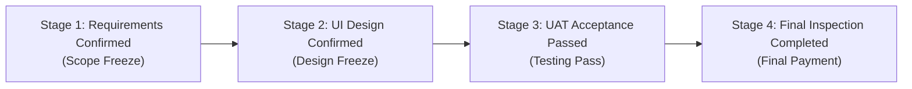

# Empasy Enterprise End-to-End Standard Documentation Framework & Delivery/Management Practical Guide

In software development projects, source code is what executes the system, but the foundation that runs an actual business and establishes a commercial engagement is the **official documentation framework** spanning contracts, administration, design, inspection, and settlement.

This guide is a practical manual organizing the complete catalog and authoring standards of real-world business management and delivery documents that must not be overlooked even in AI-agent-assisted development environments, along with the 4 major Sign-off governance criteria to prevent legal disputes.

::: tip Related Parent and Role-Specific Practical Guides
* **[Empasy Business & Project Management Standard Template Download Center (125 Templates)](./enterprise-document-templates.md)**: 90-8-2 single-standard 125 Clean Blank Masters + 14 synchronized Markdown files + 6 project-scale preset packages
* **[Empasy Business & Development Methodology Overview](./enterprise-project-lifecycle.md)**: End-to-end Phase 0–5 lifecycle and S/M/L tailoring criteria
* **[Practical Responsibilities & Methodology Usage Guide by 8 Core Roles](./enterprise-project-lifecycle.md#4-1-8-core-roles)**: Essential management guides for Sales, Planning, Architects, Developers, QA, Business Operations, and Clients
* **[Phase-by-Phase Action Items & Practical Execution Guide (45 Action Items SOP)](./enterprise-action-items-guide.md)**: Phase 0–5 detailed Action Items (`A0.0–A5.10`) and acceptance criteria
* **[Sales Support & Proposal Stage Practical Guide (Pre-sales)](./presales-ai-playbook.md)**: RFP analysis, proposal authoring, PoC demo creation, effort estimation
:::

---

## 1. Principle of Distinguishing Development Artifacts from Official Deliverables

In real-world project sites, program code and deliverable documents must be clearly separated.

* **Software Artifacts (Development Results)**: Technical assets required to run the system, such as source code, build scripts, container images, and local test logs.
* **Deliverables & Business Documents (Delivery and Management Documents)**: Official paperwork that proves the establishment and completion of the project to the client's decision-makers, accounting department, external auditors, and courts.

No matter how excellent the source code is, a client will not pay the final balance without a stamped acceptance certificate, and external auditors will not grant a passing verdict without UI design specifications and test reports. Therefore, mandatory phase-specific documents must be produced and signed on time alongside development.

---

## 2. Master Table of Standard Documents Across the 6-Phase Business Lifecycle

| Business Phase | Category | Document Name | Primary Purpose & Legal/Practical Effect | Author | Approver / Recipient |
| :--- | :--- | :--- | :--- | :--- | :--- |
| **Phase 0: Proposal & Deal Win** | Legal / Sales | Non-Disclosure Agreement (NDA) | Protects both parties' trade secrets and data prior to RFP analysis | Sales / Legal | Client / Empasy Inc. |
| | Feasibility Evaluation | Bid Feasibility Review Sheet (Go/No-Go) | Prevents unprofitable bids and reviews internal resource allocation feasibility | Sales / Tech Lead | Business Division Head |
| | External Submission | Technical Proposal | Presents system build plan, architecture, and delivery capabilities | Proposal PM / Pre-sales | Client Evaluation Committee |
| | Price Evidence | Official Quotation & Cost Breakdown | Calculates effort (M/M), infrastructure cost, solution license cost, and target margin | Sales / Proposal PM | Client Procurement Team |
| | Administrative Evidence | Complete Bid Qualification Documents | Corporate seal certificate, tax clearance, credit rating, performance certificates, bid bond | Business Operations | Client Contracting Dept. |
| | Technical Verification | PoC Technical Verification Report | Pre-proves core technical feasibility and provides sales demo evidence | Pre-sales / Engineering | Client Working Team |
| | Internal Control | Technical Execution Approval (Sign-off) | Development lead reviews and signs off on delivery schedule and specs in advance | Dev Lead | Business Representative |
| **Phase 1: Initiation & Analysis** | Contract | Standard Service Contract & Special Terms | Finalizes payment terms, liquidated damages, and intellectual property ownership | Legal / Sales | Client / Empasy Inc. |
| | Financial Guarantee | Contract Performance Bond Policy | Guarantees contract execution (typically 10–15% of contract value) | Business Operations | Client Contracting Team |
| | Cash Flow Security | Advance Payment Application & Advance Payment Bond | Secures advance payment (30–50%) to cover initial labor costs | Business Operations | Client Contracting / Finance Team |
| | Administrative Kickoff | Notice of Commencement (Kickoff Filing) | Establishes the official project start date | PM | Client Business Dept. |
| | Project Governance | Project Management Plan (PMP) | Organization chart, assigned personnel roster/resumes, quality and security plans | PM | Client Business Dept. |
| | Security Compliance | Complete Personnel Security Pledges | Pledges for personal data protection and prohibition of source code exfiltration | All Assigned Personnel | Client Security Team |
| | Subcontract Management | Prior Approval Application for Subcontracting (if applicable) | Compliance with the Software Promotion Act and approval for partner staffing | PM / Business Operations | Client Business Dept. |
| | Personal Data | Personal Data Processing Consignment Agreement (if applicable) | Legal consignment contract for handling client personal data | Legal / PM | Client Security Team |
| | Scope Definition | Software Requirements Specification & Traceability Matrix (RTM) | Catalogs functional/non-functional requirements and assigns tracking IDs | BA / Planner | Client Working Team |
| | Schedule Management | WBS (Work Breakdown Structure) | Finalizes detailed milestones and sprint process schedule | PM / Tech Lead | Client PM |
| | Preemptive Verification | Legacy Data Migration Early Verification Report | Early reporting of missing values and format mismatches in existing data | Data Engineer | Client IT Team |
| | **Key Sign-off** | **Requirements Confirmation Agreement (Sign-off)** | Declares completion of requirements analysis and Scope Freeze | Both PMs | Both Responsible Executives |
| **Phase 2: Design & Specification** | UI Design | UI/UX Design Specification (Storyboard) | Full screen layouts and behavior rules for business user approval | UI/UX Planner | Client Business Dept. |
| | Infrastructure | System Architecture Design (SAD) | Logical/physical server topology, network segregation, firewall ports | Infra / Architect | Client IT Team |
| | Data Model | DDL Schema Specification & ERD | Table specifications, column attributes, indexes, and relationship definitions | DBA / Backend | Client IT Team |
| | API Contract | Interface Specification (API Spec) | Transmission frequency, message formats, error codes, integration contacts | Backend Lead | Client / External Agencies |
| | **Key Sign-off** | **Design Phase Completion Report & Approval Certificate** | Locks UI and DB designs and formally agrees to enter implementation | Both PMs | Both Responsible Executives |
| **Phase 3: Implementation & Progress Control** | Progress Reporting | Weekly & Monthly Status Reports | Reports planned vs. actual progress rate (S-Curve) and next-week plans | PM | Client PM / Executives |
| | Risk Management | Issue & Risk Register | Tracks causes and countermeasures for schedule or integration delays | PM | Client PM |
| | Change Control | Change Request Form (CR Form) | Re-estimates effort/schedule and obtains written agreement upon scope change | Requester / PM | Both Responsible Executives |
| | Contract Adjustment | Task Scope Change Review Petition (if applicable) | Requests contract amount increase and period extension upon major effort increase | PM / Sales | Client Contracting Dept. |
| | Payment Billing | Interim Report & Milestone Progress Inspection Request | Evidences milestone payment conditions and bills progress payment | PM / Sales | Client Contracting Team |
| **Phase 4: Verification & Audit** | Test Planning | Test Plan | Scope and pass criteria for unit/integration/system/performance tests | QA Lead | Client QA / PM |
| | Test Specification | Test Scenarios & Test Cases Specification | Specifies inputs, normal flows, exception conditions, and expected results | QA Engineer | Client Working Team |
| | Test Results | Unit & Integration Test Results Report | Test execution results, coverage, and defect resolution details | QA Engineer | Client PM |
| | Performance / Security | Performance Load Test Results Report | Concurrent users, target TPS, and response latency measurements | Infra / QA | Client IT Team |
| | Security Audit | Secure Coding & Security Assessment Report | Web vulnerability scan, personal data encryption, source code inspection | Security Lead | Client Security Team |
| | IP Verification | Open Source (OSS) License Verification Report | Used OSS inventory, license notices, and license conflict check | Security / Tech Lead | Client Security / Legal |
| | External Audit | Third-Party Audit Remediation Report (if applicable) | Evidence of resolving findings from public/large-scale project audits | PM / Engineering Team | Audit Firm |
| | **Key Sign-off** | **User Acceptance Test (UAT) Certificate** | Client business users execute scenarios directly and sign off acceptance | Client Business Users | Both Responsible Executives |
| **Phase 5: Go-Live & Settlement** | Deployment Ops | Deployment Plan & Emergency Rollback Procedure | Time-phased launch sequence and rollback criteria for Go-Live day | DevOps / Infra | Client Operations Team |
| | Data Migration | Final Data Migration Completion Verification | Verifies full legacy data integrity and record count reconciliation | Data Engineer | Client IT Team |
| | User Support | User Manual & Administrator Manual | Separates end-user usage guide from system administrator configuration guide | Planner / Tech Writer | All Client Departments |
| | Training / Handover | Training Results Report & Handover Certificate | Training photos, attendee sign-in sheet, transfer of admin accounts/passwords | Training Lead | Client Operations Team |
| | System Transfer | System Operations Runbook (Operations Guide) | Incident response manual, daily checklist, backup schedule guide | Tech Lead / Ops Team | Client Operations Team |
| | **Balance Collection** | **Project Completion Report & Final Acceptance Certificate** | **Final proof of contract fulfillment & balance billing (tax invoice issuance)** | Both PMs | Both Representatives |
| | Billing Paperwork | Payment Request Letter & Complete Clearance Certificates | Tax invoice, national/local tax & 4 major insurance clearance, bankbook copy | Business Operations | Client Accounting / Finance |
| | Post-Launch Bond | Warranty Performance Bond Policy | Guarantees 1-year free defect warranty (5–10% of contract value) | Business Operations | Client Contracting Team |
| | Post-Launch Mgmt | Defect Warranty Plan | Free defect intake channel and SLA by incident severity | Maintenance Team | Client Operations Team |
| | Long-Term Contract | Draft Maintenance Agreement (including SLA) | Prepares transition to paid operations contract after 1-year free warranty | Sales / Maintenance | Client Contracting Team |
| | Internal Closing | Project Retrospective & Cost Settlement Report | Analyzes actual cost vs. target margin (P&L) and lessons learned | PM / Business Operations | Internal Executive Team |

---

## 3. Detailed Commentary & Authoring Standards for Key Documents by Phase

### 3.1. Pre-Sales & Initiation Phases (Phase 0 – Phase 1)

#### Non-Disclosure Agreement (NDA)
* **Purpose**: Legally protects both parties' trade secrets and internal client data from external leakage before full-scale technical discussions with the client begin.
* **Mandatory Contents**: Definition of confidential information, confidentiality obligation period (typically 2–3 years), exclusions, liability for damages upon breach, and procedures for returning or destroying materials.
* **Precautions**: Unilateral NDA drafts provided by clients may contain excessive penalty clauses; legal review is required to verify mutual and balanced confidentiality obligations.

#### Advance Payment Application & Advance Payment Bond Policy
* **Purpose**: Receives 30–50% of the contract amount early, immediately after contract execution, to cover initial labor and infrastructure costs and stabilize corporate cash flow.
* **Mandatory Contents**: Reason for advance payment request, requested amount and percentage of contract value, advance payment usage plan (specifying labor, materials, etc.), and advance payment guarantee bond policy.
* **Practical Note**: Because advance payments are restricted from being used outside their designated purpose (costs incurred on the specific project), usage receipts and supporting vouchers must be archived separately in-house.

#### Project Management Plan (PMP)
* **Purpose**: Formally submitted to the client at the kickoff briefing as the master blueprint detailing how the project will be governed throughout the contracted period.
* **Mandatory Contents**:
  1. Project overview and target system architecture diagram
  2. Execution organization chart and assigned personnel roster (role, name, grade, responsibilities, assignment period)
  3. Detailed implementation schedule (milestones and key reporting dates)
  4. Phase-by-phase deliverable submission list and review cadence
  5. Quality assurance and testing plan
  6. Security management and personnel replacement contingency plan

#### Prior Approval Application for Subcontracting (If Applicable)
* **Purpose**: Obtains prior written approval from the ordering party (client) when deploying external partner companies or outsourced personnel, in accordance with Article 51 of the Software Promotion Act (Restriction on Subcontracting).
* **Practical Note**: Unauthorized subcontracting without prior approval is grounds for debarment as an unfair vendor or contract termination; therefore, approval must be secured at initiation by attaching the subcontract agreement and payment guarantee plan.

#### Software Requirements Specification (SRS) & Requirements Traceability Matrix (RTM)
* **Purpose**: Structures client requirements with unique identifiers (e.g., REQ-001) and traces end-to-end where each requirement is reflected across design (UI, DB), implementation (source code), and testing (test cases).
* **Mandatory Contents**: Requirement ID, requirement category (functional, non-functional, security, interface), detailed description, acceptance criteria, assigned designer/developer, test case ID, and acceptance status.

---

### 3.2. Design & Implementation Phases (Phase 2 – Phase 3)

#### UI/UX Design Specification (Storyboard)
* **Purpose**: Visually specifies every screen layout in the system, validation rules for input fields, and behavioral flows upon button clicks.
* **Importance**: Client business users do not understand database tables or API documents. Obtaining written approval on the UI design specification—which clients actually see and interact with—prevents situations where clients demand rework after implementation simply because they dislike a screen layout.
* **Mandatory Contents**: Full screen menu tree, wireframes or high-resolution designs per screen, button/input interaction rules, and exception message definitions.

#### System Architecture Design (SAD) & Network Topology Diagram
* **Purpose**: Finalizes the structure of servers, networks, and security appliances where the system will be deployed.
* **Mandatory Contents**: Logical/physical architecture diagrams, server specifications by dev/staging/prod environment (vCPU, RAM, disk capacity), firewall port-opening request list (source IP, destination IP, port number, protocol), network-segregation integration method, and backup/redundancy configuration.

#### Change Request Form (CR Form)
* **Purpose**: Formally controls additional client requests or specification changes arising during project execution.
* **Operating Rules**:
  1. Verbal requests are never accepted; written form submission is mandatory.
  2. Upon receiving a change request, an impact analysis (number of affected screens, APIs, and DB changes) is performed to calculate additional effort (M/D).
  3. Work exceeding a threshold (e.g., over 3 M/D) is approved only on the condition of delivery deadline extension, exclusion of existing features, or execution of an additional contract.

---

### 3.3. Verification & Go-Live Phases (Phase 4 – Phase 5)

#### User Acceptance Test (UAT) Plan & Results Certificate
* **Purpose**: After internal engineering testing is complete, client business representatives directly execute business scenarios under conditions similar to production and determine system acceptance.
* **Execution Procedure**:
  1. Execute normal data entry, invalid data entry, payment/cancellation flows, etc. step by step according to pre-agreed scenarios.
  2. Classify discovered defects by severity (Critical, Major, Minor) and establish remediation plans.
  3. The project may proceed to Go-Live only when Critical defects are zero and the client test lead signs "Acceptance Test Passed."

#### Open Source Software (OSS) License Verification Report & Notice
* **Purpose**: Comprehensively audits licenses (Apache, MIT, BSD, GPL, etc.) of open-source components used in the system to prevent intellectual property disputes.
* **Mandatory Contents**: List of used licenses, compliance obligations (copyright attribution, verification of source code disclosure obligations), and inclusion of license notices (`NOTICE`) in the distribution package.

#### Project Completion Report & Final Acceptance Certificate
* **Purpose**: **The single most important legal document for receiving the final balance from the client and recognizing revenue.**
* **Mandatory Contents**:
  * Contract title, contract period, and contract amount
  * Final achievement summary against project objectives
  * Complete list of deliverables and submission status
  * Final inspection verdict (Pass / Qualified)
  * Client representative's official seal and date
* **Practical Note**: The date the client's official seal is stamped on the Acceptance Certificate serves as the accounting "revenue recognition date" and the legal basis for issuing the tax invoice and billing the balance.

#### Mandatory Administrative Attachments for Payment Billing
* **Purpose**: To pass fund disbursement review by the client's accounting and finance departments and receive payment smoothly.
* **Required Documents List**:
  1. Official payment request letter
  2. Electronic tax invoice
  3. National tax clearance certificate (issued via Hometax)
  4. Local tax clearance certificate (issued via Wetax)
  5. Four major social insurance premium clearance certificate
  6. Copy of corporate bankbook
  7. Copy of Final Acceptance Certificate and copy of Warranty Performance Bond Policy

---

## 4. Governance Criteria for the 4 Mandatory Sign-offs to Prevent Disputes

Most project failures stem from "differing interpretations of what was said." At the following four milestones, official written signatures from responsible executives of both parties must be secured without exception.

1. **Requirements Confirmation Sign-off (End of Phase 1)**:
   * Purpose: Aligns the features promised in the proposal with the actual feature list to be built and freezes the scope.
   * Effect: Allows any subsequent new requests to be classified as "additional development (scope change)" rather than "defects."
2. **UI Design Specification Sign-off (End of Phase 2)**:
   * Purpose: Confirms mutual agreement on screen layouts and functional flows that business users will operate.
   * Effect: Prevents overturning screen layouts or business workflows when coding is already well underway.
3. **User Acceptance Test (UAT) Pass Sign-off (End of Phase 4)**:
   * Purpose: Obtains client approval that all features operate properly based on direct client testing.
   * Effect: Blocks post-launch claims alleging "certain features never worked."
4. **Final Acceptance Sign-off (End of Phase 5)**:
   * Purpose: Officially certifies that all contracted tasks have been completed.
   * Effect: Secures the legal right to collect the final balance and officially starts the free defect warranty period.

---

## 5. Clear Boundary Between Defect Warranty and Paid Maintenance

Post-launch conflicts with clients mostly arise from differing interpretations of "defect warranty" versus "maintenance." The criteria below must be explicitly stated in both the contract and project plan.

| Category | Free Defect Warranty (Warranty) | Paid Maintenance (Maintenance / SLA) |
| :--- | :--- | :--- |
| **Legal Nature** | Obligation to fix defects (bugs) that already existed at the time of delivery | Contract for ongoing operations and enhancements tailored to a changing environment post-launch |
| **Duration** | Typically 1 year from the Final Acceptance date | Annual renewable contract following the end of the warranty period |
| **Cost** | Free of charge (included in original contract price) | Paid (typically 8–15% annually of pure development cost) |
| **Included Scope** | - System bugs failing to operate per existing requirements - Database calculation errors, abnormal server crashes - Non-functioning features explicitly specified in design docs | - Development of new business features and addition of new screens - Process modifications due to client policy changes - Support for new OS/browser upgrades - Dedicated on-site operations staffing & new external agency integrations |
| **Handling Process** | Bug intake -> Reproduction & fix -> Patch deployment | Change request intake -> Effort estimation -> Applied during scheduled releases |

---

## 6. Tailored Compliance & Mandatory Document Guidelines by Client Type

Depending on the client's sector (public agencies, financial institutions, private enterprises), statutory audit regulations and mandatory administrative templates vary significantly. During pre-sales and initiation, you must identify the client sector's characteristics and prepare documents proactively.

### 6.1. Public Sector (Government Ministries, Local Governments, Public Agencies)

Public software projects are strictly governed by the **Software Promotion Act**, the **Act on Contracts to Which the State Is a Party (State Contracts Act)**, and the **Electronic Government Act**.

| Regulation & Audit Area | Core Compliance Requirements & Rules | Mandatory Documents to Prepare & Submit |
| :--- | :--- | :--- |
| **Subcontracting Restrictions & Control** | - Compliance with Article 51 of the Software Promotion Act - Prohibition of subcontracting exceeding 50% of total contract value - Complete prohibition of re-subcontracting (multi-tier subcontracting) | - Prior Approval Application for Software Business Subcontracting - Standard Subcontract Agreement & Cost Breakdown - Written Pledge Prohibiting Re-subcontracting |
| **Advance Payment & Settlement** | - Article 34 of Government Bidding & Contract Execution Standards - Advance payment eligible up to 70% of contract amount - Mandatory payment to subcontractors within 15 days of receiving advance payment | - Advance Payment Application & Usage Plan - Advance Payment Guarantee Bond (SGI / Mutual Aid Assoc.) - Proof of Subcontractor Advance Payment (Bank Transfer Receipt) |
| **Software Development Security** | - MOIS & KISA "SW Development Security Guide" 49 security weakness checks - Proactive prevention of SQL Injection, XSS, weak authentication, etc. | - Secure Coding Inspection Results Report (`EMP-P4-06`) - Source Code Security Weakness Diagnosis & Remediation Log |
| **Third-Party Expert Audit** | - Article 57 of the Electronic Government Act (Audit of e-Government Projects) - Mandatory audits for public SW projects (Initiation / Interim / Final Audit) | - Audit Findings Remediation Plan - Audit Findings Remediation Verification Certificate |
| **Task Scope Change Review** | - Article 50 of the Software Promotion Act (Finalization of Task Scope, etc.) - Right to request a Task Review Committee upon scope changes | - Task Scope Change Review Petition - Task Scope Change Impact Analysis Matrix |

### 6.2. Financial Sector (Banks, Card Issuers, Securities, Insurers, Fintechs)

Financial-sector projects are regulated under the **Electronic Financial Transactions Supervision Regulations**, the **Credit Information Act**, and the **Personal Information Protection Act (PIPA)**, and security inspection by the Financial Security Institute (FSI) is an absolute prerequisite for Go-Live.

| Regulation & Audit Area | Core Compliance Requirements & Rules | Mandatory Documents to Prepare & Submit |
| :--- | :--- | :--- |
| **Physical & Logical Network Segregation** | - Article 15 of Electronic Financial Transactions Supervision Regulations - Complete isolation between internal business network and external internet - Control over bringing in/taking out source code and dev laptops | - Dev Equipment Entry/Exit Application & Security Checklist - External Source Code Import Application & Approval Form - Removable Media (USB) Control & Sealing Log |
| **Personal Credit Information Protection** | - Credit Information Use and Protection Act - Strict ban on using real personal data in dev and test environments - Mandatory use of pseudonymized data or de-identified synthetic data | - Test Data De-identification Processing Certificate - Personal Credit Info Handling Pledge & Training Log - Database Access Control Audit Logs |
| **FSI Vulnerability Assessment** | - Financial Security Institute Web/Mobile App Vulnerability Guide - Penetration testing and zero-critical/open defect requirement | - Vulnerability Assessment Report & Penetration Testing Report - Security Patch Remediation Verification Certificate |
| **External Integration End-to-End Encryption**| - Financial message integrations (KFTC, etc.) - Transport layer encryption (mTLS) and field-level data encryption | - Interface Security Specification - Encryption Key Management Register & Key Handover Certificate |

### 6.3. Private Enterprises (Manufacturing, Retail, Telecom, Enterprise)

Private conglomerates are particularly sensitive to **group-wide standard IT governance**, **intellectual property (IP) ownership clauses**, and **supply-chain quality standards**.

| Regulation & Audit Area | Core Compliance Requirements & Rules | Mandatory Documents to Prepare & Submit |
| :--- | :--- | :--- |
| **Intellectual Property (IP) Ownership** | - Ownership of deliverable copyrights (client exclusive vs. joint ownership) - License protection for Empasy core solutions (SyncSeries/SyncVerse) | - Software License Supply Agreement - IP Ownership & Non-Exclusive Usage Rights Special Terms |
| **Group Security / Infra Standards**| - Group internal authentication (SSO, corporate portal integration) - Compliance with approved standard cloud (CSP) and infrastructure policies | - System Architecture Compliance Review - Group Integrated Authentication (SSO) Integration Certificate |
| **Payment Terms & Collateral**| - Milestone payment schedule (30% kickoff, 40% interim, 30% final) - Verification of electronic promissory notes, Win-Win Payment, or purchasing card terms | - Milestone Progress Certificate & Tax Invoice - Contract Performance Bond & Warranty Performance Bond Policies |
| **Open Source (OSS) Compliance**| - Strict prohibition of commercial license contamination (GPL, AGPL) - Passing corporate OSS scanning tools (FOSSID, Black Duck) | - OSS License Verification Certificate & SBOM (`EMP-P4-07`) - Open Source Notice (`NOTICE`) |

### 6.4. 2026 AI Basic Act & Enterprise AI Trustworthiness Compliance

Under the **Framework Act on the Development of Artificial Intelligence and Establishment of Trust (AI Basic Act)** enacted in January 2026, every project incorporating LLMs, RAG, or autonomous agents must verify the following four legal and technical requirements starting from Initiation (Phase 1).

| Regulation & Audit Area | Core Compliance Requirements | Mandatory Documents to Prepare & Submit |
| :--- | :--- | :--- |
| **High-Impact AI Pre-Screening** | - Assessment under Article 33 of the AI Basic Act (life, safety, hiring, financial credit scoring, public decision-making) - If classified as High-Impact AI: establish risk management plan, explainability, and objection procedures | - [AI Governance & Trustworthiness Checklist (`EMP-P1-22`)](./enterprise-document-templates.md#emp-p1-22) |
| **AI-Generated Content Disclosure** | - Prior notice of AI generation or watermark/metadata labeling on generative AI outputs per Article 31 of the AI Basic Act - Mandatory source document citation display in RAG responses | - UI/UX Design Storyboard (`EMP-P2-06`) - AI Reasoning & Prompt Design Specification (`EMP-P2-24`) |
| **Exclusion from External LLM Training & PII Protection** | - Secure Zero-Data-Retention (no training) contractual proof in commercial LLM API enterprise terms - Real-time PII masking prior to LLM transmission and document-level RBAC isolation in RAG | - Mutual NDA (`EMP-P0-01`) - Personal Data Processing Consignment Agreement (`EMP-P1-08`) |
| **Quantitative Quality Eval & Audit Logs** | - Quantitative acceptance testing of precision/recall against a 50-question domain Golden-Set - 5-year immutable retention of TraceId, prompt version, tool calls, and HITL approval history | - AI Golden-Set Quality Evaluation Report (`EMP-P4-09`) - Monthly AI FinOps Settlement Report (`EMP-P5-19`) |

---

## 7. AI Agent & LLM Token Cost (FinOps) Settlement & Billing Standards

Unlike traditional SI projects, projects introducing AI-based systems (Agent-to-Agent collaboration, RAG, autonomous execution, etc.) will inevitably face disputes unless settlement rules for **ongoing monthly API token calls and GPU infrastructure costs** are established upfront.

### 7.1. Cost Attribution & Cost Accounting Principles

| Cost Item | Cost Owner | Settlement & Billing Method | Practical Notes |
| :--- | :---: | :--- | :--- |
| **External Commercial LLM API Tokens** (OpenAI, Anthropic, Google, etc.) | **Client Borne (At Cost)** | - **Principle: Direct registration of client billing account** - If billed via Empasy Inc.: pass-through cost + handling fee (5–10%) | Explicitly state in contract special terms that "LLM API usage fees are actual client-borne expenses separate from pure system engineering fees." |
| **On-Premises GPU Servers** (NVIDIA H100, L40S, etc.) | **Client Asset / Lease** | - Client directly purchases hardware or leases IDC hosting - Empasy Inc. provides spec guidance and driver/vLLM environment setup only | Log development delays caused by GPU hardware delivery delays as an excusable delay factor in the schedule register. |
| **AI RAG Vector DB Re-Indexing** (Re-embedding on data updates) | **Included in Ops Maintenance** | - Compute power required during scheduled data refreshes - Full-scale re-embedding of massive datasets is scoped separately | Agree on embedding API budget with the client in advance if data volume surges beyond 1 million records. |
| **Prompt Refinement & Tuning** | **Paid Maintenance Scope** | - Prompt modifications due to business rule changes after Go-Live - **Explicitly excluded from the 1-year free defect warranty** | Separate from simple bug fixes and settle as paid feature enhancement or dedicated SLA effort. |

### 7.2. Four Safeguards Against Token Cost Spikes (FinOps Rule)

1. **Per-User / Per-Agent Token Quota Allocation**:
   - Enforce daily/monthly maximum token caps (e.g., 50,000 tokens/day per user) at the application layer to block runaway charges from infinite loops or malicious prompt injection.
2. **Semantic Caching Adoption**:
   - Avoid repeating identical LLM calls for similar queries by returning immediate responses from a Redis vector cache, reducing external API call costs by 40–60%.
3. **Real-Time Token Consumption Monitoring & Alerts**:
   - Dispatch automated Slack/email alerts to the assigned PM and client operator at 80% of daily budget, and automatically fall back to a lightweight model (Flash/Mini) at 100%.
4. **Regularized Monthly FinOps Settlement Reports**:
   - Submit a monthly report at the start of each month summarizing prior-month call counts by model (GPT-4o, Claude 3.5 Sonnet, etc.), input/output token consumption, and department-level usage statistics to ensure cost transparency.

---

---

## 8. Four Legal & Financial Risk Controls for Managing Subcontractors & Freelancers

When deploying **outsourced development vendors (corporations/sole proprietors)** or **individual freelancers (3.3% business income earners)** during project execution to cover specialized domains (data engineering, UI publishing, etc.) or temporary staffing peaks, legal and financial risks resulting from inadequate contracts must be prevented in advance.

### 8.1. Preventing Disguised Subcontracting & "Employee Status" Lawsuits Under the Labor Standards Act (Mandatory for Freelancers)

The most frequent issue when contracting software freelancers is a post-engagement petition to the Ministry of Employment and Labor claiming **"retroactive weekly holiday allowances, severance pay, and 4 major social insurances."**

* **Risk Factor**: If a freelancer contract borrows employment-contract phrasing such as "work hours 09:00 to 18:00," "subject to company direction and supervision," or "annual paid leave granted," the freelancer is deemed a de facto employee and the company loses the lawsuit.
* **Response Principles**:
  1. Explicitly title the agreement **"Software Freelancer Service Outsourcing Agreement."**
  2. Stipulate: "The Contractor is an independent individual business income earner who completes the task based on independent expertise, and working hours and work location are at the Contractor's autonomous discretion provided the task schedule is not disrupted."
  3. Instead of attendance management (tracking tardiness or early departures), **inspect deliverables solely by unit test pass rates and completion of features specified in the Statement of Work (SOW)**.

### 8.2. 1:1 Back-to-Back Alignment of Defect Warranty & Liquidated Damages

If the legal obligations borne by the prime contractor (Empasy Inc.) toward the client are not mirrored equally in subcontract agreements, Empasy Inc. will bear 100% of any damages caused by the subcontractor's fault.
* **Response Principles**:
  1. **Aligned Defect Warranty**: Mandate the exact same obligation as the client contract in the subcontract: **"1-year free defect warranty from the date of Final Acceptance of subcontracted deliverables."**
  2. **Linked Liquidated Damages**: To cover cases where a subcontractor's delay delays the overall project deadline, enforce a clause deducting **"0.075% of the subcontract amount per day of delay"** as liquidated damages.

### 8.3. Mandatory Full Assignment of Intellectual Property (IP) & Source Code

Under copyright law, unless explicitly agreed otherwise in writing, initial copyright to software vests in the outsourced developer who wrote the code.
* **Response Principles**:
  1. **Exclusive Assignment of Economic Rights**: Explicitly state: "All economic copyrights (including the right to produce derivative works and compilation works) in all source code, design specifications, and algorithms developed under this Agreement shall irrevocably vest in Empasy Inc. upon full payment of the service fee."
  2. **Non-Exercise of Moral Rights**: Include a special covenant prohibiting the subcontractor or freelancer from exercising moral rights (right of attribution, right of integrity) to obstruct future code modifications or reuse in other projects.

### 8.4. Total Prohibition of Re-Subcontracting Under the Software Promotion Act

"Re-subcontracting," where a subcontractor farms out work to another individual or micro-vendor without Empasy Inc.'s approval, violates Article 51 of the Software Promotion Act and, if detected, triggers **debarment as an unfair vendor and contract termination** by the ordering party.
* **Response Principles**:
  1. Include in the subcontract a **"Total prohibition of any re-subcontracting (multi-tier subcontracting) without prior written approval from Empasy Inc. and the client."**
  2. Require a signed **"Written Pledge Prohibiting Re-subcontracting"** in the name of the subcontractor's CEO upon signing, and continuously verify via version control (Git commit accounts) that actual contributors match the personnel named in the contract.

---

## 9. Five Unexpected Crisis Scenarios During Execution & Operations and Standard Operating Procedures (SOP)

In actual project sites, non-engineering factors (client internal issues, delayed infrastructure provisioning, personnel departure, outages, security breaches) can threaten the company's survival. Teams must master and execute the following standard operating procedures for five major crisis scenarios in advance.

### 9.1. Extension of Time (EOT) & Liquidated Damages Exemption Procedure for Client-Caused Delays

* **Crisis Scenario**: Engineering is halted for 2–4 weeks because the client delays firewall opening, leaves external agency interface specs unfinalized, or fails to provide legacy DB migration data—yet the client's contracting department attempts to impose liquidated damages of 0.075% per day for missing the original contract deadline.
* **Response Procedure (SOP)**:
  1. **Send an Official Letter Immediately Upon Delay**: Verbal complaints or messenger chats carry no legal weight. Within 3 business days of the delay occurring, send an **"Official Notice of Temporary Suspension of Development Process Due to External Factors and Request for Cooperation."**
  2. **Quantify Delay Impact and Days**: Calculate the exact affected tasks (e.g., 20 APIs, 5 days of testing) on the WBS caused by the unopened firewall.
  3. **Submit EOT Application & Exemption Grounds**: Pursuant to Article 74 of the Enforcement Decree of the State Contracts Act, submit an **"Application for Delivery Deadline Extension and Statement of Exemption Grounds"** and demand a formal contract amendment. (When official evidence is accumulated, even the client's audit office cannot impose liquidated damages.)

### 9.2. Legally Compliant Replacement Approval Procedure When Key Personnel Depart (Resignation / Illness)

* **Crisis Scenario**: A key Project Leader (PL) or Architect listed in the proposal or Notice of Commencement leaves the site due to illness, job change, or resignation.
* **Response Procedure (SOP)**:
  1. **Never Replace Without Authorization**: Replacing personnel without client approval constitutes a contract breach and leads to bid-participation restrictions (unfair vendor debarment).
  2. **Secure Equivalent or Higher Qualification Grade**: Appoint a replacement with an **equal or higher technical grade (e.g., Senior -> Principal)** under the Korea Software Industry Association (KOSA) SW Engineer Career Certificate.
  3. **Submit Replacement Approval Application**: At least 14 days before replacement, submit an **"Application for Approval of Assigned Personnel Change (Replacement)"** together with a joint handover plan of at least 5 business days to obtain prior written approval.

### 9.3. 5-Whys Root Cause Analysis & Post-Mortem Procedure for System Incidents (P1/P2)

* **Crisis Scenario**: Immediately after Go-Live, the payment module stops or DB connection pool exhaustion paralyzes enterprise-wide services.
* **Response Procedure (SOP)**:
  1. **Escalate Status Within First 30 Minutes**: Even before identifying the root cause, immediately notify the client hotline of the outage occurrence, emergency on-call activation, and estimated workaround ETA.
  2. **Apply Temporary Workaround (Within 2 Hours)**: Minimize business impact by restoring service first via traffic switching, instance restarts, or rollback.
  3. **Submit Formal Incident Report Within 24 Hours**: Apply the 5-Whys technique to identify the Root Cause (e.g., missing query index, concurrency lock) rather than mere symptoms, and submit an official report specifying recurrence prevention measures (APM real-time alerts, circuit breakers) to restore client executive trust.

### 9.4. 72-Hour Golden-Time Reporting Procedure for Security Breaches & Personal Data Leaks

* **Crisis Scenario**: A dev/prod server is infected with ransomware, or indicators of external leakage of customer personal data are detected.
* **Response Procedure (SOP)**:
  1. **Sever External Communication Immediately**: Unplug the network cable or immediately isolate inbound/outbound firewall rules on the compromised instance.
  2. **Statutory Reporting Within 72 Hours**: Under Article 34 of the Personal Information Protection Act (PIPA), file an **official report with the Personal Information Protection Commission (PIPC) or KISA within 72 hours** of becoming aware of the leak. (Missing the deadline exposes the CEO to criminal liability and administrative fines up to billions of KRW.)
  3. **Individual Notification to Data Subjects**: Notify affected data subjects via email and SMS with leaked data items, timing, and user protective actions (password changes, etc.).

### 9.5. Milestone Progress Finalization & Dispute Settlement Procedure Upon Early Contract Termination

* **Crisis Scenario**: A project must be terminated mid-way (contract rescission/termination) due to the client's internal financial distress or irreconcilable differences over requirements.
* **Response Procedure (SOP)**:
  1. **Substantiate Objective Earned Value (S-Curve)**: Reconcile completed deliverables up to termination (number of SRS requirements, APIs, DB tables, frontend screens) against the WBS baseline to establish an objective completion rate (e.g., 55%).
  2. **Execute Milestone Settlement Agreement**: Stipulate that the client settles and pays the net balance (25%) obtained by deducting the previously received advance payment (30%) from the recognized earned amount (55%).
  3. **Covenant Not to Sue (Final Dispute Closure)**: Conditioned on deliverable handover, include a clause stating "Upon execution of this Agreement and completion of settlement payment, neither party shall bring any further claims for damages or lawsuits against the other," permanently closing litigation risk.

---

## 10. Conclusion: Three Principles of Documentation Governance for Safe Company Operations

1. **Leave it in writing, not in words**: Verbal discussions in meetings or messenger notes have weak legal standing. Record critical decisions in meeting minutes and send confirmation emails to attendees, and capture every scope change with a signed written form (CR Form).
2. **Synchronize development phases with documentation phases**: Attempting to batch-write documents after coding finishes causes loss of context from earlier decisions and builds documentation debt. Leverage AI agents so API specs, test reports, and table specifications are updated concurrently as code is produced.
3. **Prioritize settlement documents above all else**: A company's survival depends on cash flow. Administrative documents directly tied to payment disbursement—such as progress inspection requests, final acceptance certificates, and warranty performance bonds—must be scheduled from project initiation and managed with zero missed deadlines.

---

## 11. Quick Links to Related Template Downloads (125 Forms + 121 Filled Samples)

The **125 Clean Blank Master forms** in the 90-8-2 enterprise standard format and **121 real-world filled samples (`SyncFlow AI`)** ready for immediate operational use can be downloaded individually row-by-row (blank form and sample side-by-side) or as project-scale preset ZIP bundles on the page below:

* **[Go to Empasy Business Standard Templates & Download Center (125 Forms)](./enterprise-document-templates.md)**
  - **Enterprise Standard Integrated Master Pack (`Empasy_Master_Full_Pack.zip`)**: All 125 blank templates across Phase 0–5 + C0 (including 14 MD files) + 121 filled samples bundled together
  - **Project-Scale Tailoring Presets**: Small / MVP Essential Pack (`Small`, 29 forms + 27 samples), Standard Enterprise Pack (`Standard`, 88 forms + 85 samples)
  - **Purpose-Specific Add-on Packs**: AI/LLM Specialized Add-on (`AI`, 10 forms + 8 samples), Legal, Contract, Outsourcing & Crisis Management Pack (`Legal`, 18 forms + 18 samples)
  - **Sample Reference Pack (`Empasy_SyncFlow_AI_Sample_Pack.zip`)**: Standalone pack containing all 121 real-world filled samples for the hypothetical project (`Hanbit Global / SyncFlow AI`)
