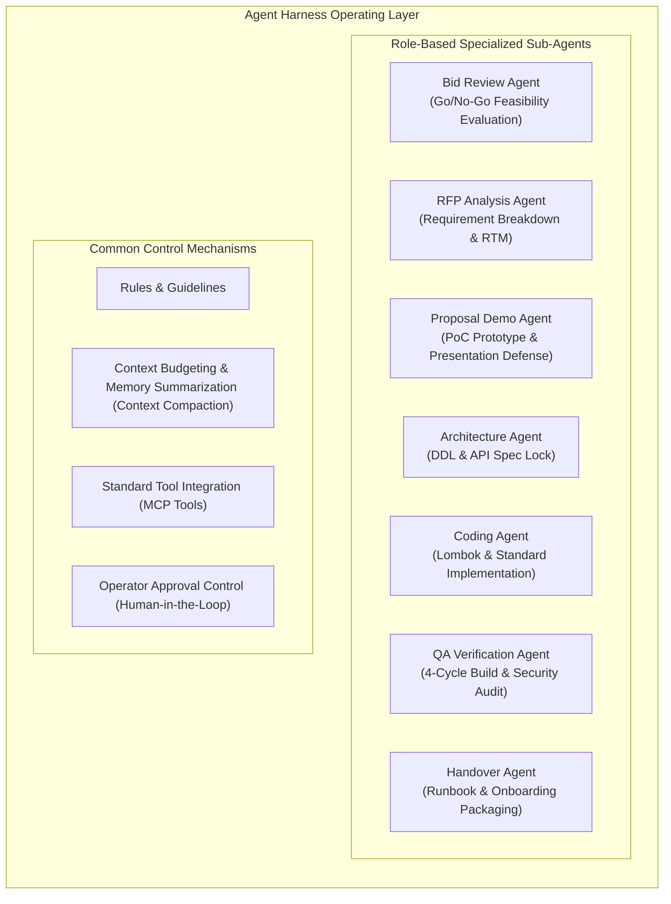
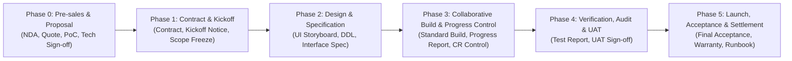
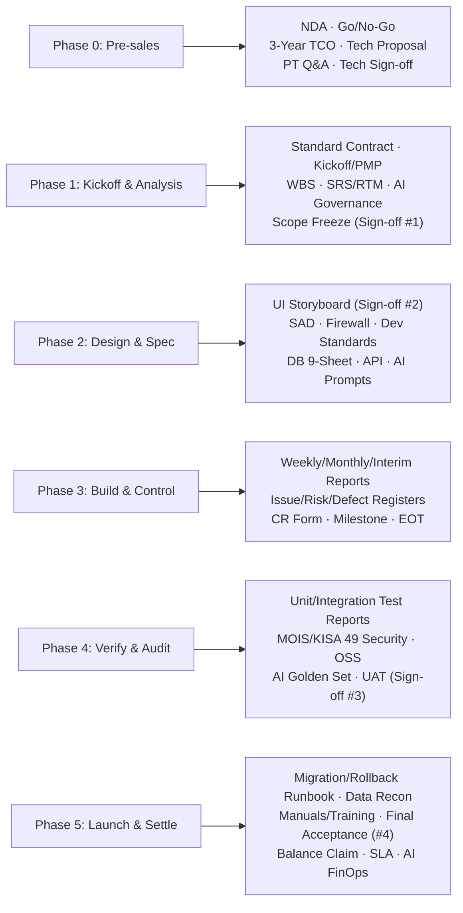

# Empasy Business & Development Methodology

> **Overview:** This methodology is Empasy's standard enterprise business operations and development framework that systematizes the entire software project lifecycle—starting from **Request for Proposal (RFP) analysis and pre-sales support** through **contract execution, project kickoff, spec-first architecture design, agent-collaborative implementation, quality verification and auditing, production launch, final acceptance sign-off, balance collection, and warranty maintenance**.

::: tip Quick Links to Related Practical Guides
* **[Empasy Standard Business & Project Management Document Templates Download Center (125 Templates)](./enterprise-document-templates.md)**: 125 enterprise standard 90-8-2 format single master (Blank) templates + 14 synchronized Markdown templates + 6 scale-based preset packages
* **[Full-Lifecycle Standard Document System & Delivery/Management Practical Guide](./enterprise-business-documents.md)**: Contracts, administrative governance, public/finance/AI Basic Act compliance, AI FinOps, subcontracting, and crisis response standards
* **[Phase-by-Phase Action Items & Practical Execution Guide (45 Action Items SOP)](./enterprise-action-items-guide.md)**: Detailed Phase 0–5 Action Items (`A0.0–A5.10`) and pass criteria
* **[Pre-sales & Proposal Practical Guide](./presales-ai-playbook.md)**: RFP analysis, proposal drafting, PoC demo creation, and effort estimation
* **[SyncVerse-Based AI Software Development Lifecycle Overview (AI-SDLC)](./ai-driven-development.md)**: Detailed 5-stage development process
* **[Situational Practical Prompt Recipes](./ai-sdlc-prompt-recipes.md)**: Ready-to-copy templates for each practical stage
:::

---

## 1. Background & Organizational Alignment

### 1.1. Limitations of Traditional Software Project Operations
In traditional IT service and System Integration (SI) environments, structural bottlenecks between sales and engineering teams have repeatedly occurred:
1. **Depletion of Engineering Resources During Pre-sales Support**:
   - Whenever a multi-hundred-page RFP arrived, senior engineers were pulled away to write technical proposals and estimate effort, disrupting schedules on existing delivery projects.
2. **Inaccurate Effort Estimation & Project Deterioration**:
   - Under tight proposal deadlines, rough experience-based Man-Month (M/M) estimates were used, making projects prone to deficits after award due to scope creep and frequent design changes.
3. **Gap Between Proposal and Actual Implementation**:
   - The architecture promised in the proposal often differed from how the assigned delivery team implemented the system, wasting 1–2 months post-award redefining specifications.
4. **Documentation Debt & Handover Friction at Launch**:
   - To meet delivery deadlines, only source code was updated while architecture documents and table definitions went stale, causing unnecessary friction during handover to customer operations.

### 1.2. Goals: Maximizing Synergy Between Engineering and Sales
This methodology centers on two core objectives:
* **Efficient Pre-sales Support**: Without overburdening engineering teams with manual work, leverage the AI harness to analyze RFPs within 1 hour and rapidly build core proof-of-concept (PoC) prototypes to boost win rates.
* **High Productivity & Quality Assurance**: Seamlessly carry over technical specifications derived during the proposal stage into delivery, and launch projects reliably through spec-first development and 4-cycle automated regression verification.

---

## 2. Principles of Integrating the Agent Harness Architecture

This methodology adapts the core design principles of open-source **ECC (Everything Claude Code)** and the **SyncVerse 4-Tier Architecture** for enterprise operations.

### Core Integration Elements
1. **Role-Based Division of Labor Across Specialized Sub-Agents**:
   - Instead of assigning an entire project to a single agent, dedicated agents are assigned per stage—bid review, proposal support, spec derivation, unit coding, security auditing, and handover—to maximize execution accuracy.
2. **Context Budgeting & Compaction**:
   - To prevent memory exhaustion and hallucinations caused by blindly feeding massive RFP documents or entire codebases, only stage-by-stage summaries and targeted modification files (`focusFiles`) are selectively processed.
3. **Automation of Rules & Pre-Verification**:
   - Enterprise standards defined for each development stage (single Canonical URL, Lombok usage, pure `INSERT` statements, etc.) are injected as project rules so consistent code is produced automatically without constant manual policing.
4. **Standard Tool Integration (MCP Protocols)**:
   - Agents directly invoke Git repositories, internal knowledge-base RAG, database schema inspection, and Jira issue tracking to accelerate execution across stages.

---

## 3. Full-Lifecycle 6-Phase Framework (Phase 0 – Phase 5)

The entire process from project award to final payment settlement and maintenance is operated under a **unified 6-phase structure (Phase 0 – Phase 5)**:

---

### Phase 0: Pre-sales & Proposal Support
* **Objective**: Improve technical proposal quality while preventing customer internal data leakage, and secure competitive advantage through live demos (PoC) and accurate cost estimation.
* **Key Activities**:
  * **Prior Execution of Non-Disclosure Agreement (NDA)**: Execute a mutual NDA before receiving detailed customer RFP materials or raw data to prevent legal risk.
  * **Bid Participation Feasibility Review (Go / No-Go)**: Evaluate technical fit, delivery timeline, profitability, and risk upfront to focus resources on winnable, profitable opportunities.
  * **Automated RFP Analysis & Technical Proposal Drafting**: Analyze multi-hundred-page customer RFPs to establish architecture diagrams, security strategies, and execution plans.
  * **Sales Demo PoC Creation & Result Reporting**: Build working prototypes for 1–2 core requested screens and compile a technical verification (PoC) result report.
  * **Official Quotation & Cost Calculation**: Consolidate M/M effort alongside infrastructure, solution licensing, and token costs, and apply an appropriate margin.
  * **Bid Qualification Document Preparation**: Obtain corporate seal certificates, national/local tax clearance certificates, credit rating reports, performance certificates, and bid bond insurance policies.
  * **Pre-Submission Technical Feasibility Sign-off**: Prior to proposal submission, the engineering lead conducts a final technical feasibility review and signs off.
* **Key Deliverables**: Non-Disclosure Agreement (NDA), Bid Feasibility Review Sheet, Technical Proposal, Official Quotation & Cost Breakdown, PoC Result Report, Complete Bid Qualification Documents, Technical Sign-off Form
* **Detailed Guides**: [Pre-sales & Proposal Practical Guide](./presales-ai-playbook.md), [Full-Lifecycle Standard Document System Guide](./enterprise-business-documents.md)

---

### Phase 1: Contract Execution, Initiation & Scope Locking
* **Objective**: Execute the formal contract, form the delivery organization, and establish a clear mutual agreement on project scope to prevent future disputes.
* **Key Activities**:
  * **Standard Service Contract Execution & Performance Bond Issuance**: Execute the main contract specifying payment terms (advance, interim, balance), liquidated damages rate, and warranty period, and issue a contract performance bond policy.
  * **Project Management Plan (PMP) & Kickoff Notice Submission**: Establish the staffing roster, org chart, master schedule, and security management plan, and hold the kickoff meeting.
  * **Collection of Security Pledges from Assigned Personnel**: Submit signed security pledges and personal information consent forms from all project participants to the customer.
  * **Finalization of Requirement Traceability Matrix (RTM)**: Structure the proposed feature list and define clear acceptance criteria.
  * **Proactive Discovery of Business Exception Policies**: Interview stakeholders upfront to document easily overlooked business policies and exception conditions.
  * **Establishment of Change Request (CR) Governance**: Pre-agree with the customer on the workflow linking additional requests to effort and schedule adjustments.
  * **Early Legacy Data Migration Validation**: Transform sample legacy DB data early in kickoff to identify missing values and cleansing requirements ahead of time.
  * **Requirement Confirmation Agreement Sign-off**: Freeze the development scope upon completion of analysis with formal sign-off from responsible leads on both sides.
* **Key Deliverables**: Standard Service Contract, Contract Performance Bond Policy, Project Management Plan (PMP), Kickoff Notice, Complete Security Pledges, Requirements Specification & RTM, WBS Schedule, Early Legacy Data Migration Validation Report, **Requirement Confirmation Agreement (Sign-off)**

---

### Phase 2: Design & Spec-First Architecture
* **Objective**: Finalize customer-approved UI storyboards and backend DB/API specifications upfront to eliminate bottlenecks between server and frontend development.
* **Key Activities**:
  * **UI/UX Storyboard Creation & Customer Approval**: Produce the complete menu hierarchy, wireframes, and interaction rules, and obtain formal sign-off from the customer's business stakeholders.
  * **System Architecture Design (SAD) & Network Topology**: Agree on server sizing, network-segregated zones, and firewall port-opening lists with the customer's infrastructure team.
  * **PostgreSQL Standard DDL Schema Authoring**: Define tables, indexes, and foreign keys using the 6-stage schema structure (`00_extensions.sql`–`05_sample_dev.sql`).
  * **Single Canonical REST API Specification Lock**: Define OpenAPI 3.0 specifications upfront and standardize all endpoints under `/api/v1/{domain}/{resource}`.
  * **Upfront External Interface Virtualization (Mock Server)**: Stand up a virtualized interface server so internal development never stalls before external integration networks open.
  * **Design Phase Completion Report & Approval Sign-off**: Lock UI and architecture designs and mutually approve entry into the implementation phase.
* **Key Deliverables**: **UI/UX Storyboard**, System Architecture Design (SAD) & Topology Diagram, 6-Stage DDL Schema Specification & ERD, Interface Specification (API Spec), External Interface Mock Server, **Design Phase Completion Report & Approval Sign-off**
* **Detailed Guide**: [Stage 02: Spec-First Architecture Guide](./ai-sdlc-02-architecture.md)

---

### Phase 3: Collaborative Implementation & Progress Control
* **Objective**: Rapidly implement standardized code while controlling schedule and budget through regular progress reporting and change governance.
* **Key Activities**:
  * **Scope-Restricted (`focusFiles`) Standard Coding**: Explicitly lock the list of modifiable files per unit task to block side effects, while enforcing Lombok and frontend modal separation standards.
  * **Live Database Integration Implementation**: Eliminate temporary mock data and implement complete code communicating with an actual local database.
  * **Weekly & Monthly Progress Reporting**: Regularly report planned vs. actual progress rates (Plan vs. Actual), this week's completions, and next week's plans.
  * **Issue & Risk Register Management**: Track external integration delays or decision-making bottlenecks and establish mitigation plans.
  * **Change Request (CR Form) Governance**: When additional requirements arise, perform AI impact analysis and obtain written approval for added effort or schedule extensions.
  * **Interim Reports & Milestone Acceptance Requests (Where Applicable)**: Upon reaching interim payment milestones, undergo interim deliverable acceptance and invoice progress payments.
* **Key Deliverables**: Standard-Compliant Source Code, Weekly/Monthly Progress Reports, Progress Rate Dashboard, Issue & Risk Register, Change Request Forms (CR Form) & Register, Milestone Acceptance Request
* **Detailed Guide**: [Stage 03: AI Collaborative Coding Guide](./ai-sdlc-03-implementation.md)

---

### Phase 4: Quality Verification, Security & Auditing
* **Objective**: Pass 4-cycle regression verification and security audits, and complete customer User Acceptance Testing (UAT) and external auditing with full approval.
* **Key Activities**:
  * **4-Cycle Automated Regression Verification**: Iteratively run Compile -> Interface Alignment -> Unit/Integration Tests -> Packaging Verification, automatically repairing build errors.
  * **Secure Coding & Security Audit Clearance**: Complete static code analysis, web vulnerability scanning, open-source license verification, and personal data encryption checks.
  * **Performance Load Testing**: Measure compliance against target concurrent user counts and response latency thresholds, and produce an APM report.
  * **User Acceptance Testing (UAT) Demonstration & Sign-off**: Have customer business stakeholders execute real operational scenarios, verify zero defects, and sign off on acceptance.
  * **Third-Party Audit Remediation (Where Applicable)**: Complete remediation of all findings raised by external audit firms, mandatory for public sector and large-scale projects.
* **Key Deliverables**: Test Plan & Scenario Specification, Unit/Integration Test Result Reports, Defect Remediation Register, Performance Load Test Report, Secure Coding/Security Assessment Report, **User Acceptance Testing (UAT) Sign-off Certificate**, Third-Party Audit Remediation Report
* **Detailed Guide**: [Stage 04: Testing & Auto-Repair Guide](./ai-sdlc-04-testing.md)

---

### Phase 5: Go-Live, Handover & Close-out
* **Objective**: Launch the service stably, transfer operational authority, and complete final acceptance to collect final payment and establish the warranty maintenance framework.
* **Key Activities**:
  * **Deployment Plan & Rollback Procedure Preparation**: Establish hourly launch-day runbooks, data synchronization procedures, and emergency rollback criteria to execute automated deployment.
  * **Final Data Migration & Reconciliation**: Validate full legacy data integrity and cross-verify record counts with the customer.
  * **User & Administrator Manual Delivery**: Provide separate manuals tailored for end users and system administrators.
  * **Customer Training & Handover Completion**: Conduct training for business users and operations teams, and formally transfer admin credentials and system privileges.
  * **Project Completion Report & Final Acceptance Request**: Report overall project outcomes and obtain the **Final Acceptance Certificate** stamped with the customer's official seal.
  * **Tax Invoice Issuance & Balance Collection**: Submit the final payment invoice backed by the Final Acceptance Certificate.
  * **Warranty Performance Bond Issuance & Maintenance Plan Submission**: Submit the performance bond guaranteeing the 1-year free warranty obligation and communicate support intake channels.
  * **Maintenance Contract Draft (SLA) Proposal**: Negotiate SLA terms for transitioning to a paid operations contract after the 1-year warranty period.
  * **Project Post-Mortem & Cost Settlement**: Close project P&L comparing actual costs and margins against the original budget, and document lessons learned for future projects.
* **Key Deliverables**: Deployment Plan & Emergency Rollback Procedure, Final Data Migration Verification Certificate, User Manual, Administrator Manual, Training Result Report & Handover Confirmation, System Operations Runbook, **Project Completion Report & Final Acceptance Certificate**, **Warranty Performance Bond Policy**, Warranty Maintenance Plan, Maintenance Contract Draft, Project Post-Mortem & Cost Settlement Report
* **Detailed Guides**: [Stage 05: Code Review & Deployment Guide](./ai-sdlc-05-review-deploy.md), [Full-Lifecycle Standard Document System Guide](./enterprise-business-documents.md)

---

## 4. Cross-Organizational Roles & Responsibilities (RACI Matrix)

Clearly defines the responsibilities and roles of key organizations across each project phase:

| Project Phase | Sales / Business Ops | Pre-sales (Tech Support) | Architect / Lead Dev | Dev / QA Team | Client / Business Users |
| :--- | :---: | :---: | :---: | :---: | :---: |
| **0. Pre-sales & Proposal** | **A (Bid/Quote Owner)** | **R (Proposal/PoC Author)** | **A (Tech Sign-off)** | C (Effort Advisory) | I (RFP Issuer) |
| **1. Contract & Kickoff** | **A (Contract/Bonds)** | I | **A (Scope Approval)** | **R (PMP/RTM)** | **A (Contract/Kickoff Approval)** |
| **2. Design & Spec** | I | I | **A / R (UI/DDL/API Lock)** | R (Mock Build) | **A (UI/Design Approval)** |
| **3. Build & Progress Control** | C (Milestone Billing) | I | C (Code/Design Review) | **A / R (Build/Reports)** | C (Weekly Report Review) |
| **4. Verification & UAT** | I | I | C (Security/Audit Check) | **R (Test Execution)** | **A (UAT Sign-off)** |
| **5. Launch & Acceptance/Settlement** | **A (Acceptance/Billing/Bond)** | I | **A (Deploy/Runbook Approval)** | **R (Handover/Training)** | **A (Final Acceptance Sign-off)** |

*(R: Responsible, A: Accountable & Final Approver, C: Consulted & Reviewer, I: Informed)*

---

### 4.1. Practical Responsibilities & Methodology Playbook for the 8 Core Roles

This methodology is not limited to engineering teams alone; it equips all 8 core roles participating in a project with concrete practical tools to mitigate risk and deliver results in their respective domains.

#### 1) Sales Representatives & Business Unit Heads (Sales & Business Leadership)
* **Key Concerns**: "Are we wasting effort on unwinnable bids?", "Will an aggressive bid lead to a project deficit?", "Will contract payments (advance/balance) be collected safely and on time?"
* **Tools Provided by the Methodology**:
  * **Phase 0 Go/No-Go Review Scorecard**: Pre-scores margin rate, timeline, and technical fit to formally filter out filler bids and loss-making deals.
  * **Engineering Lead Pre-Submission Technical Sign-off**: Eliminates the practice of sales discounting estimates unilaterally without engineering sign-off, preventing post-award conflict with delivery teams.
  * **End-to-End Advance & Balance Collection Procedures**: Establishes forms for early billing of the 30–50% advance payment immediately upon contract signing and administrative procedures for collecting the balance after final acceptance, protecting corporate cash flow.
* **Mandatory Managed Documents**: Non-Disclosure Agreement (NDA), Bid Feasibility Review Sheet, Official Quotation & Cost Breakdown, Standard Service Contract, Advance Payment Request, Final Acceptance Certificate, Official Payment Request Letter.

#### 2) Pre-sales & Technical Proposal Lead
* **Key Concerns**: "How can we rapidly analyze a multi-hundred-page RFP?", "How do we build architecture diagrams and live demos for the proposal in a short window?", "How do we defend against tough questions from proposal evaluation panelists?"
* **Tools Provided by the Methodology**:
  * **Automated RFP Structuring (`A0.1`)**: Provides prompts and workflows to rapidly decompose Functional (SFR), Non-Functional (NFR), and Data (DAR) requirements into structured tables with zero omissions.
  * **Same-Day Working PoC Demo Creation (`A0.3`)**: Uses internal standard components (`BasicModal`, etc.) to build working prototypes for 1–2 core requested screens and submit a verification report to win customer confidence.
  * **Defense Playbook for Top 10 Tough Proposal Presentation Questions (`A0.5`)**: Supplies a 3-step defense script—[Principle -> Solution -> Track Record]—for recurring tough questions covering hallucinations, traffic bottlenecks, and data migration failure mitigation.
* **Mandatory Managed Documents**: RFP Requirement Analysis Matrix, Technical Proposal (`EMP-P0-09`), PoC Technical Verification Report, Proposal PT Defense Slides (`EMP-P0-10`), Engineering Lead Technical Sign-off (`EMP-P0-11`).

#### 3) Project Manager (PM) & Service Planner (PO / BA)
* **Key Concerns**: "How do we control endless customer requirement changes (moving goalposts)?", "How do we prevent schedule slippage?", "How do we stop business users from overturning UI designs mid-project?"
* **Tools Provided by the Methodology**:
  * **Management of 4 Mandatory Sign-offs**: Enforces bilateral written sign-offs at four critical gates—Requirements Lock (`EMP-P1-20`), UI Storyboard Lock (`EMP-P2-10`), UAT Pass (`EMP-P4-11`), and Final Acceptance (`EMP-P5-12`)—to establish legally binding baselines.
  * **Prior Approval of UI Storyboard (`A2.0`)**: Obtains written sign-off before coding on the UI storyboard—the one artifact business users can clearly understand and judge—eliminating full UI rewrites mid-implementation.
  * **Change Request (CR Form) Governance (`A1.5`, `A3.6`)**: Prohibits verbal requests and formally links changes **exceeding 3 M/D** (5 M/D under large-contract special terms) to feature swaps, schedule extensions, or contract price increases (formal scope review claims).
* **Mandatory Managed Documents**: Project Management Plan (`EMP-P1-02`), WBS Master (`EMP-P1-10`), SRS/RTM (`EMP-P1-13/14`), UI Storyboard (`EMP-P2-06`), Scope Freeze Agreement (`EMP-P1-20`), Weekly/Monthly/Interim Reports (`EMP-P3-01–03`), CR Form (`EMP-P3-10`).

#### 4) System Architect & Tech Lead
* **Key Concerns**: "What if data models and API specs keep changing during implementation?", "What if external integration systems open late and block development?", "How do we prevent data cleansing failures right before launch?"
* **Tools Provided by the Methodology**:
  * **Spec-First & 6-Stage DDL Lock (`A2.2`, `A2.3`)**: Locks DDL from `00_extensions.sql` through `05_sample_dev.sql` and Canonical REST API contracts upfront.
  * **Early External Interface Virtualization Mock Server (`A2.5`)**: Enables 100% independent completion of internal development and testing even when external agency or payment gateway networks open late.
  * **Early Legacy Data Validation (`A1.6`)**: Converts sample legacy DB data in weeks 2–3 of kickoff to notify the client's IT operations team early of missing values and cleansing needs.
* **Mandatory Managed Documents**: System Architecture Design (`EMP-P2-11`), Firewall Rule Request (`EMP-P2-13`), Development Standards & Environment Definition (`EMP-P2-15`), 9-Sheet DB Specification (`EMP-P2-20`), Interface Specification (`EMP-P2-22`).

#### 5) Developers (Backend, Frontend & AI Developers)
* **Key Concerns**: "Won't AI touch the wrong code and introduce bugs?", "Will we write dummy mock code only to rewrite it later?", "Coding modals and routing repeatedly is tedious."
* **Tools Provided by the Methodology**:
  * **Modification File Whitelist (`focusFiles`) (`A3.1`)**: Provides only the target files for each unit task in context, preventing unintended source code corruption.
  * **Zero-Mock Live DB Integration Principle (`A3.2`)**: Writes complete code communicating directly with local PostgreSQL 18.6 with zero fake responses.
  * **Enterprise Coding Standard Compliance (AgentScope Java, Lombok, BasicModal Separation, DB Dynamic Routing)**: Reduces boilerplate and separates frontend modals into standalone components for readability and maintainability.
  * **One-Click Local Onboarding (`A5.5`)**: Allows newly assigned developers to spin up local infrastructure with `docker-compose-local.yml` and begin contributing within 30 minutes.
* **Mandatory Managed Documents**: Per-ticket `focusFiles` lists, Development Standards Definition (`EMP-P2-15`), AI Prompt Specification (`EMP-P3-16`), latest `docker-compose-local.yml` and `ONBOARDING.md`.

#### 6) Quality Assurance (QA) & Security Engineers
* **Key Concerns**: "Will bugs flood in right before launch?", "What if launch is delayed due to failing the customer's security audit?", "Are there any open-source license compliance disputes?"
* **Tools Provided by the Methodology**:
  * **4-Cycle Automated Regression Build Verification (`A4.1`)**: Iteratively executes Static/Compile -> API Contract & Secrets -> Unit/Integration/AI Golden Set -> Clean Packaging & Independent QA Cross-Audit.
  * **Self-Healing Loop (`autoRepairCode`) (`A4.2`)**: AI analyzes logs to automatically fix simple compilation errors (up to 3 retries).
  * **Secure Coding & AI Governance Audit (`A4.3`, `EMP-P1-22`)**: Pre-audits against MOIS/KISA 49 security weaknesses, the 2026 AI Basic Act, and OSS licenses (SBOM) to clear formal audits cleanly.
* **Mandatory Managed Documents**: Unit/Integration Test Result Reports (`EMP-P4-02/04`), SW Development Security 49-Item Checklist (`EMP-P4-06`), OSS License Verification Report (`EMP-P4-07`), Performance Test Report (`EMP-P4-08`), AI Golden Set Evaluation Report (`EMP-P4-09`).

#### 7) Business Operations, Legal/Contracts & Finance/Accounting Teams
* **Key Concerns**: "Could we face public-sector sanctions for violating subcontracting laws?", "Will the customer's accounting team delay payment over missing paperwork?", "Is the warranty bond properly executed?"
* **Tools Provided by the Methodology**:
  * **Prior NDA Execution (`A0.0`)**: Legally blocks data leaks, IP theft, and external AI training risks.
  * **Subcontracting Pre-Approval Compliance (`A1.0`)**: Obtains prior subcontracting approval under Article 51 of the Software Promotion Act to prevent legal defects when engaging external vendors.
  * **Complete Administrative Billing Package (`A5.7`)**: Assembles the full set alongside the tax invoice—national/local tax & 4 major social insurance clearance certificates, bankbook copy, acceptance certificate, and warranty bond policy.
  * **Clear Boundary Between Warranty & Maintenance (`EMP-P5-14`)**: Explicitly defines the scope of 1-year free warranty (bug fixes) versus paid maintenance (feature additions and prompt tuning) in the contract.
* **Mandatory Managed Documents**: Standard Service Contract (`EMP-P1-01`), Advance Payment Request (`EMP-P1-06`), Subcontracting Pre-Approval (`EMP-P1-07`), Outsourcing/Freelancer Contracts (`EMP-C0-08/09`), Final Completion Payment Request (`EMP-P5-13`).

#### 8) Client Decision-Makers, Business Users & External Auditors
* **Key Concerns**: "Was the system built exactly as we requested?", "Will handover to our operations team go smoothly?", "Have all audit findings been resolved?"
* **Tools Provided by the Methodology**:
  * **User Acceptance Testing (UAT) Demo & Certificate (`A4.5`)**: Provides a live demonstration environment where customer business users directly execute Given-When-Then business workflows and sign off on acceptance.
  * **Third-Party Audit Remediation Report (`A4.6`)**: Supplies before/after evidence for findings raised by professional audit firms to achieve a passing audit verdict.
  * **Structured Handover Package (`A5.3`, `A5.4`)**: Formally transfers end-user manuals, IT administrator manuals, operations runbooks, and training result reports.
* **Mandatory Managed Documents**: Scope Freeze Agreement (`EMP-P1-20`), UI Storyboard Approval (`EMP-P2-10`), UAT Certificate (`EMP-P4-11`), Audit Remediation Report (`EMP-P4-10`), Final Acceptance Certificate (`EMP-P5-12`).

---

## 5. Phase-by-Phase Standard Deliverables & Project Scale Tailoring Criteria

All deliverables produced during development are systematized into **125 unified standard templates (`EMP-G0`, `EMP-P0–P5`, `EMP-C0`)** supporting contracting and acceptance:

### 5.1 Deliverable Tailoring Criteria by Project Scale (S / M / L / AI Add-on)

Rather than applying all 125 templates uniformly to every project, select one of 4 tailoring presets matched to project scale and client regulatory rigor ([Go to Download Center](./enterprise-document-templates.md)):

| Tailoring Tier | Applicable Project Criteria | Recommended Package | Mandatory Sign-offs | Key Applicable Regulations |
| :---: | :--- | :--- | :--- | :--- |
| **Small (S)** | Under KRW 100M / 2–3 months / MVP & rapid builds | `Empasy_Preset_Small_MVP.zip` (29 templates) | Scope Freeze, Final Acceptance | Internal 4-Cycle Zero-Mock verification |
| **Medium (M)** | KRW 100M–500M / 4–6 months / General enterprise SI | `Empasy_Preset_Standard_Enterprise.zip` (88 templates) | All 4 core Sign-offs | Client security & UAT acceptance |
| **Large (L)** | KRW 500M+ / 6+ months / Public, finance & major audits | `Empasy_Master_Full_Pack.zip` (125 templates) | All 4 Sign-offs + Interim milestone | Third-party audit, MOIS/KISA 49 items |
| **AI Add-on** | All projects including LLM, RAG, or Agents | `Empasy_Preset_AI_Addon.zip` (10 templates) | AI Governance & Golden Set pass | 2026 AI Basic Act, AI FinOps |

---

## 6. Expected Benefits & Adoption Performance Management

1. **Reduced Pre-sales Turnaround & Higher Win Competitiveness**:
   - Cuts time spent on RFP analysis and technical proposal drafting, while winning client trust through same-day working PoC demos.
2. **Prevention of Bad Bids & Protection of Project Margins**:
   - Prevents risky, margin-eroding bids through upfront Go/No-Go scoring (70-point threshold) and the Engineering Lead's Technical Sign-off.
3. **Formal Control of Scope Creep**:
   - Prevents schedule derailment from unchecked scope additions through Phase 1 Requirement Confirmation sign-off (`EMP-P1-20`) and written Change Request (`EMP-P3-10`, 3 M/D threshold) governance.
4. **Elimination of Pre-Launch Data Cleansing & Security Bottlenecks**:
   - Reduces launch-delay risks through early data migration validation at kickoff and proactive MOIS/KISA 49-item secure coding checks.
5. **Reliable Payment Collection & Transparent Warranty Framework**:
   - Collects final balances backed by UAT Sign-off and Final Acceptance Certificates, and prevents post-launch operational disputes by contractually delineating free warranty maintenance from paid maintenance upfront.
