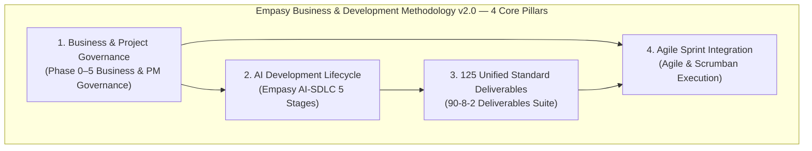
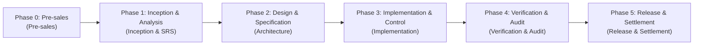

# Empasy Business & Development Methodology Portal

**Empasy Business & Development Methodology v2.0** is an enterprise-wide standard methodology that systematizes the complete software project lifecycle—from **Request for Proposal (RFP) analysis and pre-sales (Phase 0)** through **contract execution, project kickoff, spec-first architecture design, AI-collaborative implementation, 4-Cycle Zero-Mock quality verification and audit, production launch, final acceptance sign-off, balance collection, and one-year warranty maintenance (Phase 5)**.

This portal serves as a comprehensive operational hub enabling all project stakeholders—executives, sales representatives, lead PMs, architects, software and AI engineers, QA and security engineers, finance/legal teams, and client decision-makers—to collaborate seamlessly under a unified **Phase 0 to Phase 5 stage framework** and **125 unified standard templates**.

---

## 1. Four Core Pillars of the Methodology

1. **Business & Project Governance (Phase 0–5)**:
   - Administrative framework covering low-margin deal prevention (Go/No-Go 70-point threshold), 30–50% advance payment collection, 4 formal sign-offs, 3 M/D change request (CR) control, 2026 AI Basic Act governance, liquidated damages and disguised subcontracting risk prevention, and 100% final balance collection.
2. **AI Development Lifecycle (Empasy AI-SDLC)**:
   - 5-stage engineering standard from planning to deployment (Requirements Specification -> Spec-First Architecture -> AgentScope Collaborative Implementation -> 4-Cycle Zero-Mock Verification -> HITL Multi-Stage Approval Automated Deployment).
3. **125 Unified Standard Deliverables Suite (90-8-2 Deliverables Suite)**:
   - Standardized under a single enterprise code system (`EMP-G0`, `EMP-P0~P5`, `EMP-C0`) and the 90-8-2 restrained consulting design standard, featuring 125 Clean Blank Master templates, 121 worked `SyncFlow AI` sample examples (available side-by-side per row and in preset bundles), 14 synchronized Markdown documents, and 6 scale-based tailoring preset packages.
4. **Agile Sprint Integration (Agile & Scrumban Execution)**:
   - Execution culture that breaks macro milestones (WBS) down into daily-visible 1–2 week sprints driven by Git Flow and issue tracking.

---

## 2. One-Click Quick-Jump Matrix by 8 Core Roles

| Role | Responsibilities | Essential Guides | Key Standard Templates (125-Item Catalog) |
| :--- | :--- | :--- | :--- |
| **Sales / Business Lead** | Deal feasibility review, RFP analysis, TCO & estimation, contracting, balance collection | [Pre-sales Playbook](./presales-ai-playbook.md) [Lifecycle Overview](./enterprise-project-lifecycle.md) | [NDA](./enterprise-document-templates.md#emp-p0-01), [Go/No-Go](./enterprise-document-templates.md#emp-p0-02), [TCO Costing](./enterprise-document-templates.md#emp-p0-04), [Standard Contract](./enterprise-document-templates.md#emp-p1-01), [Final Payment Invoice](./enterprise-document-templates.md#emp-p5-13) |
| **Lead PM / PO** | Schedule control (WBS), securing 4 formal sign-offs, change control (3 M/D), audit response | [45 Action Items SOP](./enterprise-action-items-guide.md) [Standard Docs & Governance Guide](./enterprise-business-documents.md) | [Kickoff Report & PMP](./enterprise-document-templates.md#emp-p1-02), [WBS Master](./enterprise-document-templates.md#emp-p1-10), [Scope Freeze](./enterprise-document-templates.md#emp-p1-20), [Monthly/Interim Report](./enterprise-document-templates.md#emp-p3-02), [CR Form](./enterprise-document-templates.md#emp-p3-10), [Final Acceptance](./enterprise-document-templates.md#emp-p5-12) |
| **System Architect** | System architecture design, network segmentation & firewalls, 6-File DDL & API specification | [Spec-First Architecture Guide](./ai-sdlc-02-architecture.md) [AI-SDLC Overview](./ai-driven-development.md) | [SAD](./enterprise-document-templates.md#emp-p2-11), [Firewall Request](./enterprise-document-templates.md#emp-p2-13), [Dev Standards & Env Spec](./enterprise-document-templates.md#emp-p2-15), [9-Sheet DB Spec](./enterprise-document-templates.md#emp-p2-20) |
| **Backend / Frontend / AI** | AgentScope collaborative coding, interface implementation, prompt & unit testing | [AI Collaborative Implementation Guide](./ai-sdlc-03-implementation.md) [Practical Prompt Cheat Sheet](./ai-sdlc-prompt-recipes.md) | [API Specification](./enterprise-document-templates.md#emp-p2-22), [AI Inference & Prompt Design](./enterprise-document-templates.md#emp-p2-24), [AI Rules Dictionary](./enterprise-document-templates.md#emp-p3-15), [Prompt Specification](./enterprise-document-templates.md#emp-p3-16) |
| **QA / Security Engineer** | 4-Cycle Zero-Mock verification, 49 security checks, OSS compliance, AI golden set, UAT | [Test Automation Guide](./ai-sdlc-04-testing.md) [Planning & Requirements Guide](./ai-sdlc-01-requirements.md) | [Integration Test](./enterprise-document-templates.md#emp-p4-04), [MOIS/KISA 49-Item Checklist](./enterprise-document-templates.md#emp-p4-06), [OSS Verification](./enterprise-document-templates.md#emp-p4-07), [AI Golden Set](./enterprise-document-templates.md#emp-p4-09), [UAT Sign-off](./enterprise-document-templates.md#emp-p4-11) |
| **DevOps / Operations** | Infrastructure provisioning, automated CI/CD deployment, rollback runbook, incident & FinOps monitoring | [Code Review & Deployment Guide](./ai-sdlc-05-review-deploy.md) [Standard Docs & Governance Guide](./enterprise-business-documents.md) | [Deployment & Rollback Runbook](./enterprise-document-templates.md#emp-p5-03), [Cutover Checklist](./enterprise-document-templates.md#emp-p5-02), [Incident Report](./enterprise-document-templates.md#emp-p5-15), [AI FinOps Settlement](./enterprise-document-templates.md#emp-p5-19) |
| **Finance / Legal** | Bid documents, surety bonds, advance payment & subcontract approval, outsourcing/freelancer & AI Basic Act compliance | [Standard Docs & Governance Guide](./enterprise-business-documents.md) [Template Download Center](./enterprise-document-templates.md) | [Advance Payment Request](./enterprise-document-templates.md#emp-p1-06), [Subcontract Approval](./enterprise-document-templates.md#emp-p1-07), [AI Governance Checklist](./enterprise-document-templates.md#emp-p1-22), [Outsourcing Contract](./enterprise-document-templates.md#emp-c0-08), [Freelancer Agreement](./enterprise-document-templates.md#emp-c0-09) |
| **Client / Business Stakeholders** | Requirements confirmation, UI approval, interim reviews, UAT acceptance, final completion inspection | [Lifecycle Overview](./enterprise-project-lifecycle.md) [Standard Docs & Governance Guide](./enterprise-business-documents.md) | [Scope Freeze](./enterprise-document-templates.md#emp-p1-20), [UI Design Approval](./enterprise-document-templates.md#emp-p2-10), [UAT Sign-off](./enterprise-document-templates.md#emp-p4-11), [Final Acceptance Certificate](./enterprise-document-templates.md#emp-p5-12) |

---

## 3. Integrated 3-Axis Mapping: Business Phases (Phase 0–5), AI-SDLC, and Agile

The 6 project management phases (`Phase 0 ~ Phase 5`), 5 software engineering stages (`AI-SDLC`), and daily execution units (`Agile/Scrumban`) map 1:1 in the unified framework below.

| Business Phase (PM) | Core Objectives & Mandatory Gates | Corresponding AI-SDLC Stage | Agile & Sprint Alignment | Deliverable Code Range |
| :--- | :--- | :--- | :--- | :---: |
| **Phase 0. Pre-sales & Proposal** | Go/No-Go (70 pts), NDA, 3-Year TCO, PoC, Technical Sign-off | [Pre-sales Playbook](./presales-ai-playbook.md) | Prototype Spike | `EMP-P0-01~11` |
| **Phase 1. Inception & Analysis** | Main contract & advance payment (30–50%), WBS, early data verification, AI Basic Act check, **Sign-off #1 (Scope Freeze)** | [Stage 01: Planning & Requirements](./ai-sdlc-01-requirements.md) | Product Backlog Refinement & Story Points | `EMP-P1-01~22` |
| **Phase 2. Design & Specification** | UI Storyboard (**Sign-off #2**), SAD & firewall, 6-File DDL, canonical `/api/v1/` APIs, AI prompt design | [Stage 02: Spec-First Architecture](./ai-sdlc-02-architecture.md) | Definition of Ready (DoR) Lock | `EMP-P2-01~25` |
| **Phase 3. Implementation & Control** | AgentScope & Zero-Mock live integration, weekly/monthly/interim reports, CR control (3 M/D), progress inspection (40%) | [Stage 03: AI Collaborative Coding](./ai-sdlc-03-implementation.md) | 1–2 Week Scrumban & Git Flow | `EMP-P3-01~17` |
| **Phase 4. Verification, Audit & UAT** | 4-Cycle Zero-Mock verification, **MOIS/KISA 49 Secure Coding Rules**, OSS compliance, AI golden set, 3rd-party audit, **Sign-off #3 (UAT)** | [Stage 04: Testing & Auto-Fix](./ai-sdlc-04-testing.md) | DoD Fulfillment, Regression & Defect Triage | `EMP-P4-01~11` |
| **Phase 5. Launch, Settlement & Ops** | Cutover & rollback, data reconciliation (zero discrepancy), manuals & training, **Sign-off #4 (Final Acceptance)**, final balance (30%), SLA & FinOps | [Stage 05: Code Review & Auto-Deploy](./ai-sdlc-05-review-deploy.md) | Release Retrospective, Ops Handover & P&L | `EMP-P5-01~19` |

---

## 4. Official Deliverables & Template Download Center (125 Templates + 121 Worked Examples)

All duplicate files and legacy formats have been consolidated under the **90-8-2 enterprise design standard**, providing **125 unique Clean Blank Master templates** alongside **121 worked `SyncFlow AI` sample examples** both per row and in 6 scale-based preset ZIP packs.

::: tip 125-Item Unified Download Center & Tailoring Presets by Scale (Templates + Examples Included)
* **[Go to the Standard Document Templates Download Center](./enterprise-document-templates.md)**
* **Available Package Options (6 Packs)**:
  1. **Enterprise Master Full Pack (`Empasy_Master_Full_Pack.zip`, 125 Templates + 121 Examples + 14 MD)**: Complete all-in-one suite for public sector, financial, and large enterprise audits
  2. **Small / MVP Essential Pack (`Empasy_Preset_Small_MVP.zip`, 29 Templates + 27 Examples)**: Core suite for short-term 2–3 month projects under 100M KRW
  3. **Standard Enterprise Pack (`Empasy_Preset_Standard_Enterprise.zip`, 88 Templates + 85 Examples)**: Standard delivery suite for mid-to-large commercial SI projects
  4. **AI / LLM Project Add-on Pack (`Empasy_Preset_AI_Addon.zip`, 10 Templates + 8 Examples)**: AI Basic Act checklist, prompt & rules dictionaries, golden set, and AI FinOps
  5. **Legal, Contract, Subcontract & Risk Pack (`Empasy_Preset_Legal_Subcontract.zip`, 18 Templates + 18 Examples)**: Contracts, advance payment, subcontracting, 5 outsourcing forms, EOT, breach notification, and early termination
  6. **Worked Examples Reference Pack (`Empasy_SyncFlow_AI_Sample_Pack.zip`, 121 Examples Only)**: Complete worked example set for the sample project (`Hanbit Global / SyncFlow AI`)
:::

---

## 5. Phase-by-Phase Execution Guide (45 Action Items SOP)

This standard operating procedure defines what project practitioners must execute in each phase (`Phase 0 ~ Phase 5`), in what sequence, and which standard deliverables (`EMP-*`) determine pass/fail gate criteria.

* **[View the Full Phase-by-Phase Action Items & Execution Guide (45 Action Items SOP)](./enterprise-action-items-guide.md)**
  - Phase 0 (Pre-sales & Proposal): `A0.0 ~ A0.6` (7 Action Items)
  - Phase 1 (Inception & Analysis): `A1.0 ~ A1.7` (8 Action Items)
  - Phase 2 (Design & Specification): `A2.0 ~ A2.6` (7 Action Items)
  - Phase 3 (Implementation & Control): `A3.1 ~ A3.7` (7 Action Items)
  - Phase 4 (Verification, Audit & UAT): `A4.1 ~ A4.6` (6 Action Items)
  - Phase 5 (Launch, Settlement & Ops): `A5.1 ~ A5.10` (10 Action Items)

---

## 6. Integration with Agile Processes and Engineering Workflows

The sprint operations and engineering culture used by development teams to execute the methodology's macro milestones (WBS) week by week integrate directly with the dedicated **[Agile Process](/en/agile/)** portal.

* **[Agile & Scrumban Operations](/en/agile/scrumban)**: Hybrid Scrumban board management, WIP limits, daily scrums, and story point estimation
* **[Engineering Workflow](/en/agile/gitFlow)**: Git Flow branching model, Git commit message conventions, and issue authoring rules
* **[Methodology Comparison & Glossary](/en/agile/xp_scrum_kanban)**: Comparison of XP, Scrum, and Kanban alongside the standard Agile glossary
