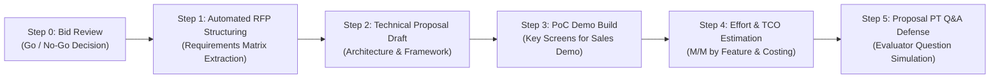

# Empasy Pre-sales & Proposal Playbook

> **Overview:** When a client Request for Proposal (RFP) arrives, this guide serves as a practical handbook for engineering and technical support teams to back up the sales organization quickly and systematically across **Non-Disclosure Agreement (NDA) execution, bid feasibility review (Go/No-Go), RFP requirements analysis, technical proposal drafting, sales demo prototyping (PoC), proposal presentation (PT) Q&A defense, and formal pricing and cost estimation**.

::: tip Related Parent and Practical Guides
* **[Empasy Project & Development Methodology Overview](./enterprise-project-lifecycle.md)**: End-to-end 6-phase enterprise project lifecycle overview
* **[Empasy End-to-End Standard Document System & Delivery Guide](./enterprise-business-documents.md)**: Standards for contract, administrative, design, acceptance, and billing documents
* **[Empasy Phase-by-Phase Action Items & Standard Operating Procedure (SOP)](./enterprise-action-items-guide.md)**: Concrete action items and procedures per phase
* **[Situational Practical Prompt Recipes](./ai-sdlc-prompt-recipes.md)**: Copy-ready prompt templates for each execution phase
:::

---

## 1. Phase Objectives and Target Audience

* **Primary Owners**: Pre-sales Engineers, Proposal Technical PMs, Solution Architects
* **Collaborators**: Account Executives (AE), Business Unit Directors, Estimation Specialists
* **Target Turnaround Time**: Within 4 to 8 hours of RFP receipt
* **Tools Used**: Internal RAG document ingestion tools, SyncVerse component templates, Claude/Cursor

---

## 2. Pre-Flight Checklist (Entry Criteria)

Verify the following items before starting this phase:
- Have the client's RFP files (PDF, HWP, DOCX, etc.) been obtained?
- Have the proposal submission deadline and proposal presentation (PT) schedule been confirmed?
- Have the client's core target domains (e-commerce, content management, infrastructure, etc.) been identified?

---

## 3. 6-Step Practical Execution Workflow



### Step 0: Non-Disclosure Agreement (NDA) Execution & Bid Feasibility Review (Go / No-Go Gate)
Before receiving detailed client RFP materials or source data, complete evaluation and administrative procedures upfront to prevent legal disputes, wasted resources on unqualified bids, and unprofitable contract awards:
1. **Mutual Non-Disclosure Agreement (NDA) Execution**: Complete a written contract to protect trade secrets and client data.
2. **Technical Fit (30 pts)**: Alignment rate with our standard framework stack (Spring Boot, PostgreSQL, Vue, etc.)
3. **Schedule Feasibility (20 pts)**: Reasonableness of development effort relative to the client's requested timeline
4. **Project Profitability (25 pts)**: Input cost and projected profit margin relative to the estimated budget
5. **Internal Asset Reuse Rate (15 pts)**: Scope of reusable existing components and solutions
6. **Risk Factors (10 pts)**: Presence of unreasonable or toxic contract clauses (penalties, excessive warranty maintenance)
7. **Advance Issuance of Bid Administrative Documents**: Corporate seal certificate, national/local tax clearance certificates, credit rating report, project performance certificates, and bid bond insurance policy.
* **Decision Criteria**: Score >= 70 points -> **Go (Proceed with Bid)**; below 70 points -> review for **No-Go (Decline Bid)**.

### Step 1: Automated RFP Structuring & Requirements Traceability Matrix (RTM) Extraction
Ingest hundreds of pages of RFP documentation into AI to rapidly extract the following items in tabular form:
* **System Functional Requirements (SFR)**: Essential business capabilities the system must implement
* **Data Requirements (DAR)**: Legacy system data migration and integration requirements
* **Non-Functional Requirements (NFR)**: Performance, security, availability, and personal data masking standards
* **Constraints**: Mandatory OS, DBMS, and cloud environments specified by the client

### Step 2: Drafting the Technical Proposal
Excluding the project management sections written by the Account Executive, rapidly draft the **'Technology & Methodology'** section:
* System architecture diagram and layer-by-layer role definitions based on our internal standard framework
* Differentiators over competing solutions (specification-first design, 4-stage self-healing integrity verification framework)
* Security, High Availability (HA), and high-volume traffic handling strategies

### Step 3: Rapid Prototyping of Key Sales Demo Screens (PoC)
To establish credibility over competitors during the client proposal presentation (PT), quickly build 1 to 2 high-interest core screens using our standard internal components.
* Example: Implement a working version of *"the client-requested AI-based automated product recommendation and coupon application screen"* within half a day and provide a live demo URL.

### Step 4: Objective Effort & Total Cost of Ownership (TCO) Integrated Estimation
* **Feature-Level Effort (M/M)**: Calculate objective effort based on requirement complexity (High / Medium / Low).
* **Integrated TCO Costing**: Reflect total costs in the quote by combining labor costs with cloud infrastructure expenses, LLM API token usage costs, and third-party license fees.
* **Technical Sign-off**: Before submitting the proposal, the development lead formally signs off confirming *"this scope can realistically be built within this schedule and effort"* prior to final bid submission.

### Step 5: Preparing Proposal Presentation (PT) Q&A Defense Scenarios
To handle sharp technical questions or challenges targeting potential weaknesses from evaluators, simulate 10 likely questions and prepare technical defense talking points for the presenters (Sales / PM).

---

## 4. Practical Prompt Examples (Copy and Use)

### Prompt 1: Bid Feasibility Review (Go / No-Go) Scorecard Generation
```markdown
[Role] Technical Evaluator on an IT Project Bid Review Committee
[Context] Review the client RFP summary below and objectively evaluate whether to participate in the bid (Go / No-Go).
[RFP Overview]
- Project Name: {{Project Name}}
- Client Budget: {{Budget Amount}}
- Project Duration: {{Execution Period, e.g., 5 months from kickoff}}
- Core Required Technologies: {{Required Tech Stack and Integration Targets}}

[Evaluation Criteria]
1. Technical Fit (30 pts): Alignment with our stack (Java/Spring Boot, PostgreSQL, Vue 3)
2. Schedule Feasibility (20 pts): Likelihood of stable delivery within the timeline
3. Project Profitability (25 pts): Appropriateness of effort relative to budget
4. Internal Solution Reuse Rate (15 pts): Ratio of reusable proprietary components
5. Contract/Security Risk (10 pts): Presence of unreasonable penalty clauses

[Output Format]
- Score and deduction rationale for each criterion
- Total score and final recommendation (Go / No-Go / Conditional Go)
- 3 mandatory pre-alignment conditions required if proceeding with the bid
```

---

### Prompt 2: Automated Decomposition of RFP Requirements Matrix
```markdown
[Role] Principal Proposal PM with 15 years of experience in Enterprise Public/Financial SI
[Context] Analyze the client RFP text below and organize a requirements traceability matrix in table format for drafting the technical proposal.
[RFP Excerpt]
{{Paste the requirements section from the RFP document}}

[Drafting Rules]
1. Clearly classify each item into Functional Requirements (SFR), Data/Integration Requirements (DAR), and Non-Functional Requirements (NFR).
2. Assign a unique ID (e.g., REQ-01), requirement name, detailed description, and complexity (High/Medium/Low) to each requirement.
3. Add a 'Review Needed' column identifying technical issues not explicitly stated by the client that must be verified prior to system implementation (e.g., legacy DB version compatibility, concurrent transaction handling, etc.).
```

---

### Prompt 3: Drafting the Technical Proposal Architecture Section
```markdown
[Role] Principal Software Architect
[Context] Write the system architecture section of the technical proposal satisfying the requirements matrix above.
[Proposed System Name] {{System Name, e.g., Next-Generation Intelligent E-Commerce Platform}}
[Baseline Stack] Java 25, Spring Boot 4.0, PostgreSQL 18.6, Vue 3, SyncVerse Orchestrator

[Requirements]
Draft the following sections in Markdown to demonstrate technical excellence and operational stability to the client's evaluation committee:
1. System architecture diagram (Mermaid block diagram)
2. Rationale for selecting the technology frameworks and expected benefits
3. Fault prevention and High Availability (HA) strategy
4. Overview of our proprietary 4-stage software quality verification framework
```

---

### Prompt 4: Generating Expected Proposal Presentation (PT) Challenge Questions & Defense Logic
```markdown
[Role] External Technical Evaluator (Senior Architect from Public Sector / Academia / Peer Industry)
[Context] Sharply probe potential weaknesses in our proposal and formulate model technical defense responses for the presenter.
[Proposal Summary]
- System Architecture: {{Summary of Proposed Architecture}}
- Data Migration: {{Legacy DB Migration Approach}}
- Schedule & Effort: {{Development Timeline and Allocated M/M}}

[Requirements]
Create 5 anticipated challenge questions an evaluator might ask, paired with technical defense logic for each:
- Example Questions: "How do you prevent concurrency defects during sudden traffic spikes?", "What is your downtime recovery plan if legacy data migration fails?"
- Response Format: 1) Acknowledge & state guiding principle -> 2) Concrete technical solution (architecture/cache/rollback) -> 3) Proven internal validation track record
```

---

### Prompt 5: Integrated Effort (Man-Month) and TCO Calculation by Feature
```markdown
[Role] SI Project Estimation and WBS Design Specialist
[Input Data] {{Previously extracted requirements matrix}}
[Project Duration] {{Target Duration, e.g., 4 months}}

[Estimation Standards]
- 1 Man-Month = 22 Man-Days
- Standard phase ratio: Analysis/Design (20%), Implementation (50%), Testing/Verification (20%), Migration/Stabilization (10%)
- Complexity effort baseline: High (10 M/D), Medium (5 M/D), Low (2 M/D)

[Output Format]
1. Summary table of required effort by WBS phase (Major Category, Subcategory, Required M/M, Assigned Role)
2. Total Cost of Ownership (TCO) estimate: Development labor + Cloud infrastructure (monthly estimate) + LLM API token cost + Solution license fees
3. Recommended contingency buffer percentage based on risk factors
```

---

## 5. Common Mistakes and Precautions

| Mistake Type | Common Pitfall | Recommended Countermeasure |
| :--- | :--- | :--- |
| **Unconditional Bidding Without Feasibility Review** | Wasting resources on low-win-rate or low-margin deals, undermining core projects | Mandate the Step 0 Go/No-Go scorecard and submit proposals only for opportunities scoring 70 points or higher. |
| **Lack of PT Q&A Defense Preparation** | Writing a strong proposal but failing to answer unexpected technical questions from evaluators | Use Prompt 4 to simulate 5 to 10 tough questions in advance before entering the presentation room. |
| **Unilateral Estimates Without Engineering Review** | Sales arbitrarily cuts effort to win the bid, causing severe schedule overruns post-award | Enforce the development lead's Technical Sign-off as a mandatory gate before bid submission. |
| **Overlooking Non-Functional Requirements** | Focusing solely on features while missing concurrent traffic targets, backup intervals, and security compliance | Separate and verify a dedicated Non-Functional Requirements (NFR) checklist during RFP analysis. |

---

## 6. Proposal Phase Exit Checklist (Exit Criteria)

Confirm the following items to complete proposal submission and sales support:
- [ ] Has a Non-Disclosure Agreement (NDA) been executed before viewing client materials?
- [ ] Has bid participation been formally approved through the Step 0 Go/No-Go review?
- [ ] Have all administrative bid documents (corporate seal certificate, tax clearance, credit rating, performance certificates, bid bond) been prepared?
- [ ] Are all functional and non-functional requirements from the RFP mapped completely in the matrix?
- [ ] Do the proposed system architecture diagram and tech stack match our internal standards?
- [ ] Have a live demo prototype (PoC) and summary report been prepared and handed over to the Account Executive?
- [ ] Has technical defense logic been documented for expected proposal presentation (PT) challenge questions?
- [ ] Has the development lead completed Technical Sign-off on the formal quote and cost estimate?

### Related Official Deliverables (Phase 0)
* **[EMP-P0-01] Mutual Non-Disclosure Agreement (NDA)** · **[EMP-P0-02] Bid Feasibility Go/No-Go Review Sheet** · **[EMP-P0-04] 3-Year TCO Costing Sheet** · **[EMP-P0-06] SW Development Standard Quotation** · **[EMP-P0-09] Project Technical Proposal** · **[EMP-P0-10] Proposal Presentation PT & Q&A Defense** · **[EMP-P0-11] Technical Feasibility Pre-Approval Form** -> [Go to Standard Template Download Center](./enterprise-document-templates.md#emp-p0-01)
