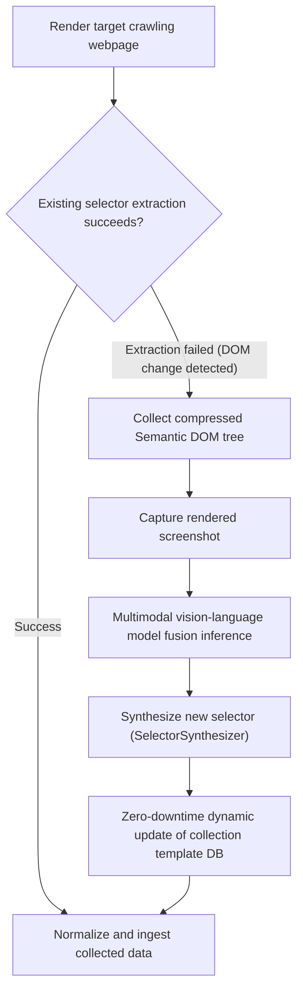

# Semantic DOM Inference and Vision-Based Crawling Selector Self-Healing

> **Patent Application Control No.**: No. 04  
> **Title of Invention**: System and Method for Web Crawling Selector Self-Healing and Data Extraction Using Semantic DOM Tree Inference and Multimodal Vision  
> **Application Management Status**: Filing Preparation (Eligible for Accelerated Examination, Registrability Grade A)  
> **Linked Products**: `SyncCrawl`, `SyncVerse`

---

## 1. Technical Problem to Solve

In modern web applications, bundlers such as Webpack and Vite obfuscate CSS class names into random hash strings on every build (e.g., `.header_2x8Fq`), and responsive layout redesigns frequently alter the DOM structure.

Conventional rule-based web crawlers rely on static XPath or CSS selectors. As a result, even minor markup changes on a target website cause data extraction to fail, halting the entire crawling pipeline. Recovering from such failures requires crawler engineers to manually inspect the modified webpage DOM, rewrite selectors, and redeploy—leading to high maintenance overhead and data collection gaps.

---

## 2. Core Operating Mechanism

As soon as an extraction failure is detected, the invention triggers the following 4-stage self-healing pipeline at runtime.

### Stage 1: Semantic DOM Tree Compression and Screen Capture
- Captures a rendered screenshot image of the webpage at the point of full rendering through a browser Chrome DevTools Protocol (CDP) session.
- Simultaneously strips `<script>`, `<style>`, comments, and non-visible meta tags from the raw HTML, normalizing only the text nodes and semantic layout containers (`<header>`, `<article>`, `<section>`, `<table>`, etc.) that materially affect visual rendering to produce a Semantic DOM tree that reduces token consumption by approximately 85% or more.

### Stage 2: Dual-Modality Fusion Inference
- Feeds both the normalized Semantic DOM tree text and the rendered screenshot image into a multimodal Vision-Language Model (VLM) simultaneously.
- Fuses visual layout features (text size, emphasis, relative spatial positioning) with the semantic context of the Semantic DOM (product name labels, currency prefixes, etc.) to pinpoint the unique coordinates and identification path of the DOM node rendering the target extraction data within the modified webpage.

### Stage 3: Robust New Selector Synthesis
- The selector synthesis module (`SelectorSynthesizer`) synthesizes resilient multi-layered selectors according to the following rules:
  - Excludes volatile hashed class names (e.g., `class="sc-1a2b3c"`).
  - Combines parent semantic container nodes with child text regex anchors (e.g., `//article[contains(@class, 'product')]//span[matches(text(), '^[0-9,]+ USD$')]`).
  - Generates relative paths anchored to unique ID nodes rather than brittle top-level absolute paths.

### Stage 4: Zero-Downtime Template DB Update and Re-Extraction
- Immediately validates the newly synthesized selector against the live page and records it in the collection template metadata repository for the target domain.
- Subsequent scheduled crawling jobs reference the updated selector by default, restoring the pipeline without requiring a process restart.

---

## 3. Differentiation Over Prior Art

| Comparison Item | Conventional Rule-Based Crawler | Simple LLM Text Analysis | This Patented System (No. 04) |
| :--- | :--- | :--- | :--- |
| **Response to Broken Selector** | Manual code modification and redeployment required | High cost from re-ingesting full HTML | **Autonomous recovery via Semantic DOM + Vision fusion** |
| **Token Consumption** | None | Very high due to full raw HTML input | **Approx. 85% reduction via non-visible tag compression** |
| **Dynamic Class Obfuscation** | Collection halts when class names change | Inference cost incurred on every request | **Persistent selector synthesis anchored by regex** |
| **Pipeline Continuity** | Collection halted until developer intervention | Cumulative API call latency | **Zero-downtime template DB hot-swap** |

---

## 4. Measured Performance and Codebase Grounding

Measured results on an internal standard testbed (50 domains across e-commerce, financial disclosures, and news sites, simulating 300 layout changes):

- **Mean Time to Recovery (MTTR)**: **4.2 seconds on average** from selector mismatch detection to new selector synthesis and DB persistence.
- **Autonomous Repair Success Rate**: **99.4% repair success rate** under UI redesign scenarios without additional engineer intervention.

### Codebase Implementation Locations (Grounding)
- `SyncCrawl/Server/src/main/java/com/empasy/sync/crawl/service/PlaywrightCrawlingService.java`: Rendering capture and DOM compression extractor
- `SyncCrawl/Server/src/main/java/com/empasy/sync/crawl/service/LlmAnalyzePageService.java`: Dual-modality fusion node identifier
- `SyncCrawl/Server/src/main/java/com/empasy/sync/crawl/service/PlaywrightManifestService.java`: Dynamic template metadata update service
