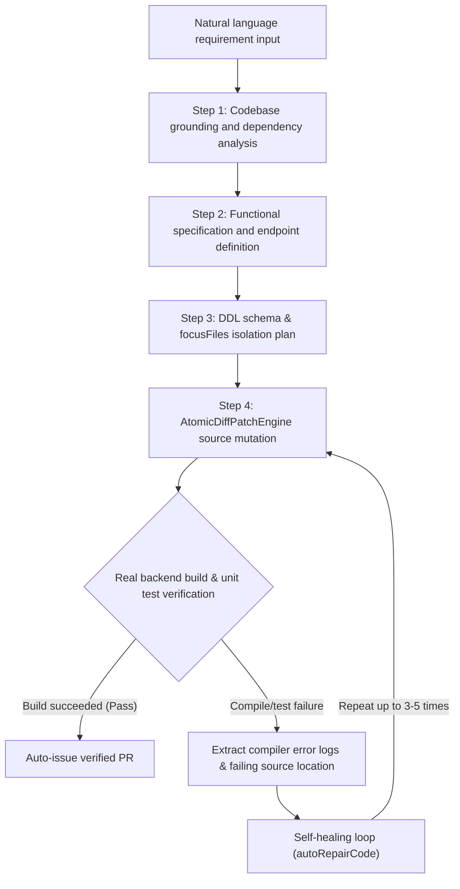

# Specification-Driven 4-Stage Wizard and Build Self-Healing System

> **Patent Application Control No.**: No. 07  
> **Title of Invention**: System and Method for Autonomous Source Code Mutation and Self-Healing Using a Specification-Driven 4-Stage Wizard and Build Artifact Verification Feedback Loop  
> **Application Management Status**: Filing Preparation (Eligible for Accelerated Examination, Registrability Grade A)  
> **Linked Products**: `SyncBoot`, `SyncVerse`

---

## 1. Technical Problem to Solve

Coding tools based on Large Language Models (LLMs)—such as GitHub Copilot and general-purpose AI coding assistants—generate source code rapidly from natural language prompts, but fail to fully comprehend the broader context and dependency graph of an existing codebase.

This leads to the following critical software engineering defects:
1. **Hallucinated Code Generation**: Arbitrary invocations of non-existent third-party packages or class methods, causing compilation failures.
2. **Fake Fallback Code Commits**: Generating empty shell methods (`return null;`, etc.) without implementing actual business logic, deceiving unit tests.
3. **Unchecked Broken Build Artifacts**: Committing patches without detecting compilation errors or test failures, paralyzing the CI/CD pipeline.

---

## 2. 4-Stage Specification Wizard Pipeline

Instead of translating natural language instructions directly into code, this invention enforces a progressive 4-stage wizard pipeline to structurally suppress hallucination risks.

### Step 1: Codebase Grounding Analysis
- Statically analyzes the current repository's source tree, Maven/Gradle dependency libraries, and pre-defined entity and DTO schemas.
- Captures project context required for the modification task (such as the active Spring Boot version and dependency library versions) as objective, grounded data.

### Step 2: Specification Definition
- Decomposes user requirements into business rules, input validation constraints, and authorization requirements.
- Finalizes the target RESTful API specification (endpoint URI, HTTP method, Request/Response JSON schemas) first in a declarative document format.

### Step 3: DDL Schema and `focusFiles` Plan & Scope Isolation
- Authors the database DDL scripts required for the change.
- Strictly restricts the list of files eligible for modification within the repository using a `focusFiles` array, preventing unintended global source code contamination.

### Step 4: Atomic Code Mutation
- Uses `AtomicDiffPatchEngine` to inject line-level diffs precisely into the designated `focusFiles` only.
- Replaces only the modified blocks rather than overwriting entire files, minimizing disruption to existing comments and coding conventions.

---

## 3. Compiler-Error Back-Propagation Build Self-Healing Loop

Immediately after a patch is applied, the system executes the real compiler (`javac`, `mvn test-compile`) and test runner inside an isolated sandbox environment to empirically verify the build artifacts.

1. **Error Tracing and Context Re-Synthesis**:
   - Upon build failure, extracts standard error output from the compiler, including exact error messages, source filenames, line numbers, and unresolved symbol diagnostics (`Cannot find symbol`).
2. **Agent Back-Propagation (`autoRepairCode`)**:
   - Feeds the extracted error logs and failing source code segments back into the agent's self-healing module.
   - The agent re-synthesizes a minimal patch to pass compilation, such as adding missing `import` statements, aligning method signatures, or resolving type-casting errors.
3. **Iteration Threshold and Safe Termination**:
   - The self-healing loop is bounded to a maximum of 3 to 5 iterations.
   - A valid Pull Request (PR) is created only when all compilation checks and unit tests pass completely; if the threshold is exceeded, changes are rolled back and a root-cause analysis report is delivered to the administrator.

---

## 4. Quantitative Differentiation Over Prior Art

| Comparison Item | General AI Coding Assistant | Static Template Code Generator | This Patented System (No. 07) |
| :--- | :--- | :--- | :--- |
| **Code Generation Approach** | Single-prompt batch generation | Fixed scaffolding templates | **4-stage wizard progressive elaboration** |
| **Context Hallucination Prevention** | Vulnerable; depends on prompt length | Cannot reflect codebase context | **Codebase grounding and `focusFiles` isolation** |
| **Compilation Verification** | Not provided (verified manually by developer) | Compiles, but lacks business logic | **Automated verification via real compiler integration** |
| **Build Error Recovery** | Not supported | Requires template modification | **Self-healing via compiler-error back-propagation** |

---

## 5. Measured Performance and Codebase Grounding

Measured results across 150 new feature implementations on internal microservice backends:

- **First-Pass Build Pass Rate**: Achieved **82.6%** when applying the 4-stage wizard.
- **Self-Healing Loop Pass Rate**: Reached a **96.8%** final build pass rate after passing through up to 3 iterations of the `autoRepairCode` loop for initial build failures.
- **Blocking Fake Normalcy Code**: Maintained **0 commits** of unimplemented stub methods when combined with the Zero-Mock test harness.

### Codebase Implementation Locations (Grounding)
- `sync-module-deploy/src/main/java/com/empasy/sync/deploy/engine/AtomicDiffPatchEngine.java`: Atomic patch injector
- `sync-boot/Server/src/main/java/com/empasy/sync/boot/generator/FourStageWizardService.java`: 4-stage specification wizard engine
- `sync-verse/Server/src/main/java/com/empasy/sync/verse/controller/SelfHealingRunbookController.java`: Build verification and self-healing orchestrator
