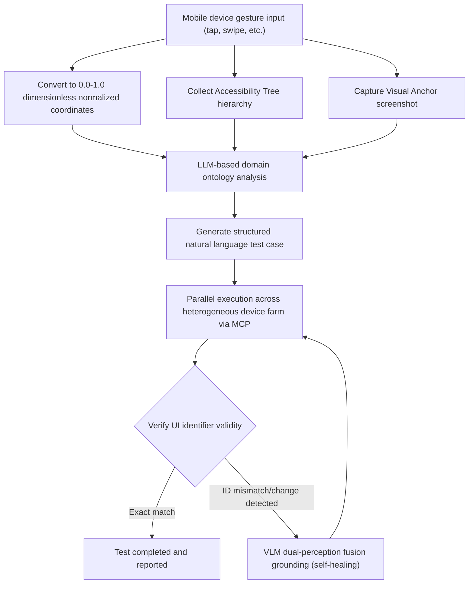

# Mobile Gesture Analysis and Natural Language Test Automation System

> **Patent Application Control No.**: No. 21  
> **Title of Invention**: System and Method for AI-Based Natural Language Test Case Generation and Automated Execution on Heterogeneous Mobile Devices via Mobile Device Gesture Recording and Native View Hierarchy Analysis  
> **Application Management Status**: Filing Preparation (Eligible for Accelerated Examination, Registrability Grade A)  
> **Linked Products**: `SyncETA`, `SyncVerse`

---

## 1. Technical Problem to Solve

Quality assurance (QA) for mobile applications incurs substantial costs due to severe fragmentation across device screen sizes, pixel densities (DPI), and operating systems (Android/iOS).

Conventional mobile test automation tools (e.g., Appium, Espresso, XCUITest) suffer from the following structural limitations:
1. **Resolution and Layout Dependency**: Gestures recorded using absolute pixel coordinates trigger taps at incorrect locations on devices with different aspect ratios, causing execution failures.
2. **Script Breakage from Identifier Changes**: When `resource-id` or `accessibility-id` attributes change due to app refactoring or build tool updates, existing test scripts are completely invalidated.
3. **High Engineering Barrier to Entry**: Test scripts must be authored in complex programming code, restricting usage by non-developer QA personnel.

---

## 2. Core Operating Mechanism

The invention encompasses the complete workflow of capturing real mobile device interactions, translating them into natural language specifications, and replaying them adaptively across heterogeneous devices.

### Stage 1: Gesture Vector Normalization and Multi-Context Collection
- Captures time-series trajectories, contact area, and pressure values from touch input events (tap, long-press, swipe, drag, etc.) performed on a physical device screen.
- Converts X and Y coordinates into **dimensionless normalized relative coordinate vectors between 0.0 and 1.0**, decoupling gestures from device-specific pixel resolutions.
- Generates a **Visual Anchor** by extracting feature vectors and bounding boxes from the screen image at the moment of touch, and merges it with the OS native Accessibility Node Hierarchy.

### Stage 2: LLM Ontology-Based Automatic Natural Language Test Case Generation
- Passes the collected composite data (normalized coordinates, node hierarchy text, visual component metadata) to a Large Language Model.
- Referencing mobile interaction domain ontology rules, the model automatically authors structured test steps (action, input value, expected result) readable by non-developers:
  - *Example*: `"On the login screen, enter 'testuser' into the username field, enter the password, and tap the 'Login' button to verify navigation to the main dashboard."`

### Stage 3: MCP-Based Adaptive Execution on Heterogeneous Device Farms
- Broadcasts the generated natural language test cases via Model Context Protocol (MCP) tool interfaces to multiple distributed physical devices (Android, iOS, tablets, etc.).
- Maps normalized coordinates in real time to each target device's physical pixels while accounting for resolution, display notches, and bottom home-bar Safe Area insets to interact accurately with the intended target.

### Stage 4: VLM Dual-Perception Fusion Self-Healing
- When native UI identifiers (IDs) change after an app version update, a Vision-Language Model (VLM) performs dual-perception fusion grounding (IoU threshold 0.10–0.30) between the stored Visual Anchor image and the updated screen.
- Intelligently locates substitute components with similar visual morphology or text positioning so testing continues uninterrupted, and records the healed selector details in the execution report.

---

## 3. Differentiation Over Prior Art

| Comparison Item | Conventional Script Tools (Appium, etc.) | Coordinate Macro Recorder | This Patented System (No. 21) |
| :--- | :--- | :--- | :--- |
| **Test Case Format** | Programming language code (Java, Python) | Raw list of pixel coordinates | **Human-readable natural language specification** |
| **Heterogeneous Device Compatibility** | Requires per-device branching in scripts | Fails on resolution changes | **Dimensionless normalized relative coordinate transform** |
| **When UI Identifiers Change** | Test immediately halts and fails | Unrecoverable | **Self-healing via VLM dual-perception fusion** |
| **Test Maintenance Accessibility** | Requires specialized test engineers | Unmaintainable | **Immediately usable by general QA and product planners** |

---

## 4. Measured Performance and Codebase Grounding

Measured results across 500 regression test runs on 12 representative domestic and international Android/iOS devices (8 smartphones, 4 tablets):

- **Cross-Device Replay Accuracy**: **98.2% replay success rate** across 11 heterogeneous-resolution devices after recording on a single device.
- **UI Change Self-Healing Rate**: **93.5% autonomous recovery rate** via VLM fusion grounding under native ID changes and layout variations.
- **Test Case Authoring Time**: **Approximately 78% reduction** in authoring time via natural language conversion compared to writing code-based scripts.

### Codebase Implementation Locations (Grounding)
- `SyncETA/Server/src/main/java/com/empasy/sync/eta/service/MobileAgentService.java`: Mobile agent controller
- `SyncETA/Server/src/main/java/com/empasy/sync/eta/service/MobileTcParserService.java`: Natural language test case parser and generator
- `SyncETA/Server/src/main/java/com/empasy/sync/eta/service/RemoteAdbService.java`: Remote Android ADB pipeline
- `SyncETA/Server/src/main/java/com/empasy/sync/eta/service/RemoteIosService.java`: Remote iOS WebDriverAgent integration service
