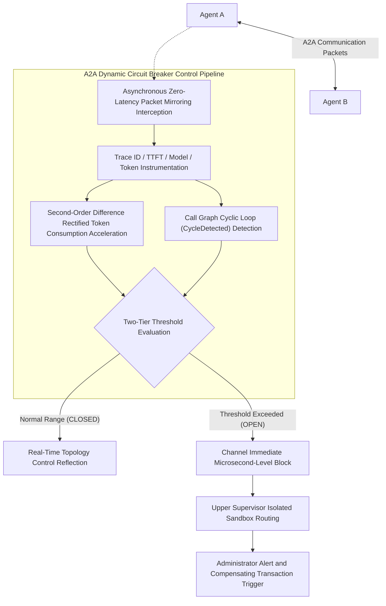

# Distributed Multi-Agent A2A Telemetry and Dynamic Circuit Breaker

> **Patent Application Management Number**: #22  
> **Title of Invention**: Integrated Control System and Method Based on A2A Dynamic Circuit Breaker for Distributed Multi-Agent Communication Telemetry Distributed Tracing and Token Runaway Chain Blocking  
> **Filing Status**: Filing in Preparation (Expedited Examination Target, Registrability Grade A)  
> **Linked Product**: `SyncVerse`

---

## 1. Technical Problem to Solve

In Agent-to-Agent (A2A) communication environments where multiple AI agents mutually query and delegate tasks, distinct failure modes emerge that differ from traditional microservices:

1. **Token Runaway Disguised as Normal HTTP 200**:
   - Even when the HTTP transport itself returns a success status code (`200 OK`), prompt mismatches or hallucinations between agents trigger infinite loops of queries and re-queries, causing cost runaway incidents that consume millions of tokens per minute.
2. **Cascading Paralysis Propagation**:
   - Latency or malformed output from a single agent propagates to downstream agents in the collaboration pipeline, halting the entire business process.
3. **Limitations of Conventional APM / Circuit Breakers**:
   - Traditional circuit breakers such as Netflix Hystrix or Resilience4j rely on simple network timeouts or HTTP 5xx error rates, making them incapable of detecting semantic conversation loops and rapid token consumption acceleration.

---

## 2. Core Operating Mechanism

This invention observes inter-agent traffic without packet instrumentation latency and synthesizes multidimensional metrics to isolate abnormal sessions in real time.

### Stage 1: Asynchronous Zero-Latency Packet Mirroring Interception
- Message payloads exchanged between agents are mirrored without network bottlenecks and delivered to a background telemetry bus.
- From each packet, distributed tracing correlation identifiers (Trace ID, Span ID), Time To First Token (TTFT), model identifier, prompt/completion token counts, and invoked tool specifications are extracted.

### Stage 2: Real-Time Calculation of Rectified Token Consumption Acceleration and Cyclic Loops
- Within a sliding time window, time-series token consumption smoothed via Exponential Moving Average (EMA) is differentiated to the second order (Second-order Difference) to derive an acceleration value.
- To isolate only intervals where the token consumption rate surges sharply, negative deltas are clipped to zero to compute **Rectified Token Consumption Acceleration ($a^+(t)$)**.
- Simultaneously, the adjacency matrix of the inter-agent call graph is analyzed in real time to detect cyclic call loops ($CycleDetected$) in the form `A -> B -> C -> A` within the same session.

### Stage 3: Two-Tier Hybrid Limit Control
The system combines two tiers of blocking criteria to prevent cost leakage while avoiding excessive false positives:
1. **Tier 1 Hard Limit**:
   - Unconditional block if inter-agent delegation hops exceed 15 within a single task session, or if the same agent fails tool execution 3 consecutive times.
2. **Tier 2 Soft Limit**:
   - Immediate channel block (transition to `OPEN` state) as soon as the **Composite Risk Index**, calculated as a weighted sum of token acceleration, cyclic loop presence, and latency variance, **reaches 0.75**.

### Stage 4: Isolated Sandbox Routing and Compensating Transactions
- Subsequent messages on a channel with an open circuit are immediately rejected, and in-flight traffic is automatically redirected to an **isolated sandbox for upper supervisor mediation**.
- The supervisor agent triggers Saga-pattern-based rollback compensating transactions for partially completed work and marks the corresponding agent node as critical on the operations console.

---

## 3. Differentiation Over Prior Art

| Comparison Dimension | Conventional Circuit Breakers (Resilience4j, etc.) | Simple Total Token Rate Limiting | Patented System (#22) |
| :--- | :--- | :--- | :--- |
| **Detection Target** | HTTP status codes (5xx errors, timeouts) | Static call count per minute/day | **Semantic conversation loops and token consumption acceleration** |
| **Blocking Disguised Normal Responses** | Undetectable (treated as normal on HTTP 200) | Cost leaks until static quota is reached | **Early preemptive blocking based on rectified acceleration** |
| **Recovery Procedure** | Simple retry | Wait for usage window reset | **Upper supervisor isolation and Saga rollback** |
| **Control Visibility** | Basic latency/error-rate metrics | Cumulative counters | **A2A call graph and real-time circuit topology** |

---

## 4. Measured Performance and Codebase Implementation Grounding

Measured results from a large-scale distributed agent simulation environment (20 agent nodes, 100 concurrent collaboration sessions, intentional infinite loop injection testing):

- **Blocking Response Speed**: Completed channel blocking within an **average of 1.8 milliseconds** after anomalous token acceleration detection.
- **Unnecessary API Cost Prevention Rate**: Reduced **wasted tokens by 94.2%** through early blocking in scenarios that previously leaked an average of 45,000 tokens per session when left unchecked.
- **Mirroring Instrumentation Overhead**: Recorded a negligible actual A2A communication latency increase of **less than 0.3%** due to packet interception.

### Codebase Implementation Locations (Grounding)
- `sync-verse/Server/src/main/java/com/empasy/sync/verse/controller/A2ACircuitBreakerController.java`: Circuit control controller
- `sync-verse/Server/src/main/java/com/empasy/sync/verse/controller/AgentStreamSseController.java`: Real-time telemetry SSE pipeline
- `sync-verse/admin/src/views/admin/orchestration/A2aMessageTracer.vue`: A2A distributed message tracer UI
- `sync-verse/admin/src/views/admin/orchestration/AgentTopologyGraph.vue`: 3D/2D agent topology control view
