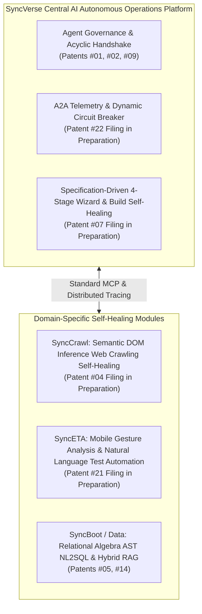

# SyncSeries Core Technology Patent Portfolio

## 1. Intellectual Property (IP) Portfolio Overview

SyncSeries is building a systematic Intellectual Property (IP) protection network to engineer solutions for reliability defects occurring in distributed multi-agent environments (such as fake normalcy, hallucination cascades, runtime selector breakage, and token runaway).

To satisfy the rigorous examination standards of major patent offices (KIPO, USPTO, EPO) regarding AI software technologies (such as the 35 U.S.C. § 101 Alice test in the United States and Article 29 software statutory eligibility in South Korea), abstract concepts at the level of mere algorithms or ideas are excluded. Instead, the claims explicitly codify **concrete hardware implementations coupled with physical processors, memory structures, and distributed network instrumentation pipelines**.

---

## 2. Rights Protection Architecture: 4-Way Quad-Category Framework

SyncSeries patent specifications are uniformly structured with independent claims across four statutory categories to enable effective enforcement against patent infringement occurring in both cloud SaaS deployment environments and distributed microservice operational environments.

| Claim Category | Constituent Elements & Scope of Protection | Legal Significance |
| :--- | :--- | :--- |
| **System Independent Claim** (Hardware System) | Coupled architecture of physical processors, memory, interface controllers, and pipeline computing units | Countering infringement in on-premises hardware server deployments and appliance form factors |
| **Method Independent Claim** (Method Pipeline) | Time-series processing steps from data ingestion, feature vector normalization, state transitions, to fallback execution | Countering infringement at the system operation process and data pipeline level |
| **Storage Medium Independent Claim** (CRM) | Instruction sequences stored on a computer-readable non-transitory recording medium | Asserting direct infringement against packaged software and firmware distribution |
| **Computer Program Independent Claim** (Direct Program) | The program itself transmitted or downloaded over a telecommunications network | Directly attacking infringement via cloud API services (SaaS) and online container image distribution |

---

## 3. Prior Art Examination Response Strategy

To proactively defend against frequent rejection grounds in software-related invention examinations (lack of inventive step, insufficient disclosure, non-statutory subject matter), the following design principles are applied:

1. **1:1 Grounding to the Actual Git Codebase (Grounding Proof)**
   - Fabricated interfaces or non-existent abstract concepts are excluded; service classes, methods, and data structures implemented in actual repositories (`SyncVerse`, `SyncCrawl`, `SyncBoot`, `SyncETA`) are mapped 1:1 to the drawings and reference numerals in the embodiment specifications.
2. **Genus-Level Independent Claims and Multi-Layered Species-Level Dependent Claims**
   - Independent claims are defined as functional genus concepts not restricted to a specific library (e.g., a particular open-source framework) or a single protocol name, blocking design-around attempts by competitors.
   - Dependent claims incorporate numerical limitations with critical technical significance (e.g., token difference acceleration thresholds, IoU matching ranges, window sizes) and multi-layered fallback logic to prepare for inventive step examinations.
3. **Ensuring External Observability (Black-Box Detectability)**
   - External observation identifiers are incorporated into the claims so that infringement can be proven through network packet headers, RFC 7807 standard error payloads, and HTTP response time-series characteristics even in external server environments where direct source code inspection is impossible.

---

## 4. Patent Management Status and Roadmap

Led by a core patent officially registered with the Korean Intellectual Property Office (KIPO), SyncSeries is pursuing expedited examination requests and sequential filings for four core Self-Healing and observability technologies essential to autonomous domain operations.

### 1) Officially Registered Patent
| Registration Number | Title of Invention | Primary Linked Solutions | Legal Status |
| :---: | :--- | :--- | :---: |
| **#10-2025-0125736** | [System and Method for AI-Based Natural Language Test Case Generation and Automated Execution Through Web Browser Action Recording](./registered-web-action-recording.md) | `SyncETA` (Web Autonomous QA), `SyncVerse` | **Registered** (Filed 2025-09-04) |

### 2) Pending Patents in Preparation (Expedited Examination Targets)
| Management Number | Title of Invention | Primary Linked Solutions | Filing Management Status |
| :---: | :--- | :--- | :---: |
| **#04** | [System and Method for Web Crawling Selector Self-Healing and Data Extraction Using Semantic DOM Tree Inference and Multimodal Vision](./04-semantic-dom-self-healing.md) | `SyncCrawl`, `SyncVerse` | **Filing in Preparation (Expedited Examination Target)** |
| **#07** | [System and Method for Source Code Autonomous Mutation and Self-Healing Using Specification-Driven 4-Stage Wizard and Build Artifact Verification Feedback Loop](./07-four-stage-wizard-build.md) | `SyncBoot`, `SyncVerse` | **Filing in Preparation (Expedited Examination Target)** |
| **#21** | [System and Method for AI-Based Natural Language Test Case Generation and Automated Execution Across Heterogeneous Mobile Devices Through Mobile Terminal Gesture Recording and Native View Hierarchy Analysis](./21-mobile-gesture-nlp.md) | `SyncETA` (Mobile QA), `SyncVerse` | **Filing in Preparation (Expedited Examination Target)** |
| **#22** | [Integrated Control System and Method Based on A2A Dynamic Circuit Breaker for Distributed Multi-Agent Communication Telemetry Distributed Tracing and Token Runaway Chain Blocking](./22-a2a-telemetry-circuit.md) | `SyncVerse` | **Filing in Preparation (Expedited Examination Target)** |
