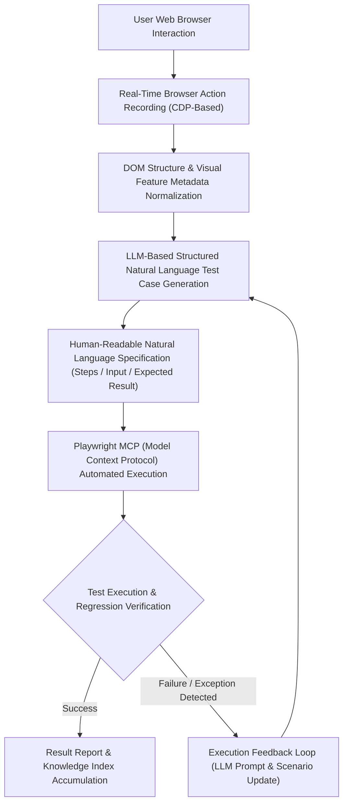

# Web Browser Action Recording-Based AI Natural Language Test Case Automation

> **Patent Registration Number**: Patent #10-2025-0125736  
> **Title of Invention**: System and Method for AI-Based Natural Language Test Case Generation and Automated Execution Through Web Browser Action Recording  
> **Filing Date**: September 4, 2025  
> **Patent Legal Status**: **Officially Registered with the Korean Intellectual Property Office (KIPO)**  
> **Primary Linked Solutions**: `SyncETA` (Web Autonomous QA Engine), `SyncVerse`

---

## 1. Technical Problem to Solve

In modern software development environments, shortened Continuous Deployment (CD) cycles make frequent regression testing essential. However, conventional test automation tools (Selenium and static script-based tools) suffered from the following structural limitations:

1. **High Cost of Authoring Test Scripts**:
   - Specialized programming proficiency was required, restricting participation in testing by non-developer QA personnel and business planners.
2. **Script Breakage Upon UI Changes**:
   - Even minor changes to frontend UI classes or DOM structures broke selectors in existing scripts, continuously incurring massive manual maintenance overhead.
3. **Lack of Readability in Test Case Management**:
   - Test scripts written in code were difficult to verify against business specifications at a glance, creating a silo problem where test asset documentation and history management became disconnected.

---

## 2. Core Operating Mechanism

This registered patent encompasses a full-lifecycle pipeline that captures routine user interactions performed in a web browser, converts them into natural language specifications, and autonomously re-executes them via a standard tool protocol (Playwright MCP).

### Stage 1: Real-Time Browser Action Recording
- Utilizes a Chrome DevTools Protocol (CDP) session to capture time-series events—such as mouse clicks, text typing, scrolling, dropdown selections, and page navigation—without latency.
- Normalizes not only raw event coordinates, but also the hierarchy of the DOM node where the event occurred, its text content, and surrounding visual elements (labels, adjacent text, etc.).

### Stage 2: LLM-Based Automated Natural Language Test Case Generation
- Passes the collected action data to a Large Language Model (LLM) to automatically convert it into structured natural language test cases rather than programming code.
- The generated document follows a clear three-part structure (test steps, input data, expected verification result), conforming to a standard document format that planners and managers can immediately review.

### Stage 3: Playwright MCP-Based Automated Execution
- The converted natural language test cases are delivered to a Playwright execution agent adhering to the Model Context Protocol (MCP) specification.
- The agent analyzes the natural language instructions, interacts with web browser DOM elements, and automatically executes scenarios across multi-browser environments (Chrome, Edge, Firefox, WebKit).

### Stage 4: Continuous Quality Improvement Feedback Loop
- Collects test execution results, failure logs, and screen snapshots, feeding them back into the LLM's prompts and context memory.
- Continuously refines the model's generation rules so that more robust and maintainable test cases are produced for identical UI patterns.

---

## 3. Quantitative Differentiation Over Prior Art

| Comparison Dimension | Conventional Script Tools (Selenium, etc.) | Static Recorder Tools | Registered Patent (#10-2025-0125736) |
| :--- | :--- | :--- | :--- |
| **Test Representation Format** | Java/Python programming code | Simple coordinates or brittle XPath listings | **Human-readable structured natural language specification** |
| **Authoring Difficulty** | Requires specialized development skills | Easy to record, impossible to maintain | **Automated generation from ordinary user actions** |
| **Execution Engine Integration** | Fixed proprietary drivers | Proprietary macro engines | **Based on standard Playwright MCP protocol** |
| **Quality Evolution System** | Manual code modification | Static repeated execution | **Continuous LLM generation quality improvement via execution feedback** |

---

## 4. Integration with Mobile Patent and Full-Stack Autonomous QA Architecture

This registered patent covers desktop web environments and combines with **Patent #21 (Mobile Gesture Recording and AI Natural Language Test Case Automation)**—currently in preparation for filing—to complete `SyncETA`'s unified "Web + Mobile" autonomous QA portfolio.

- **Web Domain (Registered Patent)**: CDP-based browser action recording -> Playwright MCP automated execution.
- **Mobile Domain (Patent #21)**: Normalized touch trajectory vectors -> adaptive parallel execution across heterogeneous device farms (Android/iOS).
- Through the organic integration of both patents, enterprises can perform quality verification from web portals to native mobile apps using a unified natural language system on a single platform.
