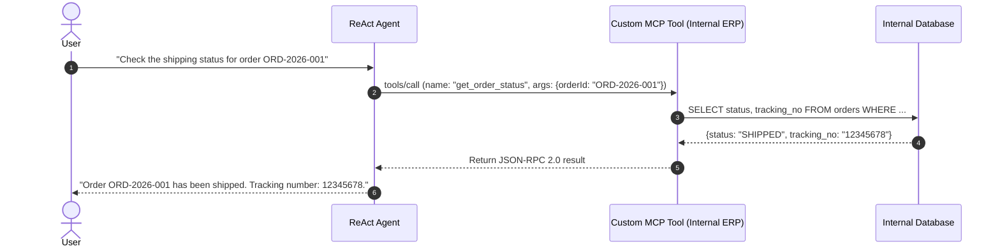

# Developing Custom MCP Tools for Internal Systems

## 1. Overview and MCP Specification

**Model Context Protocol (MCP)** is an open JSON-RPC 2.0 communication specification used by AI agents to interact with external data sources such as databases, internal ERPs, and deployment pipelines.

SyncSeries provides a standardized, annotation-based tool registration mechanism that exposes internal legacy system capabilities as structured JSON Schema tools, enabling agents to invoke them autonomously (Tool Calling) as needed.



---

## 2. Implementing Java-Based Custom Tools

`SyncSeries` backend modules can immediately register standard Spring Bean methods as MCP tools using the `@Tool` annotation.

### 1) Defining the Tool Class and Schema
```java
package com.empasy.sync.custom.tools;

import io.agentscope.core.tool.Tool;
import io.agentscope.core.tool.ToolParam;
import lombok.RequiredArgsConstructor;
import lombok.extern.slf4j.Slf4j;
import org.springframework.stereotype.Component;

@Slf4j
@Component
@RequiredArgsConstructor
public class OrderManagementTools {

    private final InternalOrderRepository orderRepository;

    @Tool(
        name = "get_order_status",
        description = "Retrieves the current order status, payment amount, and shipping tracking number based on the customer's order ID (orderId)."
    )
    public OrderStatusResult getOrderStatus(
        @ToolParam(name = "orderId", description = "Unique order identifier to query (e.g., ORD-2026-001)", required = true)
        String orderId
    ) {
        log.info("[MCP Tool] Received get_order_status call - orderId: {}", orderId);

        // 1. Basic input validation
        if (orderId == null || !orderId.matches("^ORD-\\d{4}-\\d{3,}$")) {
            throw new IllegalArgumentException("Invalid order ID format.");
        }

        // 2. Query internal database
        return orderRepository.findByOrderId(orderId)
                .map(order -> OrderStatusResult.builder()
                        .orderId(order.getId())
                        .status(order.getStatus().name())
                        .amount(order.getTotalAmount())
                        .trackingNumber(order.getTrackingNumber())
                        .build())
                .orElseThrow(() -> new OrderNotFoundException("Order not found: " + orderId));
    }
}
```

### 2) Designing the DTO Model (with Lombok)
```java
package com.empasy.sync.custom.tools;

import lombok.Builder;
import lombok.Getter;

import java.math.BigDecimal;

@Getter
@Builder
public class OrderStatusResult {
    private String orderId;
    private String status;
    private BigDecimal amount;
    private String trackingNumber;
}
```

---

## 3. Input Validation and Security Guardrails (RBAC)

Because tools invoked by agents may receive malicious or malformed parameters, strict guardrails must always be enforced.

1. **Strict JSON Schema Binding**:
   - Automatically reject unpermitted additional fields (`additionalProperties: false`).
   - Specify numeric bounds (`minimum`, `maximum`) for number parameters and regex patterns (`pattern`) for string parameters.
2. **Role-Based Access Control (Tool RBAC)**:
   - Tools requiring write permissions—such as deleting data or modifying configurations—must verify the session user's authorities:
     ```java
     @Tool(name = "cancel_order", description = "Cancels an order and processes a payment refund.")
     @PreAuthorize("hasRole('ROLE_SHOP_ADMIN')")
     public OrderCancelResult cancelOrder(...) { ... }
     ```

---

## 4. Verifying the MCP JSON-RPC Communication Contract

Registered tools are discovered and executed by standard MCP clients as follows.

### Tool List Response (`tools/list`)
```json
{
  "jsonrpc": "2.0",
  "result": {
    "tools": [
      {
        "name": "get_order_status",
        "description": "Retrieves the current order status based on the customer's order ID (orderId).",
        "inputSchema": {
          "type": "object",
          "properties": {
            "orderId": {
              "type": "string",
              "description": "Unique order identifier to query"
            }
          },
          "required": ["orderId"],
          "additionalProperties": false
        }
      }
    ]
  },
  "id": 1
}
```

### Tool Execution Request (`tools/call`)
```json
{
  "jsonrpc": "2.0",
  "method": "tools/call",
  "params": {
    "name": "get_order_status",
    "arguments": {
      "orderId": "ORD-2026-001"
    }
  },
  "id": 2
}
```
