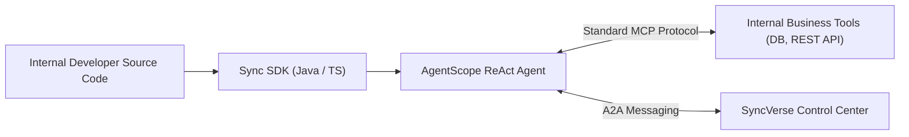
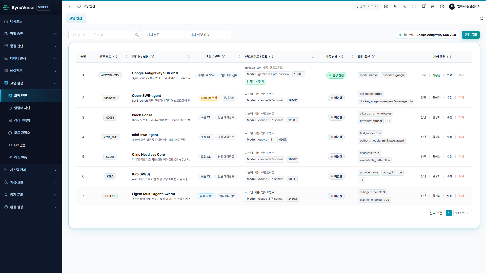
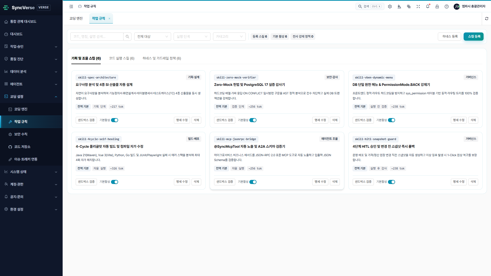
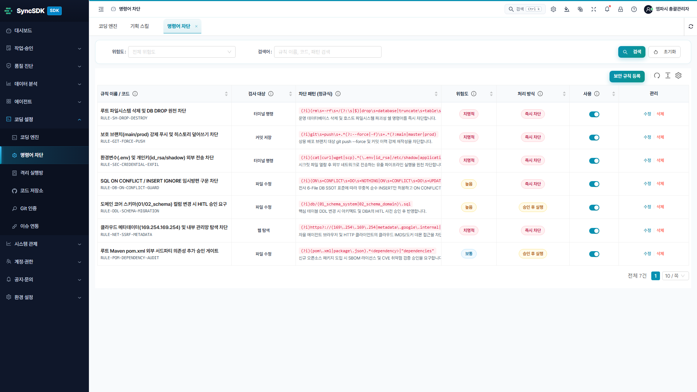
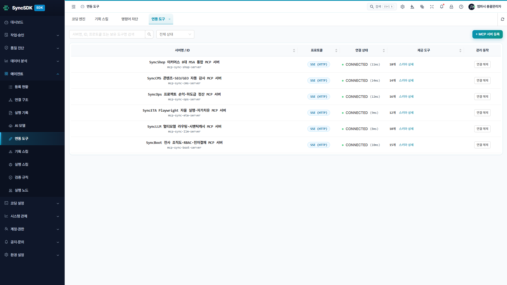

# Sync SDK and Developer Center

> **Download Product Overview & Proposal**: [SyncSDK_Proposal.pdf (12p)](/downloads/proposals/SyncSDK_Proposal.pdf){target="_blank" download="SyncSDK_Proposal.pdf"} · [All Product Proposals](/en/proposals/)

## 1. Overview

The SyncSeries Developer Center provides standardized SDKs and guides so internal engineers and partner developers can **easily integrate and extend existing business systems (Spring Boot backends, internal ERP/CRM, etc.) into a standardized AI agent ecosystem**.

SyncSeries agents are built on Java-based `AgentScope Java` (`io.agentscope:agentscope-harness`), proven across the framework, and Anthropic's **Model Context Protocol (MCP)** standard interface specification.



### Core Development Tracks and Standard Documentation

In addition to the hands-on Developer Center guides, enterprise-wide specifications and shared module documentation are available at the links below:

| Category | Key Topics | Documentation Link |
|:---|:---|:---|
| **AgentScope Java Standard** | Agent collaboration and ReAct configuration rules in Spring Boot environments | [AgentScope Guide →](/en/ecosystem/agentscope-guide) |
| **Standard MCP Specification** | Model Context Protocol tool invocation specs and error-handling standards | [MCP Protocol Spec →](/en/ecosystem/mcp-protocol) |
| **Shared Business Modules** | Six core shared modules (`sync-core`, `sync-module-ai`, `sync-module-nl2sql`, `sync-module-audit`, `sync-module-deploy`, `sync-module-rag`) and SDK architecture | [Shared Modules & SDK →](/en/ecosystem/shared-modules-and-sdk) |
| **Quality Assurance Principles** | 4-Cycle quality verification protocol backed by real infrastructure integration | [Quality Harness Principles →](/en/ecosystem/zero-mock-harness) |
| **Operations & Approval Management** | Operations guide for business approval (HITL) and token budget management console | [Operations Guide →](/en/guide/) |

---

## 2. 5-Minute Quickstart (Java / Spring Boot)

Follow this standard procedure to configure and run your first AI agent with minimal setup in a Spring Boot 4.0 environment.

### Step 1: Add Maven Dependencies
Add the SyncSeries SDK core modules to your project's `pom.xml` file:

```xml
<dependency>
    <groupId>com.empasy.sync.sdk</groupId>
    <artifactId>sync-sdk-common</artifactId>
    <version>2026.10.0</version>
</dependency>
<dependency>
    <groupId>io.agentscope</groupId>
    <artifactId>agentscope-harness</artifactId>
    <version>2.0.2</version>
</dependency>
```

### Step 2: Configure the Agent in `application.yml`
Specify your local or internal LLM gateway endpoint:

```yaml
sync:
  ai:
    gateway-url: http://localhost:8000/v1
    model-name: Llama-3.1-70B-Instruct
    api-key: ${SYNC_AI_API_KEY:local-dev-key}
    temperature: 0.1
    timeout-ms: 30000
```

### Step 3: Register Your First ReAct Agent Bean
Create the agent using Lombok annotations and constructor injection:

```java
package com.example.demo.agent;

import io.agentscope.core.agent.ReActAgent;
import io.agentscope.core.model.OpenAiChatModel;
import io.agentscope.core.tool.ToolRegistry;
import lombok.RequiredArgsConstructor;
import org.springframework.context.annotation.Bean;
import org.springframework.context.annotation.Configuration;

@Configuration
@RequiredArgsConstructor
public class SimpleAgentConfig {

    private final OpenAiChatModel chatModel;
    private final ToolRegistry toolRegistry;

    @Bean
    public ReActAgent customerSupportAgent() {
        return ReActAgent.builder()
                .name("CustomerSupportAgent")
                .sysPrompt("You are a dedicated customer support agent. Use the registered tools to look up the user's order status and respond.")
                .model(chatModel)
                .toolRegistry(toolRegistry)
                .maxIterations(5)
                .build();
    }
}
```

### Step 4: Execute and Query the Agent
Invoke the agent from a controller or service to pass user messages:

```java
package com.example.demo.controller;

import io.agentscope.core.agent.ReActAgent;
import io.agentscope.core.message.Msg;
import lombok.RequiredArgsConstructor;
import org.springframework.web.bind.annotation.*;

@RestController
@RequestMapping("/api/v1/verse/support")
@RequiredArgsConstructor
public class SupportAgentController {

    private final ReActAgent customerSupportAgent;

    @PostMapping("/ask")
    public String askAgent(@RequestBody String userQuestion) {
        Msg response = customerSupportAgent.reply(Msg.ofUser("User", userQuestion));
        return response.getText();
    }
}
```

---

## Live UI Screens and Core Workflows

### 1. Runtime Hot-Swap & Routing Control for 15 Multi-Coding Agent Engines
Control the status and dynamic model mapping of 15 coding engines—including `ANTIGRAVITY`, `CLAUDE_CODE`, `GITHUB_COPILOT`, `CODEX_CLI`, `GEMINI_CLI`, `CURSOR_CLI`, `OPENHANDS`, and `OPENSWE`—through a single interface.



### 2. Domain Skill Registry & Dynamic Prompt Template Management
Centrally manage DB-backed zero-downtime prompt templates, version history rollbacks, and specialized per-agent skill harnesses.



### 3. Isolated Sandbox Execution Security Policy: Dangerous Command Blocking & Approval Rules
Enforce dangerous command blocking and administrator approval-before-execution guardrails for terminal commands, file edits, commits, and web browsing executed by coding agents in isolated sandboxes.



### 4. Enterprise Standard MCP Tool Registry & Endpoint Integration Status
Inspect JSON Schema specifications, safety levels, and real-time invocation metrics for domain agent tools.



---

## 3. Developer Guide Index

- **[Developing Custom Tools for Internal Systems (MCP)](./custom-mcp-tool)**: Practical tutorial on packaging internal REST APIs and RDB queries as standard JSON-RPC tools.
- **[Sync SDK Interface Reference](./sync-sdk-reference)**: Key classes and error-handling standards in the `com.empasy.sync.sdk` package.
- **[Real-Environment Testing Guide (Zero-Mock)](./zero-mock-testing)**: Guide to verifying agent tool calls and behaviors in real container environments without mock objects.
