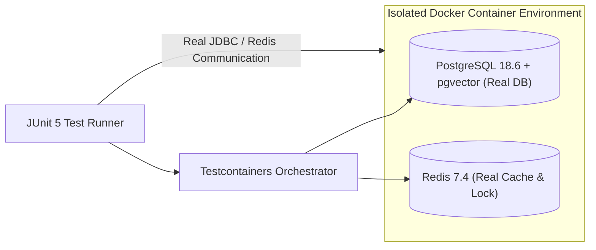

# Zero-Mock Test Environment Setup and Agent Verification

::: tip Related Policy Document
You can review the enterprise-wide 4-Cycle quality verification protocol and automated audit rules in the [Zero-Mock Enterprise Quality Verification Standard](/en/ecosystem/zero-mock-harness) document.
:::

## 1. Zero-Mock Testing Principles and Background

Mock objects commonly used in traditional unit testing (such as Mockito's `when(...).thenReturn(...)`) have the following limitations when verifying AI agent systems:

1. **Concealment of Fake Normalcy (Fake Fallback)**:
   - Mock objects cannot simulate real database constraints (such as Foreign Keys, Unique Keys, or PostgreSQL 18.6 pgvector indexes) or network latency, so tests may pass while failures occur in production.
2. **Limitations in Verifying Non-Deterministic AI Behavior**:
   - Whether dynamically generated SQL queries or JSON parameters from an agent are properly parsed by the actual database driver or target API cannot be accurately determined without communicating with real infrastructure.

Accordingly, SyncSeries adopts the **Zero-Mock principle** as its baseline policy:
> *"For agent and tool tests, empirical verification on real PostgreSQL 18.6, Redis, and MinIO infrastructure powered by Docker-based Testcontainers is recommended instead of fake mock objects."*



---

## 2. Testcontainers-Based Integration Test Base Class

All integration tests extend a reusable common abstract class to minimize container startup overhead (Singleton Container Pattern).

```java
package com.empasy.sync.test.base;

import org.springframework.boot.test.context.SpringBootTest;
import org.springframework.test.context.ActiveProfiles;
import org.springframework.test.context.DynamicPropertyRegistry;
import org.springframework.test.context.DynamicPropertySource;
import org.testcontainers.containers.GenericContainer;
import org.testcontainers.containers.PostgreSQLContainer;
import org.testcontainers.junit.jupiter.Testcontainers;
import org.testcontainers.utility.DockerImageName;

@SpringBootTest(webEnvironment = SpringBootTest.WebEnvironment.RANDOM_PORT)
@ActiveProfiles("test")
@Testcontainers
public abstract class AbstractZeroMockIntegrationTest {

    // 1. Start the real PostgreSQL 18.6 pgvector image
    static final PostgreSQLContainer<?> postgres = new PostgreSQLContainer<>(
            DockerImageName.parse("pgvector/pgvector:pg18")
    )
            .withDatabaseName("sync_test_db")
            .withUsername("test_user")
            .withPassword("test_pass")
            .withReuse(true);

    // 2. Start the real Redis image
    static final GenericContainer<?> redis = new GenericContainer<>(
            DockerImageName.parse("redis:7.4-alpine")
    )
            .withExposedPorts(6379)
            .withReuse(true);

    static {
        postgres.start();
        redis.start();
    }

    // 3. Dynamically bind Spring Boot data sources
    @DynamicPropertySource
    static void configureProperties(DynamicPropertyRegistry registry) {
        registry.add("spring.datasource.url", postgres::getJdbcUrl);
        registry.add("spring.datasource.username", postgres::getUsername);
        registry.add("spring.datasource.password", postgres::getPassword);
        registry.add("spring.data.redis.host", redis::getHost);
        registry.add("spring.data.redis.port", () -> redis.getMappedPort(6379));
    }
}
```

---

## 3. Practical Agent Tool Verification Test Code Example

Insert test fixture data into the real database and invoke the agent's tool execution method directly to assert result consistency.

```java
package com.empasy.sync.shop.tool;

import com.empasy.sync.custom.tools.OrderManagementTools;
import com.empasy.sync.custom.tools.OrderStatusResult;
import com.empasy.sync.test.base.AbstractZeroMockIntegrationTest;
import org.junit.jupiter.api.DisplayName;
import org.junit.jupiter.api.Test;
import org.springframework.beans.factory.annotation.Autowired;
import org.springframework.jdbc.core.JdbcTemplate;
import org.springframework.transaction.annotation.Transactional;

import java.math.BigDecimal;

import static org.assertj.core.api.Assertions.assertThat;
import static org.assertj.core.api.Assertions.assertThatThrownBy;

@Transactional
class OrderManagementToolsZeroMockTest extends AbstractZeroMockIntegrationTest {

    @Autowired
    private OrderManagementTools orderTools;

    @Autowired
    private JdbcTemplate jdbcTemplate;

    @Test
    @DisplayName("Verify normal query of get_order_status tool based on real DB fixture")
    void testGetOrderStatusSuccess() {
        // Given: Insert order data into the real isolated DB
        jdbcTemplate.update(
            "INSERT INTO orders (id, status, total_amount, tracking_number) VALUES (?, ?, ?, ?)",
            "ORD-2026-001", "SHIPPED", new BigDecimal("125000.00"), "TRACK-98765"
        );

        // When: Execute MCP tool method directly (No Mocking)
        OrderStatusResult result = orderTools.getOrderStatus("ORD-2026-001");

        // Then: Verify actual query result and data consistency
        assertThat(result).isNotNull();
        assertThat(result.getOrderId()).isEqualTo("ORD-2026-001");
        assertThat(result.getStatus()).isEqualTo("SHIPPED");
        assertThat(result.getAmount()).isEqualByComparingTo("125000.00");
        assertThat(result.getTrackingNumber()).isEqualTo("TRACK-98765");
    }

    @Test
    @DisplayName("Verify exception is thrown when an invalid order ID format is provided")
    void testInvalidOrderIdFormat() {
        assertThatThrownBy(() -> orderTools.getOrderStatus("INVALID_FORMAT"))
                .isInstanceOf(IllegalArgumentException.class)
                .hasMessageContaining("Invalid order ID format");
    }
}
```

---

## 4. Execution Performance Optimization in CI/CD Environments

Testcontainers is configured not to launch a new container for every test method, but to start once and reuse it (`.withReuse(true)`) across the JVM process lifecycle.

- **Container Startup Time**: Takes approximately 3–5 seconds on initial startup.
- **Subsequent Test Execution**: Executes immediately in memory, keeping total execution time overhead under 10% compared to standard mock tests.
- **Result Integrity**: Eliminates false confidence caused by mock objects and precisely verifies actual SQL syntax, transaction isolation levels, and schema validity against the real runtime environment.
