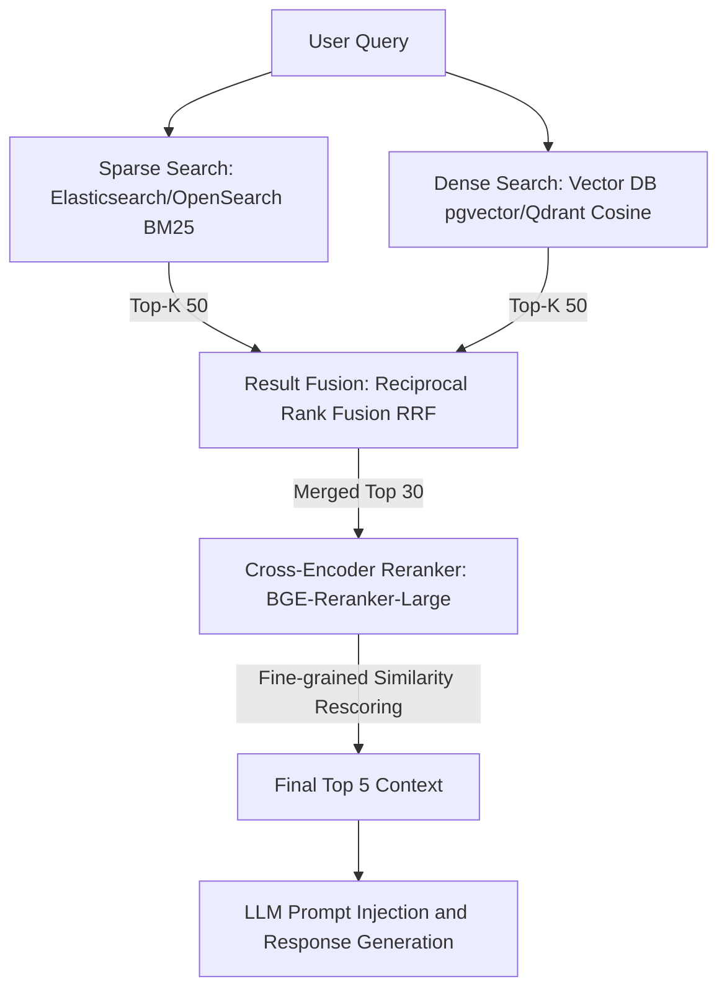

# Enterprise RAG Architecture: Sparse + Dense Hybrid Search and Cross-Encoder Reranking

## 1. Overview and Challenges in Enterprise RAG

The primary bottleneck in Retrieval-Augmented Generation (RAG) systems built for enterprise environments is **retrieval failure for domain-specific terminology and exact keywords**.

Pure Dense Vector embedding search (Cosine Similarity), adopted by most RAG frameworks, captures general natural language context well but struggles with enterprise data characteristics such as:
- **Model serial numbers and part codes**: Unique identifiers combining numbers and symbols, such as `SYNC-V2-8092` or `KR-TAX-01`.
- **Internal abbreviations and domain jargon**: Out-Of-Vocabulary (OOV) terms not present in the vocabulary of general-purpose pretrained embedding models.
- **Version notation differences**: Failure to distinguish subtle yet critical differences such as `v0.0.32` vs. `v0.0.33` in vector space, resulting in the retrieval of outdated versions.

To overcome these limitations, SyncCrawl and SyncInsight adopt **Sparse (BM25) + Dense (Vector) hybrid search** combined with **two-stage Cross-Encoder reranking** as their standard architecture.

---

## 2. Hybrid RAG Pipeline Architecture



### Stage 1: Dual Retrieval (Dual Indexing)
- **BM25 Sparse Index**: Processes text through a morphological analyzer (Nori) to build an inverted index at the morpheme and n-gram level, enabling exact keyword matching.
- **Dense Vector Index**: Searches a contextual semantic similarity space (1536-dimensional or 1024-dimensional) using `text-embedding-3-large` or `bge-m3` models.

---

## 3. Reciprocal Rank Fusion (RRF)

Because the two search engines use incompatible scoring scales (BM25 scores vs. cosine similarity scores), results are normalized using **RRF**, a rank-based weighting algorithm, rather than naive score summation.

$$\text{RRF Score}(d) = \sum_{m \in M} \frac{1}{k + r_m(d)}$$

Here, $M$ is the set of retrieval systems (BM25, Dense), $r_m(d)$ is the rank of document $d$ within system $m$ (1-based), and $k$ is a smoothing constant (typically 60) that mitigates outlier distortion.

```python
def reciprocal_rank_fusion(bm25_results: list[str], dense_results: list[str], k: int = 60) -> dict[str, float]:
    scores = {}
    
    for rank, doc_id in enumerate(bm25_results, start=1):
        scores[doc_id] = scores.get(doc_id, 0.0) + (1.0 / (k + rank))
        
    for rank, doc_id in enumerate(dense_results, start=1):
        scores[doc_id] = scores.get(doc_id, 0.0) + (1.0 / (k + rank))
        
    return dict(sorted(scores.items(), key=lambda item: item[1], reverse=True))
```

---

## 4. Stage 2: Fine-Grained Cross-Encoder Reranking

The top 30 documents selected via RRF are still computed without direct interaction (Cross-Attention) with the query text.

Whereas a **Bi-Encoder** embeds the query and document independently, a **Cross-Encoder** concatenates the entire sequence as `[CLS] Query [SEP] Document [SEP]` and passes it jointly through Transformer layers.

- **Advantage**: Achieves exceptionally high retrieval accuracy by computing fine-grained interactions between every token in the query and every token in the document.
- **Cost optimization**: Running a Cross-Encoder across tens of thousands of documents is prohibitive due to latency; therefore, Stage 1 narrows the candidate pool to 30 documents, enabling millisecond-scale inference.

---

## 5. Quantitative Benchmarks and Performance Comparison

These results were measured by running 500 validation queries against 45,000 real enterprise IT manual and internal policy documents.

| Search Architecture | Hit Rate@5 | MRR@5 (Mean Reciprocal Rank) | Average Latency |
|:---|:---|:---|:---|
| **Dense Vector Only** | 71.2% | 0.584 | **32ms** |
| **BM25 Sparse Only** | 68.4% | 0.542 | **18ms** |
| **RRF Hybrid (BM25 + Dense)** | 86.7% | 0.721 | 48ms |
| **Hybrid + Cross-Encoder Reranking (SyncSeries)** | **94.8%** | **0.892** | 92ms |

After introducing the reranking pipeline, the LLM hallucination rate dropped by **68% compared to the baseline**, producing error-free answers for queries involving internal policy part numbers and API parameters.
