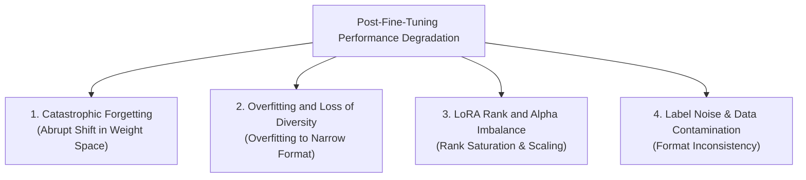

# Root Causes and Mitigation Strategies for Post-Fine-Tuning LLM Performance Degradation

## 1. Overview and Problem Statement

When fine-tuning a foundation model for domain-specific tasks (such as SQL generation, internal policy QA, or medical/financial analysis), accuracy on the target task improves, yet **core capabilities—such as general reasoning, mathematical problem solving, multilingual translation, and coding—frequently suffer sharp degradation**.

In academic literature, this phenomenon is referred to as **Catastrophic Forgetting** or the **Alignment Tax**, and resolving it is a critical challenge when building enterprise AI systems.

---

## 2. Four Core Causes of Performance Degradation



### 2.1 Abrupt Displacement in Weight Space (Catastrophic Forgetting)
A foundation model develops balanced weights across a broad multidimensional manifold during pre-training on trillions of tokens.  
Applying full fine-tuning on a small domain dataset or using an excessively high learning rate pushes the weights out of the existing optimization basin into a local optimum biased solely toward the target task.

### 2.2 Output Format Overfitting
When training forces rigid JSON templates or short response formats, the model begins **surface pattern mimicking** rather than reasoning about underlying causal relationships, exhibiting fragility even under minor prompt variations.

### 2.3 LoRA (Low-Rank Adaptation) Hyperparameter Mismatch
When using LoRA, a Parameter-Efficient Fine-Tuning (PEFT) method, misconfiguring the ratio between $r$ (Rank) and $\alpha$ (Alpha) or the learning rate causes weight update magnitudes to overwrite the model's base knowledge:
$$\Delta W = \frac{\alpha}{r} (B \times A)$$
- If $r$ is too large (e.g., $r=128$), the risk of destroying the foundation model's generalization capability increases significantly.
- If the $\alpha / r$ ratio exceeds 2.0, update magnitudes grow excessively large, accelerating destructive loss of prior knowledge.

---

## 3. Empirical Mitigations and Solutions

### 3.1 General Domain Data Replay Mixing
The most effective mitigation is mixing a **5% to 15% ratio of a high-quality general instruction replay dataset** into the domain-specific training dataset.

```python
# Dataset mixing ratio example (PyTorch Dataset)
domain_samples = load_domain_dataset()       # 85% (Domain-specific data)
general_samples = load_alpaca_eval_mix()     # 15% (General reasoning, math, and coding regularization data)

training_dataset = ConcatDataset([domain_samples, general_samples])
```

- **Effect**: The loss function continuously incorporates gradients for general reasoning capabilities, keeping weights anchored within the existing manifold region.

### 3.2 LoRA Hyperparameter Golden Rules
1. **Recommended Rank and Alpha Settings**:
   - $r = 16$ or $r = 32$ (sufficient for most downstream tasks)
   - $\alpha = 16$ or $\alpha = 32$ ($\frac{\alpha}{r} = 1.0$)
2. **Target Module Expansion**: Rather than training only `q_proj` and `v_proj`, applying low-rank adapters across all linear layers (`q, k, v, o, gate, up, down`) minimizes catastrophic forgetting.
3. **Weight Decay and Cosine Scheduler**:
   - Apply a Cosine Annealing Learning Rate Schedule
   - Set Warmup ratio between 0.05 and 0.1

### 3.3 Introducing NEFTune (Noisy Embedding Fine-Tuning)
Injecting subtle Gaussian noise into the embedding layer prevents the model from overfitting to surface token topologies:
$$\tilde{E} = E + \frac{\alpha}{\sqrt{L \cdot d}} \cdot \text{Uniform}(-1, 1)$$
- This proves highly effective at suppressing rote memorization of training answer patterns while preserving semantic reasoning ability.

---

## 4. Verification Checklist and Benchmark Pipeline

After fine-tuning and prior to production deployment, **regression checks on foundational benchmarks must be verified** alongside domain scores:

| Evaluation Metric | Target Capability | Passing Threshold |
|:---|:---|:---|
| **Domain Benchmark** | Domain-specific precision and recall | **+15% or higher improvement** over base model |
| **MMLU / ARC** | General knowledge and commonsense reasoning | **Within -3%** of base model |
| **GSM8K** | Multi-step mathematical reasoning | **Within -5%** of base model |
| **HumanEval** | Python coding and syntax generation | **Within -5%** of base model |
