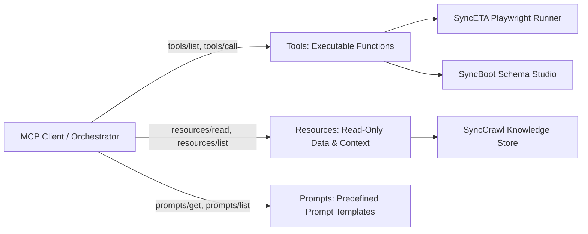

# Model Context Protocol (MCP) JSON-RPC Specification Analysis and Tool Orchestration

## 1. Overview and Research Background

To prevent Large Language Models (LLMs) from remaining isolated inside standalone applications and enable them to perform real business operations—such as querying databases, manipulating file systems, calling external APIs, and automating browsers—a **standardized Tool Calling interface** is essential.

Legacy proprietary Function Calling approaches used incompatible schemas across LLM providers (OpenAI, Anthropic, Google), causing vendor lock-in. The **Model Context Protocol (MCP)** standardizes client-to-tool-server communication on **JSON-RPC 2.0**, enabling agents to discover and invoke diverse enterprise resources and tools uniformly.

---

## 2. MCP Architecture and Three Core Primitives

The MCP specification defines three primary primitives:



1. **Tools (Executable Tools)**:
   - Callable interfaces through which a client (agent) passes parameters to trigger side effects.
   - Examples: `run_playwright_test`, `create_database_table`, `crawl_page`.
2. **Resources**:
   - Provide read-only contextual data such as files, database schemas, and log streams.
   - Accessed via URI schemes (`file://`, `postgres://`, `sync://`).
3. **Prompts (Prompt Templates)**:
   - Reusable workflow templates that guide interactions between users and agents.

---

## 3. JSON-RPC 2.0 Protocol Message Flow

### Listing Available Tools (`tools/list`)

The client queries the server for supported tools and their JSON Schema parameter specifications.

```json
// Request
{
  "jsonrpc": "2.0",
  "id": 1,
  "method": "tools/list",
  "params": {}
}

// Response
{
  "jsonrpc": "2.0",
  "id": 1,
  "result": {
    "tools": [
      {
        "name": "run_regression_test",
        "description": "Executes a Playwright E2E regression test for the specified scenario ID.",
        "inputSchema": {
          "type": "object",
          "properties": {
            "scenarioId": { "type": "string" },
            "headless": { "type": "boolean", "default": true }
          },
          "required": ["scenarioId"]
        }
      }
    ]
  }
}
```

### Invoking a Tool (`tools/call`)

```json
// Request
{
  "jsonrpc": "2.0",
  "id": 2,
  "method": "tools/call",
  "params": {
    "name": "run_regression_test",
    "arguments": {
      "scenarioId": "scn-checkout-flow",
      "headless": true
    }
  }
}

// Response
{
  "jsonrpc": "2.0",
  "id": 2,
  "result": {
    "content": [
      {
        "type": "text",
        "text": "Test passed: 12 of 12 steps succeeded (0 errors, duration 2.4s)"
      }
    ],
    "isError": false
  }
}
```

---

## 4. Transport Layer Comparison: Stdio vs. HTTP SSE

MCP specifies two standard transport mechanisms:

| Comparison Criteria | Stdio (Standard I/O) | HTTP with SSE (Server-Sent Events) |
|:---|:---|:---|
| **Runtime Environment** | Local inter-process communication on a single machine | Distributed networks and containerized environments |
| **Use Cases** | Controlling internal Playwright processes inside SyncETA Desktop | Integrating the SyncVerse central control tower with remote domain agents |
| **Communication Protocol** | stdin/stdout pipes | HTTP POST (requests) + SSE (unidirectional streaming) |
| **Security & Authentication** | OS user process privilege isolation | Bearer JWT, mTLS, IP allowlisting |
| **Scalability** | Constrained to local machine resources | Horizontal scale-out behind load balancers |

---

## 5. Applying Multi-Agent Orchestration in SyncSeries

The SyncVerse control tower orchestrates domain agents (SyncBoot, SyncCMS, SyncETA) over MCP and embeds the following enterprise patterns:

1. **Dynamic Tool Registry Discovery**:
   When each domain agent starts up, it registers its MCP endpoint with the SyncVerse gateway, which dynamically collects available tools and injects them into the LLM system prompt.
2. **Human-in-the-Loop (HITL) Pre-Approval Gate**:
   High-risk tool invocations—such as database schema alterations, payment data updates, or production deployments—are not executed immediately; instead, they transition to `status: WAITING_APPROVAL` and await administrator approval.
3. **Saga Compensating Transaction Integration**:
   If a step fails during a multi-stage workflow (e.g., API schema creation -> CMS deployment -> E2E testing), compensating tools from prior steps (`rollback_schema`, `unpublish_cms`) are executed in reverse order to preserve data consistency.
