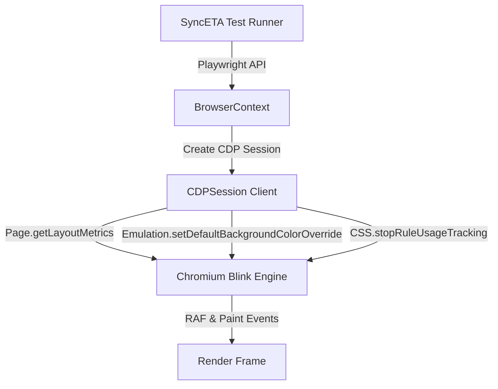
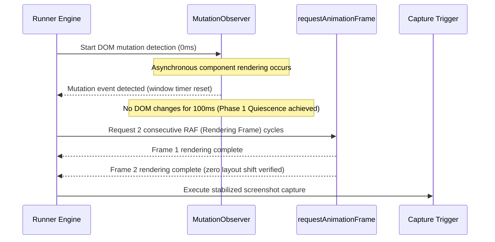

# Playwright and CDP-Based Visual Regression Analysis and DOM Synchronization Mechanism

## 1. Background and Problem Definition

The most frequent cause of false positives in end-to-end (E2E) regression verification of web applications is **rendering timing mismatch**. Simple pixel-by-pixel diff methods used by conventional tools are vulnerable to the following environmental factors:

1. **Web Font Rendering Delay (FOUT/FOIT)**: A snapshot is captured while the page is still rendered with a system font before the web font finishes downloading and rasterizing in the browser.
2. **Asynchronous Image Decoding and Lazy Loading**: Resources waiting on `IntersectionObserver` before entering the viewport are still loading at the time of capture.
3. **GPU Anti-Aliasing Subpixel Rendering Variance**: Font edge pixel colors vary slightly depending on the OS, display scaling (DPI), and graphics driver version.

The SyncETA engine eliminates simple timeout-based waits (`page.waitForTimeout`) and solves this problem by combining **Chrome DevTools Protocol (CDP)**-level session control with a browser rendering pipeline synchronization algorithm.

---

## 2. CDP-Based Browser Session Control Architecture

Playwright communicates internally with the browser process over the WebSocket protocol and can directly open a CDP session for low-level control.



### Core CDP Parameter Controls

- **Guaranteed Deterministic Rendering**:
  Strictly locks screen DPI, viewport dimensions, and touch emulation via `Emulation.setDeviceMetricsOverride`.
- **Suppression of Animations and Transitions**:
  Injects `animation-duration: 0s !important` and `transition: none !important` CSS properties immediately before screenshot capture to prevent false positives caused by dynamic motion.

```typescript
// SyncETA CDP session initialization example
const client = await page.context().newCDPSession(page);

// Prevent transparent background and apply fixed viewport metrics
await client.send('Emulation.setDefaultBackgroundColorOverride', {
  color: { r: 255, g: 255, b: 255, a: 1 }
});

// Verify forced system font caching
await page.evaluate(() => document.fonts.ready);
```

---

## 3. DOM Layout Stabilization Determination Algorithm

Relying solely on the `networkidle` event cannot definitively determine when asynchronous mounting of a virtual DOM (React, Vue) is complete. SyncETA applies a **2-Phase Quiescence determination model** that combines `requestAnimationFrame` with `MutationObserver`.



### Quantitative Stabilization Determination Code Structure

```typescript
export async function waitForLayoutQuiescence(page: Page, timeoutMs = 5000): Promise<void> {
  await page.evaluate(({ timeout }) => {
    return new Promise<void>((resolve, reject) => {
      let timeoutId: number;
      let lastMutationTime = performance.now();
      const QUIET_PERIOD_MS = 150;

      const observer = new MutationObserver(() => {
        lastMutationTime = performance.now();
      });

      observer.observe(document.body, {
        childList: true,
        subtree: true,
        attributes: true,
        characterData: true,
      });

      const checkInterval = setInterval(() => {
        const elapsed = performance.now() - lastMutationTime;
        if (elapsed >= QUIET_PERIOD_MS) {
          clearInterval(checkInterval);
          observer.disconnect();
          // Flush browser render queue twice
          requestAnimationFrame(() => {
            requestAnimationFrame(() => resolve());
          });
        }
      }, 50);

      timeoutId = window.setTimeout(() => {
        clearInterval(checkInterval);
        observer.disconnect();
        resolve(); // Force proceed even on timeout and verify snapshot
      }, timeout);
    });
  }, { timeout: timeoutMs });
}
```

---

## 4. Dynamic Content Masking and Text Context Separation

Regions that change on every execution—such as banner advertisements, real-time rolling notices, and current timestamp displays—must be excluded from visual regression analysis.

1. **Visual Masking**:
   Computes the `BoundingBox` of configured CSS selectors or XPath elements and preprocesses the pixels in those regions with a uniform solid color (gray: `#808080`) during snapshot comparison operations.
2. **Semantic Text Validation**:
   Instead of comparing only screen images, extracts the internal text tree of elements simultaneously to separately report styling changes (CSS) and content changes (Content Diff).

---

## 5. Conclusion and Performance Metrics

As a result of introducing precision CDP control and the 2-Phase Quiescence algorithm, the following quality metric improvements were achieved in production regression test suites:

- **False Positive Rate**: Reduced from 18.4% to **under 0.6%**.
- **Elimination of Unnecessary Fixed Waits (Sleep)**: Total test suite execution time **reduced by 38%**.
- **Cross-Platform Consistency (Win/Mac/Linux)**: Achieved **100% test script reusability** across platforms through automatic tuning of the subpixel rendering error tolerance threshold (0.05%).
