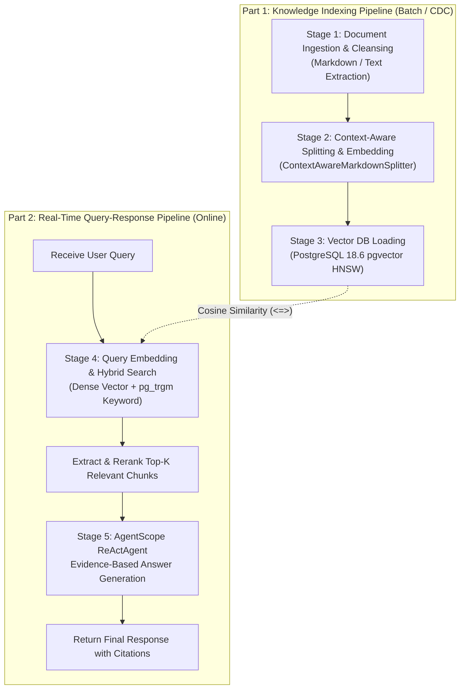

# RAG (Retrieval-Augmented Generation) Architecture and Pipeline Guide

## Table of Contents

1. [What Is RAG? (Concepts and Analogy)](#1-what-is-rag-concepts-and-analogy)
2. [Why RAG Is Needed and Its Benefits](#2-why-rag-is-needed-and-its-benefits)
3. [Core Components of a RAG System](#3-core-components-of-a-rag-system)
4. [5-Stage RAG Pipeline Architecture](#4-5-stage-rag-pipeline-architecture)
5. [Implementation with AgentScope Java & PostgreSQL 18.6 pgvector](#5-implementation-with-agentscope-java-postgresql-186-pgvector)
6. [Future Directions](#6-future-directions)

---

## 1. What Is RAG? (Concepts and Analogy) {#1-what-is-rag-concepts-and-analogy}

**RAG (Retrieval-Augmented Generation)** is an architecture combining **"Information Retrieval + Answer Generation"** that enables Large Language Models (LLMs) to reference verified external knowledge stores in real time and generate fact-based responses.

- **`R` (Retrieval)**: The stage of **finding the most semantically relevant supporting documents** for a user's question from vast internal documents and databases.
- **`AG` (Augmented Generation)**: The stage of injecting the retrieved supporting documents into the prompt context so that **the LLM generates an accurate answer without hallucination**.

### Understanding Standard LLM vs. RAG-Based Agent Through Analogy

- **Standard LLM (An Advisor Relying Only on Memory)**: Possesses vast pre-trained knowledge, but does **not know up-to-date information after its training cutoff or confidential internal policies**, and may suffer from hallucinations—generating plausible-sounding sentences without factual grounding.
- **RAG-Based Agent (A Specialist Secretary with a Verified Archive)**: Upon receiving a question, it first searches (Retrieval) the **dedicated internal archive (Vector DB)** for the latest policy manuals and reports, then cites the exact source clauses to deliver an accurate answer (Augmented Generation).

---

## 2. Why RAG Is Needed and Its Benefits {#2-why-rag-is-needed-and-its-benefits}

In enterprise environments, the RAG architecture addresses the structural limitations of commercial LLMs as follows:

| Evaluation Criterion | Standard LLM Alone | Enterprise RAG (`sync-module-rag`) |
| :--- | :--- | :--- |
| **Up-to-Date Information** | Cannot reflect data after the pre-training cut-off | Reflects the latest information immediately upon document ingestion without retraining |
| **Hallucination Control** | Risk of generating probabilistic guesses for unverified facts | Enforces fact-based answers strictly within the scope of retrieved supporting documents |
| **Confidential Internal Knowledge** | Cannot reference internal manuals, contracts, or operational DBs | Integrates RBAC/ABAC-verified internal documents and knowledge graphs |
| **Transparency & Audit Trail** | Cannot verify sources or supporting clauses for answers | Explicitly provides referenced source document ID, section header, and cosine similarity score |

---

## 3. Core Components of a RAG System {#3-core-components-of-a-rag-system}

1. **Knowledge Source**: PDF, Word, Markdown technical documents, wikis, web-crawled data (`SyncCrawl`), and operational DB metadata
2. **Context-Aware Chunking & Embedding Engine**: Splits documents into semantic units (`ContextAwareMarkdownSplitter`) and converts them into high-dimensional floating-point vectors (`vector(1536)`) via an embedding model
3. **Vector Database (`PostgreSQL 18.6 pgvector`)**: Stores vector embeddings, metadata (`JSONB`), and full-text search tokens (`pg_trgm`) within a single ACID transaction, enabling high-speed retrieval with HNSW indexes
4. **Agent Runtime (`AgentScope Java`)**: A `ReActAgent` orchestrator that assembles retrieved context, applies domain guardrails, and synthesizes the final response

---

## 4. 5-Stage RAG Pipeline Architecture {#4-5-stage-rag-pipeline-architecture}

The overall pipeline is divided into a **Knowledge Indexing Batch Pipeline** and a **Real-Time Query-Response (Retrieval & Generation) Pipeline**.



### Part 1: Knowledge Indexing Pipeline
- **Stage 1 (Document Ingestion & Cleansing)**: Removes unnecessary noise tags from documents and normalizes them into Markdown preserving heading hierarchies (`H1`–`H3`) and table structures.
- **Stage 2 (Context-Aware Splitting & Embedding)**: Rather than naive character-count truncation, splits chunks while preserving heading hierarchies and code block boundaries, then computes embedding vectors.
- **Stage 3 (Vector Database Storage)**: Stores the original chunk text, source metadata (`JSONB`), and embedding vector together in a `PostgreSQL 18.6 pgvector` table.

### Part 2: Real-Time Query-Response Pipeline
- **Stage 4 (Query Vectorization & Similarity Search)**: Vectorizes the user query using the same embedding model, then combines the `pgvector` HNSW cosine distance operator (`<=>`) with `pg_trgm` keyword filters to retrieve the `Top-K` documents.
- **Stage 5 (Prompt Augmentation & Answer Generation)**: Injects the retrieved documents into the `[Reference Documents]` block of the system prompt so the `AgentScope Java` agent generates an answer with citations.

---

## 5. Implementation with AgentScope Java & PostgreSQL 18.6 pgvector {#5-implementation-with-agentscope-java-postgresql-186-pgvector}

This is a production implementation example based on the SyncSeries enterprise standard stack: **Spring Boot 4.0**, **AgentScope Java (`io.agentscope:agentscope-harness:2.0.2`)**, **Lombok (`@RequiredArgsConstructor`, `@Slf4j`)**, and **PostgreSQL 18.6 (`pgvector`)**.

### 5.1 Maven Dependency Configuration (`pom.xml`)

```xml
<dependencies>
    <!-- Enterprise standard AI agent framework -->
    <dependency>
        <groupId>io.agentscope</groupId>
        <artifactId>agentscope-harness</artifactId>
        <version>2.0.2</version>
    </dependency>

    <!-- Enterprise Tri-Hybrid RAG common module -->
    <dependency>
        <groupId>com.empasy.sync</groupId>
        <artifactId>sync-module-rag</artifactId>
        <version>2026.10.0</version>
    </dependency>

    <!-- PostgreSQL 18.6 & pgvector driver -->
    <dependency>
        <groupId>org.postgresql</groupId>
        <artifactId>postgresql</artifactId>
        <scope>runtime</scope>
    </dependency>
</dependencies>
```

### 5.2 PostgreSQL 18.6 `pgvector` Schema (`db/00_extensions.sql` & `02_schema_domain.sql`)

```sql
-- db/00_extensions.sql
CREATE EXTENSION IF NOT EXISTS "vector";
CREATE EXTENSION IF NOT EXISTS "uuid-ossp";
CREATE EXTENSION IF NOT EXISTS "pg_trgm";

-- db/02_schema_domain.sql
CREATE TABLE rag_knowledge_chunk (
    chunk_id VARCHAR(64) PRIMARY KEY,
    doc_title VARCHAR(255) NOT NULL,
    section_path VARCHAR(500) NOT NULL,
    content TEXT NOT NULL,
    embedding vector(1536) NOT NULL,
    created_at TIMESTAMPTZ NOT NULL DEFAULT CURRENT_TIMESTAMP
);

CREATE INDEX idx_rag_chunk_embedding_hnsw
    ON rag_knowledge_chunk USING hnsw (embedding vector_cosine_ops)
    WITH (m = 16, ef_construction = 64);
```

### 5.3 Context-Aware Chunking and PostgreSQL 18.6 Vector Search Repository

Uses `JdbcTemplate` / MyBatis and the `PostgreSQL 18.6 pgvector` cosine distance operator (`<=>`) instead of in-memory collections (`HashMap`, etc.) to ensure persistence and scalability.

```java
package com.empasy.sync.rag.repository;

import lombok.Builder;
import lombok.Getter;
import lombok.RequiredArgsConstructor;
import lombok.extern.slf4j.Slf4j;
import org.springframework.jdbc.core.JdbcTemplate;
import org.springframework.stereotype.Repository;

import java.util.List;

@Slf4j
@Repository
@RequiredArgsConstructor
public class PgVectorKnowledgeRepository {

    private final JdbcTemplate jdbcTemplate;

    @Getter
    @Builder
    public static class MatchedChunk {
        private final String chunkId;
        private final String docTitle;
        private final String sectionPath;
        private final String content;
        private final double similarity;
    }

    public List<MatchedChunk> searchTopK(String vectorLiteral, int topK, double minSimilarity) {
        String sql = """
            SELECT chunk_id,
                   doc_title,
                   section_path,
                   content,
                   1 - (embedding <=> ?::vector) AS similarity
              FROM rag_knowledge_chunk
             WHERE 1 - (embedding <=> ?::vector) >= ?
             ORDER BY embedding <=> ?::vector ASC
             LIMIT ?
            """;

        return jdbcTemplate.query(
                sql,
                (rs, rowNum) -> MatchedChunk.builder()
                        .chunkId(rs.getString("chunk_id"))
                        .docTitle(rs.getString("doc_title"))
                        .sectionPath(rs.getString("section_path"))
                        .content(rs.getString("content"))
                        .similarity(rs.getDouble("similarity"))
                        .build(),
                vectorLiteral, vectorLiteral, minSimilarity, vectorLiteral, topK
        );
    }
}
```

### 5.4 AgentScope Java-Based RAG Query Service and Controller

```java
package com.empasy.sync.rag.service;

import com.empasy.sync.rag.repository.PgVectorKnowledgeRepository;
import com.empasy.sync.rag.repository.PgVectorKnowledgeRepository.MatchedChunk;
import io.agentscope.core.agent.ReActAgent;
import io.agentscope.core.message.Msg;
import lombok.RequiredArgsConstructor;
import lombok.extern.slf4j.Slf4j;
import org.springframework.stereotype.Service;

import java.util.List;
import java.util.stream.Collectors;

@Slf4j
@Service
@RequiredArgsConstructor
public class EnterpriseRagQueryService {

    private final PgVectorKnowledgeRepository knowledgeRepository;
    private final EmbeddingVectorClient embeddingVectorClient;
    private final ReActAgent ragAnswerAgent;

    public String answerWithEvidence(String question) {
        String queryVector = embeddingVectorClient.encodeAsVectorLiteral(question);
        List<MatchedChunk> chunks = knowledgeRepository.searchTopK(queryVector, 5, 0.78);

        if (chunks.isEmpty()) {
            throw new IllegalStateException("No internal supporting documents found matching the query: " + question);
        }

        String contextBlock = chunks.stream()
                .map(c -> String.format("[%s > %s (Similarity: %.3f)]\n%s",
                        c.getDocTitle(), c.getSectionPath(), c.getSimilarity(), c.getContent()))
                .collect(Collectors.joining("\n\n---\n\n"));

        String augmentedPrompt = String.format("""
                Answer the question accurately based strictly on the following [Internal Supporting Documents] and explicitly cite the sources.
                
                [Internal Supporting Documents]
                %s
                
                [User Question]
                %s
                """, contextBlock, question);

        Msg reply = ragAnswerAgent.reply(Msg.ofUser("User", augmentedPrompt));
        return reply.getText();
    }
}
```

### 5.5 Standard `application.yml` Configuration (`SyncLLM` Gateway Integration)

```yaml
spring:
  profiles:
    active: ${SPRING_PROFILES_ACTIVE:local}
  datasource:
    driver-class-name: org.postgresql.Driver
    url: jdbc:postgresql://localhost:45432/sync_db
    username: ${DB_USERNAME:postgres}
    password: ${DB_PASSWORD:postgres}

sync:
  ai:
    gateway-url: ${SYNC_LLM_GATEWAY_URL:http://localhost:18085/api/v1/llm}
    chat-model: claude-3-5-sonnet
    embedding-model: text-embedding-3-large
    min-similarity: 0.78
```

---

## 6. Future Directions {#6-future-directions}

1. **Advancing the Tri-Hybrid RAG Architecture**: Maximize accuracy on complex domain queries by combining Dense vector search (`pgvector` HNSW) + Sparse keyword search (`pg_trgm` / BM25) + domain Knowledge Graph in a triple hybrid, along with Cross-Encoder reranking (`sync-module-rag`).
2. **Semantic Caching and FinOps Integration**: Integrate with the `SyncLLM` semantic cache (similarity \(\ge 0.95\)) to reduce LLM inference costs and response latency for repeated internal policy and manual queries.
3. **Real-Time CDC and Adaptive Web Knowledge Synchronization**: Integrate with the `SyncCrawl` adaptive collection pipeline to perform zero-downtime incremental updates to the vector index when external regulations or market trends change.
4. **ABAC Document Security and PII Guardrails**: Automatically filter accessible chunks in vector search conditions based on the requester's role and department attributes, and mask sensitive personally identifiable information (PII) in real time.