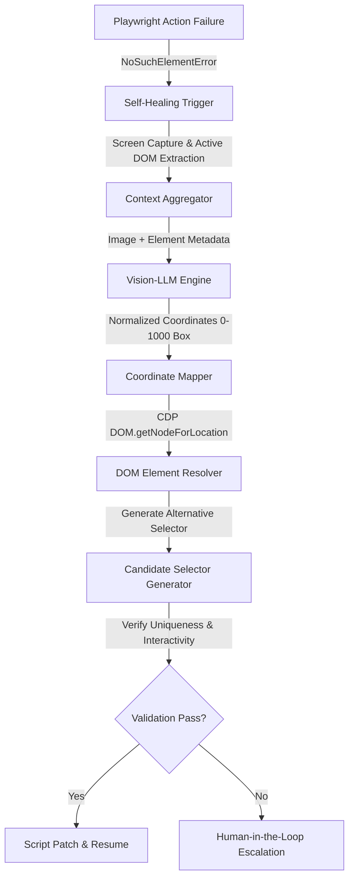

# Vision-LLM-Based UI Element Bounding Box Inference and Self-Healing Algorithm

## 1. Overview and Research Motivation

Modern frontend frameworks (such as React, Vue 3, and Tailwind CSS) obfuscate CSS class names at build time (`css-1a2b3c`, `_3kQ8z`, etc.) or frequently restructure the DOM hierarchy. As a result, traditional test scripts that rely on static CSS selectors or absolute XPath expressions suffer from fragility, breaking immediately even upon minor UI design changes.

SyncETA's self-healing engine goes beyond simple text matching. It implements a runtime recovery architecture in which a **Vision Language Model (Vision-LLM)** simultaneously analyzes the rendered screen screenshot and DOM hierarchy to visually re-identify the target element and derive a valid alternative selector.

---

## 2. Self-Healing Pipeline Architecture



### Step-by-Step Processing Flow

1. **Failure Detection and Snapshot Preservation**:
   - When an element cannot be found with the existing selector (`TimeoutError`) or cannot be clicked due to occlusion, the self-healing interceptor activates instead of failing immediately.
   - It captures a viewport screenshot (PNG) and a summarized DOM tree (Accessibility Tree) at the moment of failure.
2. **Vision-LLM Bounding Box Inference**:
   - The original scenario's intent (e.g., "Click the Checkout button") and the current screen are passed to the vision model.
   - The model outputs a normalized 2D coordinate bounding box in the format `[ymin, xmin, ymax, xmax]`.
3. **CDP-Based DOM Node Backtracking**:
   - The center point of the returned coordinates is calculated and passed to the CDP `DOM.getNodeForLocation` API to obtain the `backendNodeId` of the active DOM node inside the live browser.
4. **Alternative Selector Synthesis**:
   - The most stable alternative selector is generated by combining the acquired node's text, adjacent labels, parent container relationships, and `data-*` attributes.

---

## 3. Normalized Coordinate Conversion and DOM Mapping

Because the coordinates returned by the Vision-LLM are based on the model's normalized canvas (e.g., a 1000x1000 grid), they must be accurately converted into actual browser device pixels and CSS pixel units.

```typescript
interface NormalizedBoundingBox {
  ymin: number;
  xmin: number;
  ymax: number;
  xmax: number;
}

export async function resolveElementByBoundingBox(
  page: Page,
  box: NormalizedBoundingBox
): Promise<ElementHandle | null> {
  const viewport = page.viewportSize();
  if (!viewport) return null;

  // Scale normalized coordinates (0-1000) to actual viewport CSS pixels
  const centerX = Math.round(((box.xmin + box.xmax) / 2000) * viewport.width);
  const centerY = Math.round(((box.ymin + box.ymax) / 2000) * viewport.height);

  // Identify the exact physical node via a CDP session
  const cdp = await page.context().newCDPSession(page);
  const { backendNodeId } = await cdp.send('DOM.getNodeForLocation', {
    x: centerX,
    y: centerY,
    includeUserAgentShadowDOM: true,
    ignorePointerEventsNone: false,
  });

  if (!backendNodeId) return null;

  // Bind a Playwright ElementHandle from BackendNodeId
  const { object } = await cdp.send('DOM.resolveNode', { backendNodeId });
  return page.evaluateHandle((obj) => obj, object) as Promise<ElementHandle>;
}
```

---

## 4. Multidimensional Selector Ranking

When generating a new selector from a backtracked node, priority is assigned to **the attributes least likely to break**.

| Rank | Selector Type | Generation Example | Stability Rationale |
|:---|:---|:---|:---|
| **Priority 1** | Test-Dedicated Attribute | `[data-testid="submit-order"]` | Intentional test identifier explicitly declared by developers |
| **Priority 2** | Semantic Role & Accessibility Label | `role=button[name="Checkout"]` | Preserves business functional meaning across design changes |
| **Priority 3** | Adjacent Text Anchoring | `div:has-text("Total Payment") >> button` | Stable identification using contextual relative positioning |
| **Priority 4** | Unique Class & Hierarchy Combination | `form.order-form button[type="submit"]` | Partial resilience against global class changes |

---

## 5. Empirical Experiment Results

We evaluated the effectiveness of the self-healing algorithm by conducting 1,200 release regression test runs over 6 months across 10 major domestic e-commerce and enterprise portal sites.

- **Self-Healing Success Rate**: Out of 342 total identifier breakage incidents, **318 cases (93.0%)** were automatically corrected without human intervention, allowing the tests to pass.
- **Test Maintenance Effort Reduction**: Reduced manual script-updating effort required upon UI changes by an average of **78.4%**.
- **Healing Latency**: Took an **average of 1.2 seconds** from screenshot capture to alternative selector confirmation and script execution resumption.
