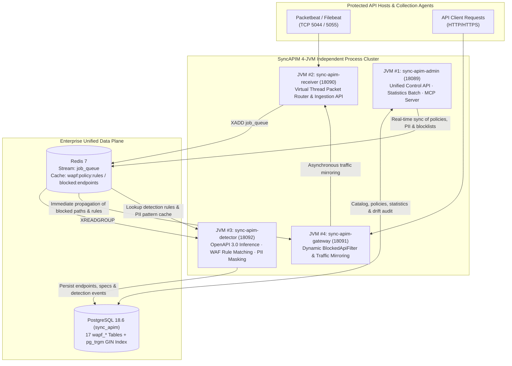

# SyncAPIM 4-JVM System Architecture and Database Design

`SyncAPIM` is a high-performance API monitoring and security agent platform built on the standard technology stack of **Java 25 (Virtual Threads)**, **Spring Boot 4.0**, **AgentScope Java (`io.agentscope:agentscope-harness`)**, **PostgreSQL 18.6 (`JSONB` + `pg_trgm`)**, **Redis 7 Stream**, and **Vue 3 + Vben Admin (`@empasy/sync-apim-admin`)**.

---

## 1. Performance-Isolated 4-JVM Process Architecture

To prevent I/O-intensive packet ingestion and CPU-intensive regex/JWT threat detection workloads from introducing latency to the admin console or inline gateway in high-volume API traffic environments, `SyncAPIM` runs as **four independent JVM processes**.

### 1.1 Per-JVM Roles and Port Specifications

| JVM Module Name | Host Port (Container) | Core Classes | Primary Role and Performance Isolation Purpose |
| :--- | :---: | :--- | :--- |
| **`sync-apim-admin`** | `18089` (`8080`) | `WapfApiEndPointController`, `WapfPolicyController`, `ApimTrafficAggregationService`, `SyncApimAgent`, `ApimMcpController` | Serves REST APIs (`/api/v1/apim/...`) for 11 monitoring/control screens, runs 5-minute traffic and threat statistics aggregation batches, and exposes 6 MCP tools integrated with `SyncVerse`. |
| **`sync-apim-receiver`** | `18090` (`8081`) TCP `5044`/`5055` | `PacketReceiver`, `LumberjackRouter`, `RedisStreamProducerService`, `ApimReceiverController` | Operates a Java 25 Virtual Threads-based non-blocking TCP socket server and HTTP ingestion endpoint (`/api/v1/apim/receiver/ingest`), pushing payloads to Redis Stream `job_queue`. |
| **`sync-apim-detector`** | `18092` (`8090`) | `RedisStreamConsumer`, `DetectionRuleServiceImpl`, `WapfDetectRuleServiceImpl` | Performs real-time packet parsing on Redis Stream worker thread pools, auto-registers endpoints, synthesizes OpenAPI 3.0.1 specs, runs 6 WAF regex/JWT threat detections and 8 PII masking rules, and persists records to PostgreSQL `wapf_detect_event`. |
| **`sync-apim-gateway`** | `18091` (`8083`) | `BlockedApiFilter`, `BlockedApiRegistryService`, `ApimGatewayController` | Synchronizes with DB (`wapf_api_endpoint.block_status='1'`) and Redis (`wapf:blocked:endpoints`) to immediately reject blocked shadow/high-risk API calls with `403 Forbidden` while mirroring legitimate traffic to `receiver`. |

---

## 2. Multi-Module Directory and Maven Coordinate Structure

Every module under `sync-apim/Server/` maintains a strict `1:1` match between its Maven `artifactId` and physical directory name in accordance with enterprise standards.

- **Top-Level Parent POM**: `com.empasy.sync.apim:sync-apim-parent:1.0.0-SNAPSHOT` (`sync-apim/pom.xml`)
- **Backend Parent POM**: `com.empasy.sync.apim:sync-apim-server-parent:1.0.0-SNAPSHOT` (`sync-apim/Server/pom.xml`)
- **Common and Core Modules**:
  - `Server/sync-apim-common`: 17 domain entities (`WapfApiEndPoint`, `WapfDetectEvent`, etc.), MyBatis-Plus Mappers, and common Services (including the `WapfOpenApiSpecServiceImpl` drift audit engine)
  - `Server/sync-apim-base-core`: `MybatisPlusConfig`, `RedisConfig`, `AuthInterceptor`, `GlobalExceptionHandler`
  - `Server/sync-apim-module-system`: System authentication/authorization and dynamic DB-driven menu provider (`/api/v1/apim/sys/permission/getUserPermissionByToken`)

---

## 3. PostgreSQL 18.6 Domain Database Design (`db/02_schema_domain.sql`)

The legacy PostgreSQL + OpenSearch dual-storage setup has been consolidated into a single **PostgreSQL 18.6 (`sync_apim` database)** to reduce operational complexity and memory footprint.

| Category | Physical Table Names | Key Columns and Design Characteristics |
| :--- | :--- | :--- |
| **Agents & Hosts** | `wapf_agent`, `wapf_agent_host`, `wapf_host` | Collection agent master (SHA-256 `auth_key`), protected API hosts (`host`, `status`), and `N:M` mappings |
| **API Catalog** | `wapf_api_endpoint`, `wapf_api_endpoint_detail`, `wapf_api_endpoint_history` | Auto-discovered unique `host` + `path` + `method` endpoints, risk score (`risk_score`), block status (`block_status`), and path merge history |
| **Data Fields & Specs** | `wapf_data_field`, `wapf_open_api_spec` | JSONPath fields by request/response section (`REQ_QUERY`, `REQ_BODY`, `RES_BODY`), PII mapping (`sensitivity_uuid`), OpenAPI 3.0.1 JSON specs, and drift status (`contract_status`, `drift_summary`) |
| **WAF Policies & Detection Rules** | `wapf_policy`, `wapf_policy_api_endpoint`, `wapf_policy_rule`, `wapf_rule` | 7 standard security policy masters (`basic` default policy flag), per-policy endpoint mappings, 6 threat detection regexes (`pattern`), and JWT verification options (`jwt_option`) |
| **PII & Alerts** | `wapf_sensitivity`, `wapf_email` | 8 personal/financial sensitive data detection regex masters and security alert email dispatch logs for high-risk threats |
| **Time-Series Statistics** | `wapf_endpoint_average`, `wapf_rule_average` | Time-series aggregation tables for per-endpoint call volume and per-rule/severity threat detection counts |
| **Real-Time Detection Events** | `wapf_detect_event` | Packet request/response headers, parameters, and bodies (`JSONB` and masked text), threat code array (`threat_codes`), risk score, and high-speed full-text search powered by `pg_trgm` GIN indexes |
