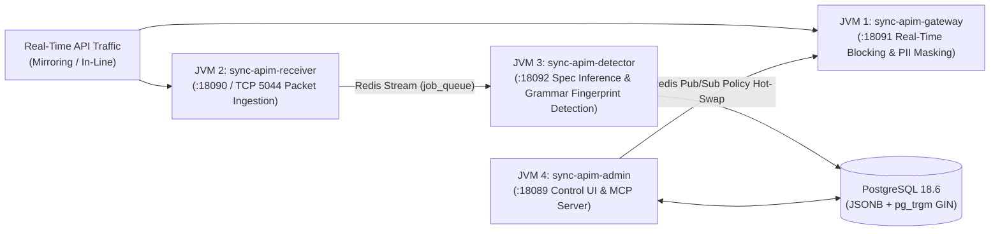

# SyncAPIM Enterprise Adoption FAQ

Here are key technical questions and answers frequently asked by security architects, infrastructure operations teams, and engineering organizations when adopting `SyncAPIM`, an enterprise API security control and OpenAPI 3.0.1 specification governance platform.

---

## 1. 4-JVM Performance Isolation and Single-Storage Architecture



### Q1. Why is `SyncAPIM` split into four separate JVMs (`admin`, `receiver`, `detector`, `gateway`) instead of a single server?
- **Answer**: An API security control solution must continuously receive thousands to tens of thousands of network packets per second (`receiver`), perform multi-layer decoding, lexical token grammar fingerprinting (`SqlXssLexicalTokenizer`), and infer OpenAPI 3.0.1 JSON schemas (`detector`). If the packet ingestion/detection engine shared the same JVM heap and CPU thread pools with the admin UI backend (`admin`) or the inline gateway (`gateway`), a massive DDoS or attack traffic spike could freeze the management console or introduce latency into the inline gateway.
- Therefore, `SyncAPIM` is designed to **share the common domain module (`sync-apim-common`) while completely isolating runtime processes across four JVMs**, guaranteeing independent latency per tier and enabling targeted horizontal scale-out of specific JVMs based on traffic characteristics.

| JVM Process | Default Ports | Primary Role | Recommended Scaling Criteria |
| :--- | :---: | :--- | :--- |
| **`sync-apim-gateway`** | `18091` (`8083`) | Inline reverse proxy, real-time threat blocking (`BlockedApiFilter`), kernel eBPF integration | Scale horizontally as inbound API RPS grows |
| **`sync-apim-receiver`** | `18090` / TCP `5044` | Java 25 Virtual Threads-based non-intrusive mirrored packet ingestion and queue publishing | Scale as the number of collection agent hosts grows |
| **`sync-apim-detector`** | `18092` (`8090`) | Shadow API schema inference, Contract Drift audit, WAF lexical analysis, and PII masking | Autoscale based on Redis Stream queue depth |
| **`sync-apim-admin`** | `18089` (`8080`) | Control dashboard REST APIs (`/api/v1/apim/*`), time-series aggregation batches, and MCP Server | Scale based on concurrent admin users and A2A control traffic |

### Q2. Is high-volume packet log forensic search possible without a heavy OpenSearch/Elasticsearch cluster?
- **Answer**: Yes. Legacy security control environments required operating a separate OpenSearch/Elasticsearch cluster (minimum 3 nodes, tens of gigabytes of JVM heap) solely for packet event search. `SyncAPIM` eliminates this by adopting a **`wapf_detect_event` single-storage architecture combining PostgreSQL 18.6 `JSONB` columns with `pg_trgm` trigram GIN indexes**.
- This enables millisecond-level substring searches across attack payloads (`ILIKE '%union select%'`), grammar fingerprint filtering, and per-endpoint time-series aggregations on a single RDBMS while drastically reducing infrastructure costs and operational complexity.

---

## 2. Zero-Downtime Adoption, Zero-Day Virtual Patching, and Shadow API Detection

### Q3. Can `SyncAPIM` be applied without modifying running legacy WAS instances or microservices?
- **Answer**: Yes. Depending on service requirements, you can choose or combine two zero-downtime deployment modes:
  1. **Out-of-Band Mirroring Mode**: Mirrors a copy of traffic to `sync-apim-receiver` from protected servers or upstream L4/L7 switches/Ingress. You can immediately begin cataloging unregistered shadow APIs and detecting threats with **zero latency impact (`0ms`) and zero Single Point of Failure (SPOF) risk** to production services.
  2. **In-Line Protection Gateway Mode**: When real-time attack blocking (`403 Forbidden`) and dynamic response-body PII masking are required for high-risk externally exposed APIs, deploy `sync-apim-gateway` in front of the service to enforce blocking policies with one click.

### Q4. When a new zero-day vulnerability is disclosed, how does `SyncAPIM` defend against it without redeploying the application?
- **Answer**: `SyncAPIM` integrates in real time with the enterprise security observatory **[`SyncWatch`](/en/syncwatch/)** to execute **zero-downtime pinpoint virtual patching**.
  1. `SyncWatch` ingests new vulnerabilities from 8 global threat feeds (OSV.dev, GitHub GHSA, NVD CVE, CISA KEV, Nuclei, OWASP CRS, MITRE ATT&CK, KISA), completes sandbox verification (TP 100%, FP 0%), and deploys an **`ApimDefensePack`** via `POST /api/v1/apim/waf/defense-pack/apply`.
  2. Immediately upon receipt, `SyncAPIM` hot-swaps the defense rules into its lexical tokenizer (`SqlXssLexicalTokenizer`) and isolated SpEL evaluator (`SandboxedDefenseEvaluator`).
  3. Even before engineering teams patch and redeploy backend source code, `SyncAPIM` precisely blocks attack payloads targeting the vulnerable endpoint (`targetPath`), reducing the window of exposure to `0 minutes`.

```json
{
  "eventId": "evt-20261118-99412",
  "detectedAt": "2026-11-18T14:22:09Z",
  "clientIp": "203.0.113.45",
  "httpMethod": "POST",
  "requestUri": "/api/v1/shop/orders/search",
  "attackCategory": "SQLI",
  "grammarFingerprint": "sUE|s&1",
  "matchedRuleId": "arule-sqli-union-001",
  "actionTaken": "BLOCKED_403_AND_EBPF_DROP",
  "evaluationLatencyMs": 0.09,
  "maskedPiiFields": ["card_number", "phone_number"]
}
```

---

## 3. Air-Gapped Operations and Compliance

### Q5. Do AI security analysis and PII masking still work in a completely air-gapped environment with no external internet access?
- **Answer**: Yes, they operate systematically offline. `SyncAPIM`'s packet ingestion, automatic OpenAPI 3.0.1 schema inference, Contract Drift comparison auditing, grammar-fingerprint-based WAF threat detection (`SqlXssLexicalTokenizer`), and 8-category personal/financial PII masking engine (national ID number, credit card number, bank account number, email, phone number, password, name, IP address) **run 100% autonomously using deterministic algorithms** with no external LLM connectivity required.
- Furthermore, forensic explanations of attack packets and remediation guidance for security operators are generated securely via an on-premises `SyncLLM` instance (integrated with internal vLLM/Ollama) inside the air-gapped network, ensuring zero external data exfiltration.
