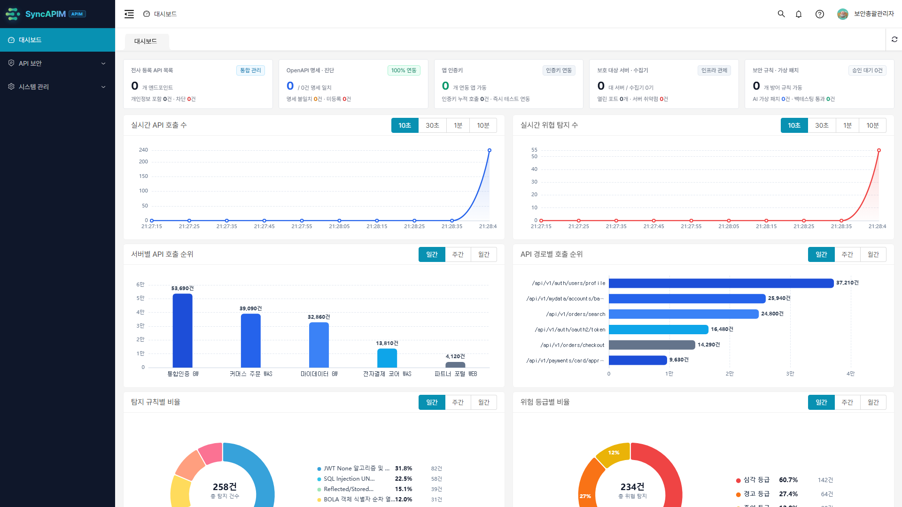
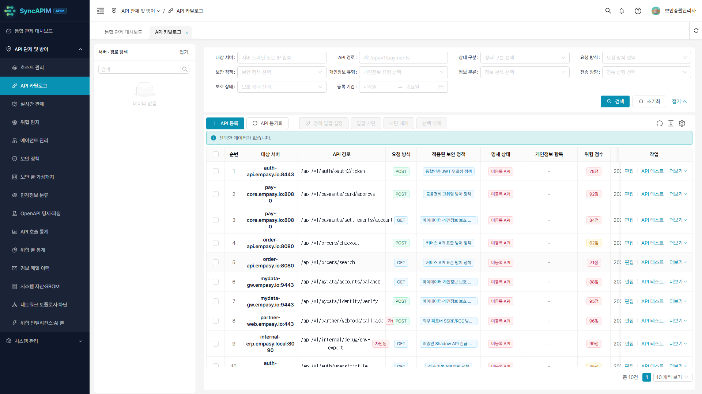
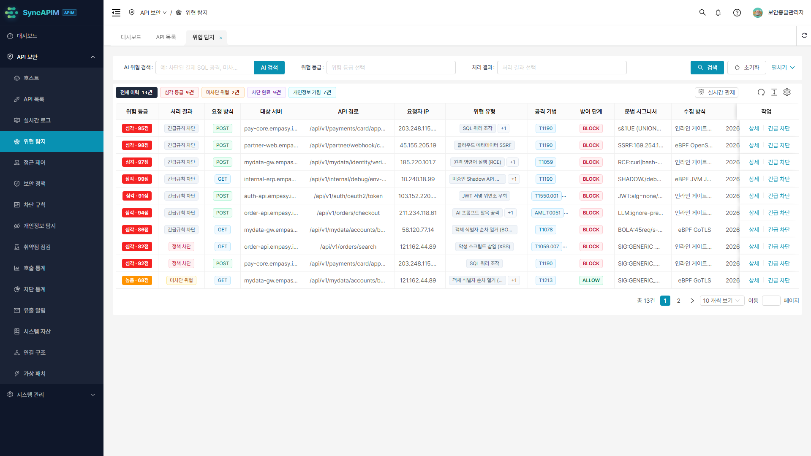
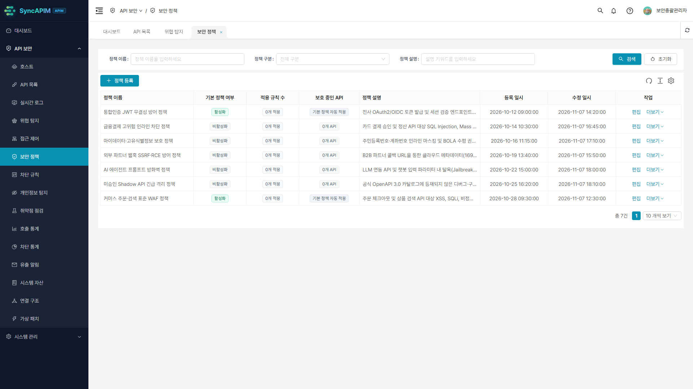

# SyncAPIM: AI Autonomous API Security Control and Specification Governance Platform

> **Guide for Non-Developers & Evaluation Teams**: Visit the [SyncAPIM Product Homepage (apim.empasy.io)](https://apim.empasy.io/en/){target="_blank" rel="noopener"} for an accessible product overview, explore the zero-install interactive UI at the [Unified Demo Portal](https://sync.empasy.io/en/products/sync-apim#demo){target="_blank" rel="noopener"}, or download brochures and proposal PDFs from the [Proposals Archive](/en/proposals/).

> [!IMPORTANT]
> **SyncSeries 4-Tier API Security & Control Agent (`SYNC_APIM`)**: `SyncAPIM` collects all API traffic flowing in front of microservices and legacy WAS servers in real time to autonomously execute **lexical token grammar fingerprinting (`SqlXssLexicalTokenizer`)**, **real-time attack pattern detection & pinpoint virtual patching integrated with `SyncWatch` (`ApimDefensePack` & `SandboxedDefenseEvaluator`)**, **kernel eBPF blocking**, **automatic cataloging of unregistered shadow APIs**, **OpenAPI 3.0.1 specification drift diagnostics**, and **dynamic masking across 8 personal/financial PII categories**.

## 1. Core Architecture and Technical Standards

- **Standard Namespace and API**: `com.empasy.sync.apim` / Canonical API Prefix `/api/v1/apim/...`
- **Performance-Isolated 4-JVM Multi-Process Architecture**:
  1. `sync-apim-admin` (ports `18089` / `8080`): Unified management console REST APIs, time-series statistics batch (`ApimTrafficAggregationService`), `SyncApimAgent`, and MCP Server (`/api/v1/apim/mcp`)
  2. `sync-apim-receiver` (ports `18090` / `8081`, TCP `5044`/`5055`): High-speed Lumberjack/Packetbeat packet receiver built on Java 25 Virtual Threads and Redis Stream (`job_queue`) producer
  3. `sync-apim-detector` (ports `18092` / `8090`): Redis Stream consumer worker, automatic OpenAPI 3.0.1 schema inference, 6-category WAF threat detection, 8-category PII masking, and PostgreSQL 18.6 persistence
  4. `sync-apim-gateway` (ports `18091` / `8083`): Dynamic API blocking filter (`BlockedApiFilter`) synced in real time with DB/Redis and inline reverse-proxy gateway
- **AI Autonomous Agent Framework**: Specification drift diagnostics and threat packet forensic explanations powered by `AgentScope Java` (`io.agentscope:agentscope-harness`)
- **PostgreSQL 18.6 High-Performance Single Storage**: Eliminates heavy external OpenSearch clusters by unifying time-series threat and traffic events (`wapf_detect_event`) on a PostgreSQL 18.6 `JSONB` + `pg_trgm` GIN index engine
- **Dynamic RBAC Menu Governance**: Dynamically delivers 11 control screens by role via Vben Admin `PermissionModeEnum.BACK` mode and the `sys_permission` single-source-of-truth DB

## 2. Key Functional Modules

### 2.1 API Monitoring (`perm-apim-000`)
1. **Host Control (`/waf/host`)**: Registers protected API gateway, WAS, and web server host inventories and monitors collection agent connection status
2. **API Catalog (`/waf/endpoint`)**: Automatically discovers API endpoints from live packet traffic, calculates risk scores, and enforces one-click instant blocking
3. **API Spec Diagnostics (`/waf/api_test`)**: Evaluates live request/response schema mismatches (Contract Drift) against OpenAPI 3.0.1 specs and identifies unauthorized shadow APIs
4. **Traffic Statistics (`/waf/api_statistics`)**: Provides per-endpoint time-series call volumes, top-called host distributions, and Excel export/import
5. **Collection Agents (`/waf/agent`)**: Issues SHA-256 authentication keys for per-domain traffic collection agents and manages target host mappings

### 2.2 API Security Defense (`perm-apim-100`)
1. **Threat Detection Logs (`/waf/request`)**: Forensic inspection of raw threat packets and block status across SQL Injection, XSS, SSRF, RCE, Directory Traversal, and JWT signature tampering
2. **Security Policies (`/waf/policy`)**: Operates 7 standard security policy groups—Authentication, Access Control, Data Encryption, Authorization, Network Security, Privacy Protection, and Intrusion Detection (changes sync immediately to Redis cache)
3. **Detection Rule Management (`/waf/rule`)**: Defines regex signature patterns and JWT integrity verification options
4. **Threat Rule Statistics (`/waf/rule_statistics`)**: Analyzes time-series detection trends and top-triggered rule charts by attack type and severity level
5. **Sensitive Data Masking (`/waf/sensitivity`)**: Manages real-time masking rules for 8 PII categories: bank account numbers, email addresses, credit card numbers, national ID numbers, names, passwords, IP addresses, and phone numbers
6. **Alert Email History (`/waf/warning_mails`)**: Tracks alert notifications sent to security officers upon high-risk attack blocks or shadow API discoveries

## Live Screens and Core Workflows

### 1. API Security Control and Real-Time Traffic & Threat Dashboard
Monitor real-time API traffic trends, threat blocking status, and newly discovered shadow API counts processed by the collection, detection, and blocking pipeline at a glance.

### 2. Live-Traffic API Endpoint Catalog and Shadow API Detection
Automatically infer HTTP methods, URI patterns, and request/response payload schemas from live traffic packets to identify unregistered shadow APIs and apply one-click blocking policies.

### 3. Real-Time Web & API Threat Detection Logs and Attack Packet Forensics
Inspect raw attack payloads and risk scores for SQL injection, XSS, SSRF, and remote code execution attempts detected and blocked by grammar fingerprinting and zero-downtime virtual patching rules.

### 4. API Security Policies and Dynamic PII Masking Management
Control real-time masking rules for 8 personal and financial PII categories—including bank account numbers, credit card numbers, national ID numbers, emails, and phone numbers—as well as per-endpoint security policies with zero downtime.

---

## 3. Documentation Guide

| Document | Key Topics Covered | Link |
| :--- | :--- | :--- |
| **4-JVM Architecture & DB Design** | 4 independent JVM process isolation architecture, Redis Stream pipeline, and detailed specification of 17 PostgreSQL 18.6 domain tables | [View Architecture →](/en/syncapim/architecture) |
| **WAF Threat Detection & PII Masking** | Shadow API detection, OpenAPI 3.0.1 Contract Drift comparison audits, 6 attack detection rules, and 8 PII masking policies | [View Security Governance →](/en/syncapim/waf-and-pii-governance) |
| **MCP Tools & REST API** | 6 MCP tools integrated with the `SyncVerse` control tower (e.g., `apim_discover_shadow_apis`) and `/api/v1/apim` REST API reference | [View MCP & API →](/en/syncapim/mcp-tools) |
| **Adoption FAQ** | Frequently asked questions on air-gapped on-premises deployment, 4-JVM performance isolation, and OpenSearch-replacement architecture | [View FAQ →](/en/syncapim/enterprise-faq) |
