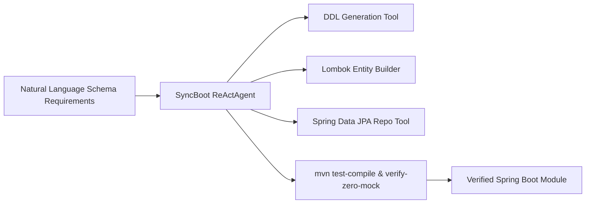

# SyncBoot AgentScope Java Integration Guide

## 1. Architecture Overview

Beyond a simple code generator, SyncBoot is a digital engineering agent that **embeds AgentScope Java (`io.agentscope:agentscope-harness`) directly into the Spring Boot runtime** to autonomously perform backend source code updates, schema validation audits, and unit test execution.



---

## 2. Spring Boot Configuration and Dependency Injection

### 2.1 `pom.xml` Configuration

```xml
<dependencies>
    <!-- Spring Boot Starters -->
    <dependency>
        <groupId>org.springframework.boot</groupId>
        <artifactId>spring-boot-starter-web</artifactId>
    </dependency>
    <dependency>
        <groupId>org.springframework.boot</groupId>
        <artifactId>spring-boot-starter-data-jpa</artifactId>
    </dependency>

    <!-- Project Lombok (Mandatory) -->
    <dependency>
        <groupId>org.projectlombok</groupId>
        <artifactId>lombok</artifactId>
        <optional>true</optional>
    </dependency>

    <!-- AgentScope Java Harness -->
    <dependency>
        <groupId>io.agentscope</groupId>
        <artifactId>agentscope-harness</artifactId>
        <version>0.3.1</version>
    </dependency>
</dependencies>
```

---

## 3. Autonomous Domain Entity Generation Service via ReActAgent

In accordance with SyncSeries standards, field injection (`@Autowired`) is strictly prohibited, and constructor injection via `@RequiredArgsConstructor` is enforced:

```java
package com.empasy.sync.boot.service;

import io.agentscope.core.ReActAgent;
import io.agentscope.core.tool.ToolBox;
import lombok.RequiredArgsConstructor;
import lombok.extern.slf4j.Slf4j;
import org.springframework.stereotype.Service;

@Slf4j
@Service
@RequiredArgsConstructor
public class AutonomousEntityBuilderService {

    private final ToolBox engineeringToolBox;

    public String generateDomainPackage(String domainDescription) {
        log.info("[SyncBoot:AgentScope] Generating domain architecture for: {}", domainDescription);

        ReActAgent agent = ReActAgent.builder()
                .name("SyncBoot-DomainEngineer")
                .sysPrompt("You are a principal architect agent specializing in designing enterprise microservices based on Spring Boot 4.0, Java 25, and MyBatis-Plus. " +
                           "All Entity and DTO classes must apply Project Lombok annotations (@Getter, @Builder, @NoArgsConstructor, @AllArgsConstructor).")
                .toolBox(engineeringToolBox)
                .maxIterations(4)
                .build();

        String result = agent.run("Generate Entity, Repository, and DTO code that satisfies the following requirements: " + domainDescription);
        log.info("[SyncBoot:AgentScope] Domain generation completed.");
        return result;
    }
}
```
