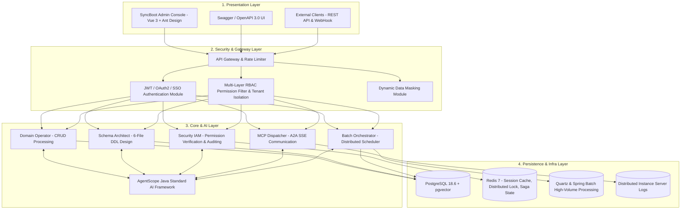

# System Architecture and Module Structure

SyncBoot is designed with a 4-layer architecture and a collaborative structure of five functional modules for reliable service operations and scalability.

---

## 4-Layer System Architecture

---

## Detailed Specification of the 5 Functional Modules

### 1. Domain Operator (Domain Data Operations)
- **Primary Role**: Executes CRUD operations and business transaction queries based on the business rules of domain entities.
- **Control Policy**: Never modifies source code or database schema DDL directly; operates strictly within defined APIs and mappers.

### 2. Schema Architect (Schema Design)
- **Primary Role**: Analyzes domain requirements to author 6-File standard SQL (`db/00_extensions.sql ~ 05_sample_dev.sql`) and derive ERD structures.
- **Control Policy**: Detects high-impact changes such as schema drops or type narrowing in advance and applies DDL only after developer approval (HITL).

### 3. Security IAM (RBAC Permissions & Tenant Isolation)
- **Primary Role**: Enforces menu, button, and API access control based on user roles while maintaining data isolation across tenants.
- **Key Features**: Supports dynamic masking of personal information columns and Row-Level Security SQL condition injection.

### 4. MCP Dispatcher (Standard Protocol Integration)
- **Primary Role**: Complies with the Model Context Protocol (MCP) specification to expose standardized tools over HTTP SSE to upstream systems and external AI clients.
- **Log Collection**: Collects and forwards error logs from distributed instances when failures occur.

### 5. Batch Orchestrator (Batch & Job Scheduler)
- **Primary Role**: Executes high-volume data settlement and periodic data aggregation jobs in a distributed manner using Quartz and Spring Batch.
- **Failure Handling**: Verifies Redis-based distributed locks and performs retries using exponential backoff.

---

## Technology Stack

| Category | Technology | Version & Details |
| :--- | :--- | :--- |
| **Backend Core** | Java, Spring Boot 4.0 | Java 25, Spring Boot 4.0 |
| **AI Framework** | AgentScope Java | `io.agentscope:agentscope-harness` |
| **ORM / Data** | MyBatis-Plus, Spring Data JPA | HikariCP, PostgreSQL 18.6 (pgvector) |
| **Protocol** | Model Context Protocol (MCP) | HTTP SSE / JSON-RPC 2.0 |
| **Frontend UI** | Vue 3, Vite, TypeScript | Ant Design Vue 4.x, Pinia, Vue Router |
| **Batch / Cache** | Spring Batch, Quartz, Redis | Redis 7.x, Lettuce |
